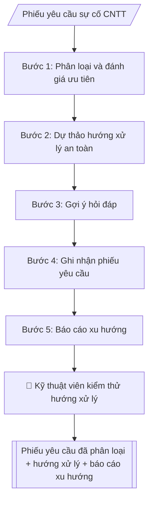

# Phân loại yêu cầu hỗ trợ CNTT

## Khi nào dùng
Khi tiếp nhận yêu cầu hỗ trợ CNTT (mạng, phần mềm, tài khoản, thiết bị) cần phân loại
nhanh, ưu tiên đúng cam kết xử lý và có hướng xử lý nhất quán. Dùng chung cho trung tâm CNTT
hoặc cán bộ phụ trách CNTT của mọi đơn vị.

## Định dạng và file đầu ra

Định dạng đầu ra có thể chọn theo sản phẩm/yêu cầu: .docx, .pdf. Đọc mục “Định dạng bổ sung” trong quy cách đầu ra trước khi chọn.

**Phải tạo file thực tế để tải xuống, không chỉ trả nội dung trong chat.** Định dạng mặc định của skill: **.docx**. Nếu có bảng số liệu nghiệp vụ yêu cầu file bảng tính riêng, tạo thêm Excel theo yêu cầu; không tự tạo file kiểm tra. Không chờ người dùng yêu cầu xuất file lần nữa. Ưu tiên định dạng người dùng chỉ định; đọc quy tắc xuất file tại references/quy-cach-dau-ra.md.

**Chạy qua API (không có công cụ tạo file):** trả đủ nội dung dạng văn bản có tiêu đề, bảng; ứng dụng gọi sẽ xuất file.

## Quy cách đầu ra và thông tin thiếu
Khi dựng file Word/Excel, áp dụng mục “Thể thức và bảng biểu khi dựng file” trong quy cách đầu ra (cỡ chữ từng thành phần, bảng nhiều trang, số trang, phụ lục). Đọc [quy cách và cấu trúc sản phẩm](references/quy-cach-dau-ra.md) trước khi soạn/xuất. File giao chỉ gồm sản phẩm nghiệp vụ được yêu cầu; kiểm tra nội bộ không xuất kèm. Thiếu thông tin thì giữ nguyên trường/mục và chỗ điền theo mẫu gốc (dòng dấu chấm, dấu gạch hoặc ô trống); không tự điền dữ liệu mẫu, số 0, mã chờ xác minh hay dòng chờ ký. Mẫu chuyên ngành còn áp dụng được ưu tiên về cấu trúc, mã biểu và người ký. Bản đầy đủ: [quy tắc chung](references/quy-tac-chung.md).

Khi người dùng yêu cầu bộ slide (.pptx), đọc mục “Xuất PowerPoint (.pptx) khi được yêu cầu” trong quy cách đầu ra.

## Kiểm soát áp dụng và phê duyệt
Trước khi chạy, xác định `ngay_ap_dung`, `loai_hinh_truong`, `quy_che_noi_bo`, `nguon_du_lieu`, `nguoi_kiem_duyet`; chỉ hỏi thông tin liên quan nghiệp vụ, không dùng giá trị giả định thay dữ liệu bắt buộc. Đối chiếu căn cứ pháp lý với văn bản gốc, hiệu lực, điều khoản áp dụng và chuyển tiếp. Bản đầy đủ: [quy tắc chung](references/quy-tac-chung.md).

## Giới hạn và human gate
AI hỗ trợ chuẩn bị và đối chiếu; cán bộ phụ trách kiểm tra dữ liệu/căn cứ, người có thẩm quyền duyệt và ký. Không đánh dấu đã ký, đã duyệt, đã công bố khi chưa có chứng cứ. Dữ liệu sinh viên, sức khỏe, nhân sự, tài chính chỉ dùng theo mục đích và phân quyền, che thông tin định danh khi dùng ví dụ (Luật 91/2025/QH15, hiệu lực 01/01/2026); không tải dữ liệu lên dịch vụ ngoài khi chưa có quyền. Bản đầy đủ: [quy tắc chung](references/quy-tac-chung.md).

## Bối cảnh riêng của VNU-IS

Bản chỉnh cho Trường Quốc tế – ĐHQGHN (VNU-IS), v0.4.2. Dựng từ website công khai và phiếu khảo sát CES còn trống; **chưa có dữ liệu khảo sát thực tế của đơn vị**. Đọc [bối cảnh VNU-IS](references/boi-canh-vnuis.md) trước khi chạy; các mã C1–C8 nằm ở mục 6 của file đó.

- **Đơn vị thường dùng:** Phòng Tổ chức và Quản trị (hạ tầng CNTT, an toàn thông tin).
- **Nghiệp vụ trong phiếu CES:** không có dòng riêng trong phiếu CES; đề xuất theo chức năng đơn vị ở sheet 00 và cần xác nhận khi khảo sát.

**Điều chỉnh khi dùng cho VNU-IS**
- Hệ thống cần định tuyến theo danh sách trên website: E-Office, LMS, cổng sinh viên, cổng việc làm, tra cứu văn bản bằng, thư viện, kho tài nguyên số; chủ hệ thống chưa rõ (C5).
- Người báo sự cố gồm viên chức và sinh viên (có sinh viên quốc tế): phiếu yêu cầu ghi ngôn ngữ.
- Sự cố liên quan tài khoản, dữ liệu người học, mất dữ liệu: chuyển người phụ trách an toàn thông tin ngay, không hướng dẫn tự xử lý.

**Chờ xác nhận khi khảo sát**
- Danh mục hệ thống và chủ hệ thống (C5).
- cam kết xử lý đang áp dụng (C8).

Nếu người dùng chưa trả lời mục chờ xác nhận liên quan, hỏi lại; không tự điền giả định.

## Đầu vào (Input)

| Trường | Mô tả | Bắt buộc |
|---|---|---|
| `mo_ta_su_co` | Mô tả sự cố từ người dùng | Có |
| `nguoi_bao` | Đơn vị/cá nhân báo (mã hóa nếu cần) | Có |
| `muc_do_bao` | Mức độ người dùng tự đánh giá: thấp/trung bình/cao/khẩn | Không |
| `thong_tin_he_thong` | Thiết bị, phần mềm, thời điểm xảy ra | Không |
| `quy_dinh_sla` | Thời gian xử lý theo mức ưu tiên của đơn vị | Không |

### Thông tin VNU-IS đã điền sẵn (không hỏi lại)

| Mục | Giá trị mặc định |
|---|---|
| Cơ quan chủ quản; Trường; địa danh | Đại học Quốc gia Hà Nội (ĐHQGHN); Trường Quốc tế – ĐHQGHN (VNU – International School); Hà Nội |
| Đơn vị sử dụng và phối hợp | Phòng Tổ chức và Quản trị (hạ tầng CNTT, an toàn thông tin) |
| Ngôn ngữ đầu ra | Tiếng Việt là bản gốc; thêm tiếng Anh cho đối tác, người học quốc tế hoặc khi được yêu cầu |
| Hệ thống nguồn dữ liệu có trên website | E-Office; LMS; cổng sinh viên; cổng việc làm; tra cứu văn bằng; thư viện; kho tài nguyên số; E-GOV. Skill không kết nối hệ thống, chỉ dùng file xuất/tải lên (C5) |
| Người duyệt và ký | Ghi theo vai trò (Trưởng phòng, Phó Hiệu trưởng phụ trách, Hiệu trưởng); tuyến duyệt và thẩm quyền ký chờ C1, C6 |

Nguồn: website và phiếu CES; đổi theo khảo sát thì sửa tại đây và trong `references/boi-canh-vnuis.md`.

## Quy trình

*⏱ là ước tính ban đầu của bộ gốc, chưa đo tại VNU-IS; hiệu chỉnh sau khảo sát.*

**Bước 1. Phân loại và đánh giá ưu tiên**
- Làm gì: đọc `mo_ta_su_co` và `thong_tin_he_thong`, xếp sự cố vào một nhóm (mạng /
  phần mềm / tài khoản & phân quyền / thiết bị / an toàn thông tin); đánh giá lại mức
  ưu tiên theo `quy_dinh_sla` dựa trên phạm vi và số người bị ảnh hưởng — không phụ thuộc
  hoàn toàn vào `muc_do_bao` do người dùng tự đánh giá; tính hạn chót cam kết xử lý từ thời điểm
  tiếp nhận.
- Dùng input: `mo_ta_su_co`, `nguoi_bao`, `muc_do_bao`, `thong_tin_he_thong`, `quy_dinh_sla`
- Vai trò: Kỹ thuật viên CNTT (tuyến 1) · AI hỗ trợ: phân loại nhóm sự cố, đề xuất mức ưu tiên và hạn chót theo cam kết xử lý · ⏱ ~5–10 phút (ước tính)
- Lưu ý nghiệp vụ: dấu hiệu an toàn thông tin (nghi bị xâm nhập, mã độc, rò rỉ dữ liệu)
  → chuyển ngay cho bộ phận ATTT, dừng xử lý tại skill này; mức ưu tiên phải ghi rõ
  căn cứ cam kết xử lý và hạn chót cụ thể.
- → Kết quả bước: "phiếu phân loại" (nhóm sự cố + mức ưu tiên + căn cứ cam kết xử lý + hạn chót).

**Bước 2. Dự thảo hướng xử lý an toàn**
- Làm gì: soạn hướng xử lý từng bước theo thứ tự kiểm tra → khắc phục cơ bản mà người
  dùng hoặc kỹ thuật viên tuyến 1 có thể làm; với mỗi bước ghi rõ thao tác, kết quả
  mong đợi, và điểm dừng để chuyển tuyến 2.
- Dùng input: kết quả bước 1 (phiếu phân loại), `thong_tin_he_thong`
- Vai trò: Kỹ thuật viên CNTT · AI hỗ trợ: dự thảo hướng xử lý an toàn từng bước (thao tác → kết quả mong đợi → điểm chuyển tuyến 2) để kiểm thử trước khi áp dụng · ⏱ ~15–30 phút (ước tính)
- Lưu ý nghiệp vụ: hướng xử lý chỉ ở mức dự thảo — kỹ thuật viên phải kiểm thử trước khi
  thực hiện hoặc gửi cho người dùng; không bao gồm thao tác thay đổi cấu hình hệ thống,
  đặt lại mật khẩu hay cấp quyền nếu thiếu xác thực/phê duyệt theo quy trình.
- → Kết quả bước: "hướng xử lý dự thảo từng bước" (kèm điểm chuyển tuyến 2).

**Bước 3. Gợi ý hỏi đáp**
- Làm gì: đối chiếu nhóm sự cố và từ khóa triệu chứng với kho tri thức, gợi ý hỏi đáp/bài
  hướng dẫn liên quan (ghi mã bài và tên bài).
- Dùng input: kết quả bước 1 (phiếu phân loại)
- Vai trò: Kỹ thuật viên CNTT (tuyến 1) · AI hỗ trợ: đối chiếu kho tri thức, gợi ý hỏi đáp khớp triệu chứng · ⏱ ~5 phút (ước tính)
- Lưu ý nghiệp vụ: chỉ gợi ý bài có thật trong kho tri thức — không bịa mã hỏi đáp;
  ưu tiên bài khớp đúng triệu chứng người dùng mô tả.
- → Kết quả bước: "danh sách hỏi đáp liên quan" (mã + tên bài).

**Bước 4. Ghi nhận phiếu yêu cầu**
- Làm gì: cấp mã phiếu yêu cầu duy nhất; ghi nhận đầy đủ phân loại, ưu tiên, `nguoi_bao`,
  hướng xử lý dự thảo (bước 2), hỏi đáp liên quan (bước 3), người phụ trách đề xuất
  và hạn chót cam kết xử lý.
- Dùng input: `nguoi_bao`, kết quả các bước 1–3, `quy_dinh_sla`
- Vai trò: Kỹ thuật viên CNTT (tuyến 1) · AI hỗ trợ: cấp mã phiếu yêu cầu duy nhất, ghi nhận đầy đủ các trường bắt buộc · ⏱ ~5 phút (ước tính)
- Lưu ý nghiệp vụ: hạn chót cam kết xử lý tính theo giờ làm việc quy định của đơn vị; mã phiếu yêu cầu
  không trùng; mọi trường bắt buộc phải có trước khi đóng triage.
- → Kết quả bước: "phiếu yêu cầu đã ghi nhận đầy đủ" (sản phẩm chính, chuyển sang Human gate).

**Bước 5. Báo cáo xu hướng** (định kỳ / theo yêu cầu)
- Làm gì: tổng hợp các phiếu yêu cầu đã ghi nhận trong kỳ theo nhóm sự cố, đơn vị phát sinh,
  thời gian xử lý trung bình; chỉ ra sự cố lặp lại và đề xuất biện pháp phòng ngừa.
- Dùng input: các phiếu yêu cầu đã ghi nhận trong kỳ (kết quả bước 4 của nhiều phiếu yêu cầu)
- Vai trò: Trưởng bộ phận CNTT · AI hỗ trợ: tổng hợp phiếu yêu cầu trong kỳ, chỉ ra sự cố lặp lại và đề xuất biện pháp phòng ngừa · ⏱ ~15–30 phút (ước tính)
- Lưu ý nghiệp vụ: báo cáo phục vụ cải tiến hệ thống, không dùng để quy trách nhiệm
  cá nhân; số liệu lấy nguyên từ phiếu yêu cầu, không ước lượng.
- → Kết quả bước: "báo cáo xu hướng sự cố định kỳ" (trình trưởng bộ phận CNTT duyệt).
## Luồng quy trình (Workflow)

## Đầu ra

File nghiệp vụ thực tế theo định dạng mặc định ở đầu skill hoặc định dạng người dùng yêu cầu, kèm liên kết tải trong phản hồi cuối.

Sản phẩm nghiệp vụ hoàn chỉnh theo [quy cách và cấu trúc](references/quy-cach-dau-ra.md), giữ các trường chưa có dữ liệu ở trạng thái trống. Không xuất kèm danh mục kiểm/phụ lục kiểm tra đầu ra.

## Kiểm tra nội bộ trước khi giao

- [ ] Bố cục khớp mẫu áp dụng và cấu trúc tại references/quy-cach-dau-ra.md.
- [ ] Mức ưu tiên có căn cứ cam kết xử lý và hạn chót cụ thể (tính theo giờ làm việc của đơn vị), không phụ thuộc hoàn toàn vào mức độ người dùng tự đánh giá.
- [ ] Hướng xử lý từng bước có thao tác → kết quả mong đợi; điểm chuyển tuyến 2 ghi rõ ràng.
- [ ] hỏi đáp chỉ gợi ý bài có thật trong kho tri thức (mã + tên bài), khớp đúng triệu chứng người dùng mô tả — không bịa mã hỏi đáp.
- [ ] Sự cố có dấu hiệu an toàn thông tin đã chuyển ngay cho bộ phận ATTT, không xử lý tại skill.
- [ ] Không đặt lại mật khẩu, cấp quyền hay thay đổi cấu hình hệ thống khi thiếu xác thực/phê duyệt theo quy trình.
- [ ] Phiếu yêu cầu có mã duy nhất, đầy đủ trường bắt buộc trước khi đóng triage.
- [ ] Đã qua Human gate: kỹ thuật viên kiểm thử hướng xử lý trước khi gửi cho người dùng hoặc thực hiện.

> Tiêu chí đạt: tất cả các ô được đánh dấu.

## Human gate (người kiểm duyệt)
- **Kỹ thuật viên** kiểm thử/kiểm tra hướng xử lý trước khi gửi cho người dùng hoặc
  thực hiện trên hệ thống.
- Trưởng bộ phận CNTT duyệt báo cáo xu hướng và đề xuất phòng ngừa.

## Giới hạn (guardrails)
- Không tự chạy lệnh, không thay đổi cấu hình/thiết lập hệ thống một cách tự động.
- Không đặt lại mật khẩu hay cấp quyền mà không có xác thực và phê duyệt theo quy trình.
- Không truy cập, sao chép dữ liệu cá nhân/dữ liệu nhạy cảm của người dùng.
- Sự cố an toàn thông tin (nghi bị xâm nhập, mã độc) phải chuyển ngay cho bộ phận
  an toàn thông tin, không tự xử lý.

## Căn cứ & lưu ý
- Theo quy chế an toàn thông tin và cam kết xử lý nội bộ của đơn vị.
- Ví dụ trong skill chỉ để minh họa; không đưa dữ liệu cá nhân thật vào ví dụ. Tên Trường, cơ quan chủ quản và địa danh dùng đúng bảng thông tin VNU-IS đã điền sẵn.

## Quản trị phiên bản
- Phiên bản gói VNU-IS `0.4.2` (cập nhật 2026-10-11), dựa trên skill gốc `helpdesk-cntt-triage` bản `1.3.2`; hồ sơ đầy đủ tại [references/version.json](references/version.json).
- Người phê duyệt nghiệp vụ: **chưa chỉ định**. Trạng thái: dự thảo nghiệp vụ; kiểm tra pháp lý trước thực thi. Ngày cập nhật không đồng nghĩa mọi văn bản đã được rà soát toàn văn.
- Giấy phép theo LICENSE của kho (bản quyền CES Global). Lịch sử thay đổi: CHANGELOG.md.
