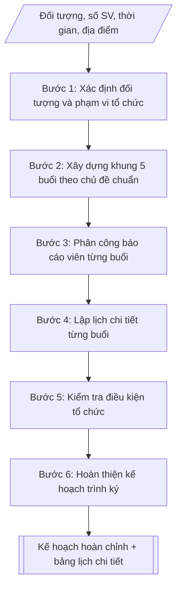

# Kế hoạch Tuần sinh hoạt công dân

## Khi nào dùng
Khi đầu khóa học / đầu năm học cần tổ chức "Tuần sinh hoạt công dân" cho sinh viên mới
trúng tuyển hoặc toàn thể sinh viên, nhằm quán triệt nội quy – quy chế, giáo dục pháp
luật, định hướng kỹ năng học tập bậc đại học và tổ chức sinh hoạt Đoàn – Hội.

## Định dạng và file đầu ra

Định dạng đầu ra có thể chọn theo sản phẩm/yêu cầu: .docx, .pdf. Đọc mục “Định dạng bổ sung” trong quy cách đầu ra trước khi chọn.

**Phải tạo file thực tế để tải xuống, không chỉ trả nội dung trong chat.** Định dạng mặc định của skill: **.docx**. Nếu có bảng số liệu nghiệp vụ yêu cầu file bảng tính riêng, tạo thêm Excel theo yêu cầu; không tự tạo file kiểm tra. Không chờ người dùng yêu cầu xuất file lần nữa. Ưu tiên định dạng người dùng chỉ định; đọc quy tắc xuất file tại references/quy-cach-dau-ra.md.

**Chạy qua API (không có công cụ tạo file):** trả đủ nội dung dạng văn bản có tiêu đề, bảng; ứng dụng gọi sẽ xuất file.

## Quy cách đầu ra và thông tin thiếu
Khi dựng file Word/Excel, áp dụng mục “Thể thức và bảng biểu khi dựng file” trong quy cách đầu ra (cỡ chữ từng thành phần, bảng nhiều trang, số trang, phụ lục). Đọc [quy cách và cấu trúc sản phẩm](references/quy-cach-dau-ra.md) trước khi soạn/xuất. File giao chỉ gồm sản phẩm nghiệp vụ được yêu cầu; kiểm tra nội bộ không xuất kèm. Thiếu thông tin thì giữ nguyên trường/mục và chỗ điền theo mẫu gốc (dòng dấu chấm, dấu gạch hoặc ô trống); không tự điền dữ liệu mẫu, số 0, mã chờ xác minh hay dòng chờ ký. Mẫu chuyên ngành còn áp dụng được ưu tiên về cấu trúc, mã biểu và người ký. Bản đầy đủ: [quy tắc chung](references/quy-tac-chung.md).

Khi người dùng yêu cầu bộ slide (.pptx), đọc mục “Xuất PowerPoint (.pptx) khi được yêu cầu” trong quy cách đầu ra.

## Kiểm soát áp dụng và phê duyệt
Trước khi chạy, xác định `ngay_ap_dung`, `loai_hinh_truong`, `quy_che_noi_bo`, `nguon_du_lieu`, `nguoi_kiem_duyet`; chỉ hỏi thông tin liên quan nghiệp vụ, không dùng giá trị giả định thay dữ liệu bắt buộc. Đối chiếu căn cứ pháp lý với văn bản gốc, hiệu lực, điều khoản áp dụng và chuyển tiếp. Bản đầy đủ: [quy tắc chung](references/quy-tac-chung.md).

## Giới hạn và human gate
AI hỗ trợ chuẩn bị và đối chiếu; cán bộ phụ trách kiểm tra dữ liệu/căn cứ, người có thẩm quyền duyệt và ký. Không đánh dấu đã ký, đã duyệt, đã công bố khi chưa có chứng cứ. Dữ liệu sinh viên, sức khỏe, nhân sự, tài chính chỉ dùng theo mục đích và phân quyền, che thông tin định danh khi dùng ví dụ (Luật 91/2025/QH15, hiệu lực 01/01/2026); không tải dữ liệu lên dịch vụ ngoài khi chưa có quyền. Bản đầy đủ: [quy tắc chung](references/quy-tac-chung.md).

## Bối cảnh riêng của VNU-IS

Bản chỉnh cho Trường Quốc tế – ĐHQGHN (VNU-IS), v0.4.2. Dựng từ website công khai và phiếu khảo sát CES còn trống; **chưa có dữ liệu khảo sát thực tế của đơn vị**. Đọc [bối cảnh VNU-IS](references/boi-canh-vnuis.md) trước khi chạy; các mã C1–C8 nằm ở mục 6 của file đó.

- **Đơn vị thường dùng:** Phòng Đào tạo (công tác sinh viên).
- **Nghiệp vụ trong phiếu CES:** không có dòng riêng trong phiếu CES; đề xuất theo chức năng đơn vị ở sheet 00 và cần xác nhận khi khảo sát.

**Điều chỉnh khi dùng cho VNU-IS**
- Kế hoạch sinh hoạt công dân gắn với từng cơ sở và đối tượng (sinh viên chương trình ĐHQGHN, liên kết, quốc tế).
- Nội dung ghi theo chủ đề do Trường ban hành, không lấy từ nơi khác.

**Chờ xác nhận khi khảo sát**
- Chu kỳ và hình thức sinh hoạt công dân (C8).
- Người phụ trách (C7).

Nếu người dùng chưa trả lời mục chờ xác nhận liên quan, hỏi lại; không tự điền giả định.

## Đầu vào (Input)

| Trường | Mô tả | Bắt buộc |
|---|---|---|
| `doi_tuong` | Sinh viên khóa mới (tân sinh viên) / toàn thể sinh viên các khóa | Có |
| `so_luong_sv` | Số lượng sinh viên tham dự dự kiến | Có |
| `thoi_gian` | Ngày bắt đầu – kết thúc (thường 5 ngày, đầu năm học) | Có |
| `dia_diem` | Hội trường / giảng đường / sân trường (chọn cơ sở: Xuân Thủy, Phan Tây Nhạc, Hòa Lạc) | Có |
| `chu_de` | Danh sách chủ đề theo từng buổi (mặc định 5 chủ đề chuẩn) | Không |
| `bao_cao_vien` | Danh sách báo cáo viên dự kiến (lãnh đạo trường, phòng ban, khách mời) | Không |
| `diem_danh` | Hình thức điểm danh (quét mã QR / ký tên / điểm danh điện tử) | Không (mặc định: quét mã QR) |

### Thông tin VNU-IS đã điền sẵn (không hỏi lại)

| Mục | Giá trị mặc định |
|---|---|
| Cơ quan chủ quản; Trường; địa danh | Đại học Quốc gia Hà Nội (ĐHQGHN); Trường Quốc tế – ĐHQGHN (VNU – International School); Hà Nội |
| Đơn vị sử dụng và phối hợp | Phòng Đào tạo (công tác sinh viên) |
| Cơ sở | Xuân Thủy (Cầu Giấy); Phan Tây Nhạc (Xuân Phương); Hòa Lạc (tòa HT1, Khu Đô thị ĐHQGHN). Ghi rõ cơ sở khi nội dung gắn địa điểm |
| Mô hình đào tạo | Chọn đúng mô hình trước khi áp quy tắc, không áp quy tắc của mô hình này cho mô hình khác: (1) ĐHQGHN cấp bằng; (2) liên kết quốc tế, đối tác nước ngoài cấp bằng; (3) song bằng; (4) cử nhân – thạc sĩ tích hợp; (5) tiếng Anh dự bị và mô hình 2+2 |
| Ngôn ngữ đầu ra | Tiếng Việt là bản gốc; thêm tiếng Anh cho đối tác, người học quốc tế hoặc khi được yêu cầu |
| Hệ thống nguồn dữ liệu có trên website | Cổng sinh viên; cổng việc làm; tra cứu văn bằng. Skill không kết nối hệ thống, chỉ dùng file xuất/tải lên (C5) |
| Người duyệt và ký | Ghi theo vai trò (Trưởng phòng, Phó Hiệu trưởng phụ trách, Hiệu trưởng); tuyến duyệt và thẩm quyền ký chờ C1, C6 |

Nguồn: website và phiếu CES; đổi theo khảo sát thì sửa tại đây và trong `references/boi-canh-vnuis.md`.

## Quy trình

*⏱ là ước tính ban đầu của bộ gốc, chưa đo tại VNU-IS; hiệu chỉnh sau khảo sát.*

**Bước 1. Xác định đối tượng và phạm vi tổ chức**
- Làm gì: xác định đối tượng là tân sinh viên (bắt buộc 100% tham dự, tính điểm rèn luyện)
  hay sinh viên toàn trường (chia theo khoa, từng buổi); chốt tổng số sinh viên tham dự dự kiến.
- Dùng input: `doi_tuong`, `so_luong_sv`.
- Vai trò: Trưởng Phòng Đào tạo (công tác sinh viên) · AI hỗ trợ: tổng hợp dự thảo phạm vi · ⏱ ~1–2 giờ (ước tính)
- Lưu ý nghiệp vụ: với tân sinh viên, kết quả tuần sinh hoạt công dân là tiêu chí đánh giá
  rèn luyện học kỳ I — phải thông báo rõ yêu cầu tham dự ngay từ đầu.
- → Kết quả bước: phạm vi tổ chức đã chốt (đối tượng, số lượng, yêu cầu tham dự).

**Bước 2. Xây dựng khung 5 buổi theo chủ đề chuẩn**
- Làm gì: dựng khung 5 buổi: Buổi 1 – Nội quy, quy chế đào tạo (quy chế tín chỉ, thi – kiểm
  tra, học phí, nghỉ học, bảo lưu); Buổi 2 – Rèn luyện, học bổng, chính sách sinh viên (đánh
  giá rèn luyện, các loại học bổng, miễn giảm, vay vốn, KTX, BHYT); Buổi 3 – An ninh, pháp
  luật, an toàn giao thông (an ninh trật tự, phòng chống ma túy – tệ nạn, ATGT, PCCC, an toàn
  không gian mạng); Buổi 4 – Kỹ năng học đại học (phương pháp học, quản lý thời gian, thuyết
  trình, làm việc nhóm, định hướng nghề nghiệp, giao lưu cựu sinh viên); Buổi 5 – Sinh hoạt
  Đoàn – Hội (giới thiệu tổ chức, CLB – đội – nhóm, đăng ký tham gia, tổng kết và phát động
  thi đua).
- Dùng input: `chu_de` (nếu không có thì dùng 5 chủ đề chuẩn).
- Vai trò: Chuyên viên Phòng Đào tạo (công tác sinh viên) · AI hỗ trợ: soạn dự thảo khung 5 buổi theo chủ đề chuẩn · ⏱ ~1–2 giờ (ước tính)
- Lưu ý nghiệp vụ: mỗi buổi phải có mục tiêu đầu ra rõ ràng cho sinh viên; tránh trùng lặp
  nội dung giữa các buổi.
- → Kết quả bước: khung nội dung 5 buổi (chủ đề, mục tiêu từng buổi).

**Bước 3. Phân công báo cáo viên từng buổi**
- Làm gì: phân công báo cáo viên phù hợp từng chủ đề: lãnh đạo Phòng Đào tạo, Phòng Đào tạo (công tác sinh viên),
  Phòng TC&QT (kế hoạch – tài chính); đại diện Công an địa phương / Cảnh sát giao thông (buổi pháp luật); giảng
  viên kỹ năng; Ban Thường vụ Đoàn – Hội Sinh viên; xác nhận tham gia của từng báo cáo viên.
- Dùng input: `bao_cao_vien`.
- Vai trò: Chuyên viên Phòng Đào tạo (công tác sinh viên) · AI hỗ trợ: lập danh sách đề xuất · ⏱ ~2–4 ngày làm việc (ước tính)
- Lưu ý nghiệp vụ: báo cáo viên khách mời (công an, CSGT) cần liên hệ, xác nhận trước ít nhất
  2 tuần; có phương án dự phòng khi báo cáo viên bận đột xuất.
- → Kết quả bước: danh sách báo cáo viên theo từng buổi (đã xác nhận tham gia).

**Bước 4. Lập lịch chi tiết từng buổi**
- Làm gì: lập bảng lịch chi tiết: ngày, giờ, nội dung/chủ đề, báo cáo viên, đối tượng, địa
  điểm, hình thức tổ chức (trực tiếp / trực tuyến / kết hợp), tài liệu phát cho sinh viên;
  chốt hình thức điểm danh (mặc định quét mã QR đầu – cuối mỗi buổi) và bài đánh giá cuối tuần.
- Dùng input: `thoi_gian`, `dia_diem`, `diem_danh`.
- Vai trò: Chuyên viên Phòng Đào tạo (công tác sinh viên) · AI hỗ trợ: soạn dự thảo bảng lịch chi tiết từng buổi · ⏱ ~2–3 giờ (ước tính)
- Lưu ý nghiệp vụ: chia ca theo khoa nếu số lượng vượt sức chứa hội trường; bài thu hoạch/
  trắc nghiệm cuối tuần tối thiểu 70% câu đúng được tính hoàn thành.
- → Kết quả bước: bảng lịch chi tiết từng buổi + quy định điểm danh, đánh giá.

**Bước 5. Kiểm tra điều kiện tổ chức**
- Làm gì: kiểm tra lịch không trùng giờ học chính khóa; báo cáo viên đã xác nhận; hội trường
  – âm thanh – ánh sáng – trình chiếu sẵn sàng; tài liệu in đủ số lượng theo đầu sinh viên.
- Dùng input: kết quả bước 3–4.
- Vai trò: Chuyên viên Phòng Đào tạo (công tác sinh viên) · AI hỗ trợ: rà soát kỹ thuật, tổng hợp và lưu trữ hồ sơ · ⏱ ~nửa ngày làm việc (ước tính)
- Lưu ý nghiệp vụ: kiểm tra thực tế tại địa điểm trước ngày khai mạc; chưa đạt thì quay lại
  điều chỉnh lịch (bước 4).
- → Kết quả bước: biên bản kiểm tra điều kiện tổ chức (đạt/chưa đạt theo từng hạng mục).

**Bước 6. Hoàn thiện kế hoạch trình ký**
- Làm gì: soạn văn bản kế hoạch đầy đủ các phần (căn cứ, mục đích – yêu cầu, thời gian – địa
  điểm – đối tượng, nội dung, tổ chức thực hiện, kinh phí) kèm bảng lịch chi tiết từng buổi;
  trình ký và triển khai.
- Dùng input: kết quả các bước 1–5.
- Vai trò: Trưởng Phòng Đào tạo (công tác sinh viên) · AI hỗ trợ: soạn văn bản kế hoạch · ⏱ ~3–5 giờ (ước tính, chưa kể thời gian chờ duyệt)
- Lưu ý nghiệp vụ: văn bản phải có số/ký hiệu, được phê duyệt trước ngày khai mạc ít nhất
  1 tuần.
- → Kết quả bước: văn bản kế hoạch Tuần sinh hoạt công dân hoàn chỉnh + bảng lịch chi tiết
  từng buổi, sẵn sàng trình ký.

## Luồng quy trình (Workflow)

## Đầu ra

File nghiệp vụ thực tế theo định dạng mặc định ở đầu skill hoặc định dạng người dùng yêu cầu, kèm liên kết tải trong phản hồi cuối.

Sản phẩm nghiệp vụ hoàn chỉnh theo [quy cách và cấu trúc](references/quy-cach-dau-ra.md), giữ các trường chưa có dữ liệu ở trạng thái trống. Không xuất kèm danh mục kiểm/phụ lục kiểm tra đầu ra.

## Kiểm tra nội bộ trước khi giao

- [ ] Bố cục khớp mẫu áp dụng và cấu trúc tại references/quy-cach-dau-ra.md.
- [ ] Kèm bảng lịch chi tiết đủ 5 buổi: ngày, giờ, nội dung/chủ đề, báo cáo viên, đối tượng, địa điểm, hình thức.
- [ ] Đối tượng, số lượng sinh viên, thời gian, địa điểm trong output khớp với Input đã cho.
- [ ] Không bịa đặt số liệu, tên báo cáo viên, trích dẫn quy chế.
- [ ] Đúng thể thức văn bản kế hoạch: số/ký hiệu, địa danh, ngày tháng năm.
- [ ] Căn cứ pháp lý (quy chế công tác sinh viên, kế hoạch năm học) còn hiệu lực.
- [ ] Đã qua Human gate: kế hoạch được phê duyệt trước ngày khai mạc ít nhất 1 tuần.
- [ ] Khung 5 buổi đúng chủ đề chuẩn, không trùng lặp nội dung giữa các buổi; ghi rõ quy định điểm danh (quét mã QR đầu – cuối buổi) và ngưỡng hoàn thành (bài thu hoạch/trắc nghiệm ≥ 70%).

Tiêu chí đạt = tất cả các ô được đánh dấu.

## Căn cứ & lưu ý
- Quy chế công tác sinh viên của trường; kế hoạch năm học của Nhà trường.
- Kết quả Tuần sinh hoạt công dân là một tiêu chí trong đánh giá kết quả rèn luyện
  học kỳ I của sinh viên.
- Lịch tổ chức không trùng với lịch học chính khóa; báo cáo viên khách mời (công an,
  cảnh sát giao thông) cần liên hệ, xác nhận trước ít nhất 2 tuần.
- Ví dụ trong skill chỉ để minh họa; không đưa dữ liệu cá nhân thật vào ví dụ. Tên Trường, cơ quan chủ quản và địa danh dùng đúng bảng thông tin VNU-IS đã điền sẵn.

## Quản trị phiên bản
- Phiên bản gói VNU-IS `0.4.2` (cập nhật 2026-10-11), dựa trên skill gốc `ke-hoach-tuan-shcd` bản `1.3.2`; hồ sơ đầy đủ tại [references/version.json](references/version.json).
- Người phê duyệt nghiệp vụ: **chưa chỉ định**. Trạng thái: dự thảo nghiệp vụ; kiểm tra pháp lý trước thực thi. Ngày cập nhật không đồng nghĩa mọi văn bản đã được rà soát toàn văn.
- Giấy phép theo LICENSE của kho (bản quyền CES Global). Lịch sử thay đổi: CHANGELOG.md.
