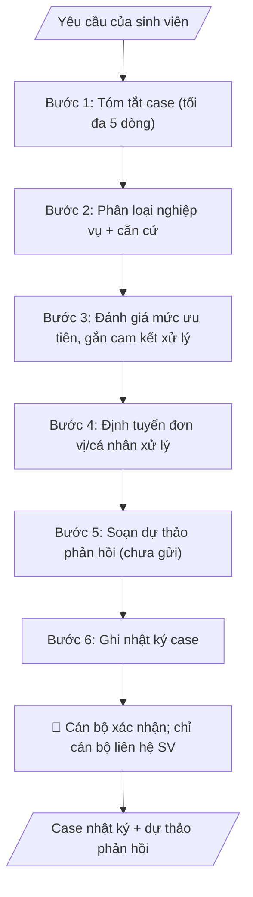

# Phân loại yêu cầu của sinh viên

## Khi nào dùng
Khi đơn vị tiếp nhận phản ánh/khiếu nại/đề nghị của sinh viên qua phiếu, email, form trực tuyến:
khiếu nại điểm số, vướng mắc học phí, vấn đề KTX, đề nghị xác nhận... Cần phân loại nhanh,
đúng đơn vị xử lý, đúng mức độ ưu tiên — thay vì dồn vào một đầu mối xử lý thủ công.

## Định dạng và file đầu ra

Định dạng đầu ra có thể chọn theo sản phẩm/yêu cầu: .docx, .pdf. Đọc mục “Định dạng bổ sung” trong quy cách đầu ra trước khi chọn.

**Phải tạo file thực tế để tải xuống, không chỉ trả nội dung trong chat.** Định dạng mặc định của skill: **.docx**. Nếu có bảng số liệu nghiệp vụ yêu cầu file bảng tính riêng, tạo thêm Excel theo yêu cầu; không tự tạo file kiểm tra. Không chờ người dùng yêu cầu xuất file lần nữa. Ưu tiên định dạng người dùng chỉ định; đọc quy tắc xuất file tại references/quy-cach-dau-ra.md.

**Chạy qua API (không có công cụ tạo file):** trả đủ nội dung dạng văn bản có tiêu đề, bảng; ứng dụng gọi sẽ xuất file.

## Quy cách đầu ra và thông tin thiếu
Khi dựng file Word/Excel, áp dụng mục “Thể thức và bảng biểu khi dựng file” trong quy cách đầu ra (cỡ chữ từng thành phần, bảng nhiều trang, số trang, phụ lục). Đọc [quy cách và cấu trúc sản phẩm](references/quy-cach-dau-ra.md) trước khi soạn/xuất. File giao chỉ gồm sản phẩm nghiệp vụ được yêu cầu; kiểm tra nội bộ không xuất kèm. Thiếu thông tin thì giữ nguyên trường/mục và chỗ điền theo mẫu gốc (dòng dấu chấm, dấu gạch hoặc ô trống); không tự điền dữ liệu mẫu, số 0, mã chờ xác minh hay dòng chờ ký. Mẫu chuyên ngành còn áp dụng được ưu tiên về cấu trúc, mã biểu và người ký. Bản đầy đủ: [quy tắc chung](references/quy-tac-chung.md).

Khi người dùng yêu cầu bộ slide (.pptx), đọc mục “Xuất PowerPoint (.pptx) khi được yêu cầu” trong quy cách đầu ra.

## Kiểm soát áp dụng và phê duyệt
Trước khi chạy, xác định `ngay_ap_dung`, `loai_hinh_truong`, `quy_che_noi_bo`, `nguon_du_lieu`, `nguoi_kiem_duyet`; chỉ hỏi thông tin liên quan nghiệp vụ, không dùng giá trị giả định thay dữ liệu bắt buộc. Đối chiếu căn cứ pháp lý với văn bản gốc, hiệu lực, điều khoản áp dụng và chuyển tiếp. Bản đầy đủ: [quy tắc chung](references/quy-tac-chung.md).

## Giới hạn và human gate
AI hỗ trợ chuẩn bị và đối chiếu; cán bộ phụ trách kiểm tra dữ liệu/căn cứ, người có thẩm quyền duyệt và ký. Không đánh dấu đã ký, đã duyệt, đã công bố khi chưa có chứng cứ. Dữ liệu sinh viên, sức khỏe, nhân sự, tài chính chỉ dùng theo mục đích và phân quyền, che thông tin định danh khi dùng ví dụ (Luật 91/2025/QH15, hiệu lực 01/01/2026); không tải dữ liệu lên dịch vụ ngoài khi chưa có quyền. Bản đầy đủ: [quy tắc chung](references/quy-tac-chung.md).

## Bối cảnh riêng của VNU-IS

Bản chỉnh cho Trường Quốc tế – ĐHQGHN (VNU-IS), v0.4.2. Dựng từ website công khai và phiếu khảo sát CES còn trống; **chưa có dữ liệu khảo sát thực tế của đơn vị**. Đọc [bối cảnh VNU-IS](references/boi-canh-vnuis.md) trước khi chạy; các mã C1–C8 nằm ở mục 6 của file đó.

- **Đơn vị thường dùng:** Phòng Đào tạo (hỗ trợ người học, công tác sinh viên).
- **Nghiệp vụ trong phiếu CES:** "Hỗ trợ người học: Phân loại và xử lý yêu cầu/kiến nghị của sinh viên" (sheet `04_KS_Dao_tao`). Tần suất gợi ý: Theo hồ sơ/vụ việc. Đầu vào gợi ý: Phiếu yêu cầu; email xuất; quy định; lịch sử xử lý. Khó khăn gợi ý: Tài liệu phân tán, nhiều định dạng; Đọc và đối chiếu thủ công mất thời gian; Dễ bỏ sót trường dữ liệu/phiên bản; Đầu ra phụ thuộc kinh nghiệm từng cá nhân. Đây là gợi ý có sẵn của CES, chưa phải xác nhận của đơn vị.

**Điều chỉnh khi dùng cho VNU-IS**
- Thêm nhãn ngôn ngữ (tiếng Việt, tiếng Anh) và nhãn loại chương trình cho mỗi case; người học có thể là sinh viên quốc tế hoặc chương trình liên kết.
- Các nhóm dịch vụ trên website: dịch vụ hành chính một cửa, tham vấn tâm lý, chăm sóc sức khỏe, ký túc xá, thư viện, học bổng, hướng nghiệp. Website không nêu đơn vị phụ trách từng dịch vụ nên bảng định tuyến để trống cho đến khi xác nhận (C7).
- Case về tâm lý, sức khỏe, an toàn: chuyển ngay cho người có chuyên môn; AI không xử lý và không đưa lời khuyên chẩn đoán.

**Chờ xác nhận khi khảo sát**
- Bảng định tuyến case: ai nhận, thời hạn phản hồi (C7).
- Phiếu yêu cầu hiện dùng (C8).

Nếu người dùng chưa trả lời mục chờ xác nhận liên quan, hỏi lại; không tự điền giả định.

## Đầu vào (Input)

| Trường | Mô tả | Bắt buộc |
|---|---|---|
| `kenh_tiep_nhan` | Phiếu / Email / Form trực tuyến / Trực tiếp | Có |
| `noi_dung_case` | Nội dung phản ánh của sinh viên (nguyên văn) | Có |
| `thong_tin_sv` | Mã SV, họ tên, khoa, khóa (để tra lịch sử) | Có |
| `quy_dinh_lien_quan` | Quy định, quy trình xử lý từng loại vụ việc + cam kết xử lý | Có |
| `lich_su_xu_ly` | Các case trước đây của SV này (nếu có) | Không |

### Thông tin VNU-IS đã điền sẵn (không hỏi lại)

| Mục | Giá trị mặc định |
|---|---|
| Cơ quan chủ quản; Trường; địa danh | Đại học Quốc gia Hà Nội (ĐHQGHN); Trường Quốc tế – ĐHQGHN (VNU – International School); Hà Nội |
| Đơn vị sử dụng và phối hợp | Phòng Đào tạo (hỗ trợ người học, công tác sinh viên) |
| Cơ sở | Xuân Thủy (Cầu Giấy); Phan Tây Nhạc (Xuân Phương); Hòa Lạc (tòa HT1, Khu Đô thị ĐHQGHN). Ghi rõ cơ sở khi nội dung gắn địa điểm |
| Mô hình đào tạo | Chọn đúng mô hình trước khi áp quy tắc, không áp quy tắc của mô hình này cho mô hình khác: (1) ĐHQGHN cấp bằng; (2) liên kết quốc tế, đối tác nước ngoài cấp bằng; (3) song bằng; (4) cử nhân – thạc sĩ tích hợp; (5) tiếng Anh dự bị và mô hình 2+2 |
| Ngôn ngữ đầu ra | Tiếng Việt là bản gốc; thêm tiếng Anh cho đối tác, người học quốc tế hoặc khi được yêu cầu |
| Hệ thống nguồn dữ liệu có trên website | Cổng sinh viên; cổng việc làm; tra cứu văn bằng. Skill không kết nối hệ thống, chỉ dùng file xuất/tải lên (C5) |
| Người duyệt và ký | Ghi theo vai trò (Trưởng phòng, Phó Hiệu trưởng phụ trách, Hiệu trưởng); tuyến duyệt và thẩm quyền ký chờ C1, C6 |

Nguồn: website và phiếu CES; đổi theo khảo sát thì sửa tại đây và trong `references/boi-canh-vnuis.md`.

## Quy trình

*⏱ là ước tính ban đầu của bộ gốc, chưa đo tại VNU-IS; hiệu chỉnh sau khảo sát.*

**Bước 1. Tóm tắt case**
- Làm gì: Đọc `noi_dung_case` (nguyên văn), trích 4 yếu tố: ai (lấy từ `thong_tin_sv`), việc gì, xảy ra khi nào, mong muốn gì; viết gọn tối đa 5 dòng, giữ nguyên ý của sinh viên, không thêm suy diễn.
- Dùng input: `noi_dung_case`, `thong_tin_sv`.
- Vai trò: Cán bộ thụ lý · AI hỗ trợ: trích 4 yếu tố (ai — việc gì — khi nào — mong muốn gì), viết gọn ≤ 5 dòng · ⏱ ~5–10 phút (ước tính)
- Lưu ý nghiệp vụ: không suy đoán động cơ hay hoàn cảnh ngoài nội dung SV viết; nếu nội dung mơ hồ, ghi rõ "cần làm rõ thêm" thay vì đoán.
- → Kết quả bước: Bản tóm tắt case (≤ 5 dòng).

**Bước 2. Phân loại nghiệp vụ**
- Làm gì: Căn cứ `quy_dinh_lien_quan`, xếp case vào nhóm nghiệp vụ (học vụ / học phí-tài chính / học bổng / KTX / kỷ luật-khiếu nại / xác nhận-giấy tờ / hỗ trợ khác); ghi rõ căn cứ điều khoản phân loại; tra `lich_su_xu_ly` để phát hiện case lặp lại của cùng SV.
- Dùng input: `noi_dung_case`, `quy_dinh_lien_quan`, `lich_su_xu_ly` (bản tóm tắt từ bước 1).
- Vai trò: Cán bộ thụ lý · AI hỗ trợ: phân loại nghiệp vụ theo quy định, tra lịch sử phát hiện case lặp · ⏱ ~10–15 phút (ước tính)
- Lưu ý nghiệp vụ: case liên quan tâm lý/sức khỏe → phân loại "hỗ trợ khác" và chuyển ngay cho bộ phận tư vấn tâm lý/y tế, không phân tích sâu; case trùng lặp phải ghi chú để tránh xử lý chồng chéo.
- → Kết quả bước: Nhóm nghiệp vụ + căn cứ phân loại + ghi chú lịch sử.

**Bước 3. Đánh giá mức độ ưu tiên và gắn cam kết xử lý**
- Làm gì: Chấm mức ưu tiên: Khẩn (ảnh hưởng quyền lợi sát hạn, an toàn) / Cao / Thường; tra `quy_dinh_lien_quan` để gắn cam kết xử lý cụ thể (VD: phản hồi trong 3 ngày làm việc) và tính ra hạn chót theo ngày làm việc.
- Dùng input: `quy_dinh_lien_quan` (phân loại từ bước 2).
- Vai trò: Cán bộ thụ lý · AI hỗ trợ: chấm mức ưu tiên và gắn cam kết xử lý, tính hạn chót theo ngày làm việc · ⏱ ~5–10 phút (ước tính)
- Lưu ý nghiệp vụ: mức Khẩn phải có căn cứ rõ ràng, không lạm dụng; hạn cam kết xử lý tính theo ngày làm việc, trừ ngày nghỉ/lễ.
- → Kết quả bước: Mức độ ưu tiên + cam kết xử lý + hạn chót.

**Bước 4. Định tuyến đơn vị xử lý**
- Làm gì: Theo phân loại nghiệp vụ, chỉ định đơn vị/cá nhân thụ lý; nếu case liên quan nhiều đơn vị: chỉ định một đầu mối chính + các đơn vị phối hợp; case vượt thẩm quyền hoặc nhạy cảm (kỷ luật, pháp lý) → định tuyến thẳng lên lãnh đạo đơn vị.
- Dùng input: `quy_dinh_lien_quan` (phân loại và ưu tiên từ bước 2–3).
- Vai trò: Cán bộ thụ lý · AI hỗ trợ: đề xuất định tuyến — một đầu mối chính + đơn vị phối hợp · ⏱ ~10–15 phút (ước tính)
- Lưu ý nghiệp vụ: một case chỉ có một đầu mối chính để tránh đùn đẩy; ghi rõ vai trò phối hợp của từng đơn vị liên quan.
- → Kết quả bước: Phiếu định tuyến (đơn vị xử lý, đầu mối, đơn vị phối hợp, hạn).

**Bước 5. Soạn dự thảo phản hồi sinh viên**
- Làm gì: Soạn thư/email trả lời SV ở dạng DỰ THẢO (chưa gửi): xác nhận đã tiếp nhận, nêu rõ hướng xử lý và thời hạn theo cam kết xử lý; văn phong tôn trọng, rõ ràng; KHÔNG hứa hẹn kết quả xử lý cụ thể.
- Dùng input: `thong_tin_sv` (tóm tắt từ bước 1, cam kết xử lý từ bước 3, định tuyến từ bước 4).
- Vai trò: Cán bộ thụ lý · AI hỗ trợ: soạn dự thảo phản hồi đúng cam kết xử lý, văn phong tôn trọng (chưa gửi) · ⏱ ~10–15 phút + ~15–30 phút duyệt (ước tính)
- Lưu ý nghiệp vụ: bẫy thường gặp là hứa "sẽ giải quyết xong" — chỉ nêu "đang xử lý, sẽ phản hồi trước ngày X"; với case nhạy cảm, ngôn từ dự thảo phải thận trọng.
- → Kết quả bước: Dự thảo phản hồi sinh viên (CHƯA GỬI).

**Bước 6. Ghi nhật ký theo dõi**
- Làm gì: Ghi nhật ký: mã case theo quy ước thống nhất toàn trường, thời gian tiếp nhận và `kenh_tiep_nhan`, phân loại, ưu tiên, đơn vị xử lý, trạng thái "chờ cán bộ xác nhận".
- Dùng input: `kenh_tiep_nhan` (kết quả các bước 2–4).
- Vai trò: Cán bộ thụ lý · AI hỗ trợ: ghi nhật ký case (mã case thống nhất, trạng thái chờ xác nhận) · ⏱ ~5 phút (ước tính)
- Lưu ý nghiệp vụ: mã case thống nhất để tra cứu, tránh xử lý trùng lặp; nhật ký case không chia sẻ ra ngoài đơn vị xử lý (bảo mật thông tin cá nhân SV).
- → Kết quả bước: Nhật ký case hoàn chỉnh — đầu vào cho Human gate (cán bộ xác nhận).
## Luồng quy trình (Workflow)

## Đầu ra

File nghiệp vụ thực tế theo định dạng mặc định ở đầu skill hoặc định dạng người dùng yêu cầu, kèm liên kết tải trong phản hồi cuối.

Sản phẩm nghiệp vụ hoàn chỉnh theo [quy cách và cấu trúc](references/quy-cach-dau-ra.md), giữ các trường chưa có dữ liệu ở trạng thái trống. Không xuất kèm danh mục kiểm/phụ lục kiểm tra đầu ra.

## Kiểm tra nội bộ trước khi giao

- [ ] Case bản yêu cầu đầy đủ 7 phần theo cấu trúc sản phẩm tại references/quy-cach-dau-ra.md: mã case + kênh + thời gian tiếp nhận; tóm tắt (≤ 5 dòng); phân loại + căn cứ điều khoản; ưu tiên + cam kết xử lý (hạn chót); định tuyến; dự thảo phản hồi đính kèm (chưa gửi); nhật ký theo dõi.
- [ ] Tóm tắt giữ nguyên ý sinh viên; nội dung mơ hồ ghi "cần làm rõ thêm", không suy đoán động cơ hay hoàn cảnh.
- [ ] Mỗi case có MỘT đầu mối chính duy nhất; case vượt thẩm quyền hoặc nhạy cảm (kỷ luật, pháp lý) đã định tuyến thẳng lên lãnh đạo đơn vị.
- [ ] Mức Khẩn có căn cứ rõ ràng, không lạm dụng; hạn cam kết xử lý tính theo ngày làm việc (trừ ngày nghỉ/lễ).
- [ ] Dự thảo phản hồi KHÔNG hứa hẹn kết quả xử lý cụ thể — chỉ nêu hướng xử lý và thời hạn theo cam kết xử lý; chỉ ở trạng thái dự thảo, chưa gửi.
- [ ] Bảo mật thông tin cá nhân sinh viên; nhật ký case không chia sẻ ngoài đơn vị xử lý; case liên quan tâm lý/sức khỏe đã chuyển ngay cho bộ phận tư vấn tâm lý/y tế, không phân tích sâu.
- [ ] Đã qua Human gate: cán bộ thụ lý đã xác nhận phân loại, ưu tiên và đơn vị xử lý; cán bộ là người duy nhất liên hệ và gửi phản hồi cho sinh viên.

> Tiêu chí đạt: tất cả các ô được đánh dấu.

## Human gate (người kiểm duyệt)
1. **Cán bộ thụ lý**: xác nhận phân loại, mức độ ưu tiên và đơn vị xử lý trước khi chuyển đi.
2. **Cán bộ là người duy nhất liên hệ và gửi phản hồi cho sinh viên** — sau khi duyệt dự thảo của AI.
3. Case vượt thẩm quyền hoặc nhạy cảm (kỷ luật, pháp lý) chuyển ngay lãnh đạo đơn vị, không để AI
   "xử lý tiếp".

## Giới hạn (guardrails)
- KHÔNG tự gửi bất kỳ phản hồi nào cho sinh viên dưới mọi hình thức.
- KHÔNG chẩn đoán, tư vấn về tâm lý, sức khỏe của sinh viên — case liên quan chuyển ngay
  cho bộ phận tư vấn tâm lý/y tế của trường.
- Bảo mật tuyệt đối thông tin cá nhân của sinh viên; nhật ký case không chia sẻ ngoài đơn vị xử lý.
- KHÔNG hứa hẹn kết quả xử lý cụ thể với sinh viên trong dự thảo (chỉ nêu hướng và thời hạn).

## Căn cứ & lưu ý
- Quy định/quy trình xử lý từng loại vụ việc và cam kết xử lý do trường ban hành là căn cứ duy nhất để
  phân loại và định tuyến.
- Nên có mã case thống nhất toàn trường để tra cứu, tránh xử lý trùng lặp.
- Ví dụ trong skill chỉ để minh họa; không đưa dữ liệu cá nhân thật vào ví dụ. Tên Trường, cơ quan chủ quản và địa danh dùng đúng bảng thông tin VNU-IS đã điền sẵn.

## Quản trị phiên bản
- Phiên bản gói VNU-IS `0.4.2` (cập nhật 2026-10-11), dựa trên skill gốc `triage-case-sinh-vien` bản `1.3.2`; hồ sơ đầy đủ tại [references/version.json](references/version.json).
- Người phê duyệt nghiệp vụ: **chưa chỉ định**. Trạng thái: dự thảo nghiệp vụ; kiểm tra pháp lý trước thực thi. Ngày cập nhật không đồng nghĩa mọi văn bản đã được rà soát toàn văn.
- Giấy phép theo LICENSE của kho (bản quyền CES Global). Lịch sử thay đổi: CHANGELOG.md.
