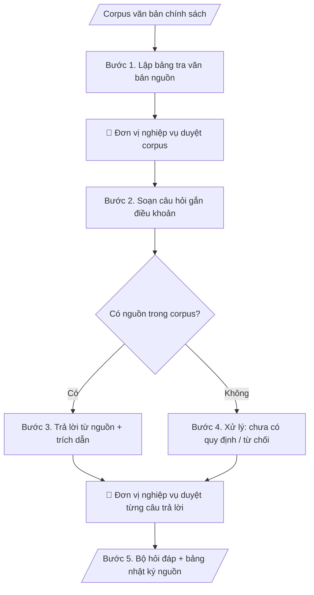

# Hỏi đáp chính sách có trích nguồn

## Khi nào dùng
Khi cần xây dựng hoặc vận hành kênh hỏi đáp (hỏi đáp, chatbot, tư vấn viên) về các chính sách,
quy định của trường: học phí, học bổng, quy chế đào tạo, chế độ cán bộ, KTX...
Yêu cầu cao nhất: trả lời đúng văn bản, có trích nguồn kiểm chứng được.

## Định dạng và file đầu ra

Định dạng đầu ra có thể chọn theo sản phẩm/yêu cầu: .docx, .pdf, .txt, .md, .html. Đọc mục “Định dạng bổ sung” trong quy cách đầu ra trước khi chọn.

**Phải tạo file thực tế để tải xuống, không chỉ trả nội dung trong chat.** Định dạng mặc định của skill: **.docx**. Nếu có bảng số liệu nghiệp vụ yêu cầu file bảng tính riêng, tạo thêm Excel theo yêu cầu; không tự tạo file kiểm tra. Không chờ người dùng yêu cầu xuất file lần nữa. Ưu tiên định dạng người dùng chỉ định; đọc quy tắc xuất file tại references/quy-cach-dau-ra.md.

**Chạy qua API (không có công cụ tạo file):** trả đủ nội dung dạng văn bản có tiêu đề, bảng; ứng dụng gọi sẽ xuất file.

## Quy cách đầu ra và thông tin thiếu
Khi dựng file Word/Excel, áp dụng mục “Thể thức và bảng biểu khi dựng file” trong quy cách đầu ra (cỡ chữ từng thành phần, bảng nhiều trang, số trang, phụ lục). Đọc [quy cách và cấu trúc sản phẩm](references/quy-cach-dau-ra.md) trước khi soạn/xuất. File giao chỉ gồm sản phẩm nghiệp vụ được yêu cầu; kiểm tra nội bộ không xuất kèm. Thiếu thông tin thì giữ nguyên trường/mục và chỗ điền theo mẫu gốc (dòng dấu chấm, dấu gạch hoặc ô trống); không tự điền dữ liệu mẫu, số 0, mã chờ xác minh hay dòng chờ ký. Mẫu chuyên ngành còn áp dụng được ưu tiên về cấu trúc, mã biểu và người ký. Bản đầy đủ: [quy tắc chung](references/quy-tac-chung.md).

Khi người dùng yêu cầu bộ slide (.pptx), đọc mục “Xuất PowerPoint (.pptx) khi được yêu cầu” trong quy cách đầu ra.

## Kiểm soát áp dụng và phê duyệt
Trước khi chạy, xác định `ngay_ap_dung`, `loai_hinh_truong`, `quy_che_noi_bo`, `nguon_du_lieu`, `nguoi_kiem_duyet`; chỉ hỏi thông tin liên quan nghiệp vụ, không dùng giá trị giả định thay dữ liệu bắt buộc. Đối chiếu căn cứ pháp lý với văn bản gốc, hiệu lực, điều khoản áp dụng và chuyển tiếp. Bản đầy đủ: [quy tắc chung](references/quy-tac-chung.md).

## Giới hạn và human gate
AI hỗ trợ chuẩn bị và đối chiếu; cán bộ phụ trách kiểm tra dữ liệu/căn cứ, người có thẩm quyền duyệt và ký. Không đánh dấu đã ký, đã duyệt, đã công bố khi chưa có chứng cứ. Dữ liệu sinh viên, sức khỏe, nhân sự, tài chính chỉ dùng theo mục đích và phân quyền, che thông tin định danh khi dùng ví dụ (Luật 91/2025/QH15, hiệu lực 01/01/2026); không tải dữ liệu lên dịch vụ ngoài khi chưa có quyền. Bản đầy đủ: [quy tắc chung](references/quy-tac-chung.md).

## Bối cảnh riêng của VNU-IS

Bản chỉnh cho Trường Quốc tế – ĐHQGHN (VNU-IS), v0.4.2. Dựng từ website công khai và phiếu khảo sát CES còn trống; **chưa có dữ liệu khảo sát thực tế của đơn vị**. Đọc [bối cảnh VNU-IS](references/boi-canh-vnuis.md) trước khi chạy; các mã C1–C8 nằm ở mục 6 của file đó.

- **Đơn vị thường dùng:** Mọi đơn vị trong Trường; viên chức, giảng viên, người học.
- **Nghiệp vụ trong phiếu CES:** không có dòng riêng trong phiếu CES; đề xuất theo chức năng đơn vị ở sheet 00 và cần xác nhận khi khảo sát.

**Điều chỉnh khi dùng cho VNU-IS**
- Nguồn chỉ gồm văn bản người dùng nạp (quy chế, quy định, thông báo); mỗi câu trả lời trích điều khoản và ngày hiệu lực. Chưa có văn bản của ĐHQGHN hay VNU-IS thì từ chối và nói rõ thiếu nguồn.
- Chia hỏi đáp theo nhóm đối tượng: viên chức, sinh viên chương trình ĐHQGHN, liên kết, quốc tế; tiếng Việt và tiếng Anh.
- Không dùng thay cho nền tảng tư vấn tuyển sinh hiện có; hỏi đáp tuyển sinh dùng vnuis-ts-hoi-dap-tuyen-sinh.

**Chờ xác nhận khi khảo sát**
- Bộ văn bản nguồn chính thức (C2).
- Người duyệt nội dung hỏi đáp (C6).

Nếu người dùng chưa trả lời mục chờ xác nhận liên quan, hỏi lại; không tự điền giả định.

## Đầu vào (Input)

| Trường | Mô tả | Bắt buộc |
|---|---|---|
| `van_ban_nguon` | Danh sách văn bản nguồn: tên, số/ký hiệu, ngày ban hành, ngày hiệu lực | Có |
| `chu_de` | Chủ đề hỏi đáp (VD: học bổng; miễn giảm học phí; bảo lưu kết quả) | Có |
| `doi_tuong` | Sinh viên / Cán bộ / Phụ huynh... (để điều chỉnh cách diễn đạt) | Không |
| `cau_hoi_mau` | Các câu hỏi thực tế thường gặp (nếu có) | Không |

### Thông tin VNU-IS đã điền sẵn (không hỏi lại)

| Mục | Giá trị mặc định |
|---|---|
| Cơ quan chủ quản; Trường; địa danh | Đại học Quốc gia Hà Nội (ĐHQGHN); Trường Quốc tế – ĐHQGHN (VNU – International School); Hà Nội |
| Đơn vị sử dụng và phối hợp | Mọi đơn vị trong Trường; viên chức, giảng viên, người học |
| Ngôn ngữ đầu ra | Tiếng Việt là bản gốc; thêm tiếng Anh cho đối tác, người học quốc tế hoặc khi được yêu cầu |
| Người duyệt và ký | Ghi theo vai trò (Trưởng phòng, Phó Hiệu trưởng phụ trách, Hiệu trưởng); tuyến duyệt và thẩm quyền ký chờ C1, C6 |

Nguồn: website và phiếu CES; đổi theo khảo sát thì sửa tại đây và trong `references/boi-canh-vnuis.md`.

## Quy trình

*⏱ là ước tính ban đầu của bộ gốc, chưa đo tại VNU-IS; hiệu chỉnh sau khảo sát.*

**Bước 1. Lập bảng tra văn bản nguồn**
- Làm gì: với mỗi văn bản trong `van_ban_nguon`, ghi: tên, số/ký hiệu, ngày ban hành, ngày hiệu lực;
  tra cứu và đánh dấu trạng thái: còn hiệu lực / hết hiệu lực / bị thay thế (ghi rõ văn bản thay thế).
- Dùng input: `van_ban_nguon`.
- Vai trò: Đơn vị nghiệp vụ (đơn vị ban hành/sở hữu chính sách) · AI hỗ trợ: lập bảng tra văn bản nguồn; đơn vị nghiệp vụ xác nhận trạng thái hiệu lực · ⏱ ~20–30 phút + ~30–60 phút duyệt (ước tính)
- Lưu ý nghiệp vụ: văn bản hết hiệu lực phải loại khỏi corpus trả lời hiện hành, nhưng vẫn lưu trong bảng tra
  để giải thích "quy định cũ" khi được hỏi; trạng thái hiệu lực do đơn vị nghiệp vụ xác nhận (human gate),
  AI chỉ đề xuất.
- → Kết quả bước: bảng tra văn bản nguồn (văn bản | hiệu lực | trạng thái | văn bản thay thế).

**Bước 2. Soạn câu hỏi gắn điều khoản**
- Làm gì: dựa trên `chu_de`, `doi_tuong` và `cau_hoi_mau` (nếu có), soạn bộ câu hỏi; mỗi câu hỏi gắn với
  (các) điều/khoản cụ thể trong bảng tra nguồn; ghi chú câu nào không tìm được điều khoản tương ứng.
- Dùng input: `chu_de`, `doi_tuong`, `cau_hoi_mau`, bảng tra nguồn (Bước 1).
- Vai trò: Chuyên viên đơn vị nghiệp vụ (đơn vị sở hữu chính sách) · AI hỗ trợ: soạn câu hỏi theo ngôn ngữ đối tượng, gắn điều khoản, đánh dấu câu chưa có nguồn · ⏱ ~15–25 phút (ước tính)
- Lưu ý nghiệp vụ: câu hỏi viết theo ngôn ngữ của đối tượng (sinh viên hỏi kiểu sinh viên); mỗi câu hỏi phải
  truy vết được về điều khoản — câu nào không gắn được thì chuyển sang nhóm "chưa có nguồn" để xử lý ở Bước 4.
- → Kết quả bước: danh sách câu hỏi (câu hỏi | điều khoản tương ứng | trạng thái có/không nguồn).

**Bước 3. Trả lời chỉ từ nguồn, có trích dẫn**
- Làm gì: viết câu trả lời cho từng câu hỏi có nguồn: diễn đạt lại dễ hiểu nhưng không thêm ý ngoài văn bản;
  cuối mỗi câu trả lời trích đủ 3 yếu tố: tên văn bản + điều/khoản + ngày hiệu lực.
- Dùng input: danh sách câu hỏi (Bước 2), `van_ban_nguon`.
- Vai trò: Chuyên viên đơn vị nghiệp vụ (đơn vị sở hữu chính sách) · AI hỗ trợ: viết câu trả lời chỉ từ nguồn, trích đủ 3 yếu tố (tên văn bản + điều/khoản + ngày hiệu lực) · ⏱ ~20–40 phút (ước tính)
- Lưu ý nghiệp vụ: cấm suy đoán, cấm "lấp" ý; câu trả lời phải đứng vững khi người đọc mở văn bản gốc
  ra đối chiếu; trích dẫn thiếu 1 trong 3 yếu tố là chưa đạt.
- → Kết quả bước: bộ câu hỏi – trả lời có trích nguồn đầy đủ.

**Bước 4. Xử lý trường hợp đặc biệt**
- Làm gì: với câu hỏi không có nguồn — trả lời "Hiện chưa có quy định về nội dung này" + hướng dẫn liên hệ
  đơn vị phụ trách; câu hỏi ngoài phạm vi corpus — từ chối lịch sự + hướng dẫn; câu hỏi về văn bản hết
  hiệu lực — ghi rõ "quy định cũ, đã được thay thế bởi..." và không dùng để trả lời cho tình huống hiện hành.
- Dùng input: danh sách câu hỏi "chưa có nguồn" (Bước 2), bảng tra nguồn (Bước 1).
- Vai trò: Chuyên viên đơn vị nghiệp vụ (đơn vị sở hữu chính sách) · AI hỗ trợ: xử lý trường hợp đặc biệt — từ chối + hướng dẫn liên hệ, không "lấp" ý · ⏱ ~10–20 phút (ước tính)
- Lưu ý nghiệp vụ: không bao giờ trả lời kiểu "chắc là..." — thà từ chối còn hơn trả lời sai chính sách;
  mọi từ chối đều phải kèm hướng đi tiếp theo cho người hỏi (liên hệ ai, ở đâu).
- → Kết quả bước: nhóm câu trả lời đặc biệt (chưa có quy định / ngoài phạm vi / quy định cũ).

**Bước 5. Xuất bộ hỏi đáp và bảng nhật ký nguồn**
- Làm gì: gộp kết quả Bước 3–4 thành bộ hỏi đáp hoàn chỉnh: mỗi mục gồm Hỏi | Đáp | trích nguồn; lập bảng nhật ký
  nguồn (câu hỏi ↔ điều khoản ↔ văn bản ↔ hiệu lực); lập danh sách câu hỏi ngoài phạm vi để bổ sung
  hoặc chuyển đơn vị xử lý.
- Dùng input: kết quả Bước 3, Bước 4.
- Vai trò: Chuyên viên đơn vị nghiệp vụ (đơn vị sở hữu chính sách) · AI hỗ trợ: xuất bộ hỏi đáp, bảng nhật ký nguồn, danh sách câu hỏi ngoài phạm vi · ⏱ ~15–25 phút (ước tính)
- Lưu ý nghiệp vụ: bảng nhật ký là công cụ kiểm chứng — đơn vị nghiệp vụ dùng để duyệt từng câu trước khi
  công bố (human gate); bộ hỏi đáp phải ghi phiên bản và ngày cập nhật.
- → Kết quả bước: bộ hỏi đáp + bảng nhật ký nguồn + danh sách câu hỏi ngoài phạm vi.
## Luồng quy trình (Workflow)

## Đầu ra

File nghiệp vụ thực tế theo định dạng mặc định ở đầu skill hoặc định dạng người dùng yêu cầu, kèm liên kết tải trong phản hồi cuối.

Sản phẩm nghiệp vụ hoàn chỉnh theo [quy cách và cấu trúc](references/quy-cach-dau-ra.md), giữ các trường chưa có dữ liệu ở trạng thái trống. Không xuất kèm danh mục kiểm/phụ lục kiểm tra đầu ra.

## Kiểm tra nội bộ trước khi giao

- [ ] Bộ hỏi đáp đầy đủ 5 phần theo cấu trúc sản phẩm tại references/quy-cach-dau-ra.md: tiêu đề + chủ đề + đối tượng + phiên bản/ngày cập nhật + corpus văn bản áp dụng; danh sách Hỏi–Đáp; nhóm câu hỏi chưa có quy định/ngoài phạm vi; bảng nhật ký nguồn; ghi chú văn bản hết hiệu lực đã loại khỏi corpus.
- [ ] Mỗi câu trả lời có trích dẫn đủ 3 yếu tố: tên văn bản + điều/khoản + ngày hiệu lực (thiếu 1 yếu tố là chưa đạt).
- [ ] Corpus văn bản nguồn còn hiệu lực, đã được đơn vị nghiệp vụ duyệt; văn bản hết hiệu lực không dùng để trả lời tình huống hiện hành.
- [ ] Câu hỏi không có nguồn được trả lời "Hiện chưa có quy định về nội dung này" kèm hướng dẫn liên hệ đơn vị phụ trách — không "lấp" ý, không dùng "chắc là...".
- [ ] Bộ hỏi đáp ghi rõ phiên bản và ngày cập nhật.
- [ ] Không tư vấn ngoài phạm vi chính sách đã duyệt; không đưa lời khuyên mang tính quyết định cá nhân.
- [ ] Đã qua Human gate: đơn vị nghiệp vụ đã duyệt corpus và từng câu trả lời trước khi công bố.

> Tiêu chí đạt: tất cả các ô được đánh dấu.

## Human gate (người kiểm duyệt)
1. **Đơn vị nghiệp vụ** (đơn vị ban hành/sở hữu chính sách): duyệt **corpus** — danh mục văn bản nguồn
   và trạng thái hiệu lực — trước khi đưa vào sử dụng.
2. Đơn vị nghiệp vụ duyệt từng câu trả lời trong bộ hỏi đáp trước khi công bố.
3. Khi văn bản nguồn thay đổi, đơn vị nghiệp vụ xác nhận cập nhật; AI không tự ý dùng văn bản mới
   khi chưa được duyệt.

## Giới hạn (guardrails)
- KHÔNG tư vấn, trả lời ngoài phạm vi chính sách đã được duyệt trong corpus.
- KHÔNG dùng văn bản hết hiệu lực để trả lời cho tình huống hiện hành.
- KHÔNG suy đoán, "lấp" câu trả lời khi không có nguồn — phải nói rõ là chưa có quy định.
- KHÔNG đưa ra lời khuyên mang tính quyết định cá nhân (VD: "bạn nên nghỉ học kỳ này").

## Căn cứ & lưu ý
- Corpus văn bản nguồn là "sự thật duy nhất" — mọi câu trả lời đều phải truy vết được về nguồn.
- Định kỳ rà soát hiệu lực văn bản (ít nhất mỗi học kỳ).
- Ví dụ trong skill chỉ để minh họa; không đưa dữ liệu cá nhân thật vào ví dụ. Tên Trường, cơ quan chủ quản và địa danh dùng đúng bảng thông tin VNU-IS đã điền sẵn.

## Quản trị phiên bản
- Phiên bản gói VNU-IS `0.4.2` (cập nhật 2026-10-11), dựa trên skill gốc `faq-chinh-sach-co-trich-nguon` bản `1.3.2`; hồ sơ đầy đủ tại [references/version.json](references/version.json).
- Người phê duyệt nghiệp vụ: **chưa chỉ định**. Trạng thái: dự thảo nghiệp vụ; kiểm tra pháp lý trước thực thi. Ngày cập nhật không đồng nghĩa mọi văn bản đã được rà soát toàn văn.
- Giấy phép theo LICENSE của kho (bản quyền CES Global). Lịch sử thay đổi: CHANGELOG.md.
