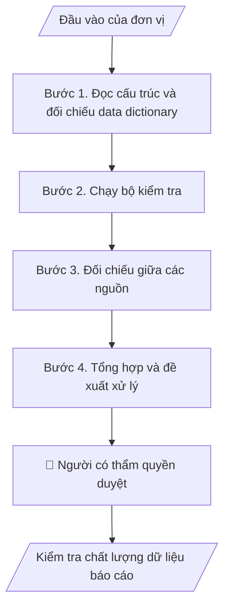

# Kiểm tra chất lượng dữ liệu báo cáo

## Khi nào dùng
Khi có file Excel hoặc CSV xuất từ hệ thống dùng để lập báo cáo, và cần biết dữ liệu có đủ tin cậy trước khi tổng hợp; khi hai nguồn báo cáo cùng một chỉ tiêu cho số khác nhau.

## Định dạng và file đầu ra

Định dạng đầu ra có thể chọn theo sản phẩm/yêu cầu: .xlsx, .csv, .pdf, .json, .html. Đọc mục “Định dạng bổ sung” trong quy cách đầu ra trước khi chọn.

**Phải tạo file thực tế để tải xuống, không chỉ trả nội dung trong chat.** Định dạng mặc định của skill: **.xlsx**. Nếu yêu cầu gồm cả báo cáo thuyết minh, tạo thêm file Word cho báo cáo; không ghép báo cáo dài vào bảng tính. Không chờ người dùng yêu cầu xuất file lần nữa. Ưu tiên định dạng người dùng chỉ định; đọc quy tắc xuất file tại references/quy-cach-dau-ra.md.

**Chạy qua API (không có công cụ tạo file):** trả đủ nội dung dạng văn bản có tiêu đề, bảng; ứng dụng gọi sẽ xuất file.

## Quy cách đầu ra và thông tin thiếu
Khi dựng file Word/Excel, áp dụng mục “Thể thức và bảng biểu khi dựng file” trong quy cách đầu ra (cỡ chữ từng thành phần, bảng nhiều trang, số trang, phụ lục). Đọc [quy cách và cấu trúc sản phẩm](references/quy-cach-dau-ra.md) trước khi soạn/xuất. File giao chỉ gồm sản phẩm nghiệp vụ được yêu cầu; kiểm tra nội bộ không xuất kèm. Thiếu thông tin thì giữ nguyên trường/mục và chỗ điền theo mẫu gốc (dòng dấu chấm, dấu gạch hoặc ô trống); không tự điền dữ liệu mẫu, số 0, mã chờ xác minh hay dòng chờ ký. Mẫu chuyên ngành còn áp dụng được ưu tiên về cấu trúc, mã biểu và người ký. Bản đầy đủ: [quy tắc chung](references/quy-tac-chung.md).

Khi người dùng yêu cầu bộ slide (.pptx), đọc mục “Xuất PowerPoint (.pptx) khi được yêu cầu” trong quy cách đầu ra.

## Kiểm soát áp dụng và phê duyệt
Trước khi chạy, xác định `ngay_ap_dung`, `loai_hinh_truong`, `quy_che_noi_bo`, `nguon_du_lieu`, `nguoi_kiem_duyet`; chỉ hỏi thông tin liên quan nghiệp vụ, không dùng giá trị giả định thay dữ liệu bắt buộc. Đối chiếu căn cứ pháp lý với văn bản gốc, hiệu lực, điều khoản áp dụng và chuyển tiếp. Bản đầy đủ: [quy tắc chung](references/quy-tac-chung.md).

## Giới hạn và human gate
AI hỗ trợ chuẩn bị và đối chiếu; cán bộ phụ trách kiểm tra dữ liệu/căn cứ, người có thẩm quyền duyệt và ký. Không đánh dấu đã ký, đã duyệt, đã công bố khi chưa có chứng cứ. Dữ liệu sinh viên, sức khỏe, nhân sự, tài chính chỉ dùng theo mục đích và phân quyền, che thông tin định danh khi dùng ví dụ (Luật 91/2025/QH15, hiệu lực 01/01/2026); không tải dữ liệu lên dịch vụ ngoài khi chưa có quyền. Bản đầy đủ: [quy tắc chung](references/quy-tac-chung.md).

## Bối cảnh riêng của VNU-IS

Skill mới cho Trường Quốc tế – ĐHQGHN (VNU-IS), v0.4.2. Dựng từ website công khai và phiếu khảo sát CES còn trống; **chưa có dữ liệu khảo sát thực tế của đơn vị**. Đọc [bối cảnh VNU-IS](references/boi-canh-vnuis.md) trước khi chạy; các mã C1–C8 nằm ở mục 6 của file đó.

- **Đơn vị thường dùng:** Phòng Đào tạo (đảm bảo chất lượng, báo cáo); mọi đơn vị lập báo cáo số liệu.
- **Nghiệp vụ trong phiếu CES:** "Chất lượng dữ liệu: Kiểm tra tính đầy đủ, nhất quán của dữ liệu báo cáo" (sheet `04_KS_Dao_tao`). Tần suất gợi ý: Định kỳ. Đầu vào gợi ý: File Excel; data dictionary; quy tắc kiểm tra. Khó khăn gợi ý: Tài liệu phân tán, nhiều định dạng; Đọc và đối chiếu thủ công mất thời gian; Dễ thiếu thành phần, sai logic hoặc bỏ sót ngoại lệ; Đầu ra phụ thuộc kinh nghiệm từng cá nhân.

**Chờ xác nhận khi khảo sát**
- Data dictionary của các file xuất từ hệ thống (C8).
- Nguồn số liệu chính thức khi hai nguồn lệch (C4).

Nếu người dùng chưa trả lời mục chờ xác nhận liên quan, hỏi lại; không tự điền giả định.

## Đầu vào (Input)

| Trường | Mô tả | Bắt buộc |
|---|---|---|
| `file_du_lieu` | File Excel hoặc CSV cần kiểm tra (đã che thông tin định danh nếu không cần) | Có |
| `data_dictionary` | Mô tả từng cột: tên, kiểu, miền giá trị, bắt buộc hay không | Không (nếu thiếu, skill đề xuất từ dữ liệu và chờ xác nhận) |
| `quy_tac_kiem_tra` | Quy tắc nghiệp vụ: ví dụ tổng theo chương trình bằng tổng theo khoa; mã chương trình thuộc danh mục | Không |
| `ky_bao_cao` | Kỳ và ngày chốt số liệu | Có |
| `nguon_doi_chieu` | File hoặc số liệu khác cùng chỉ tiêu để đối chiếu | Không |

### Thông tin VNU-IS đã điền sẵn (không hỏi lại)

| Mục | Giá trị mặc định |
|---|---|
| Cơ quan chủ quản; Trường; địa danh | Đại học Quốc gia Hà Nội (ĐHQGHN); Trường Quốc tế – ĐHQGHN (VNU – International School); Hà Nội |
| Đơn vị sử dụng và phối hợp | Phòng Đào tạo (đảm bảo chất lượng, báo cáo); mọi đơn vị lập báo cáo số liệu |
| Ngôn ngữ đầu ra | Tiếng Việt là bản gốc; thêm tiếng Anh cho đối tác, người học quốc tế hoặc khi được yêu cầu |
| Người duyệt và ký | Ghi theo vai trò (Trưởng phòng, Phó Hiệu trưởng phụ trách, Hiệu trưởng); tuyến duyệt và thẩm quyền ký chờ C1, C6 |

Nguồn: website và phiếu CES; đổi theo khảo sát thì sửa tại đây và trong `references/boi-canh-vnuis.md`.

## Quy trình

*⏱ là ước tính ban đầu của bộ gốc, chưa đo tại VNU-IS; hiệu chỉnh sau khảo sát.*

**Bước 1. Đọc cấu trúc và đối chiếu data dictionary**
- Làm gì: Liệt kê cột, kiểu, tỷ lệ ô trống; so với data dictionary; cột không có trong dictionary đưa vào danh sách chờ xác nhận.
- Dùng input: `file_du_lieu`, `data_dictionary`
- Vai trò: Chuyên viên phụ trách dữ liệu · AI hỗ trợ: quét cấu trúc · ⏱ thời gian do đơn vị ước tính sau khảo sát
- Lưu ý nghiệp vụ: Không đoán ý nghĩa cột; hỏi lại.
- → Kết quả bước: Bảng cấu trúc và chênh lệch với dictionary.

**Bước 2. Chạy bộ kiểm tra**
- Làm gì: Ô trống ở cột bắt buộc, kiểu sai, giá trị ngoài miền, bản ghi trùng, ngày vô lý, tổng phụ khác tổng, mã chương trình ngoài danh mục.
- Dùng input: `file_du_lieu`, `quy_tac_kiem_tra`
- Vai trò: Chuyên viên phụ trách dữ liệu · AI hỗ trợ: chạy kiểm tra · ⏱ thời gian do đơn vị ước tính sau khảo sát
- Lưu ý nghiệp vụ: Mỗi lỗi ghi vị trí (sheet, dòng, cột), loại lỗi và mức độ.
- → Kết quả bước: Bảng lỗi.

**Bước 3. Đối chiếu giữa các nguồn**
- Làm gì: So số liệu cùng chỉ tiêu giữa file này và nguồn đối chiếu; nêu chênh lệch tuyệt đối và tương đối.
- Dùng input: `file_du_lieu`, `nguon_doi_chieu`
- Vai trò: Chuyên viên phụ trách dữ liệu · AI hỗ trợ: đối chiếu · ⏱ thời gian do đơn vị ước tính sau khảo sát
- Lưu ý nghiệp vụ: Không chọn số nào là đúng; ghi nguồn từng số.
- → Kết quả bước: Bảng chênh lệch giữa nguồn.

**Bước 4. Tổng hợp và đề xuất xử lý**
- Làm gì: Tóm tắt số lỗi theo loại; đề xuất ai cần xác nhận hoặc sửa; kết luận mức sẵn sàng của dữ liệu cho báo cáo (đủ, đủ có điều kiện, chưa đủ).
- Dùng input: `ky_bao_cao`
- Vai trò: Trưởng đơn vị · AI hỗ trợ: dự thảo kết luận · ⏱ thời gian do đơn vị ước tính sau khảo sát
- Lưu ý nghiệp vụ: Kết luận do người phụ trách xác nhận.
- → Kết quả bước: Bản tóm tắt và danh sách việc cần làm.

## Luồng quy trình (Workflow)

## Đầu ra

File nghiệp vụ thực tế theo định dạng mặc định ở đầu skill hoặc định dạng người dùng yêu cầu, kèm liên kết tải trong phản hồi cuối.

Sản phẩm nghiệp vụ hoàn chỉnh theo [quy cách và cấu trúc](references/quy-cach-dau-ra.md), giữ các trường chưa có dữ liệu ở trạng thái trống. Không xuất kèm danh mục kiểm/phụ lục kiểm tra đầu ra.

## Kiểm tra nội bộ trước khi giao

- [ ] Bố cục khớp cấu trúc tại references/quy-cach-dau-ra.md.
- [ ] Mỗi lỗi truy được về dòng và cột gốc.
- [ ] Không sửa dữ liệu gốc trong file giao.
- [ ] Không chọn số nào đúng khi hai nguồn lệch.
- [ ] Số lỗi trong sheet Tóm tắt khớp sheet Lỗi.
- [ ] Đã qua Human gate.

Tiêu chí đạt = tất cả các ô được đánh dấu.

## Human gate (người kiểm duyệt)
- **Người phụ trách dữ liệu của đơn vị** xác nhận từng lỗi và quyết định cách xử lý.
- **Trưởng đơn vị** quyết định có dùng dữ liệu để báo cáo.

## Giới hạn (guardrails)
- KHÔNG tự sửa hay xóa dữ liệu gốc.
- KHÔNG tải dữ liệu người học hoặc nhân sự lên dịch vụ ngoài khi chưa có quyền (C5).

## Căn cứ & lưu ý
- Căn cứ pháp lý và quy định nội bộ do người dùng cung cấp; chưa có thì ghi `[CẦN XÁC MINH]`, không suy diễn.
- Ví dụ trong skill chỉ để minh họa; không đưa dữ liệu cá nhân thật vào ví dụ. Tên Trường, cơ quan chủ quản và địa danh dùng đúng bảng thông tin VNU-IS đã điền sẵn.

## Quản trị phiên bản
- Phiên bản gói VNU-IS `0.4.2` (cập nhật 2026-10-11); hồ sơ tại [references/version.json](references/version.json). Skill mới, không có bản gốc trong bộ 171 skill; dùng khung và quy cách đầu ra của skill `funnel-theo-doi-thi-sinh`.
- Người phê duyệt nghiệp vụ: **chưa chỉ định**. Trạng thái: dự thảo nghiệp vụ, chờ khảo sát; kiểm tra pháp lý trước thực thi.
- Giấy phép theo LICENSE của kho (bản quyền CES Global).
