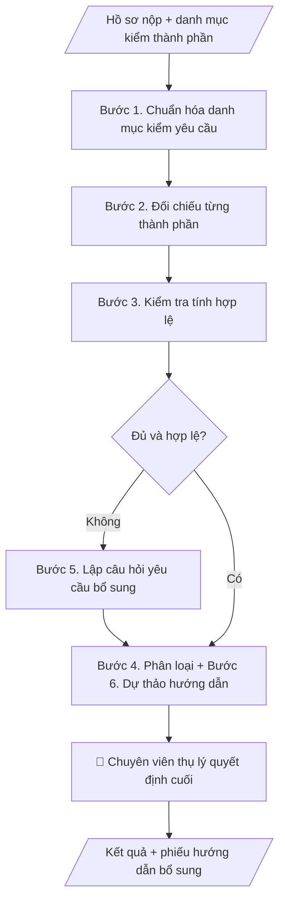

# Kiểm tra đầy đủ hồ sơ

## Khi nào dùng
Khi tiếp nhận bất kỳ bộ hồ sơ nào cần kiểm tra tính đầy đủ, hợp lệ trước khi trình xử lý:
hồ sơ tuyển dụng, bổ nhiệm, khen thưởng, học bổng, miễn giảm học phí, tốt nghiệp, thanh quyết toán...
Áp dụng cho mọi phòng ban — chỉ cần có danh mục kiểm danh mục thành phần.

## Định dạng và file đầu ra

Định dạng đầu ra có thể chọn theo sản phẩm/yêu cầu: .docx, .pdf. Đọc mục “Định dạng bổ sung” trong quy cách đầu ra trước khi chọn.

**Phải tạo file thực tế để tải xuống, không chỉ trả nội dung trong chat.** Định dạng mặc định của skill: **.docx**. Nếu có bảng số liệu nghiệp vụ yêu cầu file bảng tính riêng, tạo thêm Excel theo yêu cầu; không tự tạo file kiểm tra. Không chờ người dùng yêu cầu xuất file lần nữa. Ưu tiên định dạng người dùng chỉ định; đọc quy tắc xuất file tại references/quy-cach-dau-ra.md.

**Chạy qua API (không có công cụ tạo file):** trả đủ nội dung dạng văn bản có tiêu đề, bảng; ứng dụng gọi sẽ xuất file.

## Quy cách đầu ra và thông tin thiếu
Khi dựng file Word/Excel, áp dụng mục “Thể thức và bảng biểu khi dựng file” trong quy cách đầu ra (cỡ chữ từng thành phần, bảng nhiều trang, số trang, phụ lục). Đọc [quy cách và cấu trúc sản phẩm](references/quy-cach-dau-ra.md) trước khi soạn/xuất. File giao chỉ gồm sản phẩm nghiệp vụ được yêu cầu; kiểm tra nội bộ không xuất kèm. Thiếu thông tin thì giữ nguyên trường/mục và chỗ điền theo mẫu gốc (dòng dấu chấm, dấu gạch hoặc ô trống); không tự điền dữ liệu mẫu, số 0, mã chờ xác minh hay dòng chờ ký. Mẫu chuyên ngành còn áp dụng được ưu tiên về cấu trúc, mã biểu và người ký. Bản đầy đủ: [quy tắc chung](references/quy-tac-chung.md).

Khi người dùng yêu cầu bộ slide (.pptx), đọc mục “Xuất PowerPoint (.pptx) khi được yêu cầu” trong quy cách đầu ra.

## Kiểm soát áp dụng và phê duyệt
Trước khi chạy, xác định `ngay_ap_dung`, `loai_hinh_truong`, `quy_che_noi_bo`, `nguon_du_lieu`, `nguoi_kiem_duyet`; chỉ hỏi thông tin liên quan nghiệp vụ, không dùng giá trị giả định thay dữ liệu bắt buộc. Đối chiếu căn cứ pháp lý với văn bản gốc, hiệu lực, điều khoản áp dụng và chuyển tiếp. Bản đầy đủ: [quy tắc chung](references/quy-tac-chung.md).

## Giới hạn và human gate
AI hỗ trợ chuẩn bị và đối chiếu; cán bộ phụ trách kiểm tra dữ liệu/căn cứ, người có thẩm quyền duyệt và ký. Không đánh dấu đã ký, đã duyệt, đã công bố khi chưa có chứng cứ. Dữ liệu sinh viên, sức khỏe, nhân sự, tài chính chỉ dùng theo mục đích và phân quyền, che thông tin định danh khi dùng ví dụ (Luật 91/2025/QH15, hiệu lực 01/01/2026); không tải dữ liệu lên dịch vụ ngoài khi chưa có quyền. Bản đầy đủ: [quy tắc chung](references/quy-tac-chung.md).

## Bối cảnh riêng của VNU-IS

Bản chỉnh cho Trường Quốc tế – ĐHQGHN (VNU-IS), v0.4.2. Dựng từ website công khai và phiếu khảo sát CES còn trống; **chưa có dữ liệu khảo sát thực tế của đơn vị**. Đọc [bối cảnh VNU-IS](references/boi-canh-vnuis.md) trước khi chạy; các mã C1–C8 nằm ở mục 6 của file đó.

- **Đơn vị thường dùng:** Mọi đơn vị trong Trường.
- **Nghiệp vụ trong phiếu CES:** "Hồ sơ: Kiểm tra thành phần hồ sơ đăng ký/xét tuyển" (sheet `05_KS_TT_Tuyen_sinh`). Tần suất gợi ý: Theo hồ sơ/vụ việc. Đầu vào gợi ý: Hồ sơ; danh mục bắt buộc; tiêu chí; biểu mẫu. Khó khăn gợi ý: Tài liệu phân tán, nhiều định dạng; Đọc và đối chiếu thủ công mất thời gian; Dễ thiếu thành phần, sai logic hoặc bỏ sót ngoại lệ; Đầu ra phụ thuộc kinh nghiệm từng cá nhân. Đây là gợi ý có sẵn của CES, chưa phải xác nhận của đơn vị.

**Điều chỉnh khi dùng cho VNU-IS**
- Danh mục thành phần do người dùng nạp theo loại hồ sơ (học vụ, tuyển sinh, nhân sự, đề tài, thanh toán...); skill không tự đặt danh mục.
- Hồ sơ của người học quốc tế hoặc chương trình liên kết: ghi rõ giấy tờ nào do đối tác hoặc cơ quan nước ngoài cấp, cần bản dịch hoặc hợp pháp hóa theo quy định hiện hành (do người phụ trách xác nhận).
- Kết quả là bảng đủ, thiếu, không rõ; không kết luận hồ sơ hợp lệ.

**Chờ xác nhận khi khảo sát**
- Danh mục thành phần của từng loại hồ sơ (C8).
- Quy định về giấy tờ nước ngoài (C2).

Nếu người dùng chưa trả lời mục chờ xác nhận liên quan, hỏi lại; không tự điền giả định.

## Đầu vào (Input)

| Trường | Mô tả | Bắt buộc |
|---|---|---|
| `loai_ho_so` | VD: hồ sơ xét học bổng; hồ sơ bổ nhiệm; hồ sơ thanh quyết toán đề tài... | Có |
| `checklist` | Danh mục thành phần bắt buộc + tiêu chí hợp lệ của từng thành phần | Có |
| `ho_so_hien_co` | Liệt kê từng thành phần hiện có (tên file/mục + tình trạng sơ bộ) | Có |
| `tieu_chi_hop_le` | Quy tắc chung: mẫu biểu, thời hạn hiệu lực, chữ ký, công chứng... | Không |

### Thông tin VNU-IS đã điền sẵn (không hỏi lại)

| Mục | Giá trị mặc định |
|---|---|
| Cơ quan chủ quản; Trường; địa danh | Đại học Quốc gia Hà Nội (ĐHQGHN); Trường Quốc tế – ĐHQGHN (VNU – International School); Hà Nội |
| Đơn vị sử dụng và phối hợp | Mọi đơn vị trong Trường |
| Ngôn ngữ đầu ra | Tiếng Việt là bản gốc; thêm tiếng Anh cho đối tác, người học quốc tế hoặc khi được yêu cầu |
| Người duyệt và ký | Ghi theo vai trò (Trưởng phòng, Phó Hiệu trưởng phụ trách, Hiệu trưởng); tuyến duyệt và thẩm quyền ký chờ C1, C6 |

Nguồn: website và phiếu CES; đổi theo khảo sát thì sửa tại đây và trong `references/boi-canh-vnuis.md`.

## Quy trình

*⏱ là ước tính ban đầu của bộ gốc, chưa đo tại VNU-IS; hiệu chỉnh sau khảo sát.*

**Bước 1. Chuẩn hóa danh mục kiểm yêu cầu**
- Làm gì: với mỗi thành phần trong `checklist`, ghi rõ: tên thành phần, bắt buộc hay không bắt buộc,
  mẫu biểu yêu cầu, điều kiện hợp lệ (chữ ký, dấu, thời hạn hiệu lực), và cách đối chiếu (bản gốc hay bản sao).
- Dùng input: `checklist`, `tieu_chi_hop_le`.
- Vai trò: Chuyên viên thụ lý hồ sơ (đơn vị tiếp nhận hồ sơ) · AI hỗ trợ: chuẩn hóa danh mục kiểm; chuyên viên xác nhận các thành phần thiếu tiêu chí hợp lệ · ⏱ ~10–20 phút + ~15–30 phút xác nhận (ước tính)
- Lưu ý nghiệp vụ: danh mục kiểm là "thước đo" của toàn bộ quy trình — danh mục kiểm mơ hồ thì kết quả đối chiếu
  vô nghĩa; thành phần nào thiếu tiêu chí hợp lệ thì đánh dấu "cần làm rõ" và chuyển chuyên viên xác nhận,
  không tự suy ra.
- → Kết quả bước: danh mục kiểm chuẩn hóa (mỗi thành phần có tiêu chí kiểm tra cụ thể).

**Bước 2. Đối chiếu từng thành phần**
- Làm gì: so từng thành phần trong `ho_so_hien_co` với danh mục kiểm chuẩn hóa, đánh dấu: Có / Thiếu /
  Có nhưng cần kiểm tra kỹ; ghi rõ tên file/mục tương ứng của từng thành phần.
- Dùng input: `checklist` (đã chuẩn hóa ở Bước 1), `ho_so_hien_co`.
- Vai trò: Chuyên viên thụ lý hồ sơ (đơn vị tiếp nhận hồ sơ) · AI hỗ trợ: đối chiếu từng thành phần với danh mục kiểm, đánh dấu Có/Thiếu/Có nhưng cần kiểm tra kỹ · ⏱ ~10–20 phút (ước tính)
- Lưu ý nghiệp vụ: phân biệt "thiếu thành phần" (chưa nộp) với "có nhưng chưa hợp lệ" (nộp rồi nhưng
  sai mẫu/hết hạn) — hai trường hợp này dẫn đến câu hỏi bổ sung khác nhau ở Bước 5.
- → Kết quả bước: bảng đối chiếu sơ bộ (thành phần | trạng thái có/thiếu).

**Bước 3. Kiểm tra tính hợp lệ từng thành phần**
- Làm gì: với mỗi thành phần đã đánh dấu "Có", kiểm tra 4 điểm: đúng mẫu biểu quy định;
  còn thời hạn hiệu lực (VD: giấy xác nhận trong 6 tháng); đủ chữ ký, đóng dấu theo yêu cầu;
  thông tin nhất quán giữa các giấy tờ (họ tên, ngày sinh, mã số...).
- Dùng input: `ho_so_hien_co`, `tieu_chi_hop_le`, `checklist` (đã chuẩn hóa).
- Vai trò: Chuyên viên thụ lý hồ sơ (đơn vị tiếp nhận hồ sơ) · AI hỗ trợ: kiểm tra 4 điểm hợp lệ (mẫu biểu, hiệu lực, chữ ký, nhất quán thông tin) · ⏱ ~15–30 phút (ước tính)
- Lưu ý nghiệp vụ: bẫy thường gặp là giấy tờ "nhìn có vẻ đủ" nhưng đã hết hiệu lực hoặc thiếu xác nhận
  của đơn vị có thẩm quyền; thông tin không khớp giữa các giấy tờ (VD: họ tên viết khác nhau) phải ghi
  cụ thể chỗ khác nhau.
- → Kết quả bước: bảng hợp lệ/không hợp lệ từng thành phần kèm lý do cụ thể.

**Bước 4. Phân loại kết quả tổng thể**
- Làm gì: tổng hợp kết quả Bước 2–3, xếp hồ sơ vào một trong các nhóm: Đủ & hợp lệ / Thiếu thành phần /
  Có thành phần không hợp lệ; đếm số mục cần bổ sung; nêu kết luận tổng thể dự kiến.
- Dùng input: kết quả Bước 2, Bước 3.
- Vai trò: Chuyên viên thụ lý hồ sơ (đơn vị tiếp nhận hồ sơ) · AI hỗ trợ: đề xuất phân loại tổng thể; chuyên viên ra quyết định cuối cùng · ⏱ ~10–15 phút + ~15–30 phút duyệt (ước tính)
- Lưu ý nghiệp vụ: AI chỉ đề xuất phân loại, KHÔNG tự kết luận "hồ sơ đạt" hay "loại hồ sơ" — quyết định
  cuối cùng thuộc chuyên viên thụ lý (human gate).
- → Kết quả bước: kết luận phân loại dự kiến + số lượng mục cần bổ sung.

**Bước 5. Lập câu hỏi yêu cầu bổ sung**
- Làm gì: với mỗi mục thiếu/không hợp lệ, soạn một câu hỏi rõ ràng gửi người nộp: thiếu cái gì,
  theo mẫu nào, xin ở đâu, hạn nộp nào; diễn đạt cụ thể đến mức người nộp đọc là làm được ngay
  (VD: "Thiếu Giấy xác nhận hộ nghèo năm 2026 — mẫu số 01/XN-UBND, còn hiệu lực 6 tháng").
- Dùng input: kết quả Bước 3, Bước 4, `tieu_chi_hop_le`.
- Vai trò: Chuyên viên thụ lý hồ sơ (đơn vị tiếp nhận hồ sơ) · AI hỗ trợ: soạn câu hỏi yêu cầu bổ sung theo từng thành phần · ⏱ ~10–15 phút (ước tính)
- Lưu ý nghiệp vụ: mỗi câu hỏi phải gắn đúng thành phần và đúng lý do; không yêu cầu người nộp
  cung cấp giấy tờ ngoài danh mục `checklist`.
- → Kết quả bước: danh sách câu hỏi bổ sung theo từng thành phần.

**Bước 6. Dự thảo phiếu hướng dẫn hoàn thiện hồ sơ**
- Làm gì: soạn phiếu/văn bản hướng dẫn gửi người nộp: liệt kê các mục cần bổ sung (từ Bước 5),
  ghi rõ hạn bổ sung, nơi nộp bổ sung, và hậu quả nếu quá hạn (nếu quy định có).
- Dùng input: kết quả Bước 5, `loai_ho_so`.
- Vai trò: Chuyên viên thụ lý hồ sơ (đơn vị tiếp nhận hồ sơ) · AI hỗ trợ: soạn dự thảo phiếu hướng dẫn; chuyên viên duyệt trước khi gửi · ⏱ ~10–15 phút + ~15–30 phút duyệt (ước tính)
- Lưu ý nghiệp vụ: phiếu hướng dẫn chỉ là dự thảo — chuyên viên thụ lý duyệt trước khi gửi;
  không tự gửi cho người nộp.
- → Kết quả bước: dự thảo phiếu hướng dẫn hoàn thiện hồ sơ (ghi hạn bổ sung).
## Luồng quy trình (Workflow)

## Đầu ra

File nghiệp vụ thực tế theo định dạng mặc định ở đầu skill hoặc định dạng người dùng yêu cầu, kèm liên kết tải trong phản hồi cuối.

Sản phẩm nghiệp vụ hoàn chỉnh theo [quy cách và cấu trúc](references/quy-cach-dau-ra.md), giữ các trường chưa có dữ liệu ở trạng thái trống. Không xuất kèm danh mục kiểm/phụ lục kiểm tra đầu ra.

## Kiểm tra nội bộ trước khi giao

- [ ] Bảng đối chiếu đầy đủ 4 phần theo cấu trúc sản phẩm tại references/quy-cach-dau-ra.md: tiêu đề (loại hồ sơ, người nộp/đơn vị nộp, ngày kiểm tra, danh mục kiểm áp dụng); bảng đối chiếu (STT | Thành phần | Yêu cầu | Tình trạng | Ghi chú); kết luận tổng thể; danh sách câu hỏi bổ sung + hạn bổ sung.
- [ ] Tình trạng từng thành phần khớp với hồ sơ trong Input: phân biệt đúng "thiếu thành phần" và "có nhưng chưa hợp lệ".
- [ ] Không bịa đặt giấy tờ, không suy đoán hay tự điền nội dung còn thiếu trong hồ sơ.
- [ ] Mỗi câu hỏi yêu cầu bổ sung gắn đúng thành phần và đúng lý do; không yêu cầu người nộp cung cấp giấy tờ ngoài danh mục kiểm tra.
- [ ] Hạn bổ sung rõ ràng (ngày, giờ); nơi nộp bổ sung ghi cụ thể.
- [ ] Đã qua Human gate: chuyên viên thụ lý đã ra quyết định cuối cùng (đạt / yêu cầu bổ sung / từ chối tiếp nhận) kèm lý do.
- [ ] Dự thảo phiếu hướng dẫn chỉ ở trạng thái dự thảo — chưa gửi cho người nộp.
- [ ] Danh mục kiểm danh mục hồ sơ là căn cứ duy nhất; AI không tự thêm/bớt thành phần.

> Tiêu chí đạt: tất cả các ô được đánh dấu.

## Human gate (người kiểm duyệt)
1. **Chuyên viên thụ lý hồ sơ**: là người duy nhất ra quyết định cuối cùng — đạt / yêu cầu bổ sung / từ chối tiếp nhận (ghi lý do).
2. AI chỉ hỗ trợ đối chiếu và soạn dự thảo; không được tự kết luận "hồ sơ đạt" hay "loại hồ sơ".
3. Trường hợp danh mục kiểm chưa rõ hoặc có tình huống ngoại lệ, chuyển chuyên viên xử lý thủ công.

## Giới hạn (guardrails)
- KHÔNG tự phê duyệt hoặc từ chối bất kỳ hồ sơ nào.
- KHÔNG suy đoán, tự điền nội dung còn thiếu trong hồ sơ.
- KHÔNG yêu cầu người nộp cung cấp giấy tờ ngoài danh mục quy định.
- KHÔNG lưu trữ bản sao giấy tờ tùy thân vượt quá phạm vi xử lý hồ sơ (bảo vệ dữ liệu cá nhân).

## Căn cứ & lưu ý
- Danh mục kiểm danh mục hồ sơ do đơn vị nghiệp vụ ban hành là căn cứ duy nhất; AI không tự thêm/bớt thành phần.
- Ví dụ trong skill chỉ để minh họa; không đưa dữ liệu cá nhân thật vào ví dụ. Tên Trường, cơ quan chủ quản và địa danh dùng đúng bảng thông tin VNU-IS đã điền sẵn.

## Quản trị phiên bản
- Phiên bản gói VNU-IS `0.4.2` (cập nhật 2026-10-11), dựa trên skill gốc `kiem-tra-day-du-ho-so` bản `1.3.2`; hồ sơ đầy đủ tại [references/version.json](references/version.json).
- Người phê duyệt nghiệp vụ: **chưa chỉ định**. Trạng thái: dự thảo nghiệp vụ; kiểm tra pháp lý trước thực thi. Ngày cập nhật không đồng nghĩa mọi văn bản đã được rà soát toàn văn.
- Giấy phép theo LICENSE của kho (bản quyền CES Global). Lịch sử thay đổi: CHANGELOG.md.
