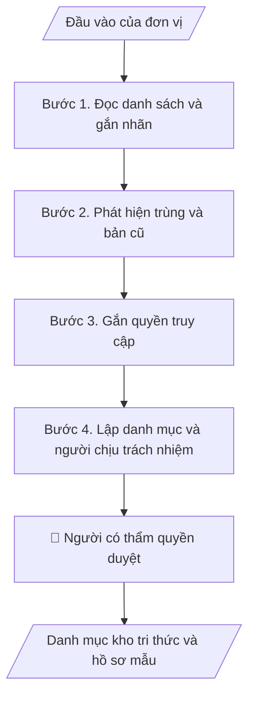

# Danh mục kho tri thức và hồ sơ mẫu

## Khi nào dùng
Khi tài liệu mẫu nằm rải rác ở nhiều nơi và cần một danh mục có người chịu trách nhiệm; khi chuẩn bị đưa tài liệu vào hệ thống hỏi đáp hoặc skill dùng chung.

## Định dạng và file đầu ra

Định dạng đầu ra có thể chọn theo sản phẩm/yêu cầu: .xlsx, .csv, .pdf, .json, .html. Đọc mục “Định dạng bổ sung” trong quy cách đầu ra trước khi chọn.

**Phải tạo file thực tế để tải xuống, không chỉ trả nội dung trong chat.** Định dạng mặc định của skill: **.xlsx**. Nếu yêu cầu gồm cả báo cáo thuyết minh, tạo thêm file Word cho báo cáo; không ghép báo cáo dài vào bảng tính. Không chờ người dùng yêu cầu xuất file lần nữa. Ưu tiên định dạng người dùng chỉ định; đọc quy tắc xuất file tại references/quy-cach-dau-ra.md.

**Chạy qua API (không có công cụ tạo file):** trả đủ nội dung dạng văn bản có tiêu đề, bảng; ứng dụng gọi sẽ xuất file.

## Quy cách đầu ra và thông tin thiếu
Khi dựng file Word/Excel, áp dụng mục “Thể thức và bảng biểu khi dựng file” trong quy cách đầu ra (cỡ chữ từng thành phần, bảng nhiều trang, số trang, phụ lục). Đọc [quy cách và cấu trúc sản phẩm](references/quy-cach-dau-ra.md) trước khi soạn/xuất. File giao chỉ gồm sản phẩm nghiệp vụ được yêu cầu; kiểm tra nội bộ không xuất kèm. Thiếu thông tin thì giữ nguyên trường/mục và chỗ điền theo mẫu gốc (dòng dấu chấm, dấu gạch hoặc ô trống); không tự điền dữ liệu mẫu, số 0, mã chờ xác minh hay dòng chờ ký. Mẫu chuyên ngành còn áp dụng được ưu tiên về cấu trúc, mã biểu và người ký. Bản đầy đủ: [quy tắc chung](references/quy-tac-chung.md).

Khi người dùng yêu cầu bộ slide (.pptx), đọc mục “Xuất PowerPoint (.pptx) khi được yêu cầu” trong quy cách đầu ra.

## Kiểm soát áp dụng và phê duyệt
Trước khi chạy, xác định `ngay_ap_dung`, `loai_hinh_truong`, `quy_che_noi_bo`, `nguon_du_lieu`, `nguoi_kiem_duyet`; chỉ hỏi thông tin liên quan nghiệp vụ, không dùng giá trị giả định thay dữ liệu bắt buộc. Đối chiếu căn cứ pháp lý với văn bản gốc, hiệu lực, điều khoản áp dụng và chuyển tiếp. Bản đầy đủ: [quy tắc chung](references/quy-tac-chung.md).

## Giới hạn và human gate
AI hỗ trợ chuẩn bị và đối chiếu; cán bộ phụ trách kiểm tra dữ liệu/căn cứ, người có thẩm quyền duyệt và ký. Không đánh dấu đã ký, đã duyệt, đã công bố khi chưa có chứng cứ. Dữ liệu sinh viên, sức khỏe, nhân sự, tài chính chỉ dùng theo mục đích và phân quyền, che thông tin định danh khi dùng ví dụ (Luật 91/2025/QH15, hiệu lực 01/01/2026); không tải dữ liệu lên dịch vụ ngoài khi chưa có quyền. Bản đầy đủ: [quy tắc chung](references/quy-tac-chung.md).

## Bối cảnh riêng của VNU-IS

Skill mới cho Trường Quốc tế – ĐHQGHN (VNU-IS), v0.4.2. Dựng từ website công khai và phiếu khảo sát CES còn trống; **chưa có dữ liệu khảo sát thực tế của đơn vị**. Đọc [bối cảnh VNU-IS](references/boi-canh-vnuis.md) trước khi chạy; các mã C1–C8 nằm ở mục 6 của file đó.

- **Đơn vị thường dùng:** Viện ĐMST&CGCN; Phòng KHCN và Hợp tác phát triển; Văn phòng (TC&QT).
- **Nghiệp vụ trong phiếu CES:** "Quản trị hồ sơ – tri thức: Lưu trữ, phân loại và tái sử dụng hồ sơ, biểu mẫu, phương pháp và bài học" (sheet `08_KS_Vien_DMST_CGCN`). Tần suất gợi ý: Thường xuyên. Đầu vào gợi ý: Hợp đồng; proposal; báo cáo; biểu mẫu; tài liệu chuyên môn; quy tắc phân loại. Khó khăn gợi ý: Khó tìm bản mới nhất; trùng lặp; thiếu cấu trúc và phân quyền thống nhất.

**Chờ xác nhận khi khảo sát**
- Khung phân loại và nơi lưu tài liệu (C5, C8).
- Quy định phân quyền tài liệu (C5).

Nếu người dùng chưa trả lời mục chờ xác nhận liên quan, hỏi lại; không tự điền giả định.

## Đầu vào (Input)

| Trường | Mô tả | Bắt buộc |
|---|---|---|
| `danh_sach_tai_lieu` | Danh sách file: tên, đường dẫn hoặc nơi lưu, ngày sửa, đơn vị tạo | Có |
| `khung_phan_loai` | Khung phân loại do Trường quyết: nghiệp vụ, đơn vị, loại tài liệu | Có |
| `quy_tac_dat_ten` | Quy tắc đặt tên và đánh phiên bản nếu có | Không |
| `danh_sach_ban_chinh` | Tài liệu đã được xác nhận là bản chính thức | Không |
| `quyen_truy_cap` | Phân quyền đọc: ai được xem tài liệu nào | Có |

### Thông tin VNU-IS đã điền sẵn (không hỏi lại)

| Mục | Giá trị mặc định |
|---|---|
| Cơ quan chủ quản; Trường; địa danh | Đại học Quốc gia Hà Nội (ĐHQGHN); Trường Quốc tế – ĐHQGHN (VNU – International School); Hà Nội |
| Đơn vị sử dụng và phối hợp | Viện ĐMST&CGCN; Phòng KHCN và Hợp tác phát triển; Văn phòng (TC&QT) |
| Ngôn ngữ đầu ra | Tiếng Việt là bản gốc; thêm tiếng Anh cho đối tác, người học quốc tế hoặc khi được yêu cầu |
| Người duyệt và ký | Ghi theo vai trò (Trưởng phòng, Phó Hiệu trưởng phụ trách, Hiệu trưởng); tuyến duyệt và thẩm quyền ký chờ C1, C6 |

Nguồn: website và phiếu CES; đổi theo khảo sát thì sửa tại đây và trong `references/boi-canh-vnuis.md`.

## Quy trình

*⏱ là ước tính ban đầu của bộ gốc, chưa đo tại VNU-IS; hiệu chỉnh sau khảo sát.*

**Bước 1. Đọc danh sách và gắn nhãn**
- Làm gì: Gán nhãn theo khung phân loại; tài liệu không xếp được đưa vào nhóm chờ.
- Dùng input: `danh_sach_tai_lieu`, `khung_phan_loai`
- Vai trò: Chuyên viên · AI hỗ trợ: gắn nhãn đề xuất · ⏱ thời gian do đơn vị ước tính sau khảo sát
- Lưu ý nghiệp vụ: Chỉ dựa tên và thông tin có trong danh sách; không mở nội dung nhạy cảm khi chưa được phép.
- → Kết quả bước: Danh mục gắn nhãn.

**Bước 2. Phát hiện trùng và bản cũ**
- Làm gì: So tên và ngày để tìm bản trùng hoặc bản cũ; đề xuất bản dùng chính, đối chiếu danh sách bản chính nếu có.
- Dùng input: `danh_sach_tai_lieu`, `danh_sach_ban_chinh`, `quy_tac_dat_ten`
- Vai trò: Chuyên viên · AI hỗ trợ: so khớp · ⏱ thời gian do đơn vị ước tính sau khảo sát
- Lưu ý nghiệp vụ: Không xóa hay gộp file; chỉ đề xuất.
- → Kết quả bước: Danh sách trùng và đề xuất.

**Bước 3. Gắn quyền truy cập**
- Làm gì: Mỗi tài liệu gắn mức truy cập theo bảng quyền; thiếu quy định thì ghi "chưa xác định".
- Dùng input: `quyen_truy_cap`
- Vai trò: Trưởng đơn vị · AI hỗ trợ: đối chiếu quyền · ⏱ thời gian do đơn vị ước tính sau khảo sát
- Lưu ý nghiệp vụ: Không mở rộng quyền xem.
- → Kết quả bước: Cột quyền truy cập.

**Bước 4. Lập danh mục và người chịu trách nhiệm**
- Làm gì: Tạo danh mục cuối: nhãn, bản chính, người chịu trách nhiệm cập nhật, ngày rà gần nhất.
- Dùng input: `danh_sach_ban_chinh`
- Vai trò: Trưởng đơn vị · AI hỗ trợ: lập danh mục · ⏱ thời gian do đơn vị ước tính sau khảo sát
- Lưu ý nghiệp vụ: Người chịu trách nhiệm do đơn vị chỉ định, không tự gán tên.
- → Kết quả bước: Danh mục kho tri thức.

## Luồng quy trình (Workflow)

## Đầu ra

File nghiệp vụ thực tế theo định dạng mặc định ở đầu skill hoặc định dạng người dùng yêu cầu, kèm liên kết tải trong phản hồi cuối.

Sản phẩm nghiệp vụ hoàn chỉnh theo [quy cách và cấu trúc](references/quy-cach-dau-ra.md), giữ các trường chưa có dữ liệu ở trạng thái trống. Không xuất kèm danh mục kiểm/phụ lục kiểm tra đầu ra.

## Kiểm tra nội bộ trước khi giao

- [ ] Bố cục khớp cấu trúc tại references/quy-cach-dau-ra.md.
- [ ] Mỗi tài liệu có đúng một nhãn chính.
- [ ] Quyền truy cập khớp bảng quyền.
- [ ] Đề xuất xóa hoặc gộp chỉ là đề xuất.
- [ ] Không có nội dung tài liệu nhạy cảm trong danh mục.
- [ ] Đã qua Human gate.

Tiêu chí đạt = tất cả các ô được đánh dấu.

## Human gate (người kiểm duyệt)
- **Trưởng đơn vị** xác nhận bản chính và người chịu trách nhiệm.
- **Người phụ trách an toàn thông tin** xác nhận phân quyền.

## Giới hạn (guardrails)
- KHÔNG tải tài liệu chứa dữ liệu cá nhân lên dịch vụ ngoài khi chưa có quyền (C5).
- KHÔNG xóa hoặc đổi tên file gốc.

## Căn cứ & lưu ý
- Căn cứ pháp lý và quy định nội bộ do người dùng cung cấp; chưa có thì ghi `[CẦN XÁC MINH]`, không suy diễn.
- Ví dụ trong skill chỉ để minh họa; không đưa dữ liệu cá nhân thật vào ví dụ. Tên Trường, cơ quan chủ quản và địa danh dùng đúng bảng thông tin VNU-IS đã điền sẵn.

## Quản trị phiên bản
- Phiên bản gói VNU-IS `0.4.2` (cập nhật 2026-10-11); hồ sơ tại [references/version.json](references/version.json). Skill mới, không có bản gốc trong bộ 171 skill; dùng khung và quy cách đầu ra của skill `funnel-theo-doi-thi-sinh`.
- Người phê duyệt nghiệp vụ: **chưa chỉ định**. Trạng thái: dự thảo nghiệp vụ, chờ khảo sát; kiểm tra pháp lý trước thực thi.
- Giấy phép theo LICENSE của kho (bản quyền CES Global).
