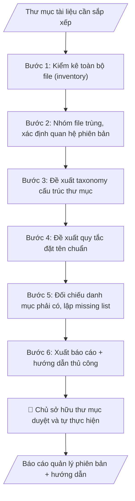

# Quản lý file & phiên bản (chỉ đọc)

## Khi nào dùng
Khi thư mục tài liệu của đơn vị trở nên lộn xộn (nhiều bản "final", "final2", "mới nhất"...),
cần kiểm kê, sắp xếp lại và xây dựng quy tắc quản lý — nhưng yêu cầu an toàn tuyệt đối:
AI chỉ phân tích và đề xuất, con người thực hiện thay đổi thủ công.

## Định dạng và file đầu ra

Định dạng đầu ra có thể chọn theo sản phẩm/yêu cầu: .xlsx, .csv, .pdf, .json, .html. Đọc mục “Định dạng bổ sung” trong quy cách đầu ra trước khi chọn.

**Phải tạo file thực tế để tải xuống, không chỉ trả nội dung trong chat.** Định dạng mặc định của skill: **.xlsx**. Nếu yêu cầu gồm cả báo cáo thuyết minh, tạo thêm file Word cho báo cáo; không ghép báo cáo dài vào bảng tính. Không chờ người dùng yêu cầu xuất file lần nữa. Ưu tiên định dạng người dùng chỉ định; đọc quy tắc xuất file tại references/quy-cach-dau-ra.md.

**Chạy qua API (không có công cụ tạo file):** trả đủ nội dung dạng văn bản có tiêu đề, bảng; ứng dụng gọi sẽ xuất file.

## Quy cách đầu ra và thông tin thiếu
Khi dựng file Word/Excel, áp dụng mục “Thể thức và bảng biểu khi dựng file” trong quy cách đầu ra (cỡ chữ từng thành phần, bảng nhiều trang, số trang, phụ lục). Đọc [quy cách và cấu trúc sản phẩm](references/quy-cach-dau-ra.md) trước khi soạn/xuất. File giao chỉ gồm sản phẩm nghiệp vụ được yêu cầu; kiểm tra nội bộ không xuất kèm. Thiếu thông tin thì giữ nguyên trường/mục và chỗ điền theo mẫu gốc (dòng dấu chấm, dấu gạch hoặc ô trống); không tự điền dữ liệu mẫu, số 0, mã chờ xác minh hay dòng chờ ký. Mẫu chuyên ngành còn áp dụng được ưu tiên về cấu trúc, mã biểu và người ký. Bản đầy đủ: [quy tắc chung](references/quy-tac-chung.md).

Khi người dùng yêu cầu bộ slide (.pptx), đọc mục “Xuất PowerPoint (.pptx) khi được yêu cầu” trong quy cách đầu ra.

## Kiểm soát áp dụng và phê duyệt
Trước khi chạy, xác định `ngay_ap_dung`, `loai_hinh_truong`, `quy_che_noi_bo`, `nguon_du_lieu`, `nguoi_kiem_duyet`; chỉ hỏi thông tin liên quan nghiệp vụ, không dùng giá trị giả định thay dữ liệu bắt buộc. Đối chiếu căn cứ pháp lý với văn bản gốc, hiệu lực, điều khoản áp dụng và chuyển tiếp. Bản đầy đủ: [quy tắc chung](references/quy-tac-chung.md).

## Giới hạn và human gate
AI hỗ trợ chuẩn bị và đối chiếu; cán bộ phụ trách kiểm tra dữ liệu/căn cứ, người có thẩm quyền duyệt và ký. Không đánh dấu đã ký, đã duyệt, đã công bố khi chưa có chứng cứ. Dữ liệu sinh viên, sức khỏe, nhân sự, tài chính chỉ dùng theo mục đích và phân quyền, che thông tin định danh khi dùng ví dụ (Luật 91/2025/QH15, hiệu lực 01/01/2026); không tải dữ liệu lên dịch vụ ngoài khi chưa có quyền. Bản đầy đủ: [quy tắc chung](references/quy-tac-chung.md).

## Bối cảnh riêng của VNU-IS

Bản chỉnh cho Trường Quốc tế – ĐHQGHN (VNU-IS), v0.4.2. Dựng từ website công khai và phiếu khảo sát CES còn trống; **chưa có dữ liệu khảo sát thực tế của đơn vị**. Đọc [bối cảnh VNU-IS](references/boi-canh-vnuis.md) trước khi chạy; các mã C1–C8 nằm ở mục 6 của file đó.

- **Đơn vị thường dùng:** Mọi đơn vị trong Trường; Viện ĐMST&CGCN (quản trị hồ sơ, tri thức).
- **Nghiệp vụ trong phiếu CES:** "Quản trị hồ sơ – tri thức: Lưu trữ, phân loại và tái sử dụng hồ sơ, biểu mẫu, phương pháp và bài học" (sheet `08_KS_Vien_DMST_CGCN`). Tần suất gợi ý: Thường xuyên. Đầu vào gợi ý: Hợp đồng; proposal; báo cáo; biểu mẫu; tài liệu chuyên môn; quy tắc phân loại. Khó khăn gợi ý: Khó tìm bản mới nhất; trùng lặp; thiếu cấu trúc và phân quyền thống nhất. Đây là gợi ý có sẵn của CES, chưa phải xác nhận của đơn vị.

**Điều chỉnh khi dùng cho VNU-IS**
- Chạy ở chế độ chỉ đọc trên thư mục người dùng chỉ định; không đổi tên hay xóa file thật.
- Quy tắc đặt tên gợi ý phải gồm đơn vị, loại tài liệu, kỳ hoặc năm học, phiên bản và ngôn ngữ (Việt, Anh) vì tài liệu của Trường thường song ngữ.
- Tài liệu có dữ liệu cá nhân hoặc bí mật đối tác: gắn nhãn hạn chế, không đưa vào bảng tra chung.

**Chờ xác nhận khi khảo sát**
- Nơi lưu tài liệu hiện nay (ổ chung, E-Office, đám mây) (C5).
- Quy tắc phân quyền truy cập (C5).

Nếu người dùng chưa trả lời mục chờ xác nhận liên quan, hỏi lại; không tự điền giả định.

## Đầu vào (Input)

| Trường | Mô tả | Bắt buộc |
|---|---|---|
| `mo_ta_thu_muc` | Mô tả cấu trúc thư mục hiện tại (các thư mục con, loại tài liệu) | Có |
| `danh_sach_file` | Liệt kê file (tên, ngày sửa, dung lượng — không cần nội dung) | Có |
| `quy_tac_hien_tai` | Quy tắc đặt tên/lưu trữ đang áp dụng (nếu có) | Không |
| `chinh_sach_luu_tru` | Thời hạn lưu trữ, phân loại mật (nếu có) | Không |

### Thông tin VNU-IS đã điền sẵn (không hỏi lại)

| Mục | Giá trị mặc định |
|---|---|
| Cơ quan chủ quản; Trường; địa danh | Đại học Quốc gia Hà Nội (ĐHQGHN); Trường Quốc tế – ĐHQGHN (VNU – International School); Hà Nội |
| Đơn vị sử dụng và phối hợp | Mọi đơn vị trong Trường; Viện ĐMST&CGCN (quản trị hồ sơ, tri thức) |
| Ngôn ngữ đầu ra | Tiếng Việt là bản gốc; thêm tiếng Anh cho đối tác, người học quốc tế hoặc khi được yêu cầu |
| Người duyệt và ký | Ghi theo vai trò (Trưởng phòng, Phó Hiệu trưởng phụ trách, Hiệu trưởng); tuyến duyệt và thẩm quyền ký chờ C1, C6 |

Nguồn: website và phiếu CES; đổi theo khảo sát thì sửa tại đây và trong `references/boi-canh-vnuis.md`.

## Quy trình

*⏱ là ước tính ban đầu của bộ gốc, chưa đo tại VNU-IS; hiệu chỉnh sau khảo sát.*

**Bước 1. Kiểm kê toàn bộ file (inventory)**
- Làm gì: Từ `mo_ta_thu_muc` và `danh_sach_file`, lập bảng kiểm kê: tên file, thư mục chứa, ngày sửa đổi cuối, dung lượng, loại tài liệu suy từ tên/mô tả; đánh dấu file có tên bất thường (ký tự lạ, thiếu đuôi mở rộng) hoặc thiếu ngày sửa.
- Dùng input: `mo_ta_thu_muc`, `danh_sach_file`.
- Vai trò: Chủ sở hữu thư mục · AI hỗ trợ: kiểm kê tự động toàn bộ file từ metadata (tên, ngày sửa, dung lượng) · ⏱ ~15–30 phút (ước tính)
- Lưu ý nghiệp vụ: chỉ làm việc với metadata (tên, ngày, dung lượng) — tuyệt đối không mở nội dung file nhạy cảm; file thiếu ngày sửa ghi rõ "không xác định" thay vì đoán.
- → Kết quả bước: Bảng inventory đầy đủ — đầu vào cho mọi bước sau.

**Bước 2. Phát hiện trùng lặp và xác định quan hệ phiên bản**
- Làm gì: Nhóm các file có tên gốc tương tự nhau (bỏ hậu tố kiểu final/final2/mới nhất/chốt/sửa) thành từng nhóm phiên bản; sắp xếp trong mỗi nhóm theo ngày sửa đổi; đề xuất "bản mới nhất dự kiến" (ngày mới nhất) kèm mức tin cậy; ghi rõ nhóm nào chưa chắc chắn, cần chủ sở hữu xác nhận.
- Dùng input: `danh_sach_file`, `quy_tac_hien_tai`.
- Vai trò: Chủ sở hữu thư mục · AI hỗ trợ: nhóm file theo tên gốc, sắp xếp theo ngày, đề xuất bản mới nhất kèm mức tin cậy · ⏱ ~15–30 phút (ước tính)
- Lưu ý nghiệp vụ: ngày sửa mới nhất chưa chắc là bản đúng nhất (có thể ai đó mở–lưu nhầm) — mọi kết luận đều ghi "dự kiến, cần xác nhận"; không suy đoán về khác biệt nội dung giữa các bản khi chưa mở file.
- → Kết quả bước: Version map sơ bộ (nhóm phiên bản + bản mới nhất dự kiến).

**Bước 3. Đề xuất taxonomy cấu trúc thư mục**
- Làm gì: Căn cứ loại tài liệu trong bảng inventory, thiết kế cấu trúc thư mục đề xuất theo loại tài liệu / năm / trạng thái (VD: `/VanBan2026/DaBanHanh/`, `/DuThao/`, `/ThamKhao/`); mỗi thư mục ghi rõ tiêu chí file nào được xếp vào.
- Dùng input: `mo_ta_thu_muc`, `chinh_sach_luu_tru` (bảng inventory từ bước 1).
- Vai trò: Chủ sở hữu thư mục · AI hỗ trợ: thiết kế taxonomy thư mục đề xuất (không quá 3 cấp) + tiêu chí xếp file · ⏱ ~15–25 phút (ước tính)
- Lưu ý nghiệp vụ: taxonomy phải đơn giản, không quá 3 cấp sâu; tách riêng thư mục Tham khảo/Lưu trữ để tài liệu cũ không lẫn với văn bản đang hiệu lực; tôn trọng phân loại mật trong `chinh_sach_luu_tru`.
- → Kết quả bước: Sơ đồ taxonomy đề xuất + tiêu chí xếp file từng thư mục.

**Bước 4. Đề xuất quy tắc đặt tên chuẩn**
- Làm gì: Xây dựng mẫu tên file chuẩn (VD: `YYYYMMDD_Loai_SoKyHieu_TrichYeu_vN.ext`); quy định đánh phiên bản bằng v1, v2... thay vì "final2"; lập bảng chuyển đổi tên cũ → tên mới cho từng nhóm trong version map.
- Dùng input: `quy_tac_hien_tai` (version map từ bước 2).
- Vai trò: Chủ sở hữu thư mục · AI hỗ trợ: xây dựng mẫu tên file chuẩn + bảng chuyển đổi tên cũ → tên mới · ⏱ ~15–25 phút (ước tính)
- Lưu ý nghiệp vụ: tên file không dấu, không khoảng trắng (dùng gạch nối/gạch dưới), ngày đặt ở đầu để sắp xếp tự động; số/ký hiệu văn bản giữ nguyên định dạng gốc để tra cứu được.
- → Kết quả bước: Naming plan (mẫu tên chuẩn + bảng đối chiếu tên cũ → tên mới).

**Bước 5. Đối chiếu danh mục phải có, lập missing list**
- Làm gì: So bảng inventory với danh mục tài liệu bắt buộc (sổ văn bản đi/đến, danh mục hồ sơ theo quy định lưu trữ trong `chinh_sach_luu_tru`); liệt kê tài liệu còn thiếu theo từng nhóm, ghi rõ thiếu số/ký hiệu nào.
- Dùng input: `danh_sach_file`, `chinh_sach_luu_tru`.
- Vai trò: Chuyên viên văn thư / Chủ sở hữu thư mục · AI hỗ trợ: đối chiếu inventory với danh mục bắt buộc, lập missing list · ⏱ ~10–20 phút (ước tính)
- Lưu ý nghiệp vụ: chỉ liệt kê thiếu khi có căn cứ (danh mục bắt buộc) — không suy đoán "đáng lẽ phải có"; phân biệt "thiếu thật" với "đặt tên khác nên chưa nhận ra".
- → Kết quả bước: Missing list theo nhóm tài liệu.

**Bước 6. Xuất báo cáo và hướng dẫn thực hiện thủ công**
- Làm gì: Gộp inventory, version map, naming plan, taxonomy, missing list thành báo cáo quản lý phiên bản theo cấu trúc sản phẩm tại references/quy-cach-dau-ra.md; viết danh mục kiểm hướng dẫn từng bước để chủ sở hữu tự thực hiện (xác nhận bản mới nhất → đổi tên → sắp xếp thư mục), ghi rõ AI không thực hiện bất kỳ thao tác nào trên file.
- Dùng input: (kết quả các bước 1–5).
- Vai trò: Chủ sở hữu thư mục · AI hỗ trợ: xuất báo cáo quản lý phiên bản + danh mục kiểm hướng dẫn thực hiện thủ công chi tiết · ⏱ ~15–25 phút (ước tính)
- Lưu ý nghiệp vụ: hướng dẫn phải chi tiết đến mức người không rành công nghệ cũng làm được; nhấn mạnh sao lưu (backup) trước khi đổi tên/di chuyển; chế độ CHỈ ĐỌC là tuyệt đối.
- → Kết quả bước: Báo cáo quản lý phiên bản hoàn chỉnh — sản phẩm cuối.
## Luồng quy trình (Workflow)

## Đầu ra

File nghiệp vụ thực tế theo định dạng mặc định ở đầu skill hoặc định dạng người dùng yêu cầu, kèm liên kết tải trong phản hồi cuối.

Sản phẩm nghiệp vụ hoàn chỉnh theo [quy cách và cấu trúc](references/quy-cach-dau-ra.md), giữ các trường chưa có dữ liệu ở trạng thái trống. Không xuất kèm danh mục kiểm/phụ lục kiểm tra đầu ra.

## Kiểm tra nội bộ trước khi giao

- [ ] Báo cáo đầy đủ 6 phần theo cấu trúc sản phẩm tại references/quy-cach-dau-ra.md: thông tin đợt kiểm kê (phạm vi, thời gian, tổng số file); file bảng tra; version map + mức tin cậy; naming plan + taxonomy đề xuất; missing list; hướng dẫn thực hiện thủ công.
- [ ] Version map nhóm đúng các phiên bản của cùng một tài liệu; bản mới nhất ghi "dự kiến, cần chủ sở hữu xác nhận", kèm mức tin cậy.
- [ ] Naming plan có mẫu tên file chuẩn (ngày ở đầu, không dấu, không khoảng trắng) + bảng chuyển đổi tên cũ → tên mới cho từng nhóm.
- [ ] Missing list chỉ liệt kê khi có căn cứ (danh mục bắt buộc trong chính sách lưu trữ); phân biệt "thiếu thật" với "đặt tên khác nên chưa nhận ra".
- [ ] Chế độ CHỈ ĐỌC tuyệt đối: chỉ làm việc với metadata (không mở nội dung file nhạy cảm); không xóa, không đổi tên, không di chuyển, không ghi đè bất kỳ file nào.
- [ ] Hướng dẫn thủ công chi tiết đến mức người không rành công nghệ cũng làm được; nhấn mạnh sao lưu (backup) trước khi đổi tên/di chuyển.
- [ ] Đã qua Human gate: chủ sở hữu thư mục đã duyệt toàn bộ version map và naming plan trước khi làm bất kỳ thay đổi nào.

> Tiêu chí đạt: tất cả các ô được đánh dấu.

## Human gate (người kiểm duyệt)
1. **Chủ sở hữu thư mục** (trưởng đơn vị hoặc người được phân công): duyệt toàn bộ version map,
   naming plan trước khi làm bất cứ thay đổi nào.
2. Mọi thao tác đổi tên/di chuyển/xóa đều do con người thực hiện thủ công theo hướng dẫn;
   AI không được thực hiện hoặc "hỗ trợ chạy lệnh" thay.

## Giới hạn (guardrails)
- CHẾ ĐỘ CHỈ ĐỌC là tuyệt đối: KHÔNG xóa, KHÔNG di chuyển, KHÔNG đổi tên, KHÔNG ghi đè
  bất kỳ file nào dưới mọi hình thức.
- KHÔNG truy cập các thư mục/file được phân loại mật hoặc hạn chế truy cập.
- KHÔNG mở nội dung file nhạy cảm (hồ sơ cá nhân, tài chính chi tiết) — chỉ làm việc với tên file
  và metadata.
- Khi không chắc file nào là bản mới nhất, ghi rõ "cần chủ sở hữu xác nhận", không tự kết luận.

## Căn cứ & lưu ý
- Quy tắc đặt tên sau khi duyệt nên ban hành thành văn bản nội bộ của đơn vị để mọi người cùng theo.
- Nên chạy kiểm kê định kỳ (mỗi quý) để thư mục không lộn xộn trở lại.
- Ví dụ trong skill chỉ để minh họa; không đưa dữ liệu cá nhân thật vào ví dụ. Tên Trường, cơ quan chủ quản và địa danh dùng đúng bảng thông tin VNU-IS đã điền sẵn.

## Quản trị phiên bản
- Phiên bản gói VNU-IS `0.4.2` (cập nhật 2026-10-11), dựa trên skill gốc `quan-ly-phien-ban-tai-lieu` bản `1.3.2`; hồ sơ đầy đủ tại [references/version.json](references/version.json).
- Người phê duyệt nghiệp vụ: **chưa chỉ định**. Trạng thái: dự thảo nghiệp vụ; kiểm tra pháp lý trước thực thi. Ngày cập nhật không đồng nghĩa mọi văn bản đã được rà soát toàn văn.
- Giấy phép theo LICENSE của kho (bản quyền CES Global). Lịch sử thay đổi: CHANGELOG.md.
