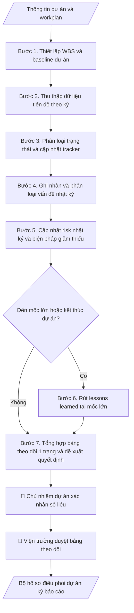

# Quản trị dự án

## Khi nào dùng
Khi Viện ĐMST & CGCN (hoặc đơn vị tương đương) cần quản trị một dự án: theo dõi tiến độ các gói
việc, ghi nhận vấn đề/rủi ro, rút bài học kinh nghiệm, tổng hợp bảng theo dõi báo cáo.

## Định dạng và file đầu ra

Định dạng đầu ra có thể chọn theo sản phẩm/yêu cầu: .xlsx, .csv, .pdf, .json, .html. Đọc mục “Định dạng bổ sung” trong quy cách đầu ra trước khi chọn.

**Phải tạo file thực tế để tải xuống, không chỉ trả nội dung trong chat.** Định dạng mặc định của skill: **.xlsx**. Nếu yêu cầu gồm cả báo cáo thuyết minh, tạo thêm file Word cho báo cáo; không ghép báo cáo dài vào bảng tính. Không chờ người dùng yêu cầu xuất file lần nữa. Ưu tiên định dạng người dùng chỉ định; đọc quy tắc xuất file tại references/quy-cach-dau-ra.md.

**Chạy qua API (không có công cụ tạo file):** trả đủ nội dung dạng văn bản có tiêu đề, bảng; ứng dụng gọi sẽ xuất file.

## Quy cách đầu ra và thông tin thiếu
Khi dựng file Word/Excel, áp dụng mục “Thể thức và bảng biểu khi dựng file” trong quy cách đầu ra (cỡ chữ từng thành phần, bảng nhiều trang, số trang, phụ lục). Đọc [quy cách và cấu trúc sản phẩm](references/quy-cach-dau-ra.md) trước khi soạn/xuất. File giao chỉ gồm sản phẩm nghiệp vụ được yêu cầu; kiểm tra nội bộ không xuất kèm. Thiếu thông tin thì giữ nguyên trường/mục và chỗ điền theo mẫu gốc (dòng dấu chấm, dấu gạch hoặc ô trống); không tự điền dữ liệu mẫu, số 0, mã chờ xác minh hay dòng chờ ký. Mẫu chuyên ngành còn áp dụng được ưu tiên về cấu trúc, mã biểu và người ký. Bản đầy đủ: [quy tắc chung](references/quy-tac-chung.md).

Khi người dùng yêu cầu bộ slide (.pptx), đọc mục “Xuất PowerPoint (.pptx) khi được yêu cầu” trong quy cách đầu ra.

## Kiểm soát áp dụng và phê duyệt
Trước khi chạy, xác định `ngay_ap_dung`, `loai_hinh_truong`, `quy_che_noi_bo`, `nguon_du_lieu`, `nguoi_kiem_duyet`; chỉ hỏi thông tin liên quan nghiệp vụ, không dùng giá trị giả định thay dữ liệu bắt buộc. Đối chiếu căn cứ pháp lý với văn bản gốc, hiệu lực, điều khoản áp dụng và chuyển tiếp. Bản đầy đủ: [quy tắc chung](references/quy-tac-chung.md).

## Giới hạn và human gate
AI hỗ trợ chuẩn bị và đối chiếu; cán bộ phụ trách kiểm tra dữ liệu/căn cứ, người có thẩm quyền duyệt và ký. Không đánh dấu đã ký, đã duyệt, đã công bố khi chưa có chứng cứ. Dữ liệu sinh viên, sức khỏe, nhân sự, tài chính chỉ dùng theo mục đích và phân quyền, che thông tin định danh khi dùng ví dụ (Luật 91/2025/QH15, hiệu lực 01/01/2026); không tải dữ liệu lên dịch vụ ngoài khi chưa có quyền. Bản đầy đủ: [quy tắc chung](references/quy-tac-chung.md).

## Bối cảnh riêng của VNU-IS

Bản chỉnh cho Trường Quốc tế – ĐHQGHN (VNU-IS), v0.4.2. Dựng từ website công khai và phiếu khảo sát CES còn trống; **chưa có dữ liệu khảo sát thực tế của đơn vị**. Đọc [bối cảnh VNU-IS](references/boi-canh-vnuis.md) trước khi chạy; các mã C1–C8 nằm ở mục 6 của file đó.

- **Đơn vị thường dùng:** Viện ĐMST&CGCN; Phòng KHCN&HTPT.
- **Nghiệp vụ trong phiếu CES:** "Vận hành dự án: Theo dõi tiến độ, sản phẩm bàn giao, vấn đề và trách nhiệm các bên" (sheet `08_KS_Vien_DMST_CGCN`). Tần suất gợi ý: Hàng tuần/tháng. Đầu vào gợi ý: Kế hoạch; hợp đồng; biên bản; báo cáo tiến độ; danh sách nhiệm vụ. Khó khăn gợi ý: Cập nhật thủ công; khó hợp nhất trạng thái và phát hiện chậm tiến độ. Đây là gợi ý có sẵn của CES, chưa phải xác nhận của đơn vị.

**Điều chỉnh khi dùng cho VNU-IS**
- Sổ theo dõi dự án (phạm vi, mốc, rủi ro, thay đổi) dùng chung cho dự án của Viện và Phòng; thay đổi phạm vi phải có người duyệt ghi tên vai trò.
- Chỉ dùng khi đơn vị có từ hai dự án chạy cùng lúc, nếu không bảng riêng từng dự án là đủ.

**Chờ xác nhận khi khảo sát**
- Danh sách dự án đang chạy (C8).
- Người quyết định thay đổi phạm vi (C6).

Nếu người dùng chưa trả lời mục chờ xác nhận liên quan, hỏi lại; không tự điền giả định.

## Đầu vào (Input)

| Trường | Mô tả | Bắt buộc |
|---|---|---|
| `ten_du_an` | Tên dự án + mã dự án | Có |
| `chu_du_an` | Chủ nhiệm / quản lý dự án | Có |
| `muc_tieu` | Mục tiêu và phạm vi dự án | Có |
| `workplan` | Danh sách gói việc: tên, mốc hoàn thành, người phụ trách | Có |
| `ngan_sach` | Tổng ngân sách và phân bổ theo gói việc | Không |
| `ky_bao_cao` | Chu kỳ cập nhật (tuần/tháng) | Không (mặc định: tháng) |
| `nguong_trang_thai` | Ngưỡng chênh lệch (điểm % thực tế so với kế hoạch) để phân loại 4 trạng thái | Không (thiếu thì chỉ tính chênh lệch, để trống trạng thái chờ chủ nhiệm xác nhận; không tự đặt ngưỡng) |

### Thông tin VNU-IS đã điền sẵn (không hỏi lại)

| Mục | Giá trị mặc định |
|---|---|
| Cơ quan chủ quản; Trường; địa danh | Đại học Quốc gia Hà Nội (ĐHQGHN); Trường Quốc tế – ĐHQGHN (VNU – International School); Hà Nội |
| Đơn vị sử dụng và phối hợp | Viện ĐMST&CGCN; Phòng KHCN&HTPT |
| Ngôn ngữ đầu ra | Tiếng Việt là bản gốc; thêm tiếng Anh cho đối tác, người học quốc tế hoặc khi được yêu cầu |
| Người duyệt và ký | Ghi theo vai trò (Trưởng phòng, Phó Hiệu trưởng phụ trách, Hiệu trưởng); tuyến duyệt và thẩm quyền ký chờ C1, C6 |

Nguồn: website và phiếu CES; đổi theo khảo sát thì sửa tại đây và trong `references/boi-canh-vnuis.md`.

## Quy trình

*⏱ là ước tính ban đầu của bộ gốc, chưa đo tại VNU-IS; hiệu chỉnh sau khảo sát.*

**Bước 1. Thiết lập WBS và baseline dự án**
- Làm gì: Chia dự án thành các gói việc (WP) từ `workplan`; mỗi gói việc ghi rõ: tên, mốc
  hoàn thành (ngày cụ thể), người phụ trách, sản phẩm bàn giao đo đếm được, ngân sách phân
  bổ (nếu có `ngan_sach`). Chốt bảng này làm "baseline" (kế hoạch gốc) để mọi kỳ sau so sánh.
- Dùng input: `ten_du_an`, `chu_du_an`, `muc_tieu`, `workplan`, `ngan_sach`.
- Vai trò: Chủ nhiệm dự án · AI hỗ trợ: soạn bảng WBS dự thảo từ workplan · ⏱ 2–3 giờ (ước tính)
- Lưu ý nghiệp vụ: mỗi gói việc phải có sản phẩm bàn giao kiểm chứng được (tránh gói việc chung
  chung kiểu "hoàn thành giai đoạn"); một người không nên phụ trách quá nhiều gói việc
  cùng kỳ; baseline sau khi chốt chỉ đổi khi có phê duyệt thay đổi phạm vi.
- Kiểm tra bổ sung: tổng ngân sách phân bổ theo gói việc phải khớp `ngan_sach` tổng; nếu lệch, báo người dùng và giữ nguyên số liệu đã nhập, không tự điều chỉnh.
- → Kết quả bước: Bảng WBS (mã gói việc, tên, mốc, người phụ trách, sản phẩm bàn giao, ngân sách)
  — baseline cố định của dự án.

**Bước 2. Thu thập dữ liệu tiến độ theo kỳ**
- Làm gì: Đến mỗi kỳ (`ky_bao_cao`: tuần/tháng), thu thập % hoàn thành thực tế từng gói
  việc từ người phụ trách, yêu cầu kèm minh chứng (biên bản, file sản phẩm, ảnh hiện
  trường). Đối chiếu với baseline bước 1, ghi chênh lệch.
- Dùng input: `ky_bao_cao`, `workplan`.
- Vai trò: Chuyên viên điều phối dự án Viện ĐMST · AI hỗ trợ: soạn biểu mẫu và tổng hợp số liệu đối chiếu · ⏱ 1–2 giờ mỗi kỳ (ước tính)
- Lưu ý nghiệp vụ: % tiến độ phải gắn minh chứng, không nhận số ước lượng miệng; phát
  hiện sớm dấu hiệu chậm (trượt mốc quá 10% thời lượng gói việc thì báo ngay chủ nhiệm).
- → Kết quả bước: Bảng dữ liệu tiến độ thô theo kỳ (gói việc, % kế hoạch, % thực tế,
  minh chứng).

**Bước 3. Phân loại trạng thái và cập nhật tracker**
- Làm gì: Đánh dấu trạng thái mỗi gói việc theo 4 mức: Đúng tiến độ / Chậm / Có nguy cơ
  chậm / Hoàn thành. Với gói "Chậm" hoặc "Có nguy cơ chậm": ghi nguyên nhân và mức chênh
  lệch so với baseline. Phân loại theo `nguong_trang_thai`; gói việc chưa có minh chứng thì không nhận % thực tế và để trống trạng thái.
- Dùng input: `workplan`, `ky_bao_cao`, `nguong_trang_thai` (nếu có).
- Vai trò: Chủ nhiệm dự án · AI hỗ trợ: tính chênh lệch và gợi ý phân loại trạng thái · ⏱ 30–60 phút (ước tính)
- Lưu ý nghiệp vụ: trạng thái dựa trên số liệu bước 2, không "làm đẹp" số liệu; trạng
  thái do chủ nhiệm dự án xác nhận trước khi đưa vào báo cáo.
- → Kết quả bước: Bảng tracker tiến độ kỳ hiện tại (chuẩn để báo cáo).

**Bước 4. Ghi nhận và phân loại vấn đề nhật ký**
- Làm gì: Thu thập vấn đề phát sinh trong kỳ từ chủ nhiệm/người phụ trách; mỗi vấn đề ghi:
  mô tả, mức độ (nghiêm trọng/trung bình/nhẹ), người xử lý, hạn xử lý, trạng thái
  (mở/đang xử lý/đóng). Rà soát vấn đề kỳ trước: vấn đề nào quá hạn chưa đóng thì đánh dấu
  và yêu cầu giải trình.
- Dùng input: `ten_du_an`, `chu_du_an`.
- Vai trò: Chủ nhiệm dự án · AI hỗ trợ: soạn dự thảo vấn đề nhật ký và rà soát vấn đề quá hạn · ⏱ 30–60 phút (ước tính)
- Lưu ý nghiệp vụ: vấn đề "nghiêm trọng" phải có người xử lý và hạn xử lý ngay trong ngày
  ghi nhận; không đóng vấn đề khi chưa có minh chứng đã xử lý xong.
- → Kết quả bước: Vấn đề nhật ký cập nhật (phân loại theo mức độ, trạng thái, hạn xử lý).

**Bước 5. Cập nhật risk nhật ký và biện pháp giảm thiểu**
- Làm gì: Rà soát risk nhật ký kỳ trước: rủi ro nào đã xảy ra (chuyển thành vấn đề), rủi ro mới
  nào xuất hiện; mỗi rủi ro ghi: mô tả, xác suất (cao/trung bình/thấp), mức tác động,
  biện pháp giảm thiểu, người theo dõi, thời hạn rà soát lại.
- Dùng input: `ten_du_an`, `workplan` (xem gói việc sắp đến mốc để đoán rủi ro).
- Vai trò: Chủ nhiệm dự án · AI hỗ trợ: rà soát risk nhật ký và đề xuất rủi ro mới · ⏱ 30–60 phút (ước tính)
- Lưu ý nghiệp vụ: với mỗi gói việc sắp đến mốc, đặt câu hỏi "điều gì có thể làm trượt
  mốc này"; biện pháp giảm thiểu phải có người chịu trách nhiệm và thời hạn cụ thể.
- → Kết quả bước: Risk nhật ký cập nhật (rủi ro + biện pháp giảm thiểu có chủ sở hữu).

**Bước 6. Rút lessons learned tại mốc lớn**
- Làm gì: Tại mỗi mốc lớn hoặc khi kết thúc dự án: chọn 3–5 sự kiện đáng chú ý (sự cố
  hoặc thành công bất ngờ); phân tích theo khung: tình huống → nguyên nhân gốc → bài
  học → khuyến nghị cụ thể cho dự án sau (ai áp dụng, áp dụng khi nào).
- Dùng input: `ten_du_an` + vấn đề nhật ký (kết quả bước 4), risk nhật ký (kết quả bước 5).
- Vai trò: Chuyên viên điều phối dự án Viện ĐMST · AI hỗ trợ: tổng hợp khung sự kiện từ vấn đề/risk nhật ký · ⏱ 1–2 giờ (ước tính)
- Lưu ý nghiệp vụ: khuyến nghị phải hành động được, tránh chung chung kiểu "cần phối
  hợp tốt hơn"; ghi cả bài học tích cực (điều làm tốt nên lặp lại).
- → Kết quả bước: Bảng lessons learned (tình huống → bài học → khuyến nghị).

**Bước 7. Tổng hợp bảng theo dõi 1 trang và đề xuất quyết định**
- Làm gì: Gộp kết quả các bước 3–6 thành bảng theo dõi 1 trang: tiến độ tổng thể (%), top 3
  vấn đề nghiêm trọng nhất, top 3 rủi ro, danh sách quyết định cần lãnh đạo viện (nội
  dung, phương án đề xuất, hạn quyết định). Kiểm tra số liệu nhất quán giữa tracker,
  vấn đề nhật ký, risk nhật ký.
- Dùng input: `ten_du_an`, `chu_du_an`, `ngan_sach` (tình hình giải ngân nếu có).
- Vai trò: Viện trưởng · AI hỗ trợ: soạn bảng theo dõi 1 trang và kiểm tra nhất quán số liệu · ⏱ 1–2 giờ (ước tính)
- Lưu ý nghiệp vụ: mỗi "quyết định cần lãnh đạo" phải nêu: vấn đề gì, đề xuất phương án
  gì, cần quyết trước ngày nào và hậu quả nếu không quyết; không đưa việc nhóm tự xử
  lý được lên lãnh đạo.
- → Kết quả bước: Bảng theo dõi tóm tắt 1 trang (sản phẩm trình lãnh đạo).

## Luồng quy trình (Workflow)

## Đầu ra

File nghiệp vụ thực tế theo định dạng mặc định ở đầu skill hoặc định dạng người dùng yêu cầu, kèm liên kết tải trong phản hồi cuối.

Sản phẩm nghiệp vụ hoàn chỉnh theo [quy cách và cấu trúc](references/quy-cach-dau-ra.md), giữ các trường chưa có dữ liệu ở trạng thái trống. Không xuất kèm danh mục kiểm/phụ lục kiểm tra đầu ra.

## Kiểm tra nội bộ trước khi giao

- [ ] Bố cục khớp mẫu áp dụng và cấu trúc tại references/quy-cach-dau-ra.md.
- [ ] Số liệu trong tracker, vấn đề nhật ký, risk nhật ký khớp với Input (workplan, tiến độ theo kỳ) đã cho.
- [ ] Không bịa đặt số liệu tiến độ, minh chứng, biên bản không có thật.
- [ ] Trạng thái gói việc (đúng tiến độ / chậm / nguy cơ chậm / hoàn thành) dựa trên số liệu, không "làm đẹp".
- [ ] Mỗi gói việc trong tracker có sản phẩm bàn giao đo đếm được và người phụ trách cụ thể.
- [ ] Baseline (WBS) cố định; mọi thay đổi so với baseline đều có phê duyệt thay đổi phạm vi.
- [ ] Mỗi quyết định cần lãnh đạo viện đều nêu rõ: vấn đề, phương án đề xuất, hạn quyết định.
- [ ] Đã qua Human gate: chủ nhiệm dự án xác nhận số liệu, viện trưởng duyệt bảng theo dõi.

Tiêu chí đạt = tất cả các ô được đánh dấu.

## Human gate (người kiểm duyệt)
- **Chủ nhiệm dự án** xác nhận tính chính xác của trạng thái tiến độ, vấn đề, risk trước mỗi kỳ báo cáo.
- **Viện trưởng Viện ĐMST & CGCN** duyệt bảng theo dõi và các quyết định cần lãnh đạo trước khi trình lên Ban Giám hiệu/đối tác.

## Giới hạn (guardrails)
- KHÔNG tự động gửi báo cáo cho khách hàng/đối tác.
- KHÔNG tự ý đổi trạng thái, mốc thời gian trên hệ thống quản lý khi chưa có xác nhận của chủ nhiệm.
- KHÔNG cam kết tiến độ/kinh phí thay mặt nhà trường với đối tác.

## Căn cứ & lưu ý
- Quy chế quản lý dự án nội bộ của Viện/trường (nếu có); thông lệ điều phối dự án (PMBOK rút gọn).
- Dữ liệu dự án có thể nhạy cảm — không đưa thông tin mật lên hệ thống ngoài khi chưa được phép.
- Ví dụ trong skill chỉ để minh họa; không đưa dữ liệu cá nhân thật vào ví dụ. Tên Trường, cơ quan chủ quản và địa danh dùng đúng bảng thông tin VNU-IS đã điền sẵn.

## Quản trị phiên bản
- Phiên bản gói VNU-IS `0.4.2` (cập nhật 2026-10-11), dựa trên skill gốc `pmo-quan-tri-du-an` bản `1.3.2`; hồ sơ đầy đủ tại [references/version.json](references/version.json).
- Người phê duyệt nghiệp vụ: **chưa chỉ định**. Trạng thái: dự thảo nghiệp vụ; kiểm tra pháp lý trước thực thi. Ngày cập nhật không đồng nghĩa mọi văn bản đã được rà soát toàn văn.
- Giấy phép theo LICENSE của kho (bản quyền CES Global). Lịch sử thay đổi: CHANGELOG.md.
