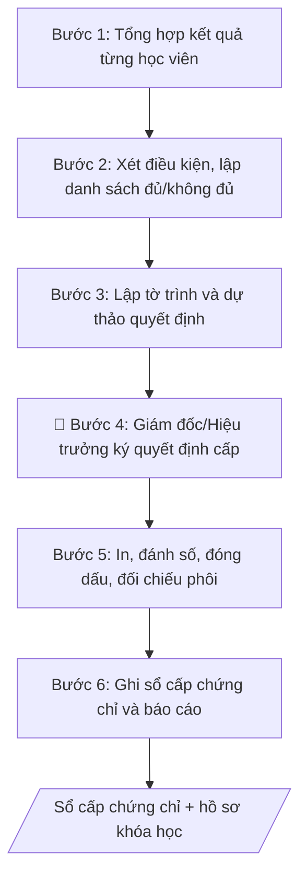

# Cấp chứng chỉ đào tạo liên tục

## Khi nào dùng
Khi khóa bồi dưỡng ngắn hạn kết thúc: xét điều kiện hoàn thành của từng học viên,
trình cấp chứng chỉ, ghi sổ và quản lý phôi chứng chỉ.

## Định dạng và file đầu ra

Định dạng đầu ra có thể chọn theo sản phẩm/yêu cầu: .docx, .pdf. Đọc mục “Định dạng bổ sung” trong quy cách đầu ra trước khi chọn.

**Phải tạo file thực tế để tải xuống, không chỉ trả nội dung trong chat.** Định dạng mặc định của skill: **.docx**. Nếu có bảng số liệu nghiệp vụ yêu cầu file bảng tính riêng, tạo thêm Excel theo yêu cầu; không tự tạo file kiểm tra. Không chờ người dùng yêu cầu xuất file lần nữa. Ưu tiên định dạng người dùng chỉ định; đọc quy tắc xuất file tại references/quy-cach-dau-ra.md.

**Chạy qua API (không có công cụ tạo file):** trả đủ nội dung dạng văn bản có tiêu đề, bảng; ứng dụng gọi sẽ xuất file.

## Quy cách đầu ra và thông tin thiếu
Khi dựng file Word/Excel, áp dụng mục “Thể thức và bảng biểu khi dựng file” trong quy cách đầu ra (cỡ chữ từng thành phần, bảng nhiều trang, số trang, phụ lục). Đọc [quy cách và cấu trúc sản phẩm](references/quy-cach-dau-ra.md) trước khi soạn/xuất. File giao chỉ gồm sản phẩm nghiệp vụ được yêu cầu; kiểm tra nội bộ không xuất kèm. Thiếu thông tin thì giữ nguyên trường/mục và chỗ điền theo mẫu gốc (dòng dấu chấm, dấu gạch hoặc ô trống); không tự điền dữ liệu mẫu, số 0, mã chờ xác minh hay dòng chờ ký. Mẫu chuyên ngành còn áp dụng được ưu tiên về cấu trúc, mã biểu và người ký. Bản đầy đủ: [quy tắc chung](references/quy-tac-chung.md).

Khi người dùng yêu cầu bộ slide (.pptx), đọc mục “Xuất PowerPoint (.pptx) khi được yêu cầu” trong quy cách đầu ra.

## Kiểm soát áp dụng và phê duyệt
Trước khi chạy, xác định `ngay_ap_dung`, `loai_hinh_truong`, `quy_che_noi_bo`, `nguon_du_lieu`, `nguoi_kiem_duyet`; chỉ hỏi thông tin liên quan nghiệp vụ, không dùng giá trị giả định thay dữ liệu bắt buộc. Đối chiếu căn cứ pháp lý với văn bản gốc, hiệu lực, điều khoản áp dụng và chuyển tiếp. Bản đầy đủ: [quy tắc chung](references/quy-tac-chung.md).

## Giới hạn và human gate
AI hỗ trợ chuẩn bị và đối chiếu; cán bộ phụ trách kiểm tra dữ liệu/căn cứ, người có thẩm quyền duyệt và ký. Không đánh dấu đã ký, đã duyệt, đã công bố khi chưa có chứng cứ. Dữ liệu sinh viên, sức khỏe, nhân sự, tài chính chỉ dùng theo mục đích và phân quyền, che thông tin định danh khi dùng ví dụ (Luật 91/2025/QH15, hiệu lực 01/01/2026); không tải dữ liệu lên dịch vụ ngoài khi chưa có quyền. Bản đầy đủ: [quy tắc chung](references/quy-tac-chung.md).

## Bối cảnh riêng của VNU-IS

Bản chỉnh cho Trường Quốc tế – ĐHQGHN (VNU-IS), v0.4.2. Dựng từ website công khai và phiếu khảo sát CES còn trống; **chưa có dữ liệu khảo sát thực tế của đơn vị**. Đọc [bối cảnh VNU-IS](references/boi-canh-vnuis.md) trước khi chạy; các mã C1–C8 nằm ở mục 6 của file đó.

- **Đơn vị thường dùng:** Viện ĐMST&CGCN.
- **Nghiệp vụ trong phiếu CES:** không có dòng riêng trong phiếu CES; đề xuất theo chức năng đơn vị ở sheet 00 và cần xác nhận khi khảo sát.

**Điều chỉnh khi dùng cho VNU-IS**
- Chứng chỉ chỉ cấp theo quy định hiện hành; thẩm quyền cấp chưa xác nhận (C1, C2).
- Danh sách người học lấy từ điểm danh và đánh giá của khóa; không tự gán kết quả.

**Chờ xác nhận khi khảo sát**
- Quy định cấp chứng chỉ của Trường (C2).
- Mẫu chứng chỉ và số hiệu (C8).

Nếu người dùng chưa trả lời mục chờ xác nhận liên quan, hỏi lại; không tự điền giả định.

## Đầu vào (Input)

| Trường | Mô tả | Bắt buộc |
|---|---|---|
| `ten_khoa` | Tên khóa học, thời gian tổ chức | Có |
| `danh_sach_hv` | Danh sách học viên: họ tên, ngày sinh, kết quả (chuyên cần, điểm) | Có |
| `dieu_kien_cap` | Điều kiện cấp chứng chỉ của khóa học | Có |
| `mau_chung_chi` | Mẫu chứng chỉ áp dụng | Có |
| `so_phoi` | Số phôi chứng chỉ cấp phát cho đợt này | Có |

### Thông tin VNU-IS đã điền sẵn (không hỏi lại)

| Mục | Giá trị mặc định |
|---|---|
| Cơ quan chủ quản; Trường; địa danh | Đại học Quốc gia Hà Nội (ĐHQGHN); Trường Quốc tế – ĐHQGHN (VNU – International School); Hà Nội |
| Đơn vị sử dụng và phối hợp | Viện ĐMST&CGCN |
| Cơ sở | Xuân Thủy (Cầu Giấy); Phan Tây Nhạc (Xuân Phương); Hòa Lạc (tòa HT1, Khu Đô thị ĐHQGHN). Ghi rõ cơ sở khi nội dung gắn địa điểm |
| Ngôn ngữ đầu ra | Tiếng Việt là bản gốc; thêm tiếng Anh cho đối tác, người học quốc tế hoặc khi được yêu cầu |
| Người duyệt và ký | Ghi theo vai trò (Trưởng phòng, Phó Hiệu trưởng phụ trách, Hiệu trưởng); tuyến duyệt và thẩm quyền ký chờ C1, C6 |

Nguồn: website và phiếu CES; đổi theo khảo sát thì sửa tại đây và trong `references/boi-canh-vnuis.md`.

## Quy trình

*⏱ là ước tính ban đầu của bộ gốc, chưa đo tại VNU-IS; hiệu chỉnh sau khảo sát.*

**Bước 1. Tổng hợp kết quả từng học viên**
- Làm gì: thu thập từ hồ sơ khóa học: bảng điểm danh/chuyên cần từng buổi và bảng điểm đánh giá (bài tập/kiểm tra); tính tỷ lệ chuyên cần (%) và điểm tổng kết cho từng học viên trong `danh_sach_hv`; đánh dấu các trường hợp số liệu thiếu/khuyết (nghỉ có phép, bỏ thi) để xác minh với phụ trách khóa học trước khi xét.
- Dùng input: `ten_khoa`, `danh_sach_hv`.
- Vai trò: Cán bộ Trung tâm · AI hỗ trợ: tổng hợp bảng kết quả và tính tỷ lệ chuyên cần/điểm, phụ trách khóa học xác minh các trường hợp số liệu thiếu · ⏱ 2–4 giờ (ước tính)
- Lưu ý nghiệp vụ: số liệu phải lấy từ hồ sơ gốc (bảng điểm danh có chữ ký, bài thi đã chấm) — không dùng số liệu "nhớ" của giảng viên. Trường hợp đặc biệt (ốm đau có giấy xác nhận) phải có biên bản xử lý riêng, không tự cộng điểm chuyên cần.
- → Kết quả bước: bảng tổng hợp kết quả từng học viên (họ tên, ngày sinh, chuyên cần %, điểm).

**Bước 2. Xét điều kiện và lập danh sách đủ/không đủ**
- Làm gì: đối chiếu từng học viên với `dieu_kien_cap` đã công bố (ngưỡng chuyên cần, ngưỡng điểm); lập 2 danh sách: đủ điều kiện (ghi rõ số hiệu phôi dự kiến cho từng người) và không đủ điều kiện (ghi rõ lý do từng người: nghỉ quá số buổi / không đạt điểm); phụ trách khóa học ký xác nhận cả 2 danh sách.
- Dùng input: `dieu_kien_cap` (+ bảng tổng hợp ở Bước 1).
- Vai trò: Giám đốc Trung tâm · AI hỗ trợ: đối chiếu từng học viên với điều kiện cấp và lập 2 danh sách dự thảo, phụ trách khóa học ký xác nhận · ⏱ 1–2 giờ (ước tính)
- Lưu ý nghiệp vụ: điều kiện xét phải ĐÚNG điều kiện đã công bố khi chiêu sinh — không được nâng/hạ chuẩn sau khi khóa học kết thúc. Học viên khiếu nại thì giải quyết dứt điểm trước khi trình cấp, không để danh sách "treo".
- → Kết quả bước: danh sách đủ điều kiện (kèm dải số hiệu dự kiến) + danh sách không đủ điều kiện (kèm lý do từng người), có chữ ký phụ trách khóa học.

**Bước 3. Lập tờ trình và dự thảo quyết định**
- Làm gì: soạn tờ trình gửi Giám đốc Trung tâm/Hiệu trưởng: thông tin khóa học (`ten_khoa`, thời gian, sĩ số), căn cứ điều kiện cấp đã công bố, kết quả xét (số đủ/không đủ điều kiện + lý do tóm tắt); soạn dự thảo quyết định cấp chứng chỉ theo `mau_chung_chi` (phần căn cứ, điều khoản, dải số hiệu); đính kèm danh sách học viên.
- Dùng input: `ten_khoa`, `mau_chung_chi` (+ 2 danh sách ở Bước 2).
- Vai trò: Giám đốc Trung tâm · AI hỗ trợ: soạn dự thảo tờ trình và quyết định theo mẫu · ⏱ 1–2 giờ (ước tính)
- Lưu ý nghiệp vụ: dải số hiệu trong quyết định phải khớp với `so_phoi` được cấp phát — lệch 1 số cũng phải giải trình. Tờ trình phải nêu cả số không đủ điều kiện để người ký nắm toàn cảnh.
- → Kết quả bước: tờ trình + dự thảo quyết định + danh sách học viên kèm theo, sẵn sàng trình ký.

**Bước 4. Trình ký quyết định (human gate)**
- Làm gì: trình Giám đốc Trung tâm/Hiệu trưởng ký quyết định cấp chứng chỉ; nếu người ký yêu cầu xác minh thêm (VD: trường hợp giáp ranh ngưỡng), quay lại Bước 2 bổ sung minh chứng; nhận quyết định đã ký, đóng số văn bản, lưu hồ sơ.
- Dùng input: hồ sơ tờ trình ở Bước 3.
- Vai trò: Giám đốc Trung tâm · AI hỗ trợ: soạn dự thảo văn bản trình ký, kiểm tra thể thức · ⏱ 1–3 ngày làm việc (chờ lịch ký) (ước tính)
- Lưu ý nghiệp vụ: chỉ in chứng chỉ SAU khi quyết định đã ký — in trước là sai quy trình và phát sinh rủi ro thừa/thiếu phôi.
- → Kết quả bước: quyết định cấp chứng chỉ đã ký, đóng dấu.

**Bước 5. In, đánh số và cấp phát chứng chỉ**
- Làm gì: in chứng chỉ theo `mau_chung_chi`, điền thông tin từng học viên, đánh số hiệu liên tục theo dải đã duyệt; trình ký, đóng dấu; đối chiếu số phôi đã dùng với `so_phoi` (đã dùng / hỏng / còn lại — phôi hỏng phải lưu lại, không được vứt bỏ); phát chứng chỉ cho học viên (ký nhận) hoặc gửi theo địa chỉ đã đăng ký.
- Dùng input: `mau_chung_chi`, `so_phoi` (+ quyết định đã ký ở Bước 4, danh sách ở Bước 2).
- Vai trò: Giám đốc Trung tâm · AI hỗ trợ: hỗ trợ kiểm tra chính tả và đối chiếu số hiệu · ⏱ 1–2 ngày làm việc (ước tính)
- Lưu ý nghiệp vụ: kiểm tra chính tả họ tên, ngày sinh trên từng chứng chỉ trước khi trình ký — sai 1 dấu cũng phải in lại, tuyệt đối không tẩy xóa. Phôi trắng tuyệt đối không để lọt ra ngoài; mất phôi phải lập biên bản ngay.
- → Kết quả bước: chứng chỉ đã ký, đóng dấu, cấp phát có ký nhận + biên bản đối chiếu phôi.

**Bước 6. Ghi sổ cấp chứng chỉ và báo cáo**
- Làm gì: ghi từng chứng chỉ vào sổ cấp chứng chỉ: số hiệu, họ tên, ngày sinh, tên khóa, ngày cấp; lưu hồ sơ khóa học (quyết định, danh sách, bảng điểm, biên bản đối chiếu phôi); tổng hợp báo cáo số chứng chỉ đã cấp trong kỳ gửi đơn vị quản lý.
- Dùng input: `ten_khoa` (+ kết quả Bước 5).
- Vai trò: Cán bộ Trung tâm · AI hỗ trợ: hỗ trợ điền số liệu vào biểu mẫu sổ số · ⏱ 2–3 giờ (ước tính)
- Lưu ý nghiệp vụ: sổ cấp chứng chỉ là căn cứ pháp lý khi xác minh văn bằng — ghi chép phải đầy đủ, không tẩy xóa; nên có bản số (scan) dự phòng. Số liệu báo cáo kỳ phải khớp với sổ.
- → Kết quả bước: sổ cấp chứng chỉ đã cập nhật + báo cáo số chứng chỉ đã cấp trong kỳ.

## Luồng quy trình (Workflow)

## Đầu ra

File nghiệp vụ thực tế theo định dạng mặc định ở đầu skill hoặc định dạng người dùng yêu cầu, kèm liên kết tải trong phản hồi cuối.

Sản phẩm nghiệp vụ hoàn chỉnh theo [quy cách và cấu trúc](references/quy-cach-dau-ra.md), giữ các trường chưa có dữ liệu ở trạng thái trống. Không xuất kèm danh mục kiểm/phụ lục kiểm tra đầu ra.

## Kiểm tra nội bộ trước khi giao

- [ ] Bố cục khớp mẫu áp dụng và cấu trúc tại references/quy-cach-dau-ra.md.
- [ ] Số học viên và kết quả xét trong quyết định khớp với Input (`danh_sach_hv`, `dieu_kien_cap`).
- [ ] Dải số hiệu chứng chỉ trong quyết định khớp 100% với số phôi được cấp phát (`so_phoi`).
- [ ] Không bịa đặt số liệu, kết quả đánh giá học viên, số hiệu chứng chỉ.
- [ ] Đúng thể thức hành chính: tiêu đề, số hiệu, ngày tháng, chữ ký, đóng dấu.
- [ ] Đã qua Human gate: Giám đốc Trung tâm/Hiệu trưởng đã ký quyết định.
- [ ] Chỉ cấp chứng chỉ cho học viên đủ điều kiện theo đúng điều kiện đã công bố khi chiêu sinh.
- [ ] Biên bản đối chiếu phôi đầy đủ (đã dùng / hỏng / còn lại); phôi hỏng được lưu lại, không vứt bỏ.
- [ ] Họ tên, ngày sinh trên từng chứng chỉ chính xác, không tẩy xóa.
- [ ] Sổ cấp chứng chỉ đã ghi đầy đủ, không tẩy xóa; số liệu báo cáo kỳ khớp với sổ.

Tiêu chí đạt = tất cả các ô được đánh dấu.

## Human gate (người kiểm duyệt)
- Phụ trách khóa học lập danh sách; Giám đốc Trung tâm ký quyết định cấp.
- Đối chiếu số phôi sử dụng với sổ quản lý phôi (kế toán/văn thư).

## Giới hạn (guardrails)
- Tuyệt đối không cấp chứng chỉ cho người không đủ điều kiện hoặc không tham dự khóa học.
- Không sửa thông tin trên chứng chỉ sau khi đã ký; sai sót phải thu hồi và cấp lại theo quy trình.
- Không để lộ/lọt phôi chứng chỉ trắng; mất phôi phải lập biên bản ngay.

## Căn cứ & lưu ý
- Quy định về mẫu, in, quản lý và cấp chứng chỉ đào tạo, bồi dưỡng của Bộ GD&ĐT và của trường.
- Ví dụ trong skill chỉ để minh họa; không đưa dữ liệu cá nhân thật vào ví dụ. Tên Trường, cơ quan chủ quản và địa danh dùng đúng bảng thông tin VNU-IS đã điền sẵn.

## Quản trị phiên bản
- Phiên bản gói VNU-IS `0.4.2` (cập nhật 2026-10-11), dựa trên skill gốc `cap-chung-chi-dao-tao-lien-tuc` bản `1.3.2`; hồ sơ đầy đủ tại [references/version.json](references/version.json).
- Người phê duyệt nghiệp vụ: **chưa chỉ định**. Trạng thái: dự thảo nghiệp vụ; kiểm tra pháp lý trước thực thi. Ngày cập nhật không đồng nghĩa mọi văn bản đã được rà soát toàn văn.
- Giấy phép theo LICENSE của kho (bản quyền CES Global). Lịch sử thay đổi: CHANGELOG.md.
