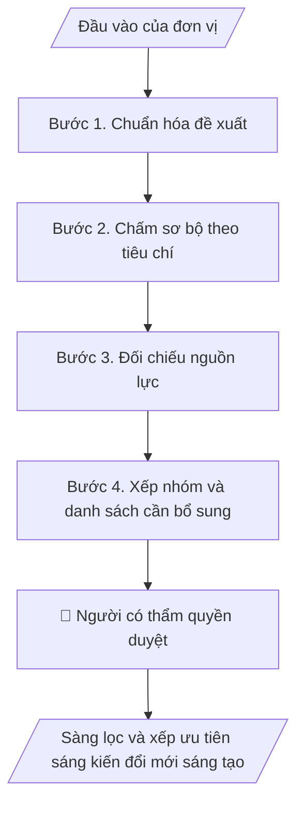

# Sàng lọc và xếp ưu tiên sáng kiến đổi mới sáng tạo

## Khi nào dùng
Khi Viện nhận nhiều sáng kiến hoặc nhu cầu từ khoa, giảng viên, sinh viên, đối tác và cần bảng so sánh có tiêu chí rõ để chọn việc làm trước.

## Định dạng và file đầu ra

Định dạng đầu ra có thể chọn theo sản phẩm/yêu cầu: .xlsx, .csv, .pdf, .json, .html. Đọc mục “Định dạng bổ sung” trong quy cách đầu ra trước khi chọn.

**Phải tạo file thực tế để tải xuống, không chỉ trả nội dung trong chat.** Định dạng mặc định của skill: **.xlsx**. Nếu yêu cầu gồm cả báo cáo thuyết minh, tạo thêm file Word cho báo cáo; không ghép báo cáo dài vào bảng tính. Không chờ người dùng yêu cầu xuất file lần nữa. Ưu tiên định dạng người dùng chỉ định; đọc quy tắc xuất file tại references/quy-cach-dau-ra.md.

**Chạy qua API (không có công cụ tạo file):** trả đủ nội dung dạng văn bản có tiêu đề, bảng; ứng dụng gọi sẽ xuất file.

## Quy cách đầu ra và thông tin thiếu
Khi dựng file Word/Excel, áp dụng mục “Thể thức và bảng biểu khi dựng file” trong quy cách đầu ra (cỡ chữ từng thành phần, bảng nhiều trang, số trang, phụ lục). Đọc [quy cách và cấu trúc sản phẩm](references/quy-cach-dau-ra.md) trước khi soạn/xuất. File giao chỉ gồm sản phẩm nghiệp vụ được yêu cầu; kiểm tra nội bộ không xuất kèm. Thiếu thông tin thì giữ nguyên trường/mục và chỗ điền theo mẫu gốc (dòng dấu chấm, dấu gạch hoặc ô trống); không tự điền dữ liệu mẫu, số 0, mã chờ xác minh hay dòng chờ ký. Mẫu chuyên ngành còn áp dụng được ưu tiên về cấu trúc, mã biểu và người ký. Bản đầy đủ: [quy tắc chung](references/quy-tac-chung.md).

Khi người dùng yêu cầu bộ slide (.pptx), đọc mục “Xuất PowerPoint (.pptx) khi được yêu cầu” trong quy cách đầu ra.

## Kiểm soát áp dụng và phê duyệt
Trước khi chạy, xác định `ngay_ap_dung`, `loai_hinh_truong`, `quy_che_noi_bo`, `nguon_du_lieu`, `nguoi_kiem_duyet`; chỉ hỏi thông tin liên quan nghiệp vụ, không dùng giá trị giả định thay dữ liệu bắt buộc. Đối chiếu căn cứ pháp lý với văn bản gốc, hiệu lực, điều khoản áp dụng và chuyển tiếp. Bản đầy đủ: [quy tắc chung](references/quy-tac-chung.md).

## Giới hạn và human gate
AI hỗ trợ chuẩn bị và đối chiếu; cán bộ phụ trách kiểm tra dữ liệu/căn cứ, người có thẩm quyền duyệt và ký. Không đánh dấu đã ký, đã duyệt, đã công bố khi chưa có chứng cứ. Dữ liệu sinh viên, sức khỏe, nhân sự, tài chính chỉ dùng theo mục đích và phân quyền, che thông tin định danh khi dùng ví dụ (Luật 91/2025/QH15, hiệu lực 01/01/2026); không tải dữ liệu lên dịch vụ ngoài khi chưa có quyền. Bản đầy đủ: [quy tắc chung](references/quy-tac-chung.md).

## Bối cảnh riêng của VNU-IS

Skill mới cho Trường Quốc tế – ĐHQGHN (VNU-IS), v0.4.2. Dựng từ website công khai và phiếu khảo sát CES còn trống; **chưa có dữ liệu khảo sát thực tế của đơn vị**. Đọc [bối cảnh VNU-IS](references/boi-canh-vnuis.md) trước khi chạy; các mã C1–C8 nằm ở mục 6 của file đó.

- **Đơn vị thường dùng:** Viện ĐMST&CGCN.
- **Nghiệp vụ trong phiếu CES:** "Danh mục đổi mới sáng tạo: Tiếp nhận, sàng lọc và ưu tiên sáng kiến/nhu cầu đổi mới sáng tạo" (sheet `08_KS_Vien_DMST_CGCN`). Tần suất gợi ý: Theo đợt/đề xuất. Đầu vào gợi ý: Phiếu đề xuất; nhu cầu đơn vị/doanh nghiệp; tiêu chí ưu tiên; định hướng của Trường. Khó khăn gợi ý: Thông tin đề xuất không đồng nhất; khó so sánh mức tác động, tính khả thi và nguồn lực.

**Chờ xác nhận khi khảo sát**
- Tiêu chí và trọng số của Viện (C6, C8).
- Kênh tiếp nhận sáng kiến hiện có (C5).

Nếu người dùng chưa trả lời mục chờ xác nhận liên quan, hỏi lại; không tự điền giả định.

## Đầu vào (Input)

| Trường | Mô tả | Bắt buộc |
|---|---|---|
| `danh_sach_sang_kien` | Danh sách hoặc phiếu đề xuất: người đề xuất, mô tả, đối tượng hưởng lợi, nguồn lực cần | Có |
| `tieu_chi_cham` | Tiêu chí và trọng số do Viện quyết định (ví dụ phù hợp chiến lược, khả thi, tác động) | Có |
| `nguon_luc_hien_co` | Nhân sự, thời gian, ngân sách Viện có thể dành cho việc mới | Có |
| `lich_su_xu_ly` | Các sáng kiến đã nhận trước đây và kết quả, để tránh trùng | Không |
| `ky_xet` | Đợt hoặc kỳ xét | Có |

### Thông tin VNU-IS đã điền sẵn (không hỏi lại)

| Mục | Giá trị mặc định |
|---|---|
| Cơ quan chủ quản; Trường; địa danh | Đại học Quốc gia Hà Nội (ĐHQGHN); Trường Quốc tế – ĐHQGHN (VNU – International School); Hà Nội |
| Đơn vị sử dụng và phối hợp | Viện ĐMST&CGCN |
| Cơ sở | Xuân Thủy (Cầu Giấy); Phan Tây Nhạc (Xuân Phương); Hòa Lạc (tòa HT1, Khu Đô thị ĐHQGHN). Ghi rõ cơ sở khi nội dung gắn địa điểm |
| Ngôn ngữ đầu ra | Tiếng Việt là bản gốc; thêm tiếng Anh cho đối tác, người học quốc tế hoặc khi được yêu cầu |
| Người duyệt và ký | Ghi theo vai trò (Trưởng phòng, Phó Hiệu trưởng phụ trách, Hiệu trưởng); tuyến duyệt và thẩm quyền ký chờ C1, C6 |

Nguồn: website và phiếu CES; đổi theo khảo sát thì sửa tại đây và trong `references/boi-canh-vnuis.md`.

## Quy trình

*⏱ là ước tính ban đầu của bộ gốc, chưa đo tại VNU-IS; hiệu chỉnh sau khảo sát.*

**Bước 1. Chuẩn hóa đề xuất**
- Làm gì: Đưa mỗi sáng kiến về cùng các trường; đánh dấu trường thiếu và đề xuất trùng với lịch sử xử lý.
- Dùng input: `danh_sach_sang_kien`, `lich_su_xu_ly`
- Vai trò: Chuyên viên Viện · AI hỗ trợ: chuẩn hóa và phát hiện trùng · ⏱ thời gian do đơn vị ước tính sau khảo sát
- Lưu ý nghiệp vụ: Không viết lại ý của người đề xuất.
- → Kết quả bước: Bảng sáng kiến chuẩn hóa.

**Bước 2. Chấm sơ bộ theo tiêu chí**
- Làm gì: Áp tiêu chí và trọng số do Viện cung cấp; mỗi điểm có lý do ngắn trích từ nội dung đề xuất.
- Dùng input: `tieu_chi_cham`
- Vai trò: Chuyên viên Viện · AI hỗ trợ: chấm sơ bộ có lý do · ⏱ thời gian do đơn vị ước tính sau khảo sát
- Lưu ý nghiệp vụ: Điểm sơ bộ chỉ là gợi ý; thiếu thông tin thì ghi "chưa đủ cơ sở", không đoán.
- → Kết quả bước: Bảng điểm sơ bộ.

**Bước 3. Đối chiếu nguồn lực**
- Làm gì: So nhu cầu nguồn lực của từng sáng kiến với nguồn lực hiện có; nêu tổ hợp khả thi.
- Dùng input: `nguon_luc_hien_co`
- Vai trò: Trưởng bộ phận · AI hỗ trợ: lập bảng đối chiếu · ⏱ thời gian do đơn vị ước tính sau khảo sát
- Lưu ý nghiệp vụ: Không tự phân bổ ngân sách.
- → Kết quả bước: Bảng khả thi theo nguồn lực.

**Bước 4. Xếp nhóm và danh sách cần bổ sung**
- Làm gì: Chia nhóm: nên làm ngay, cần bổ sung thông tin, để sau, không phù hợp; mỗi nhóm có lý do và việc tiếp theo.
- Dùng input: `ky_xet`
- Vai trò: Trưởng Viện · AI hỗ trợ: dự thảo xếp nhóm · ⏱ thời gian do đơn vị ước tính sau khảo sát
- Lưu ý nghiệp vụ: Quyết định cuối do lãnh đạo Viện.
- → Kết quả bước: Bảng ưu tiên và danh sách việc tiếp theo.

## Luồng quy trình (Workflow)

## Đầu ra

File nghiệp vụ thực tế theo định dạng mặc định ở đầu skill hoặc định dạng người dùng yêu cầu, kèm liên kết tải trong phản hồi cuối.

Sản phẩm nghiệp vụ hoàn chỉnh theo [quy cách và cấu trúc](references/quy-cach-dau-ra.md), giữ các trường chưa có dữ liệu ở trạng thái trống. Không xuất kèm danh mục kiểm/phụ lục kiểm tra đầu ra.

## Kiểm tra nội bộ trước khi giao

- [ ] Bố cục khớp cấu trúc tại references/quy-cach-dau-ra.md.
- [ ] Mỗi điểm có lý do truy được về nội dung đề xuất.
- [ ] Tiêu chí và trọng số đúng như Viện cung cấp.
- [ ] Sáng kiến trùng lịch sử đã được gắn cờ.
- [ ] Không có quyết định chọn hoặc loại do AI tự đưa ra.
- [ ] Đã qua Human gate.

Tiêu chí đạt = tất cả các ô được đánh dấu.

## Human gate (người kiểm duyệt)
- **Lãnh đạo Viện** quyết định sáng kiến nào được triển khai.
- **Người đề xuất** được thông báo kết quả theo cách Viện quy định.

## Giới hạn (guardrails)
- KHÔNG tự loại sáng kiến.
- KHÔNG đặt tiêu chí hay trọng số thay Viện.

## Căn cứ & lưu ý
- Căn cứ pháp lý và quy định nội bộ do người dùng cung cấp; chưa có thì ghi `[CẦN XÁC MINH]`, không suy diễn.
- Ví dụ trong skill chỉ để minh họa; không đưa dữ liệu cá nhân thật vào ví dụ. Tên Trường, cơ quan chủ quản và địa danh dùng đúng bảng thông tin VNU-IS đã điền sẵn.

## Quản trị phiên bản
- Phiên bản gói VNU-IS `0.4.2` (cập nhật 2026-10-11); hồ sơ tại [references/version.json](references/version.json). Skill mới, không có bản gốc trong bộ 171 skill; dùng khung và quy cách đầu ra của skill `funnel-theo-doi-thi-sinh`.
- Người phê duyệt nghiệp vụ: **chưa chỉ định**. Trạng thái: dự thảo nghiệp vụ, chờ khảo sát; kiểm tra pháp lý trước thực thi.
- Giấy phép theo LICENSE của kho (bản quyền CES Global).
