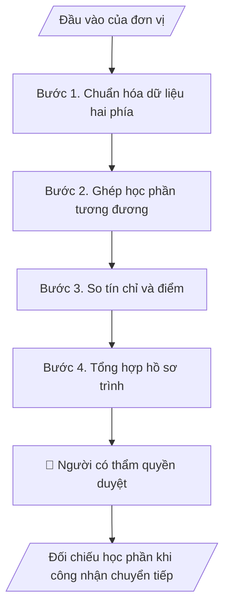

# Đối chiếu học phần khi công nhận chuyển tiếp

## Khi nào dùng
Khi sinh viên đến hoặc đi theo chương trình trao đổi, liên kết hoặc chuyển tiếp và cần hồ sơ đối chiếu học phần. Mục này không có trong phiếu CES; được đề xuất từ website (mục công nhận chuyển tiếp, mô hình 2+2) và cần xác nhận khi khảo sát.

## Định dạng và file đầu ra

Định dạng đầu ra có thể chọn theo sản phẩm/yêu cầu: .xlsx, .csv, .pdf, .json, .html. Đọc mục “Định dạng bổ sung” trong quy cách đầu ra trước khi chọn.

**Phải tạo file thực tế để tải xuống, không chỉ trả nội dung trong chat.** Định dạng mặc định của skill: **.xlsx**. Nếu yêu cầu gồm cả báo cáo thuyết minh, tạo thêm file Word cho báo cáo; không ghép báo cáo dài vào bảng tính. Không chờ người dùng yêu cầu xuất file lần nữa. Ưu tiên định dạng người dùng chỉ định; đọc quy tắc xuất file tại references/quy-cach-dau-ra.md.

**Chạy qua API (không có công cụ tạo file):** trả đủ nội dung dạng văn bản có tiêu đề, bảng; ứng dụng gọi sẽ xuất file.

## Quy cách đầu ra và thông tin thiếu
Khi dựng file Word/Excel, áp dụng mục “Thể thức và bảng biểu khi dựng file” trong quy cách đầu ra (cỡ chữ từng thành phần, bảng nhiều trang, số trang, phụ lục). Đọc [quy cách và cấu trúc sản phẩm](references/quy-cach-dau-ra.md) trước khi soạn/xuất. File giao chỉ gồm sản phẩm nghiệp vụ được yêu cầu; kiểm tra nội bộ không xuất kèm. Thiếu thông tin thì giữ nguyên trường/mục và chỗ điền theo mẫu gốc (dòng dấu chấm, dấu gạch hoặc ô trống); không tự điền dữ liệu mẫu, số 0, mã chờ xác minh hay dòng chờ ký. Mẫu chuyên ngành còn áp dụng được ưu tiên về cấu trúc, mã biểu và người ký. Bản đầy đủ: [quy tắc chung](references/quy-tac-chung.md).

Khi người dùng yêu cầu bộ slide (.pptx), đọc mục “Xuất PowerPoint (.pptx) khi được yêu cầu” trong quy cách đầu ra.

## Kiểm soát áp dụng và phê duyệt
Trước khi chạy, xác định `ngay_ap_dung`, `loai_hinh_truong`, `quy_che_noi_bo`, `nguon_du_lieu`, `nguoi_kiem_duyet`; chỉ hỏi thông tin liên quan nghiệp vụ, không dùng giá trị giả định thay dữ liệu bắt buộc. Đối chiếu căn cứ pháp lý với văn bản gốc, hiệu lực, điều khoản áp dụng và chuyển tiếp. Bản đầy đủ: [quy tắc chung](references/quy-tac-chung.md).

## Giới hạn và human gate
AI hỗ trợ chuẩn bị và đối chiếu; cán bộ phụ trách kiểm tra dữ liệu/căn cứ, người có thẩm quyền duyệt và ký. Không đánh dấu đã ký, đã duyệt, đã công bố khi chưa có chứng cứ. Dữ liệu sinh viên, sức khỏe, nhân sự, tài chính chỉ dùng theo mục đích và phân quyền, che thông tin định danh khi dùng ví dụ (Luật 91/2025/QH15, hiệu lực 01/01/2026); không tải dữ liệu lên dịch vụ ngoài khi chưa có quyền. Bản đầy đủ: [quy tắc chung](references/quy-tac-chung.md).

## Bối cảnh riêng của VNU-IS

Skill mới cho Trường Quốc tế – ĐHQGHN (VNU-IS), v0.4.2. Dựng từ website công khai và phiếu khảo sát CES còn trống; **chưa có dữ liệu khảo sát thực tế của đơn vị**. Đọc [bối cảnh VNU-IS](references/boi-canh-vnuis.md) trước khi chạy; các mã C1–C8 nằm ở mục 6 của file đó.

- **Đơn vị thường dùng:** Phòng Đào tạo; Phòng KHCN và Hợp tác phát triển; các khoa.
- **Nghiệp vụ trong phiếu CES:** không có trong phiếu CES; đề xuất từ website (mục công nhận chuyển tiếp, mô hình 2+2) và cần xác nhận khi khảo sát.

**Chờ xác nhận khi khảo sát**
- Quy định công nhận chuyển tiếp của Trường và của đối tác (C2).
- Người có thẩm quyền xét mức tương đương (C6).

Nếu người dùng chưa trả lời mục chờ xác nhận liên quan, hỏi lại; không tự điền giả định.

## Đầu vào (Input)

| Trường | Mô tả | Bắt buộc |
|---|---|---|
| `bang_diem_noi_di` | Bảng điểm của sinh viên ở nơi đi, đã che định danh nếu không cần | Có |
| `de_cuong_noi_di` | Đề cương hoặc mô tả học phần nơi đi (tín chỉ, giờ, nội dung, chuẩn đầu ra, ngôn ngữ) | Có |
| `ctdt_noi_den` | Khung chương trình và đề cương học phần nơi đến | Có |
| `quy_dinh_cong_nhan` | Quy định công nhận và quy đổi do Trường hoặc đối tác ban hành | Có |
| `bang_quy_doi` | Bảng quy đổi tín chỉ và điểm nếu có | Không |

### Thông tin VNU-IS đã điền sẵn (không hỏi lại)

| Mục | Giá trị mặc định |
|---|---|
| Cơ quan chủ quản; Trường; địa danh | Đại học Quốc gia Hà Nội (ĐHQGHN); Trường Quốc tế – ĐHQGHN (VNU – International School); Hà Nội |
| Đơn vị sử dụng và phối hợp | Phòng Đào tạo; Phòng KHCN và Hợp tác phát triển; các khoa |
| Cơ sở | Xuân Thủy (Cầu Giấy); Phan Tây Nhạc (Xuân Phương); Hòa Lạc (tòa HT1, Khu Đô thị ĐHQGHN). Ghi rõ cơ sở khi nội dung gắn địa điểm |
| Mô hình đào tạo | Chọn đúng mô hình trước khi áp quy tắc, không áp quy tắc của mô hình này cho mô hình khác: (1) ĐHQGHN cấp bằng; (2) liên kết quốc tế, đối tác nước ngoài cấp bằng; (3) song bằng; (4) cử nhân – thạc sĩ tích hợp; (5) tiếng Anh dự bị và mô hình 2+2 |
| Ngôn ngữ đầu ra | Tiếng Việt là bản gốc; thêm tiếng Anh cho đối tác, người học quốc tế hoặc khi được yêu cầu |
| Hệ thống nguồn dữ liệu có trên website | LMS; cổng sinh viên. Skill không kết nối hệ thống, chỉ dùng file xuất/tải lên (C5) |
| Người duyệt và ký | Ghi theo vai trò (Trưởng phòng, Phó Hiệu trưởng phụ trách, Hiệu trưởng); tuyến duyệt và thẩm quyền ký chờ C1, C6 |

Nguồn: website và phiếu CES; đổi theo khảo sát thì sửa tại đây và trong `references/boi-canh-vnuis.md`.

## Quy trình

*⏱ là ước tính ban đầu của bộ gốc, chưa đo tại VNU-IS; hiệu chỉnh sau khảo sát.*

**Bước 1. Chuẩn hóa dữ liệu hai phía**
- Làm gì: Lập bảng học phần nơi đi và nơi đến với cùng các cột: mã, tên (Việt, Anh), tín chỉ, giờ, chuẩn đầu ra, ngôn ngữ giảng dạy.
- Dùng input: `bang_diem_noi_di`, `de_cuong_noi_di`, `ctdt_noi_den`
- Vai trò: Chuyên viên đào tạo · AI hỗ trợ: chuẩn hóa · ⏱ thời gian do đơn vị ước tính sau khảo sát
- Lưu ý nghiệp vụ: Học phần thiếu đề cương ghi "chưa có đề cương".
- → Kết quả bước: Hai bảng học phần chuẩn hóa.

**Bước 2. Ghép học phần tương đương**
- Làm gì: Đề xuất ghép theo nội dung và chuẩn đầu ra; mỗi cặp ghi mức: tương đương, một phần, không tương đương, chưa đủ dữ liệu; nêu lý do ngắn.
- Dùng input: `de_cuong_noi_di`, `ctdt_noi_den`, `quy_dinh_cong_nhan`
- Vai trò: Chuyên viên đào tạo · AI hỗ trợ: đề xuất ghép · ⏱ thời gian do đơn vị ước tính sau khảo sát
- Lưu ý nghiệp vụ: Chỉ là đề xuất; không có kết luận công nhận.
- → Kết quả bước: Bảng đối chiếu đề xuất.

**Bước 3. So tín chỉ và điểm**
- Làm gì: So tín chỉ, giờ; quy đổi tín chỉ và điểm chỉ khi có bảng quy đổi do Trường hoặc đối tác ban hành.
- Dùng input: `bang_diem_noi_di`, `bang_quy_doi`, `quy_dinh_cong_nhan`
- Vai trò: Chuyên viên đào tạo · AI hỗ trợ: tính theo bảng quy đổi · ⏱ thời gian do đơn vị ước tính sau khảo sát
- Lưu ý nghiệp vụ: Không có bảng quy đổi thì để trống cột quy đổi.
- → Kết quả bước: Bảng tín chỉ và điểm.

**Bước 4. Tổng hợp hồ sơ trình**
- Làm gì: Tóm tắt số học phần đề xuất công nhận, thiếu minh chứng, cần ý kiến chuyên môn.
- Dùng input: `quy_dinh_cong_nhan`
- Vai trò: Trưởng khoa · AI hỗ trợ: dự thảo tóm tắt · ⏱ thời gian do đơn vị ước tính sau khảo sát
- Lưu ý nghiệp vụ: Người có thẩm quyền quyết định theo quy định.
- → Kết quả bước: Hồ sơ đối chiếu trình người có thẩm quyền.

## Luồng quy trình (Workflow)

## Đầu ra

File nghiệp vụ thực tế theo định dạng mặc định ở đầu skill hoặc định dạng người dùng yêu cầu, kèm liên kết tải trong phản hồi cuối.

Sản phẩm nghiệp vụ hoàn chỉnh theo [quy cách và cấu trúc](references/quy-cach-dau-ra.md), giữ các trường chưa có dữ liệu ở trạng thái trống. Không xuất kèm danh mục kiểm/phụ lục kiểm tra đầu ra.

## Kiểm tra nội bộ trước khi giao

- [ ] Bố cục khớp cấu trúc tại references/quy-cach-dau-ra.md.
- [ ] Mỗi cặp ghép có lý do và minh chứng.
- [ ] Không có cột quy đổi khi chưa có bảng quy đổi.
- [ ] Không có kết luận công nhận.
- [ ] Thông tin sinh viên đã che hoặc tối thiểu.
- [ ] Đã qua Human gate.

Tiêu chí đạt = tất cả các ô được đánh dấu.

## Human gate (người kiểm duyệt)
- **Trưởng khoa hoặc hội đồng chuyên môn** xét mức tương đương.
- **Người có thẩm quyền của Trường** quyết định công nhận.

## Giới hạn (guardrails)
- KHÔNG tự quy đổi tín chỉ hay điểm khi chưa có bảng quy đổi chính thức.
- KHÔNG kết luận công nhận.

## Căn cứ & lưu ý
- Căn cứ pháp lý và quy định nội bộ do người dùng cung cấp; chưa có thì ghi `[CẦN XÁC MINH]`, không suy diễn.
- Ví dụ trong skill chỉ để minh họa; không đưa dữ liệu cá nhân thật vào ví dụ. Tên Trường, cơ quan chủ quản và địa danh dùng đúng bảng thông tin VNU-IS đã điền sẵn.

## Quản trị phiên bản
- Phiên bản gói VNU-IS `0.4.2` (cập nhật 2026-10-11); hồ sơ tại [references/version.json](references/version.json). Skill mới, không có bản gốc trong bộ 171 skill; dùng khung và quy cách đầu ra của skill `funnel-theo-doi-thi-sinh`.
- Người phê duyệt nghiệp vụ: **chưa chỉ định**. Trạng thái: dự thảo nghiệp vụ, chờ khảo sát; kiểm tra pháp lý trước thực thi.
- Giấy phép theo LICENSE của kho (bản quyền CES Global).
