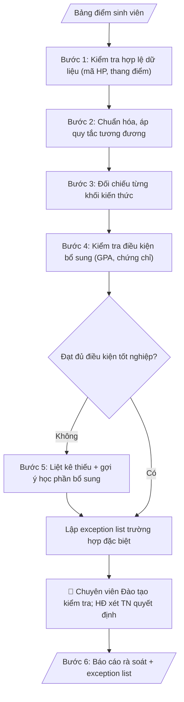

# Rà soát tiến độ tốt nghiệp

## Khi nào dùng
Cuối mỗi học kỳ hoặc trước đợt xét tốt nghiệp, khi cần rà soát nhanh sinh viên đã đủ điều kiện
tốt nghiệp chưa, còn thiếu học phần/điều kiện gì. Dùng chung cho Phòng Đào tạo, các khoa,
cố vấn học tập — không phụ thuộc tên đơn vị.

## Định dạng và file đầu ra

Định dạng đầu ra có thể chọn theo sản phẩm/yêu cầu: .docx, .pdf. Đọc mục “Định dạng bổ sung” trong quy cách đầu ra trước khi chọn.

**Phải tạo file thực tế để tải xuống, không chỉ trả nội dung trong chat.** Định dạng mặc định của skill: **.docx**. Nếu có bảng số liệu nghiệp vụ yêu cầu file bảng tính riêng, tạo thêm Excel theo yêu cầu; không tự tạo file kiểm tra. Không chờ người dùng yêu cầu xuất file lần nữa. Ưu tiên định dạng người dùng chỉ định; đọc quy tắc xuất file tại references/quy-cach-dau-ra.md.

**Chạy qua API (không có công cụ tạo file):** trả đủ nội dung dạng văn bản có tiêu đề, bảng; ứng dụng gọi sẽ xuất file.

## Quy cách đầu ra và thông tin thiếu
Khi dựng file Word/Excel, áp dụng mục “Thể thức và bảng biểu khi dựng file” trong quy cách đầu ra (cỡ chữ từng thành phần, bảng nhiều trang, số trang, phụ lục). Đọc [quy cách và cấu trúc sản phẩm](references/quy-cach-dau-ra.md) trước khi soạn/xuất. File giao chỉ gồm sản phẩm nghiệp vụ được yêu cầu; kiểm tra nội bộ không xuất kèm. Thiếu thông tin thì giữ nguyên trường/mục và chỗ điền theo mẫu gốc (dòng dấu chấm, dấu gạch hoặc ô trống); không tự điền dữ liệu mẫu, số 0, mã chờ xác minh hay dòng chờ ký. Mẫu chuyên ngành còn áp dụng được ưu tiên về cấu trúc, mã biểu và người ký. Bản đầy đủ: [quy tắc chung](references/quy-tac-chung.md).

Khi người dùng yêu cầu bộ slide (.pptx), đọc mục “Xuất PowerPoint (.pptx) khi được yêu cầu” trong quy cách đầu ra.

## Kiểm soát áp dụng và phê duyệt
Trước khi chạy, xác định `ngay_ap_dung`, `loai_hinh_truong`, `quy_che_noi_bo`, `nguon_du_lieu`, `nguoi_kiem_duyet`; chỉ hỏi thông tin liên quan nghiệp vụ, không dùng giá trị giả định thay dữ liệu bắt buộc. Đối chiếu căn cứ pháp lý với văn bản gốc, hiệu lực, điều khoản áp dụng và chuyển tiếp. Bản đầy đủ: [quy tắc chung](references/quy-tac-chung.md).

## Giới hạn và human gate
AI hỗ trợ chuẩn bị và đối chiếu; cán bộ phụ trách kiểm tra dữ liệu/căn cứ, người có thẩm quyền duyệt và ký. Không đánh dấu đã ký, đã duyệt, đã công bố khi chưa có chứng cứ. Dữ liệu sinh viên, sức khỏe, nhân sự, tài chính chỉ dùng theo mục đích và phân quyền, che thông tin định danh khi dùng ví dụ (Luật 91/2025/QH15, hiệu lực 01/01/2026); không tải dữ liệu lên dịch vụ ngoài khi chưa có quyền. Bản đầy đủ: [quy tắc chung](references/quy-tac-chung.md).

## Bối cảnh riêng của VNU-IS

Bản chỉnh cho Trường Quốc tế – ĐHQGHN (VNU-IS), v0.4.2. Dựng từ website công khai và phiếu khảo sát CES còn trống; **chưa có dữ liệu khảo sát thực tế của đơn vị**. Đọc [bối cảnh VNU-IS](references/boi-canh-vnuis.md) trước khi chạy; các mã C1–C8 nằm ở mục 6 của file đó.

- **Đơn vị thường dùng:** Phòng Đào tạo (tốt nghiệp, cố vấn học tập).
- **Nghiệp vụ trong phiếu CES:** "Tốt nghiệp: Rà soát điều kiện tốt nghiệp từ file dữ liệu" (sheet `04_KS_Dao_tao`). Tần suất gợi ý: Theo nhu cầu. Đầu vào gợi ý: Bảng điểm; chuẩn đầu ra; chứng chỉ; quy định. Khó khăn gợi ý: Tài liệu phân tán, nhiều định dạng; Đọc và đối chiếu thủ công mất thời gian; Dễ bỏ sót trường dữ liệu/phiên bản; Đầu ra phụ thuộc kinh nghiệm từng cá nhân. Đây là gợi ý có sẵn của CES, chưa phải xác nhận của đơn vị.

**Điều chỉnh khi dùng cho VNU-IS**
- Mỗi chương trình có bộ điều kiện riêng do người dùng nạp; không dùng chung một bộ cho mọi chương trình (ĐHQGHN cấp bằng, liên kết, song bằng, tích hợp khác nhau).
- Chứng chỉ ngoại ngữ và các điều kiện ngoài bảng điểm: ghi nguồn minh chứng; thiếu minh chứng thì ghi "chưa có minh chứng".
- Kết quả chia 3 nhóm: có thể đủ điều kiện, thiếu điều kiện (nêu thiếu gì), cần người xem xét. Skill không kết luận ai tốt nghiệp.
- Có thể dùng cho cố vấn học tập: bản tóm tắt tiến độ và cảnh báo cho từng sinh viên, gửi qua đầu mối có thẩm quyền.

**Chờ xác nhận khi khảo sát**
- Bộ điều kiện tốt nghiệp từng chương trình (C2).
- Mẫu bảng điểm xuất từ hệ thống (C5, C8).

Nếu người dùng chưa trả lời mục chờ xác nhận liên quan, hỏi lại; không tự điền giả định.

## Đầu vào (Input)

| Trường | Mô tả | Bắt buộc |
|---|---|---|
| `bang_diem` | Danh sách học phần đã học: mã HP, tên HP, số tín chỉ, điểm, học kỳ (mã SV ẩn danh, VD: SV-0847) | Có |
| `khung_ctdt` | Khung chương trình đào tạo: các khối kiến thức, số tín chỉ yêu cầu mỗi khối, danh mục HP bắt buộc/tự chọn | Có |
| `dieu_kien_bo_sung` | Điều kiện tốt nghiệp ngoài tín chỉ: GPA tối thiểu, chứng chỉ ngoại ngữ/tin học, không nợ học phí... | Không |
| `quy_tac_tuong_duong` | Bảng quy đổi học phần tương đương / học phần thay thế | Không |
| `phien_ban_quy_tac` | Phiên bản quy tắc áp dụng (ghi rõ để truy vết) | Có |

### Thông tin VNU-IS đã điền sẵn (không hỏi lại)

| Mục | Giá trị mặc định |
|---|---|
| Cơ quan chủ quản; Trường; địa danh | Đại học Quốc gia Hà Nội (ĐHQGHN); Trường Quốc tế – ĐHQGHN (VNU – International School); Hà Nội |
| Đơn vị sử dụng và phối hợp | Phòng Đào tạo (tốt nghiệp, cố vấn học tập) |
| Cơ sở | Xuân Thủy (Cầu Giấy); Phan Tây Nhạc (Xuân Phương); Hòa Lạc (tòa HT1, Khu Đô thị ĐHQGHN). Ghi rõ cơ sở khi nội dung gắn địa điểm |
| Mô hình đào tạo | Chọn đúng mô hình trước khi áp quy tắc, không áp quy tắc của mô hình này cho mô hình khác: (1) ĐHQGHN cấp bằng; (2) liên kết quốc tế, đối tác nước ngoài cấp bằng; (3) song bằng; (4) cử nhân – thạc sĩ tích hợp; (5) tiếng Anh dự bị và mô hình 2+2 |
| Ngôn ngữ đầu ra | Tiếng Việt là bản gốc; thêm tiếng Anh cho đối tác, người học quốc tế hoặc khi được yêu cầu |
| Hệ thống nguồn dữ liệu có trên website | LMS; cổng sinh viên. Skill không kết nối hệ thống, chỉ dùng file xuất/tải lên (C5) |
| Người duyệt và ký | Ghi theo vai trò (Trưởng phòng, Phó Hiệu trưởng phụ trách, Hiệu trưởng); tuyến duyệt và thẩm quyền ký chờ C1, C6 |

Nguồn: website và phiếu CES; đổi theo khảo sát thì sửa tại đây và trong `references/boi-canh-vnuis.md`.

## Quy trình

*⏱ là ước tính ban đầu của bộ gốc, chưa đo tại VNU-IS; hiệu chỉnh sau khảo sát.*

**Bước 1. Kiểm tra hợp lệ dữ liệu đầu vào**
- Làm gì: Kiểm tra `bang_diem`: đủ các trường (mã HP, tên HP, số tín chỉ, điểm, học kỳ); mã HP đúng định dạng; điểm nằm trong thang cho phép; phát hiện dòng trùng lặp, dòng thiếu trường; kiểm tra `khung_ctdt` có đầy đủ các khối kiến thức và chỉ tiêu; nếu phát hiện lỗi → dừng và báo danh sách lỗi, không rà soát tiếp.
- Dùng input: `bang_diem`, `khung_ctdt`, `phien_ban_quy_tac`.
- Vai trò: Chuyên viên Phòng Đào tạo · AI hỗ trợ: kiểm tra định dạng, thang điểm, dòng trùng/thiếu; dừng khi có lỗi · ⏱ ~10–20 phút (ước tính)
- Lưu ý nghiệp vụ: dữ liệu rác cho ra kết luận rác — kiểm tra hợp lệ là bắt buộc; điểm nằm ngoài thang (VD: 11/10) phải báo lỗi, không tự sửa.
- → Kết quả bước: Báo cáo kiểm tra hợp lệ (đạt/không đạt + danh sách lỗi nếu có).

**Bước 2. Chuẩn hóa và áp quy tắc tương đương**
- Làm gì: Gộp các lần học lại cùng mã HP, giữ điểm cao nhất theo quy định; quy đổi HP cũ sang HP tương đương theo `quy_tac_tuong_duong`; loại các HP không thuộc chương trình ra khỏi phép tính; ghi lại mọi lần quy đổi vào nhật ký để truy vết.
- Dùng input: `bang_diem`, `quy_tac_tuong_duong`.
- Vai trò: Chuyên viên Phòng Đào tạo · AI hỗ trợ: gộp lần học lại, áp quy tắc tương đương chính thức, ghi nhật ký quy đổi · ⏱ ~15–30 phút (ước tính)
- Lưu ý nghiệp vụ: chỉ áp quy tắc tương đương có trong bảng chính thức — không tự suy "môn này giống môn kia"; học lại lấy điểm cao nhất theo đúng quy định của trường.
- → Kết quả bước: Bảng điểm đã chuẩn hóa + nhật ký quy đổi.

**Bước 3. Đối chiếu từng khối kiến thức**
- Làm gì: Tính tín chỉ tích lũy (chỉ tính HP đạt) cho từng khối trong `khung_ctdt` (đại cương, cơ sở ngành, chuyên ngành, tự chọn); so sánh với chỉ tiêu từng khối; đánh dấu ĐẠT/CHƯA ĐẠT cho từng khối kèm số tín chỉ còn thiếu.
- Dùng input: `khung_ctdt` (bảng điểm chuẩn hóa từ bước 2).
- Vai trò: Chuyên viên Phòng Đào tạo · AI hỗ trợ: tính tín chỉ tích lũy từng khối, so chỉ tiêu, đánh dấu ĐẠT/CHƯA ĐẠT · ⏱ ~10–20 phút (ước tính)
- Lưu ý nghiệp vụ: HP đạt nhưng thuộc sai khối không được tính sang khối khác; khối tự chọn chỉ tính trong hạn mức quy định.
- → Kết quả bước: Bảng đối chiếu từng khối (tích lũy/yêu cầu/trạng thái).

**Bước 4. Kiểm tra điều kiện bổ sung**
- Làm gì: Tính GPA tích lũy so với mức tối thiểu; kiểm tra chứng chỉ ngoại ngữ/tin học; kiểm tra tình trạng nợ học phí/kỷ luật nếu có dữ liệu; mỗi điều kiện trong `dieu_kien_bo_sung` đánh dấu ĐẠT / CHƯA ĐẠT / KHÔNG CÓ DỮ LIỆU.
- Dùng input: `bang_diem`, `dieu_kien_bo_sung`.
- Vai trò: Chuyên viên Phòng Đào tạo · AI hỗ trợ: kiểm tra GPA, chứng chỉ, học phí; thiếu dữ liệu ghi "không có dữ liệu" · ⏱ ~10–15 phút (ước tính)
- Lưu ý nghiệp vụ: thiếu dữ liệu thì ghi "không có dữ liệu", không suy đoán là đạt; GPA tính theo đúng thang quy chế (thang 4 hay thang 10).
- → Kết quả bước: Bảng điều kiện bổ sung (từng điều kiện + trạng thái).

**Bước 5. Liệt kê thiếu và gợi ý bổ sung**
- Làm gì: Với mỗi khối/điều kiện CHƯA ĐẠT: nêu rõ thiếu bao nhiêu tín chỉ hoặc còn thiếu điều kiện gì; gợi ý học phần cụ thể có thể đăng ký bổ sung dựa trên danh mục HP trong `khung_ctdt`; sắp xếp gợi ý theo thứ tự ưu tiên.
- Dùng input: `khung_ctdt` (kết quả đối chiếu từ bước 3–4).
- Vai trò: Chuyên viên Phòng Đào tạo · AI hỗ trợ: liệt kê thiếu và gợi ý học phần bổ sung khả thi, sắp xếp ưu tiên · ⏱ ~10–20 phút (ước tính)
- Lưu ý nghiệp vụ: gợi ý phải khả thi (HP còn mở trong học kỳ tới, không trùng lịch) — nếu không chắc thì ghi "cần cố vấn học tập xác nhận"; không hứa "đăng ký là đủ điều kiện".
- → Kết quả bước: Danh sách thiếu + gợi ý học phần bổ sung.

**Bước 6. Xuất báo cáo rà soát và lập exception list**
- Làm gì: Gộp kết quả các bước thành báo cáo rà soát từng sinh viên theo cấu trúc sản phẩm tại references/quy-cach-dau-ra.md, ghi rõ `phien_ban_quy_tac` áp dụng và kết luận "đạt/chưa đạt THEO QUY TẮC"; tách các trường hợp đặc biệt (bảo lưu, chuyển ngành, miễn trừ) vào exception list để hội đồng xem xét thủ công.
- Dùng input: `phien_ban_quy_tac` (kết quả các bước 1–5).
- Vai trò: Chuyên viên Phòng Đào tạo · AI hỗ trợ: xuất báo cáo rà soát + exception list theo cấu trúc chuẩn để trình hội đồng xét tốt nghiệp · ⏱ ~15–25 phút + ~1–2 giờ duyệt (ước tính)
- Lưu ý nghiệp vụ: không bao giờ kết luận "đủ điều kiện tốt nghiệp" thay hội đồng — chỉ nêu trạng thái theo quy tắc; exception list ghi rõ lý do cần xem xét thủ công.
- → Kết quả bước: Báo cáo rà soát từng sinh viên + exception list — sản phẩm cuối.
## Luồng quy trình (Workflow)

## Đầu ra

File nghiệp vụ thực tế theo định dạng mặc định ở đầu skill hoặc định dạng người dùng yêu cầu, kèm liên kết tải trong phản hồi cuối.

Sản phẩm nghiệp vụ hoàn chỉnh theo [quy cách và cấu trúc](references/quy-cach-dau-ra.md), giữ các trường chưa có dữ liệu ở trạng thái trống. Không xuất kèm danh mục kiểm/phụ lục kiểm tra đầu ra.

## Kiểm tra nội bộ trước khi giao

- [ ] Báo cáo rà soát đầy đủ 6 phần theo cấu trúc sản phẩm tại references/quy-cach-dau-ra.md: thông tin SV + ngành + phiên bản quy tắc áp dụng; đối chiếu từng khối; điều kiện bổ sung; kết luận theo quy tắc; học phần thiếu + gợi ý; chuyển hội đồng (có/không + lý do).
- [ ] Phiên bản quy tắc áp dụng được ghi rõ trong báo cáo để truy vết.
- [ ] Số liệu trong output khớp với bảng điểm Input; tính toán đúng thang quy chế (thang 4 hay thang 10).
- [ ] Chỉ áp quy tắc tương đương có trong bảng chính thức — không tự suy "môn này giống môn kia"; mọi lần quy đổi có nhật ký truy vết.
- [ ] Điều kiện thiếu dữ liệu ghi "không có dữ liệu", không suy đoán là đạt.
- [ ] Kết luận là "đạt/chưa đạt THEO QUY TẮC phiên bản X" — không thay hội đồng kết luận tốt nghiệp; exception list ghi rõ lý do cần xem xét thủ công.
- [ ] Dữ liệu sinh viên được ẩn danh (mã hóa) khi xử lý; không cập nhật/sửa đổi dữ liệu trên hệ thống quản lý đào tạo.
- [ ] Đã qua Human gate: chuyên viên Phòng Đào tạo đã kiểm tra báo cáo rà soát và danh sách ngoại lệ trước khi trình.

> Tiêu chí đạt: tất cả các ô được đánh dấu.

## Human gate (người kiểm duyệt)
- **Chuyên viên Phòng Đào tạo** kiểm tra báo cáo rà soát và danh sách ngoại lệ trước khi trình.
- **Hội đồng xét tốt nghiệp** là đơn vị duy nhất ra quyết định công nhận tốt nghiệp; kết quả rà soát chỉ là tài liệu tham khảo.
- Không công bố danh sách rà soát rộng rãi khi chưa được duyệt.

## Giới hạn (guardrails)
- Không cập nhật, sửa đổi hay ghi đè dữ liệu trên hệ thống quản lý đào tạo.
- Dữ liệu sinh viên phải được ẩn danh (mã hóa) khi đưa vào xử lý.
- Không tự kết luận "đủ điều kiện tốt nghiệp" thay hội đồng — chỉ nêu "đạt/chưa đạt THEO QUY TẮC phiên bản X".
- Không suy đoán lý do thiếu (bỏ học, hoàn cảnh...) ngoài dữ liệu.

## Căn cứ & lưu ý
- Áp dụng theo quy chế đào tạo của từng trường (phiên bản quy tắc phải được ghi rõ trong báo cáo).
- Ví dụ trong skill chỉ để minh họa; không đưa dữ liệu cá nhân thật vào ví dụ. Tên Trường, cơ quan chủ quản và địa danh dùng đúng bảng thông tin VNU-IS đã điền sẵn.

## Quản trị phiên bản
- Phiên bản gói VNU-IS `0.4.2` (cập nhật 2026-10-11), dựa trên skill gốc `audit-tien-do-tot-nghiep` bản `1.3.2`; hồ sơ đầy đủ tại [references/version.json](references/version.json).
- Người phê duyệt nghiệp vụ: **chưa chỉ định**. Trạng thái: dự thảo nghiệp vụ; kiểm tra pháp lý trước thực thi. Ngày cập nhật không đồng nghĩa mọi văn bản đã được rà soát toàn văn.
- Giấy phép theo LICENSE của kho (bản quyền CES Global). Lịch sử thay đổi: CHANGELOG.md.
