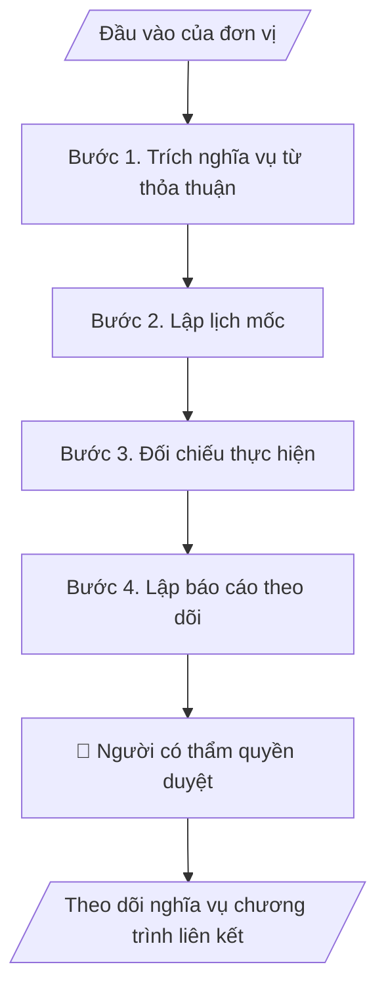

# Theo dõi nghĩa vụ chương trình liên kết

## Khi nào dùng
Khi Trường có nhiều chương trình liên kết với điều kiện khác nhau và cần biết việc nào đến hạn, bên nào chịu trách nhiệm; khi chuẩn bị gặp đối tác hoặc báo cáo ĐHQGHN.

## Định dạng và file đầu ra

Định dạng đầu ra có thể chọn theo sản phẩm/yêu cầu: .docx, .pdf. Đọc mục “Định dạng bổ sung” trong quy cách đầu ra trước khi chọn.

**Phải tạo file thực tế để tải xuống, không chỉ trả nội dung trong chat.** Định dạng mặc định của skill: **.docx**. Nếu có bảng số liệu nghiệp vụ yêu cầu file bảng tính riêng, tạo thêm Excel theo yêu cầu; không tự tạo file kiểm tra. Không chờ người dùng yêu cầu xuất file lần nữa. Ưu tiên định dạng người dùng chỉ định; đọc quy tắc xuất file tại references/quy-cach-dau-ra.md.

**Chạy qua API (không có công cụ tạo file):** trả đủ nội dung dạng văn bản có tiêu đề, bảng; ứng dụng gọi sẽ xuất file.

## Quy cách đầu ra và thông tin thiếu
Khi dựng file Word/Excel, áp dụng mục “Thể thức và bảng biểu khi dựng file” trong quy cách đầu ra (cỡ chữ từng thành phần, bảng nhiều trang, số trang, phụ lục). Đọc [quy cách và cấu trúc sản phẩm](references/quy-cach-dau-ra.md) trước khi soạn/xuất. File giao chỉ gồm sản phẩm nghiệp vụ được yêu cầu; kiểm tra nội bộ không xuất kèm. Thiếu thông tin thì giữ nguyên trường/mục và chỗ điền theo mẫu gốc (dòng dấu chấm, dấu gạch hoặc ô trống); không tự điền dữ liệu mẫu, số 0, mã chờ xác minh hay dòng chờ ký. Mẫu chuyên ngành còn áp dụng được ưu tiên về cấu trúc, mã biểu và người ký. Bản đầy đủ: [quy tắc chung](references/quy-tac-chung.md).

Khi người dùng yêu cầu bộ slide (.pptx), đọc mục “Xuất PowerPoint (.pptx) khi được yêu cầu” trong quy cách đầu ra.

Khi báo cáo có số liệu cần so sánh hoặc nêu xu hướng, đọc mục “Biểu đồ và hình trong báo cáo số liệu” trong quy cách đầu ra trước khi vẽ.

## Kiểm soát áp dụng và phê duyệt
Trước khi chạy, xác định `ngay_ap_dung`, `loai_hinh_truong`, `quy_che_noi_bo`, `nguon_du_lieu`, `nguoi_kiem_duyet`; chỉ hỏi thông tin liên quan nghiệp vụ, không dùng giá trị giả định thay dữ liệu bắt buộc. Đối chiếu căn cứ pháp lý với văn bản gốc, hiệu lực, điều khoản áp dụng và chuyển tiếp. Bản đầy đủ: [quy tắc chung](references/quy-tac-chung.md).

## Giới hạn và human gate
AI hỗ trợ chuẩn bị và đối chiếu; cán bộ phụ trách kiểm tra dữ liệu/căn cứ, người có thẩm quyền duyệt và ký. Không đánh dấu đã ký, đã duyệt, đã công bố khi chưa có chứng cứ. Dữ liệu sinh viên, sức khỏe, nhân sự, tài chính chỉ dùng theo mục đích và phân quyền, che thông tin định danh khi dùng ví dụ (Luật 91/2025/QH15, hiệu lực 01/01/2026); không tải dữ liệu lên dịch vụ ngoài khi chưa có quyền. Bản đầy đủ: [quy tắc chung](references/quy-tac-chung.md).

## Bối cảnh riêng của VNU-IS

Skill mới cho Trường Quốc tế – ĐHQGHN (VNU-IS), v0.4.2. Dựng từ website công khai và phiếu khảo sát CES còn trống; **chưa có dữ liệu khảo sát thực tế của đơn vị**. Đọc [bối cảnh VNU-IS](references/boi-canh-vnuis.md) trước khi chạy; các mã C1–C8 nằm ở mục 6 của file đó.

- **Đơn vị thường dùng:** Phòng Đào tạo (liên kết quốc tế); Phòng KHCN và Hợp tác phát triển.
- **Nghiệp vụ trong phiếu CES:** không có dòng riêng trong phiếu CES; chức năng liên kết quốc tế được ghi ở Phòng Đào tạo (sheet 00) và website nêu mô hình liên kết, song bằng, tích hợp, dự bị; cần xác nhận khi khảo sát.

**Chờ xác nhận khi khảo sát**
- Danh sách chương trình liên kết thực tế và thỏa thuận (C2).
- Đầu mối từng đối tác (C7).

Nếu người dùng chưa trả lời mục chờ xác nhận liên quan, hỏi lại; không tự điền giả định.

## Đầu vào (Input)

| Trường | Mô tả | Bắt buộc |
|---|---|---|
| `thoa_thuan_lien_ket` | Văn bản thỏa thuận từng chương trình (bản người dùng cung cấp) | Có |
| `danh_sach_chuong_trinh` | Danh sách chương trình: đối tác, mô hình, khóa, người học hiện có | Có |
| `lich_moc` | Các mốc đã biết: báo cáo, kiểm định, gia hạn, thanh toán | Không |
| `tinh_hinh_thuc_hien` | Ghi chú tình hình thực hiện hiện tại của từng chương trình | Không |
| `ngay_chot` | Ngày chốt theo dõi | Có |

### Thông tin VNU-IS đã điền sẵn (không hỏi lại)

| Mục | Giá trị mặc định |
|---|---|
| Cơ quan chủ quản; Trường; địa danh | Đại học Quốc gia Hà Nội (ĐHQGHN); Trường Quốc tế – ĐHQGHN (VNU – International School); Hà Nội |
| Đơn vị sử dụng và phối hợp | Phòng Đào tạo (liên kết quốc tế); Phòng KHCN và Hợp tác phát triển |
| Cơ sở | Xuân Thủy (Cầu Giấy); Phan Tây Nhạc (Xuân Phương); Hòa Lạc (tòa HT1, Khu Đô thị ĐHQGHN). Ghi rõ cơ sở khi nội dung gắn địa điểm |
| Mô hình đào tạo | Chọn đúng mô hình trước khi áp quy tắc, không áp quy tắc của mô hình này cho mô hình khác: (1) ĐHQGHN cấp bằng; (2) liên kết quốc tế, đối tác nước ngoài cấp bằng; (3) song bằng; (4) cử nhân – thạc sĩ tích hợp; (5) tiếng Anh dự bị và mô hình 2+2 |
| Ngôn ngữ đầu ra | Tiếng Việt là bản gốc; thêm tiếng Anh cho đối tác, người học quốc tế hoặc khi được yêu cầu |
| Hệ thống nguồn dữ liệu có trên website | LMS; cổng sinh viên. Skill không kết nối hệ thống, chỉ dùng file xuất/tải lên (C5) |
| Người duyệt và ký | Ghi theo vai trò (Trưởng phòng, Phó Hiệu trưởng phụ trách, Hiệu trưởng); tuyến duyệt và thẩm quyền ký chờ C1, C6 |

Nguồn: website và phiếu CES; đổi theo khảo sát thì sửa tại đây và trong `references/boi-canh-vnuis.md`.

## Quy trình

*⏱ là ước tính ban đầu của bộ gốc, chưa đo tại VNU-IS; hiệu chỉnh sau khảo sát.*

**Bước 1. Trích nghĩa vụ từ thỏa thuận**
- Làm gì: Từ mỗi thỏa thuận, trích nghĩa vụ của từng bên, mốc, điều kiện gia hạn, chấm dứt; điều khoản mơ hồ gắn `[CẦN XÁC MINH]`.
- Dùng input: `thoa_thuan_lien_ket`, `danh_sach_chuong_trinh`
- Vai trò: Chuyên viên liên kết · AI hỗ trợ: trích điều khoản · ⏱ thời gian do đơn vị ước tính sau khảo sát
- Lưu ý nghiệp vụ: Chỉ trích những gì văn bản ghi; không diễn giải pháp lý.
- → Kết quả bước: Bảng nghĩa vụ theo chương trình.

**Bước 2. Lập lịch mốc**
- Làm gì: Gộp mốc từ thỏa thuận và lịch mốc đã có; mốc quá hạn hoặc sắp tới hạn trong 60 ngày được tô nổi.
- Dùng input: `lich_moc`, `ngay_chot`
- Vai trò: Chuyên viên liên kết · AI hỗ trợ: lập lịch · ⏱ thời gian do đơn vị ước tính sau khảo sát
- Lưu ý nghiệp vụ: Ngưỡng 60 ngày là mặc định, đơn vị chỉnh được.
- → Kết quả bước: Lịch mốc.

**Bước 3. Đối chiếu thực hiện**
- Làm gì: So nghĩa vụ với tình hình thực hiện; nghĩa vụ không có thông tin gắn "chưa rõ".
- Dùng input: `tinh_hinh_thuc_hien`
- Vai trò: Trưởng phòng · AI hỗ trợ: đối chiếu · ⏱ thời gian do đơn vị ước tính sau khảo sát
- Lưu ý nghiệp vụ: Không tự coi là đã thực hiện khi không có xác nhận.
- → Kết quả bước: Bảng thực hiện.

**Bước 4. Lập báo cáo theo dõi**
- Làm gì: Ghép báo cáo: tình trạng từng chương trình, việc đến hạn, rủi ro, việc cần quyết.
- Dùng input: `danh_sach_chuong_trinh`
- Vai trò: Trưởng phòng · AI hỗ trợ: dự thảo báo cáo · ⏱ thời gian do đơn vị ước tính sau khảo sát
- Lưu ý nghiệp vụ: Rủi ro pháp lý chuyển pháp chế rà.
- → Kết quả bước: Báo cáo theo dõi chương trình liên kết.

## Luồng quy trình (Workflow)

## Đầu ra

File nghiệp vụ thực tế theo định dạng mặc định ở đầu skill hoặc định dạng người dùng yêu cầu, kèm liên kết tải trong phản hồi cuối.

Sản phẩm nghiệp vụ hoàn chỉnh theo [quy cách và cấu trúc](references/quy-cach-dau-ra.md), giữ các trường chưa có dữ liệu ở trạng thái trống. Không xuất kèm danh mục kiểm/phụ lục kiểm tra đầu ra.

## Kiểm tra nội bộ trước khi giao

- [ ] Bố cục khớp cấu trúc tại references/quy-cach-dau-ra.md.
- [ ] Mỗi nghĩa vụ truy được về điều khoản.
- [ ] Mốc quá hạn đã được nêu.
- [ ] Không có diễn giải pháp lý vượt văn bản.
- [ ] Thông tin thiếu được ghi rõ.
- [ ] Đã qua Human gate.

Tiêu chí đạt = tất cả các ô được đánh dấu.

## Human gate (người kiểm duyệt)
- **Trưởng phòng Đào tạo** xác nhận nội dung theo dõi.
- **Pháp chế** rà điều khoản trước khi nêu ý kiến với đối tác.

## Giới hạn (guardrails)
- KHÔNG diễn giải điều khoản thay người có thẩm quyền.
- KHÔNG đưa thỏa thuận mật lên dịch vụ ngoài khi chưa có quyền (C5).

## Căn cứ & lưu ý
- Căn cứ pháp lý và quy định nội bộ do người dùng cung cấp; chưa có thì ghi `[CẦN XÁC MINH]`, không suy diễn.
- Ví dụ trong skill chỉ để minh họa; không đưa dữ liệu cá nhân thật vào ví dụ. Tên Trường, cơ quan chủ quản và địa danh dùng đúng bảng thông tin VNU-IS đã điền sẵn.

## Quản trị phiên bản
- Phiên bản gói VNU-IS `0.4.2` (cập nhật 2026-10-11); hồ sơ tại [references/version.json](references/version.json). Skill mới, không có bản gốc trong bộ 171 skill; dùng khung và quy cách đầu ra của skill `hop-nhat-bao-cao-don-vi`.
- Người phê duyệt nghiệp vụ: **chưa chỉ định**. Trạng thái: dự thảo nghiệp vụ, chờ khảo sát; kiểm tra pháp lý trước thực thi.
- Giấy phép theo LICENSE của kho (bản quyền CES Global).
