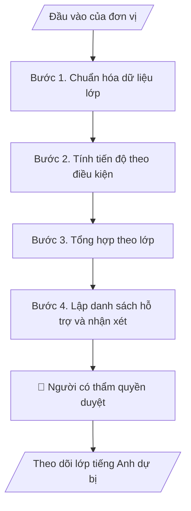

# Theo dõi lớp tiếng Anh dự bị

## Khi nào dùng
Khi có file kết quả các đợt kiểm tra và chuyên cần của các lớp tiếng Anh dự bị và cần bảng tiến độ, danh sách cần hỗ trợ và điều kiện chuyển tiếp.

## Định dạng và file đầu ra

Định dạng đầu ra có thể chọn theo sản phẩm/yêu cầu: .xlsx, .csv, .pdf, .json, .html. Đọc mục “Định dạng bổ sung” trong quy cách đầu ra trước khi chọn.

**Phải tạo file thực tế để tải xuống, không chỉ trả nội dung trong chat.** Định dạng mặc định của skill: **.xlsx**. Nếu yêu cầu gồm cả báo cáo thuyết minh, tạo thêm file Word cho báo cáo; không ghép báo cáo dài vào bảng tính. Không chờ người dùng yêu cầu xuất file lần nữa. Ưu tiên định dạng người dùng chỉ định; đọc quy tắc xuất file tại references/quy-cach-dau-ra.md.

**Chạy qua API (không có công cụ tạo file):** trả đủ nội dung dạng văn bản có tiêu đề, bảng; ứng dụng gọi sẽ xuất file.

## Quy cách đầu ra và thông tin thiếu
Khi dựng file Word/Excel, áp dụng mục “Thể thức và bảng biểu khi dựng file” trong quy cách đầu ra (cỡ chữ từng thành phần, bảng nhiều trang, số trang, phụ lục). Đọc [quy cách và cấu trúc sản phẩm](references/quy-cach-dau-ra.md) trước khi soạn/xuất. File giao chỉ gồm sản phẩm nghiệp vụ được yêu cầu; kiểm tra nội bộ không xuất kèm. Thiếu thông tin thì giữ nguyên trường/mục và chỗ điền theo mẫu gốc (dòng dấu chấm, dấu gạch hoặc ô trống); không tự điền dữ liệu mẫu, số 0, mã chờ xác minh hay dòng chờ ký. Mẫu chuyên ngành còn áp dụng được ưu tiên về cấu trúc, mã biểu và người ký. Bản đầy đủ: [quy tắc chung](references/quy-tac-chung.md).

Khi người dùng yêu cầu bộ slide (.pptx), đọc mục “Xuất PowerPoint (.pptx) khi được yêu cầu” trong quy cách đầu ra.

## Kiểm soát áp dụng và phê duyệt
Trước khi chạy, xác định `ngay_ap_dung`, `loai_hinh_truong`, `quy_che_noi_bo`, `nguon_du_lieu`, `nguoi_kiem_duyet`; chỉ hỏi thông tin liên quan nghiệp vụ, không dùng giá trị giả định thay dữ liệu bắt buộc. Đối chiếu căn cứ pháp lý với văn bản gốc, hiệu lực, điều khoản áp dụng và chuyển tiếp. Bản đầy đủ: [quy tắc chung](references/quy-tac-chung.md).

## Giới hạn và human gate
AI hỗ trợ chuẩn bị và đối chiếu; cán bộ phụ trách kiểm tra dữ liệu/căn cứ, người có thẩm quyền duyệt và ký. Không đánh dấu đã ký, đã duyệt, đã công bố khi chưa có chứng cứ. Dữ liệu sinh viên, sức khỏe, nhân sự, tài chính chỉ dùng theo mục đích và phân quyền, che thông tin định danh khi dùng ví dụ (Luật 91/2025/QH15, hiệu lực 01/01/2026); không tải dữ liệu lên dịch vụ ngoài khi chưa có quyền. Bản đầy đủ: [quy tắc chung](references/quy-tac-chung.md).

## Bối cảnh riêng của VNU-IS

Skill mới cho Trường Quốc tế – ĐHQGHN (VNU-IS), v0.4.2. Dựng từ website công khai và phiếu khảo sát CES còn trống; **chưa có dữ liệu khảo sát thực tế của đơn vị**. Đọc [bối cảnh VNU-IS](references/boi-canh-vnuis.md) trước khi chạy; các mã C1–C8 nằm ở mục 6 của file đó.

- **Đơn vị thường dùng:** Phòng Đào tạo (tiếng Anh dự bị).
- **Nghiệp vụ trong phiếu CES:** không có dòng riêng trong phiếu CES; tiếng Anh dự bị được ghi ở Phòng Đào tạo (sheet 00) và website nêu mô hình dự bị cộng 2+2; cần xác nhận khi khảo sát.

**Chờ xác nhận khi khảo sát**
- Điều kiện chuyển tiếp và thang điểm (C2, C3).
- Hệ thống lưu điểm tiếng Anh dự bị (C5).

Nếu người dùng chưa trả lời mục chờ xác nhận liên quan, hỏi lại; không tự điền giả định.

## Đầu vào (Input)

| Trường | Mô tả | Bắt buộc |
|---|---|---|
| `danh_sach_lop` | Danh sách người học theo lớp, mã người học, chương trình dự kiến vào | Có |
| `ket_qua_kiem_tra` | Điểm đầu vào và các lần kiểm tra theo kỹ năng | Có |
| `chuyen_can` | Dữ liệu chuyên cần theo buổi | Không |
| `dieu_kien_chuyen_tiep` | Điều kiện chuyển lên chương trình chính do Trường quy định | Có |
| `moc_xet` | Ngày các mốc xét chuyển tiếp | Có |

### Thông tin VNU-IS đã điền sẵn (không hỏi lại)

| Mục | Giá trị mặc định |
|---|---|
| Cơ quan chủ quản; Trường; địa danh | Đại học Quốc gia Hà Nội (ĐHQGHN); Trường Quốc tế – ĐHQGHN (VNU – International School); Hà Nội |
| Đơn vị sử dụng và phối hợp | Phòng Đào tạo (tiếng Anh dự bị) |
| Cơ sở | Xuân Thủy (Cầu Giấy); Phan Tây Nhạc (Xuân Phương); Hòa Lạc (tòa HT1, Khu Đô thị ĐHQGHN). Ghi rõ cơ sở khi nội dung gắn địa điểm |
| Mô hình đào tạo | Chọn đúng mô hình trước khi áp quy tắc, không áp quy tắc của mô hình này cho mô hình khác: (1) ĐHQGHN cấp bằng; (2) liên kết quốc tế, đối tác nước ngoài cấp bằng; (3) song bằng; (4) cử nhân – thạc sĩ tích hợp; (5) tiếng Anh dự bị và mô hình 2+2 |
| Ngôn ngữ đầu ra | Tiếng Việt là bản gốc; thêm tiếng Anh cho đối tác, người học quốc tế hoặc khi được yêu cầu |
| Hệ thống nguồn dữ liệu có trên website | LMS; cổng sinh viên. Skill không kết nối hệ thống, chỉ dùng file xuất/tải lên (C5) |
| Người duyệt và ký | Ghi theo vai trò (Trưởng phòng, Phó Hiệu trưởng phụ trách, Hiệu trưởng); tuyến duyệt và thẩm quyền ký chờ C1, C6 |

Nguồn: website và phiếu CES; đổi theo khảo sát thì sửa tại đây và trong `references/boi-canh-vnuis.md`.

## Quy trình

*⏱ là ước tính ban đầu của bộ gốc, chưa đo tại VNU-IS; hiệu chỉnh sau khảo sát.*

**Bước 1. Chuẩn hóa dữ liệu lớp**
- Làm gì: Ghép danh sách với kết quả và chuyên cần theo mã người học; lập danh sách thiếu dữ liệu.
- Dùng input: `danh_sach_lop`, `ket_qua_kiem_tra`, `chuyen_can`
- Vai trò: Chuyên viên đào tạo · AI hỗ trợ: ghép và kiểm tra · ⏱ thời gian do đơn vị ước tính sau khảo sát
- Lưu ý nghiệp vụ: Báo cáo ra ngoài Phòng dùng mã người học, không họ tên.
- → Kết quả bước: Bảng dữ liệu chuẩn hóa.

**Bước 2. Tính tiến độ theo điều kiện**
- Làm gì: Đối chiếu từng người với điều kiện chuyển tiếp: đã đạt, đang tiến tới, có nguy cơ; ghi lý do theo từng điều kiện.
- Dùng input: `ket_qua_kiem_tra`, `dieu_kien_chuyen_tiep`
- Vai trò: Chuyên viên đào tạo · AI hỗ trợ: tính và phân loại · ⏱ thời gian do đơn vị ước tính sau khảo sát
- Lưu ý nghiệp vụ: Ngưỡng nguy cơ do Phòng đặt; chưa đặt thì chỉ nêu khoảng cách đến điều kiện.
- → Kết quả bước: Bảng tiến độ.

**Bước 3. Tổng hợp theo lớp**
- Làm gì: Thống kê theo lớp và chương trình dự kiến: số người đạt, nguy cơ, thiếu dữ liệu.
- Dùng input: `danh_sach_lop`, `moc_xet`
- Vai trò: Chuyên viên đào tạo · AI hỗ trợ: tổng hợp · ⏱ thời gian do đơn vị ước tính sau khảo sát
- Lưu ý nghiệp vụ: Không so sánh chất lượng giảng viên từ số liệu lớp.
- → Kết quả bước: Bảng theo lớp.

**Bước 4. Lập danh sách hỗ trợ và nhận xét**
- Làm gì: Danh sách người cần hỗ trợ trước mốc xét, nhận xét theo số liệu, việc cần làm.
- Dùng input: `moc_xet`
- Vai trò: Trưởng bộ phận · AI hỗ trợ: dự thảo · ⏱ thời gian do đơn vị ước tính sau khảo sát
- Lưu ý nghiệp vụ: Quyết định hỗ trợ và chuyển tiếp do Phòng.
- → Kết quả bước: Danh sách hỗ trợ và nhận xét.

## Luồng quy trình (Workflow)

## Đầu ra

File nghiệp vụ thực tế theo định dạng mặc định ở đầu skill hoặc định dạng người dùng yêu cầu, kèm liên kết tải trong phản hồi cuối.

Sản phẩm nghiệp vụ hoàn chỉnh theo [quy cách và cấu trúc](references/quy-cach-dau-ra.md), giữ các trường chưa có dữ liệu ở trạng thái trống. Không xuất kèm danh mục kiểm/phụ lục kiểm tra đầu ra.

## Kiểm tra nội bộ trước khi giao

- [ ] Bố cục khớp cấu trúc tại references/quy-cach-dau-ra.md.
- [ ] Trạng thái từng người khớp điều kiện cung cấp.
- [ ] Không có họ tên trong bản tổng hợp.
- [ ] Người thiếu dữ liệu được liệt kê riêng.
- [ ] Không có kết luận về chất lượng giảng viên.
- [ ] Đã qua Human gate.

Tiêu chí đạt = tất cả các ô được đánh dấu.

## Human gate (người kiểm duyệt)
- **Trưởng phòng Đào tạo** xác nhận điều kiện và danh sách.
- **Người có thẩm quyền** quyết định xét chuyển tiếp.

## Giới hạn (guardrails)
- KHÔNG tự quyết người được chuyển hoặc không được chuyển.
- KHÔNG tải dữ liệu người học lên dịch vụ ngoài khi chưa có quyền (C5).

## Căn cứ & lưu ý
- Căn cứ pháp lý và quy định nội bộ do người dùng cung cấp; chưa có thì ghi `[CẦN XÁC MINH]`, không suy diễn.
- Ví dụ trong skill chỉ để minh họa; không đưa dữ liệu cá nhân thật vào ví dụ. Tên Trường, cơ quan chủ quản và địa danh dùng đúng bảng thông tin VNU-IS đã điền sẵn.

## Quản trị phiên bản
- Phiên bản gói VNU-IS `0.4.2` (cập nhật 2026-10-11); hồ sơ tại [references/version.json](references/version.json). Skill mới, không có bản gốc trong bộ 171 skill; dùng khung và quy cách đầu ra của skill `funnel-theo-doi-thi-sinh`.
- Người phê duyệt nghiệp vụ: **chưa chỉ định**. Trạng thái: dự thảo nghiệp vụ, chờ khảo sát; kiểm tra pháp lý trước thực thi.
- Giấy phép theo LICENSE của kho (bản quyền CES Global).
