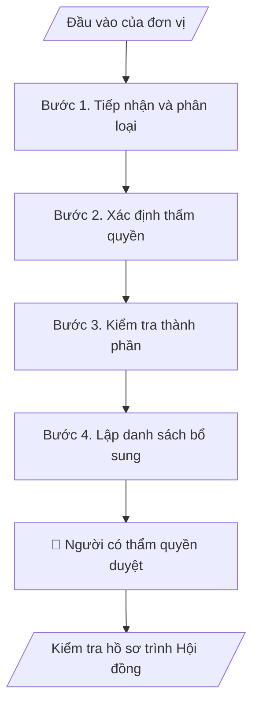

# Kiểm tra hồ sơ trình Hội đồng

## Khi nào dùng
Khi thư ký Hội đồng nhận tờ trình, đề án, chương trình đào tạo, quy chế hoặc nội dung xin ý kiến và cần biết hồ sơ đã đủ để đưa ra phiên họp chưa.

## Định dạng và file đầu ra

Định dạng đầu ra có thể chọn theo sản phẩm/yêu cầu: .docx, .pdf. Đọc mục “Định dạng bổ sung” trong quy cách đầu ra trước khi chọn.

**Phải tạo file thực tế để tải xuống, không chỉ trả nội dung trong chat.** Định dạng mặc định của skill: **.docx**. Nếu có bảng số liệu nghiệp vụ yêu cầu file bảng tính riêng, tạo thêm Excel theo yêu cầu; không tự tạo file kiểm tra. Không chờ người dùng yêu cầu xuất file lần nữa. Ưu tiên định dạng người dùng chỉ định; đọc quy tắc xuất file tại references/quy-cach-dau-ra.md.

**Chạy qua API (không có công cụ tạo file):** trả đủ nội dung dạng văn bản có tiêu đề, bảng; ứng dụng gọi sẽ xuất file.

## Quy cách đầu ra và thông tin thiếu
Khi dựng file Word/Excel, áp dụng mục “Thể thức và bảng biểu khi dựng file” trong quy cách đầu ra (cỡ chữ từng thành phần, bảng nhiều trang, số trang, phụ lục). Đọc [quy cách và cấu trúc sản phẩm](references/quy-cach-dau-ra.md) trước khi soạn/xuất. File giao chỉ gồm sản phẩm nghiệp vụ được yêu cầu; kiểm tra nội bộ không xuất kèm. Thiếu thông tin thì giữ nguyên trường/mục và chỗ điền theo mẫu gốc (dòng dấu chấm, dấu gạch hoặc ô trống); không tự điền dữ liệu mẫu, số 0, mã chờ xác minh hay dòng chờ ký. Mẫu chuyên ngành còn áp dụng được ưu tiên về cấu trúc, mã biểu và người ký. Bản đầy đủ: [quy tắc chung](references/quy-tac-chung.md).

Khi người dùng yêu cầu bộ slide (.pptx), đọc mục “Xuất PowerPoint (.pptx) khi được yêu cầu” trong quy cách đầu ra.

Khi báo cáo có số liệu cần so sánh hoặc nêu xu hướng, đọc mục “Biểu đồ và hình trong báo cáo số liệu” trong quy cách đầu ra trước khi vẽ.

## Kiểm soát áp dụng và phê duyệt
Trước khi chạy, xác định `ngay_ap_dung`, `loai_hinh_truong`, `quy_che_noi_bo`, `nguon_du_lieu`, `nguoi_kiem_duyet`; chỉ hỏi thông tin liên quan nghiệp vụ, không dùng giá trị giả định thay dữ liệu bắt buộc. Đối chiếu căn cứ pháp lý với văn bản gốc, hiệu lực, điều khoản áp dụng và chuyển tiếp. Bản đầy đủ: [quy tắc chung](references/quy-tac-chung.md).

## Giới hạn và human gate
AI hỗ trợ chuẩn bị và đối chiếu; cán bộ phụ trách kiểm tra dữ liệu/căn cứ, người có thẩm quyền duyệt và ký. Không đánh dấu đã ký, đã duyệt, đã công bố khi chưa có chứng cứ. Dữ liệu sinh viên, sức khỏe, nhân sự, tài chính chỉ dùng theo mục đích và phân quyền, che thông tin định danh khi dùng ví dụ (Luật 91/2025/QH15, hiệu lực 01/01/2026); không tải dữ liệu lên dịch vụ ngoài khi chưa có quyền. Bản đầy đủ: [quy tắc chung](references/quy-tac-chung.md).

## Bối cảnh riêng của VNU-IS

Skill mới cho Trường Quốc tế – ĐHQGHN (VNU-IS), v0.4.2. Dựng từ website công khai và phiếu khảo sát CES còn trống; **chưa có dữ liệu khảo sát thực tế của đơn vị**. Đọc [bối cảnh VNU-IS](references/boi-canh-vnuis.md) trước khi chạy; các mã C1–C8 nằm ở mục 6 của file đó.

- **Đơn vị thường dùng:** Hội đồng Khoa học và Đào tạo (thư ký); đơn vị trình hồ sơ.
- **Nghiệp vụ trong phiếu CES:** "Tiếp nhận đề xuất: Tiếp nhận và phân loại nội dung xin ý kiến/thẩm định của Hội đồng" (sheet `09_KS_HD_KH_DT`). Tần suất gợi ý: Theo hồ sơ/phiên họp. Đầu vào gợi ý: Tờ trình; đề án/chương trình; quy định; biểu mẫu; hồ sơ kèm theo. Khó khăn gợi ý: Hồ sơ từ nhiều đơn vị, tên gọi và thành phần chưa đồng nhất. Nghiệp vụ liên quan: "Kiểm tra hồ sơ: Kiểm tra thành phần, tính đầy đủ và điều kiện đưa ra Hội đồng".

**Điều chỉnh khi dùng cho VNU-IS**
- Theo Điều 18 Luật 125/2025/QH15, Hội đồng khoa học và đào tạo chỉ tư vấn; "nghị quyết", "kết luận" của Hội đồng là ý kiến tham mưu, quyết định thuộc Hiệu trưởng hoặc cấp có thẩm quyền (chờ C6). Không viết như quyết định có hiệu lực thi hành. Hội đồng trường công lập đã chấm dứt từ 01/01/2026 (Điều 46).

**Chờ xác nhận khi khảo sát**
- Quy chế và danh mục thành phần hồ sơ của Hội đồng (C2, C8).
- Tuyến chuyển hồ sơ giữa đơn vị và Hội đồng (C6).

Nếu người dùng chưa trả lời mục chờ xác nhận liên quan, hỏi lại; không tự điền giả định.

## Đầu vào (Input)

| Trường | Mô tả | Bắt buộc |
|---|---|---|
| `ho_so_trinh` | Tờ trình và toàn bộ hồ sơ kèm theo | Có |
| `danh_muc_thanh_phan` | Danh mục thành phần bắt buộc theo từng loại nội dung do Hội đồng hoặc Trường quy định | Có |
| `quy_che_hoi_dong` | Quy chế về thẩm quyền và điều kiện đưa nội dung ra Hội đồng | Có |
| `y_kien_don_vi` | Ý kiến các đơn vị liên quan nếu quy định yêu cầu | Không |

### Thông tin VNU-IS đã điền sẵn (không hỏi lại)

| Mục | Giá trị mặc định |
|---|---|
| Cơ quan chủ quản; Trường; địa danh | Đại học Quốc gia Hà Nội (ĐHQGHN); Trường Quốc tế – ĐHQGHN (VNU – International School); Hà Nội |
| Đơn vị sử dụng và phối hợp | Hội đồng Khoa học và Đào tạo (thư ký); đơn vị trình hồ sơ |
| Cơ sở | Xuân Thủy (Cầu Giấy); Phan Tây Nhạc (Xuân Phương); Hòa Lạc (tòa HT1, Khu Đô thị ĐHQGHN). Ghi rõ cơ sở khi nội dung gắn địa điểm |
| Ngôn ngữ đầu ra | Tiếng Việt là bản gốc; thêm tiếng Anh cho đối tác, người học quốc tế hoặc khi được yêu cầu |
| Hệ thống nguồn dữ liệu có trên website | E-Office (văn bản điều hành). Skill không kết nối hệ thống, chỉ dùng file xuất/tải lên (C5) |
| Người duyệt và ký | Ghi theo vai trò (Trưởng phòng, Phó Hiệu trưởng phụ trách, Hiệu trưởng); tuyến duyệt và thẩm quyền ký chờ C1, C6 |

Nguồn: website và phiếu CES; đổi theo khảo sát thì sửa tại đây và trong `references/boi-canh-vnuis.md`.

## Quy trình

*⏱ là ước tính ban đầu của bộ gốc, chưa đo tại VNU-IS; hiệu chỉnh sau khảo sát.*

**Bước 1. Tiếp nhận và phân loại**
- Làm gì: Ghi ngày nhận, đơn vị trình, tên hồ sơ, loại nội dung (đề án, chương trình, quy chế, ý kiến chuyên môn, khác).
- Dùng input: `ho_so_trinh`
- Vai trò: Thư ký Hội đồng · AI hỗ trợ: lập phiếu tiếp nhận · ⏱ thời gian do đơn vị ước tính sau khảo sát
- Lưu ý nghiệp vụ: Không rõ loại thì ghi "chưa phân loại" và hỏi lại.
- → Kết quả bước: Phiếu tiếp nhận.

**Bước 2. Xác định thẩm quyền**
- Làm gì: Đối chiếu nội dung với quy chế Hội đồng để nêu nội dung thuộc thẩm quyền xin ý kiến hay thẩm định, hay chuyển đơn vị khác.
- Dùng input: `quy_che_hoi_dong`
- Vai trò: Thư ký Hội đồng · AI hỗ trợ: đối chiếu quy chế · ⏱ thời gian do đơn vị ước tính sau khảo sát
- Lưu ý nghiệp vụ: Chưa có quy chế thì để trống và ghi `[CẦN XÁC MINH]` (C2); không tự suy ra thẩm quyền.
- → Kết quả bước: Nhận định thẩm quyền để người có thẩm quyền xác nhận.

**Bước 3. Kiểm tra thành phần**
- Làm gì: Đối chiếu từng thành phần: có, thiếu, không rõ; kiểm tra phiên bản và phụ lục được nhắc trong tờ trình có mặt đầy đủ; ý kiến đơn vị liên quan.
- Dùng input: `ho_so_trinh`, `danh_muc_thanh_phan`, `y_kien_don_vi`
- Vai trò: Thư ký Hội đồng · AI hỗ trợ: lập bảng kiểm · ⏱ thời gian do đơn vị ước tính sau khảo sát
- Lưu ý nghiệp vụ: Mâu thuẫn giữa tờ trình và phụ lục (số liệu, tên, ngày) được nêu riêng.
- → Kết quả bước: Bảng kiểm thành phần.

**Bước 4. Lập danh sách bổ sung**
- Làm gì: Liệt kê điều cần bổ sung, đơn vị trả lời, hạn đề xuất.
- Dùng input: `danh_muc_thanh_phan`
- Vai trò: Thư ký Hội đồng · AI hỗ trợ: dự thảo danh sách · ⏱ thời gian do đơn vị ước tính sau khảo sát
- Lưu ý nghiệp vụ: Hạn do người có thẩm quyền chốt.
- → Kết quả bước: Danh sách cần bổ sung.

## Luồng quy trình (Workflow)

## Đầu ra

File nghiệp vụ thực tế theo định dạng mặc định ở đầu skill hoặc định dạng người dùng yêu cầu, kèm liên kết tải trong phản hồi cuối.

Sản phẩm nghiệp vụ hoàn chỉnh theo [quy cách và cấu trúc](references/quy-cach-dau-ra.md), giữ các trường chưa có dữ liệu ở trạng thái trống. Không xuất kèm danh mục kiểm/phụ lục kiểm tra đầu ra.

## Kiểm tra nội bộ trước khi giao

- [ ] Bố cục khớp cấu trúc tại references/quy-cach-dau-ra.md.
- [ ] Mọi thành phần trong danh mục được đối chiếu.
- [ ] Phụ lục nhắc trong tờ trình đều được kiểm tra.
- [ ] Không có kết luận hồ sơ đủ điều kiện.
- [ ] Chỗ thiếu quy chế được đánh dấu.
- [ ] Đã qua Human gate.

Tiêu chí đạt = tất cả các ô được đánh dấu.

## Human gate (người kiểm duyệt)
- **Thư ký Hội đồng** xác nhận bảng kiểm.
- **Người có thẩm quyền** quyết định hồ sơ đủ điều kiện đưa ra Hội đồng.

## Giới hạn (guardrails)
- KHÔNG tự kết luận hồ sơ đủ điều kiện hay thuộc thẩm quyền.
- KHÔNG chia sẻ hồ sơ ngoài danh sách được phép.

## Căn cứ & lưu ý
- Căn cứ pháp lý và quy định nội bộ do người dùng cung cấp; chưa có thì ghi `[CẦN XÁC MINH]`, không suy diễn.
- Ví dụ trong skill chỉ để minh họa; không đưa dữ liệu cá nhân thật vào ví dụ. Tên Trường, cơ quan chủ quản và địa danh dùng đúng bảng thông tin VNU-IS đã điền sẵn.

## Quản trị phiên bản
- Phiên bản gói VNU-IS `0.4.2` (cập nhật 2026-10-11); hồ sơ tại [references/version.json](references/version.json). Skill mới, không có bản gốc trong bộ 171 skill; dùng khung và quy cách đầu ra của skill `hop-nhat-bao-cao-don-vi`.
- Người phê duyệt nghiệp vụ: **chưa chỉ định**. Trạng thái: dự thảo nghiệp vụ, chờ khảo sát; kiểm tra pháp lý trước thực thi.
- Giấy phép theo LICENSE của kho (bản quyền CES Global).
