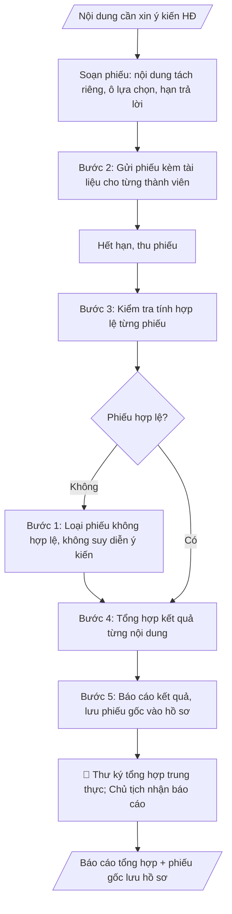

# Phiếu lấy ý kiến hội đồng

## Khi nào dùng
Khi cần xin ý kiến Hội đồng KH&ĐT bằng văn bản (không họp tập trung): các nội dung phát sinh
giữa hai kỳ họp, nội dung đơn giản đã có đủ tài liệu, hoặc cần ý kiến nhanh. Không áp dụng cho
nội dung mà quy chế bắt buộc phải họp.

## Khi nào KHÔNG dùng
- Nội dung quy chế bắt buộc phải họp tập trung (không dùng phiếu lấy ý kiến thay phiên họp).

## Định dạng và file đầu ra

Định dạng đầu ra có thể chọn theo sản phẩm/yêu cầu: .docx, .pdf. Đọc mục “Định dạng bổ sung” trong quy cách đầu ra trước khi chọn.

**Phải tạo file thực tế để tải xuống, không chỉ trả nội dung trong chat.** Định dạng mặc định của skill: **.docx**. Nếu có bảng số liệu nghiệp vụ yêu cầu file bảng tính riêng, tạo thêm Excel theo yêu cầu; không tự tạo file kiểm tra. Không chờ người dùng yêu cầu xuất file lần nữa. Ưu tiên định dạng người dùng chỉ định; đọc quy tắc xuất file tại references/quy-cach-dau-ra.md.

**Chạy qua API (không có công cụ tạo file):** trả đủ nội dung dạng văn bản có tiêu đề, bảng; ứng dụng gọi sẽ xuất file.

## Quy cách đầu ra và thông tin thiếu
Khi dựng file Word/Excel, áp dụng mục “Thể thức và bảng biểu khi dựng file” trong quy cách đầu ra (cỡ chữ từng thành phần, bảng nhiều trang, số trang, phụ lục). Đọc [quy cách và cấu trúc sản phẩm](references/quy-cach-dau-ra.md) trước khi soạn/xuất. File giao chỉ gồm sản phẩm nghiệp vụ được yêu cầu; kiểm tra nội bộ không xuất kèm. Thiếu thông tin thì giữ nguyên trường/mục và chỗ điền theo mẫu gốc (dòng dấu chấm, dấu gạch hoặc ô trống); không tự điền dữ liệu mẫu, số 0, mã chờ xác minh hay dòng chờ ký. Mẫu chuyên ngành còn áp dụng được ưu tiên về cấu trúc, mã biểu và người ký. Bản đầy đủ: [quy tắc chung](references/quy-tac-chung.md).

Khi người dùng yêu cầu bộ slide (.pptx), đọc mục “Xuất PowerPoint (.pptx) khi được yêu cầu” trong quy cách đầu ra.

## Kiểm soát áp dụng và phê duyệt
Trước khi chạy, xác định `ngay_ap_dung`, `loai_hinh_truong`, `quy_che_noi_bo`, `nguon_du_lieu`, `nguoi_kiem_duyet`; chỉ hỏi thông tin liên quan nghiệp vụ, không dùng giá trị giả định thay dữ liệu bắt buộc. Đối chiếu căn cứ pháp lý với văn bản gốc, hiệu lực, điều khoản áp dụng và chuyển tiếp. Bản đầy đủ: [quy tắc chung](references/quy-tac-chung.md).

## Giới hạn và human gate
AI hỗ trợ chuẩn bị và đối chiếu; cán bộ phụ trách kiểm tra dữ liệu/căn cứ, người có thẩm quyền duyệt và ký. Không đánh dấu đã ký, đã duyệt, đã công bố khi chưa có chứng cứ. Dữ liệu sinh viên, sức khỏe, nhân sự, tài chính chỉ dùng theo mục đích và phân quyền, che thông tin định danh khi dùng ví dụ (Luật 91/2025/QH15, hiệu lực 01/01/2026); không tải dữ liệu lên dịch vụ ngoài khi chưa có quyền. Bản đầy đủ: [quy tắc chung](references/quy-tac-chung.md).

## Bối cảnh riêng của VNU-IS

Bản chỉnh cho Trường Quốc tế – ĐHQGHN (VNU-IS), v0.4.2. Dựng từ website công khai và phiếu khảo sát CES còn trống; **chưa có dữ liệu khảo sát thực tế của đơn vị**. Đọc [bối cảnh VNU-IS](references/boi-canh-vnuis.md) trước khi chạy; các mã C1–C8 nằm ở mục 6 của file đó.

- **Đơn vị thường dùng:** Hội đồng Khoa học và Đào tạo (thư ký, người xử lý hồ sơ).
- **Nghiệp vụ trong phiếu CES:** "Lấy ý kiến – phản biện: Tổng hợp ý kiến chuyên gia/thành viên trước hoặc tại phiên họp" (sheet `09_KS_HD_KH_DT`). Tần suất gợi ý: Theo hồ sơ/phiên họp. Đầu vào gợi ý: Phiếu nhận xét; báo cáo phản biện; email/ý kiến; tiêu chí thẩm định. Khó khăn gợi ý: Ý kiến nhiều định dạng; nội dung trùng lặp hoặc mâu thuẫn; khó truy vết. Đây là gợi ý có sẵn của CES, chưa phải xác nhận của đơn vị.

**Điều chỉnh khi dùng cho VNU-IS**
- Theo Điều 18 Luật 125/2025/QH15, Hội đồng khoa học và đào tạo chỉ tư vấn; "nghị quyết", "kết luận" của Hội đồng là ý kiến tham mưu, quyết định thuộc Hiệu trưởng hoặc cấp có thẩm quyền (chờ C6). Không viết như quyết định có hiệu lực thi hành. Hội đồng trường công lập đã chấm dứt từ 01/01/2026 (Điều 46).
- Thành phần theo website: Chủ tịch (đại diện ĐHQGHN), Phó Chủ tịch, ủy viên thường trực, thư ký, ủy viên; có chuyên gia ngoài Trường. Phiếu phân biệt thành viên trong và ngoài Trường; không tự gán chức danh.
- Tổng hợp theo từng nội dung hoặc điều khoản; ghi rõ ý kiến không đồng thuận và nguồn từng ý kiến để truy vết.
- Ý kiến phản biện có thể cần bảo mật: chỉ chia sẻ theo quy định của Hội đồng.

**Chờ xác nhận khi khảo sát**
- Mẫu phiếu và tiêu chí thẩm định (C8).
- Quy chế hoạt động của Hội đồng (C2).

Nếu người dùng chưa trả lời mục chờ xác nhận liên quan, hỏi lại; không tự điền giả định.

## Đầu vào (Input)

| Trường | Mô tả | Bắt buộc |
|---|---|---|
| `noi_dung_xin_y_kien` | Từng nội dung cần xin ý kiến, trình bày ngắn gọn rõ ràng | Có |
| `tai_lieu_kem` | Danh mục tài liệu gửi kèm để thành viên nghiên cứu | Có |
| `thanh_vien` | Danh sách thành viên được xin ý kiến | Có |
| `han_tra_loi` | Thời hạn trả lời phiếu | Có |
| `hinh_thuc_y_kien` | Đồng ý / Không đồng ý / Ý kiến khác (ghi rõ) | Không (mặc định: 3 ô trên) |

### Thông tin VNU-IS đã điền sẵn (không hỏi lại)

| Mục | Giá trị mặc định |
|---|---|
| Cơ quan chủ quản; Trường; địa danh | Đại học Quốc gia Hà Nội (ĐHQGHN); Trường Quốc tế – ĐHQGHN (VNU – International School); Hà Nội |
| Đơn vị sử dụng và phối hợp | Hội đồng Khoa học và Đào tạo (thư ký, người xử lý hồ sơ) |
| Cơ sở | Xuân Thủy (Cầu Giấy); Phan Tây Nhạc (Xuân Phương); Hòa Lạc (tòa HT1, Khu Đô thị ĐHQGHN). Ghi rõ cơ sở khi nội dung gắn địa điểm |
| Ngôn ngữ đầu ra | Tiếng Việt là bản gốc; thêm tiếng Anh cho đối tác, người học quốc tế hoặc khi được yêu cầu |
| Hệ thống nguồn dữ liệu có trên website | E-Office (văn bản điều hành). Skill không kết nối hệ thống, chỉ dùng file xuất/tải lên (C5) |
| Người duyệt và ký | Ghi theo vai trò (Trưởng phòng, Phó Hiệu trưởng phụ trách, Hiệu trưởng); tuyến duyệt và thẩm quyền ký chờ C1, C6 |

Nguồn: website và phiếu CES; đổi theo khảo sát thì sửa tại đây và trong `references/boi-canh-vnuis.md`.

## Quy trình

*⏱ là ước tính ban đầu của bộ gốc, chưa đo tại VNU-IS; hiệu chỉnh sau khảo sát.*

**Bước 1. Soạn phiếu lấy ý kiến**
- Làm gì: soạn phiếu gồm tiêu đề; từng nội dung trong `noi_dung_xin_y_kien` tách riêng, trình bày ngắn gọn rõ ràng; danh mục `tai_lieu_kem`; các ô lựa chọn theo `hinh_thuc_y_kien` (mặc định: Đồng ý / Không đồng ý / Ý kiến khác + dòng ghi ý kiến); họ tên + chữ ký thành viên; `han_tra_loi` và nơi gửi lại.
- Dùng input: `noi_dung_xin_y_kien`, `tai_lieu_kem`, `han_tra_loi`, `hinh_thuc_y_kien`.
- Vai trò: Thư ký hội đồng (soạn phiếu theo đúng nội dung xin ý kiến) · AI hỗ trợ: soạn phiếu: nội dung tách riêng, ô lựa chọn, hạn trả lời, nơi gửi lại · ⏱ ~15–20 phút (ước tính)
- Lưu ý nghiệp vụ: mỗi nội dung chỉ hỏi một vấn đề, không gộp nhiều câu hỏi vào một ô; không dùng phiếu lấy ý kiến thay phiên họp đối với nội dung quy chế bắt buộc phải họp.
- → Kết quả bước: mẫu phiếu lấy ý kiến hoàn chỉnh.

**Bước 2. Gửi phiếu kèm tài liệu**
- Làm gì: gửi phiếu cho từng thành viên trong `thanh_vien` kèm đầy đủ `tai_lieu_kem` (bản giấy hoặc điện tử theo quy chế); ghi nhận thời điểm gửi và danh sách đã nhận.
- Dùng input: `thanh_vien`, `tai_lieu_kem`, kết quả bước 1.
- Vai trò: Văn thư (gửi phiếu kèm đầy đủ tài liệu cho toàn bộ thành viên) · AI hỗ trợ: lập danh sách gửi và theo dõi nhận/trả · ⏱ ~15–30 phút (ước tính)
- Lưu ý nghiệp vụ: kiểm tra không sót thành viên; lưu bằng chứng đã gửi để xác định phiếu gửi trễ hạn khi tổng hợp.
- → Kết quả bước: phiếu đã gửi đến toàn bộ thành viên + danh sách theo dõi nhận/trả.

**Bước 3. Thu phiếu và kiểm tra tính hợp lệ**
- Làm gì: hết `han_tra_loi`, thu phiếu về; kiểm tra từng phiếu: có chữ ký thành viên, gửi trong hạn, ý kiến ghi rõ ràng; loại phiếu không hợp lệ (thiếu chữ ký, trễ hạn, ý kiến mơ hồ).
- Dùng input: `han_tra_loi`, kết quả bước 2.
- Vai trò: Thư ký hội đồng (thu phiếu, kiểm tra tính hợp lệ, loại phiếu không hợp lệ) · AI hỗ trợ: tổng hợp trước danh sách phiếu thu được theo hạn trả lời, hỗ trợ đối chiếu chữ ký · ⏱ ~30 phút–1 giờ (tùy số phiếu) (ước tính)
- Lưu ý nghiệp vụ: tuyệt đối không suy diễn ý kiến từ phiếu không ghi rõ hoặc phiếu trễ hạn; phiếu không hợp lệ phải loại khỏi tổng hợp và ghi rõ lý do.
- → Kết quả bước: tập phiếu hợp lệ + danh sách phiếu bị loại (kèm lý do).

**Bước 4. Tổng hợp kết quả từng nội dung**
- Làm gì: đếm số phiếu phát ra/thu về; với mỗi nội dung, tổng hợp số đồng ý/không đồng ý/ý kiến khác; trích nguyên văn các ý kiến khác (nếu có); lập bảng tổng hợp.
- Dùng input: kết quả bước 3.
- Vai trò: Thư ký hội đồng (tổng hợp kết quả chỉ từ phiếu hợp lệ) · AI hỗ trợ: đếm và tổng hợp kết quả từng nội dung, trích nguyên văn ý kiến khác · ⏱ ~15–30 phút (ước tính)
- Lưu ý nghiệp vụ: chỉ tổng hợp phiếu hợp lệ; không công bố kết quả khi chưa đủ số phiếu hợp lệ theo quy định; trích ý kiến khác phải nguyên văn, không diễn giải lại.
- → Kết quả bước: bảng tổng hợp kết quả từng nội dung.

**Bước 5. Báo cáo kết quả và lưu hồ sơ**
- Làm gì: lập báo cáo tổng hợp kết quả trình Chủ tịch hội đồng; lưu phiếu gốc vào hồ sơ như biên bản họp.
- Dùng input: kết quả bước 4.
- Vai trò: Chủ tịch hội đồng (nhận báo cáo); Thư ký lưu phiếu gốc vào hồ sơ · AI hỗ trợ: lập báo cáo tổng hợp kết quả trình Chủ tịch · ⏱ ~20–30 phút (ước tính)
- Lưu ý nghiệp vụ: báo cáo phải nêu rõ kết luận từng nội dung (được đa số tán thành hay không) và ý kiến cần tiếp thu; phiếu gốc lưu đầy đủ, không thất lạc.
- → Kết quả bước: báo cáo tổng hợp trình Chủ tịch + phiếu gốc lưu hồ sơ.
## Luồng quy trình (Workflow)

## Đầu ra

File nghiệp vụ thực tế theo định dạng mặc định ở đầu skill hoặc định dạng người dùng yêu cầu, kèm liên kết tải trong phản hồi cuối.

Sản phẩm nghiệp vụ hoàn chỉnh theo [quy cách và cấu trúc](references/quy-cach-dau-ra.md), giữ các trường chưa có dữ liệu ở trạng thái trống. Không xuất kèm danh mục kiểm/phụ lục kiểm tra đầu ra.

## Kiểm tra nội bộ trước khi giao

- [ ] Bố cục khớp mẫu áp dụng và cấu trúc tại references/quy-cach-dau-ra.md.
- [ ] Mỗi nội dung chỉ hỏi một vấn đề, không gộp nhiều câu hỏi vào một ô; nội dung quy chế bắt buộc phải họp không dùng phiếu lấy ý kiến thay phiên họp.
- [ ] Phiếu gửi đúng toàn bộ thành viên kèm đầy đủ tài liệu (bản giấy hoặc điện tử theo quy chế); lưu bằng chứng đã gửi để xác định phiếu gửi trễ hạn.
- [ ] Chỉ tổng hợp phiếu hợp lệ (có chữ ký thành viên, gửi trong hạn, ý kiến ghi rõ ràng); phiếu không hợp lệ loại khỏi tổng hợp và ghi rõ lý do.
- [ ] Bảng tổng hợp: số phiếu phát ra/thu về + số đồng ý/không đồng ý/ý kiến khác từng nội dung; ý kiến khác trích nguyên văn, không diễn giải lại.
- [ ] Không công bố kết quả khi chưa đủ số phiếu hợp lệ theo quy định.
- [ ] Báo cáo nêu rõ kết luận từng nội dung (được đa số tán thành hay không) và ý kiến cần tiếp thu; phiếu gốc lưu đầy đủ như biên bản họp, không thất lạc.
- [ ] Đã qua Human gate: Chủ tịch quyết định áp dụng hình thức lấy ý kiến bằng văn bản (chỉ nội dung quy chế cho phép); thư ký tổng hợp trung thực.

> Tiêu chí đạt: tất cả các ô được đánh dấu.

## Human gate (người kiểm duyệt)
- **Chủ tịch hội đồng** quyết định áp dụng hình thức lấy ý kiến bằng văn bản (chỉ cho nội dung
  quy chế cho phép, không thay phiên họp bắt buộc).
- **Thư ký hội đồng** tổng hợp trung thực, báo cáo kết quả trình Chủ tịch.

## Giới hạn (guardrails)
- KHÔNG dùng phiếu lấy ý kiến thay cho phiên họp đối với nội dung quy chế bắt buộc phải họp
  (VD: thông qua chương trình đào tạo, xét học hàm... — theo quy chế từng trường).
- KHÔNG suy diễn ý kiến từ phiếu không ghi rõ hoặc phiếu gửi trễ hạn.
- KHÔNG công bố kết quả khi chưa đủ số phiếu hợp lệ theo quy định.

## Căn cứ & lưu ý
- Quy chế tổ chức và hoạt động của Hội đồng KH&ĐT (quy định về hình thức lấy ý kiến).
- Phiếu gốc phải được lưu hồ sơ đầy đủ như biên bản họp.
- Ví dụ trong skill chỉ để minh họa; không đưa dữ liệu cá nhân thật vào ví dụ. Tên Trường, cơ quan chủ quản và địa danh dùng đúng bảng thông tin VNU-IS đã điền sẵn.

## Quản trị phiên bản
- Phiên bản gói VNU-IS `0.4.2` (cập nhật 2026-10-11), dựa trên skill gốc `phieu-lay-y-kien-hoi-dong` bản `1.3.2`; hồ sơ đầy đủ tại [references/version.json](references/version.json).
- Người phê duyệt nghiệp vụ: **chưa chỉ định**. Trạng thái: dự thảo nghiệp vụ; kiểm tra pháp lý trước thực thi. Ngày cập nhật không đồng nghĩa mọi văn bản đã được rà soát toàn văn.
- Giấy phép theo LICENSE của kho (bản quyền CES Global). Lịch sử thay đổi: CHANGELOG.md.
