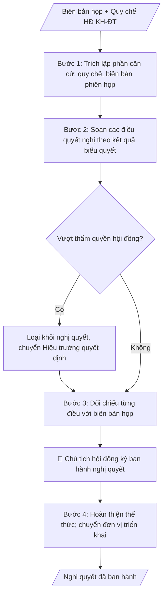

# Nghị quyết Hội đồng KH&ĐT

## Khi nào dùng
Sau phiên họp Hội đồng Khoa học và Đào tạo đã biểu quyết thông qua các nội dung (chương trình
đào tạo, danh mục đề tài, công nhận chức danh, định hướng KHCN...), cần ban hành nghị quyết
làm căn cứ để Hiệu trưởng quyết định và các đơn vị triển khai.

## Định dạng và file đầu ra

Định dạng đầu ra có thể chọn theo sản phẩm/yêu cầu: .docx, .pdf. Đọc mục “Định dạng bổ sung” trong quy cách đầu ra trước khi chọn.

**Phải tạo file thực tế để tải xuống, không chỉ trả nội dung trong chat.** Định dạng mặc định của skill: **.docx**. Nếu có bảng số liệu nghiệp vụ yêu cầu file bảng tính riêng, tạo thêm Excel theo yêu cầu; không tự tạo file kiểm tra. Không chờ người dùng yêu cầu xuất file lần nữa. Ưu tiên định dạng người dùng chỉ định; đọc quy tắc xuất file tại references/quy-cach-dau-ra.md.

**Chạy qua API (không có công cụ tạo file):** trả đủ nội dung dạng văn bản có tiêu đề, bảng; ứng dụng gọi sẽ xuất file.

## Quy cách đầu ra và thông tin thiếu
Khi dựng file Word/Excel, áp dụng mục “Thể thức và bảng biểu khi dựng file” trong quy cách đầu ra (cỡ chữ từng thành phần, bảng nhiều trang, số trang, phụ lục). Đọc [quy cách và cấu trúc sản phẩm](references/quy-cach-dau-ra.md) trước khi soạn/xuất. File giao chỉ gồm sản phẩm nghiệp vụ được yêu cầu; kiểm tra nội bộ không xuất kèm. Thiếu thông tin thì giữ nguyên trường/mục và chỗ điền theo mẫu gốc (dòng dấu chấm, dấu gạch hoặc ô trống); không tự điền dữ liệu mẫu, số 0, mã chờ xác minh hay dòng chờ ký. Mẫu chuyên ngành còn áp dụng được ưu tiên về cấu trúc, mã biểu và người ký. Bản đầy đủ: [quy tắc chung](references/quy-tac-chung.md).

Khi người dùng yêu cầu bộ slide (.pptx), đọc mục “Xuất PowerPoint (.pptx) khi được yêu cầu” trong quy cách đầu ra.

## Kiểm soát áp dụng và phê duyệt
Trước khi chạy, xác định `ngay_ap_dung`, `loai_hinh_truong`, `quy_che_noi_bo`, `nguon_du_lieu`, `nguoi_kiem_duyet`; chỉ hỏi thông tin liên quan nghiệp vụ, không dùng giá trị giả định thay dữ liệu bắt buộc. Đối chiếu căn cứ pháp lý với văn bản gốc, hiệu lực, điều khoản áp dụng và chuyển tiếp. Bản đầy đủ: [quy tắc chung](references/quy-tac-chung.md).

## Giới hạn và human gate
AI hỗ trợ chuẩn bị và đối chiếu; cán bộ phụ trách kiểm tra dữ liệu/căn cứ, người có thẩm quyền duyệt và ký. Không đánh dấu đã ký, đã duyệt, đã công bố khi chưa có chứng cứ. Dữ liệu sinh viên, sức khỏe, nhân sự, tài chính chỉ dùng theo mục đích và phân quyền, che thông tin định danh khi dùng ví dụ (Luật 91/2025/QH15, hiệu lực 01/01/2026); không tải dữ liệu lên dịch vụ ngoài khi chưa có quyền. Bản đầy đủ: [quy tắc chung](references/quy-tac-chung.md).

## Bối cảnh riêng của VNU-IS

Bản chỉnh cho Trường Quốc tế – ĐHQGHN (VNU-IS), v0.4.2. Dựng từ website công khai và phiếu khảo sát CES còn trống; **chưa có dữ liệu khảo sát thực tế của đơn vị**. Đọc [bối cảnh VNU-IS](references/boi-canh-vnuis.md) trước khi chạy; các mã C1–C8 nằm ở mục 6 của file đó.

- **Đơn vị thường dùng:** Hội đồng Khoa học và Đào tạo; Văn phòng Trường.
- **Nghiệp vụ trong phiếu CES:** "Ban hành kết luận: Hoàn thiện, rà soát và phát hành nghị quyết/kết luận/kiến nghị" (sheet `09_KS_HD_KH_DT`). Tần suất gợi ý: Theo phiên họp. Đầu vào gợi ý: Dự thảo biên bản; kết quả biểu quyết; ý kiến chỉnh sửa; mẫu văn bản. Khó khăn gợi ý: Chỉnh sửa nhiều vòng; phải bảo đảm thống nhất giữa biên bản, biểu quyết và văn bản. Đây là gợi ý có sẵn của CES, chưa phải xác nhận của đơn vị.

**Điều chỉnh khi dùng cho VNU-IS**
- Theo Điều 18 Luật 125/2025/QH15, Hội đồng khoa học và đào tạo chỉ tư vấn; "nghị quyết", "kết luận" của Hội đồng là ý kiến tham mưu, quyết định thuộc Hiệu trưởng hoặc cấp có thẩm quyền (chờ C6). Không viết như quyết định có hiệu lực thi hành. Hội đồng trường công lập đã chấm dứt từ 01/01/2026 (Điều 46).
- Đối chiếu ba chiều: biên bản, kết quả biểu quyết, văn bản; mọi con số biểu quyết phải khớp.
- Hội đồng có vai trò tư vấn chuyên môn theo website; chọn hình thức văn bản (nghị quyết, kết luận, kiến nghị) theo quy chế Hội đồng, chưa có quy chế thì hỏi lại (C2).
- Người ban hành và ký (Chủ tịch Hội đồng hay Hiệu trưởng căn cứ kiến nghị của Hội đồng) chưa xác nhận (C1).

**Chờ xác nhận khi khảo sát**
- Quy chế tổ chức và hoạt động của Hội đồng (C2).
- Mẫu nghị quyết và người ký (C1, C8).

Nếu người dùng chưa trả lời mục chờ xác nhận liên quan, hỏi lại; không tự điền giả định.

## Đầu vào (Input)

| Trường | Mô tả | Bắt buộc |
|---|---|---|
| `so_nghi_quyet` | Số, ký hiệu nghị quyết | Có |
| `phien_hop` | Căn cứ phiên họp (số, ngày) và biên bản họp | Có |
| `can_cu` | Quy chế tổ chức HĐ, các văn bản pháp lý liên quan | Có |
| `dieu_quyet_nghi` | Từng điều quyết nghị: nội dung + kết quả biểu quyết | Có |
| `hieu_luc` | Hiệu lực thi hành | Có |
| `noi_nhan` | Nơi nhận (Ban Giám hiệu, các đơn vị, lưu) | Có |

### Thông tin VNU-IS đã điền sẵn (không hỏi lại)

| Mục | Giá trị mặc định |
|---|---|
| Cơ quan chủ quản; Trường; địa danh | Đại học Quốc gia Hà Nội (ĐHQGHN); Trường Quốc tế – ĐHQGHN (VNU – International School); Hà Nội |
| Đơn vị sử dụng và phối hợp | Hội đồng Khoa học và Đào tạo; Văn phòng Trường |
| Cơ sở | Xuân Thủy (Cầu Giấy); Phan Tây Nhạc (Xuân Phương); Hòa Lạc (tòa HT1, Khu Đô thị ĐHQGHN). Ghi rõ cơ sở khi nội dung gắn địa điểm |
| Ngôn ngữ đầu ra | Tiếng Việt là bản gốc; thêm tiếng Anh cho đối tác, người học quốc tế hoặc khi được yêu cầu |
| Hệ thống nguồn dữ liệu có trên website | E-Office (văn bản điều hành). Skill không kết nối hệ thống, chỉ dùng file xuất/tải lên (C5) |
| Người duyệt và ký | Ghi theo vai trò (Trưởng phòng, Phó Hiệu trưởng phụ trách, Hiệu trưởng); tuyến duyệt và thẩm quyền ký chờ C1, C6 |

Nguồn: website và phiếu CES; đổi theo khảo sát thì sửa tại đây và trong `references/boi-canh-vnuis.md`.

## Quy trình

*⏱ là ước tính ban đầu của bộ gốc, chưa đo tại VNU-IS; hiệu chỉnh sau khảo sát.*

**Bước 1. Trích lập phần căn cứ**
- Làm gì: trích Quy chế tổ chức và hoạt động của Hội đồng từ `can_cu`; trích biên bản phiên họp trong `phien_hop` (số biên bản, ngày họp); sắp xếp các căn cứ theo thứ tự (quy chế trước, biên bản sau).
- Dùng input: `can_cu`, `phien_hop`.
- Vai trò: Thư ký hội đồng (trích lập phần căn cứ theo biên bản đã ký) · AI hỗ trợ: trích lập phần căn cứ theo thứ tự quy chế trước, biên bản sau · ⏱ ~10–15 phút (ước tính)
- Lưu ý nghiệp vụ: chỉ trích căn cứ có liên quan trực tiếp đến nội dung quyết nghị; số biên bản và ngày họp phải khớp chính xác biên bản đã ký.
- → Kết quả bước: phần căn cứ hoàn chỉnh (quy chế + biên bản phiên họp).

**Bước 2. Soạn các điều quyết nghị**
- Làm gì: với từng nội dung trong `dieu_quyet_nghi`, viết một điều riêng ghi rõ nội dung và kết quả biểu quyết; điều cuối quy định đơn vị chịu trách nhiệm thi hành; thêm điều về `hieu_luc`.
- Dùng input: `dieu_quyet_nghi`, `hieu_luc`.
- Vai trò: Thư ký hội đồng (soát đảm bảo không sửa đổi nội dung đã biểu quyết) · AI hỗ trợ: soạn từng điều quyết nghị từ nội dung đã biểu quyết, kèm kết quả biểu quyết · ⏱ ~20–30 phút (ước tính)
- Lưu ý nghiệp vụ: mỗi điều chỉ chứa một nội dung đã được biểu quyết thông qua; tuyệt đối không sửa đổi nội dung đã biểu quyết khi soạn nghị quyết; không đưa nội dung vượt thẩm quyền của hội đồng vào quyết nghị.
- → Kết quả bước: dự thảo các điều quyết nghị (kèm kết quả biểu quyết từng điều).

**Bước 3. Đối chiếu với biên bản và kiểm tra thẩm quyền**
- Làm gì: đối chiếu từng điều quyết nghị với biên bản họp (nội dung, số liệu biểu quyết); rà soát từng điều xem có vượt thẩm quyền của hội đồng theo quy chế không (hội đồng tư vấn/quyết nghị chuyên môn; quyết định hành chính thuộc Hiệu trưởng).
- Dùng input: kết quả bước 2, `phien_hop`, `can_cu`.
- Vai trò: Chủ tịch hội đồng (xác nhận, loại nội dung vượt thẩm quyền) · AI hỗ trợ: đối chiếu từng điều với biên bản, rà soát thẩm quyền từng điều · ⏱ ~20–30 phút (ước tính)
- Lưu ý nghiệp vụ: nội dung vượt thẩm quyền thì loại khỏi nghị quyết, chuyển Hiệu trưởng quyết định; sai lệch số liệu biểu quyết so với biên bản phải sửa ngay, không tự điều chỉnh.
- → Kết quả bước: dự thảo nghị quyết đã đối chiếu khớp biên bản và đúng thẩm quyền.

**Bước 4. Hoàn thiện thể thức, ký ban hành và triển khai**
- Làm gì: ghi `so_nghi_quyet`, địa danh và ngày ban hành; lập `noi_nhan`; trình Chủ tịch hội đồng ký ban hành; chuyển nghị quyết đến Hiệu trưởng và các đơn vị liên quan triển khai.
- Dùng input: `so_nghi_quyet`, `noi_nhan`, kết quả bước 3.
- Vai trò: Chủ tịch hội đồng (đối chiếu biên bản, ký ban hành); Văn thư phát hành · AI hỗ trợ: chuẩn bị văn bản, lập danh sách nơi nhận trước khi trình ký · ⏱ ~30 phút–1 ngày làm việc (ước tính)
- Lưu ý nghiệp vụ: Chủ tịch hội đồng đối chiếu với biên bản trước khi ký; nghị quyết hội đồng là căn cứ chuyên môn để Hiệu trưởng ra quyết định hành chính theo thẩm quyền.
- → Kết quả bước: nghị quyết đã ký ban hành, chuyển các đơn vị triển khai.
## Luồng quy trình (Workflow)

## Đầu ra

File nghiệp vụ thực tế theo định dạng mặc định ở đầu skill hoặc định dạng người dùng yêu cầu, kèm liên kết tải trong phản hồi cuối.

Sản phẩm nghiệp vụ hoàn chỉnh theo [quy cách và cấu trúc](references/quy-cach-dau-ra.md), giữ các trường chưa có dữ liệu ở trạng thái trống. Không xuất kèm danh mục kiểm/phụ lục kiểm tra đầu ra.

## Kiểm tra nội bộ trước khi giao

- [ ] Bố cục khớp mẫu áp dụng và cấu trúc tại references/quy-cach-dau-ra.md.
- [ ] Căn cứ pháp lý đầy đủ, còn hiệu lực: Quy chế tổ chức và hoạt động của Hội đồng; số biên bản và ngày họp khớp chính xác biên bản đã ký.
- [ ] Mỗi điều quyết nghị chỉ chứa một nội dung đã biểu quyết thông qua; không đưa nội dung vượt thẩm quyền hội đồng vào quyết nghị (nội dung vượt thẩm quyền chuyển Hiệu trưởng quyết định).
- [ ] Kết quả biểu quyết từng điều khớp 100% biên bản họp — tuyệt đối không sửa đổi nội dung đã biểu quyết.
- [ ] Có điều cuối quy định đơn vị chịu trách nhiệm thi hành và điều về hiệu lực thi hành.
- [ ] Đã qua Human gate: Chủ tịch hội đồng đối chiếu với biên bản trước khi ký ban hành.

> Tiêu chí đạt: tất cả các ô được đánh dấu.

## Human gate (người kiểm duyệt)
- **Chủ tịch Hội đồng** ký ban hành nghị quyết sau khi đối chiếu với biên bản họp.
- **Hiệu trưởng** xem xét và ra quyết định hành chính theo thẩm quyền đối với các nội dung
  cần quyết định (nghị quyết hội đồng là căn cứ chuyên môn).

## Giới hạn (guardrails)
- KHÔNG quyết nghị nội dung vượt thẩm quyền của hội đồng theo quy chế (hội đồng có chức
  năng tư vấn/quyết nghị chuyên môn, không thay quyết định quản lý của Hiệu trưởng).
- KHÔNG ban hành nghị quyết khi chưa có biên bản họp và kết quả biểu quyết hợp lệ.
- KHÔNG sửa đổi nội dung đã biểu quyết khi soạn nghị quyết.

## Căn cứ & lưu ý
- Quy chế tổ chức và hoạt động của Hội đồng KH&ĐT; Luật Giáo dục đại học 2025 (125/2025/QH15).
- Ví dụ trong skill chỉ để minh họa; không đưa dữ liệu cá nhân thật vào ví dụ. Tên Trường, cơ quan chủ quản và địa danh dùng đúng bảng thông tin VNU-IS đã điền sẵn.

## Quản trị phiên bản
- Phiên bản gói VNU-IS `0.4.2` (cập nhật 2026-10-11), dựa trên skill gốc `nghi-quyet-hoi-dong-khdt` bản `1.3.2`; hồ sơ đầy đủ tại [references/version.json](references/version.json).
- Người phê duyệt nghiệp vụ: **chưa chỉ định**. Trạng thái: dự thảo nghiệp vụ; kiểm tra pháp lý trước thực thi. Ngày cập nhật không đồng nghĩa mọi văn bản đã được rà soát toàn văn.
- Giấy phép theo LICENSE của kho (bản quyền CES Global). Lịch sử thay đổi: CHANGELOG.md.
