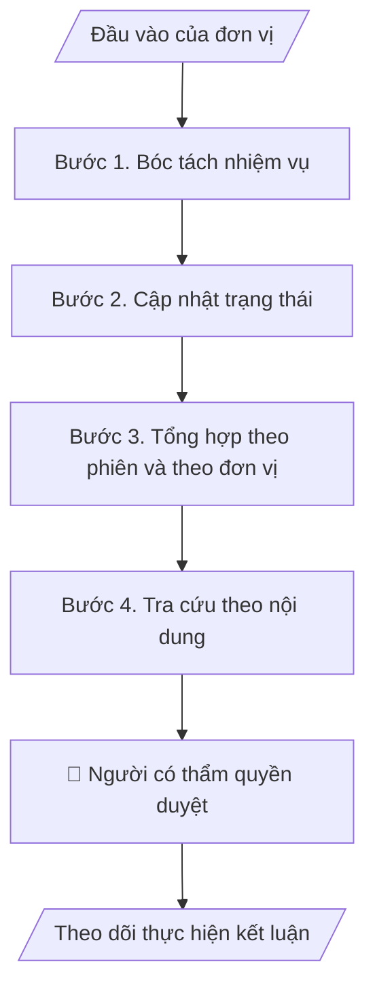

# Theo dõi thực hiện kết luận

## Khi nào dùng
Khi có nghị quyết hoặc kết luận mới cần giao việc và theo dõi; khi cần báo cáo tình hình thực hiện qua nhiều phiên; khi cần tra cứu lịch sử quyết nghị theo chủ đề.

## Định dạng và file đầu ra

Định dạng đầu ra có thể chọn theo sản phẩm/yêu cầu: .xlsx, .csv, .pdf, .json, .html. Đọc mục “Định dạng bổ sung” trong quy cách đầu ra trước khi chọn.

**Phải tạo file thực tế để tải xuống, không chỉ trả nội dung trong chat.** Định dạng mặc định của skill: **.xlsx**. Nếu yêu cầu gồm cả báo cáo thuyết minh, tạo thêm file Word cho báo cáo; không ghép báo cáo dài vào bảng tính. Không chờ người dùng yêu cầu xuất file lần nữa. Ưu tiên định dạng người dùng chỉ định; đọc quy tắc xuất file tại references/quy-cach-dau-ra.md.

**Chạy qua API (không có công cụ tạo file):** trả đủ nội dung dạng văn bản có tiêu đề, bảng; ứng dụng gọi sẽ xuất file.

## Quy cách đầu ra và thông tin thiếu
Khi dựng file Word/Excel, áp dụng mục “Thể thức và bảng biểu khi dựng file” trong quy cách đầu ra (cỡ chữ từng thành phần, bảng nhiều trang, số trang, phụ lục). Đọc [quy cách và cấu trúc sản phẩm](references/quy-cach-dau-ra.md) trước khi soạn/xuất. File giao chỉ gồm sản phẩm nghiệp vụ được yêu cầu; kiểm tra nội bộ không xuất kèm. Thiếu thông tin thì giữ nguyên trường/mục và chỗ điền theo mẫu gốc (dòng dấu chấm, dấu gạch hoặc ô trống); không tự điền dữ liệu mẫu, số 0, mã chờ xác minh hay dòng chờ ký. Mẫu chuyên ngành còn áp dụng được ưu tiên về cấu trúc, mã biểu và người ký. Bản đầy đủ: [quy tắc chung](references/quy-tac-chung.md).

Khi người dùng yêu cầu bộ slide (.pptx), đọc mục “Xuất PowerPoint (.pptx) khi được yêu cầu” trong quy cách đầu ra.

## Kiểm soát áp dụng và phê duyệt
Trước khi chạy, xác định `ngay_ap_dung`, `loai_hinh_truong`, `quy_che_noi_bo`, `nguon_du_lieu`, `nguoi_kiem_duyet`; chỉ hỏi thông tin liên quan nghiệp vụ, không dùng giá trị giả định thay dữ liệu bắt buộc. Đối chiếu căn cứ pháp lý với văn bản gốc, hiệu lực, điều khoản áp dụng và chuyển tiếp. Bản đầy đủ: [quy tắc chung](references/quy-tac-chung.md).

## Giới hạn và human gate
AI hỗ trợ chuẩn bị và đối chiếu; cán bộ phụ trách kiểm tra dữ liệu/căn cứ, người có thẩm quyền duyệt và ký. Không đánh dấu đã ký, đã duyệt, đã công bố khi chưa có chứng cứ. Dữ liệu sinh viên, sức khỏe, nhân sự, tài chính chỉ dùng theo mục đích và phân quyền, che thông tin định danh khi dùng ví dụ (Luật 91/2025/QH15, hiệu lực 01/01/2026); không tải dữ liệu lên dịch vụ ngoài khi chưa có quyền. Bản đầy đủ: [quy tắc chung](references/quy-tac-chung.md).

## Bối cảnh riêng của VNU-IS

Skill mới cho Trường Quốc tế – ĐHQGHN (VNU-IS), v0.4.2. Dựng từ website công khai và phiếu khảo sát CES còn trống; **chưa có dữ liệu khảo sát thực tế của đơn vị**. Đọc [bối cảnh VNU-IS](references/boi-canh-vnuis.md) trước khi chạy; các mã C1–C8 nằm ở mục 6 của file đó.

- **Đơn vị thường dùng:** Hội đồng Khoa học và Đào tạo (thư ký); đơn vị được giao thực hiện.
- **Nghiệp vụ trong phiếu CES:** "Theo dõi thực hiện: Theo dõi đơn vị thực hiện kết luận, kiến nghị và nội dung cần hoàn thiện" (sheet `09_KS_HD_KH_DT`). Tần suất gợi ý: Định kỳ/sau họp. Đầu vào gợi ý: Kết luận; danh sách nhiệm vụ; báo cáo phản hồi; minh chứng. Khó khăn gợi ý: Thiếu đầu mối/hạn rõ; cập nhật thủ công; khó theo dõi liên tục qua nhiều phiên. Nghiệp vụ liên quan: "Lưu trữ – tra cứu: Lập hồ sơ phiên họp và tra cứu lịch sử quyết nghị theo nội dung".

**Điều chỉnh khi dùng cho VNU-IS**
- Theo Điều 18 Luật 125/2025/QH15, Hội đồng khoa học và đào tạo chỉ tư vấn; "nghị quyết", "kết luận" của Hội đồng là ý kiến tham mưu, quyết định thuộc Hiệu trưởng hoặc cấp có thẩm quyền (chờ C6). Không viết như quyết định có hiệu lực thi hành. Hội đồng trường công lập đã chấm dứt từ 01/01/2026 (Điều 46).

**Chờ xác nhận khi khảo sát**
- Cách giao việc sau phiên họp và người đôn đốc (C6).
- Mẫu bảng theo dõi hiện dùng (C8).

Nếu người dùng chưa trả lời mục chờ xác nhận liên quan, hỏi lại; không tự điền giả định.

## Đầu vào (Input)

| Trường | Mô tả | Bắt buộc |
|---|---|---|
| `ket_luan` | Nghị quyết, kết luận, kiến nghị của từng phiên | Có |
| `bang_theo_doi_hien_co` | Bảng theo dõi các phiên trước nếu có | Không |
| `bao_cao_phan_hoi` | Phản hồi, minh chứng của các đơn vị | Không |
| `ngay_doi_chieu` | Ngày dùng để tính quá hạn (người dùng cung cấp) | Có |

### Thông tin VNU-IS đã điền sẵn (không hỏi lại)

| Mục | Giá trị mặc định |
|---|---|
| Cơ quan chủ quản; Trường; địa danh | Đại học Quốc gia Hà Nội (ĐHQGHN); Trường Quốc tế – ĐHQGHN (VNU – International School); Hà Nội |
| Đơn vị sử dụng và phối hợp | Hội đồng Khoa học và Đào tạo (thư ký); đơn vị được giao thực hiện |
| Cơ sở | Xuân Thủy (Cầu Giấy); Phan Tây Nhạc (Xuân Phương); Hòa Lạc (tòa HT1, Khu Đô thị ĐHQGHN). Ghi rõ cơ sở khi nội dung gắn địa điểm |
| Ngôn ngữ đầu ra | Tiếng Việt là bản gốc; thêm tiếng Anh cho đối tác, người học quốc tế hoặc khi được yêu cầu |
| Hệ thống nguồn dữ liệu có trên website | E-Office (văn bản điều hành). Skill không kết nối hệ thống, chỉ dùng file xuất/tải lên (C5) |
| Người duyệt và ký | Ghi theo vai trò (Trưởng phòng, Phó Hiệu trưởng phụ trách, Hiệu trưởng); tuyến duyệt và thẩm quyền ký chờ C1, C6 |

Nguồn: website và phiếu CES; đổi theo khảo sát thì sửa tại đây và trong `references/boi-canh-vnuis.md`.

## Quy trình

*⏱ là ước tính ban đầu của bộ gốc, chưa đo tại VNU-IS; hiệu chỉnh sau khảo sát.*

**Bước 1. Bóc tách nhiệm vụ**
- Làm gì: Mỗi kết luận tách thành các nhiệm vụ: nội dung, đơn vị chủ trì, phối hợp, hạn, đầu ra; thiếu đầu mối hoặc hạn thì để trống và đưa vào danh sách cần hỏi lại.
- Dùng input: `ket_luan`
- Vai trò: Thư ký Hội đồng · AI hỗ trợ: bóc tách · ⏱ thời gian do đơn vị ước tính sau khảo sát
- Lưu ý nghiệp vụ: Giữ trích dẫn câu gốc của kết luận cho từng nhiệm vụ.
- → Kết quả bước: Bảng nhiệm vụ.

**Bước 2. Cập nhật trạng thái**
- Làm gì: Đối chiếu phản hồi và minh chứng; trạng thái: chưa làm, đang làm, hoàn thành (có minh chứng), quá hạn, cần làm rõ.
- Dùng input: `bang_theo_doi_hien_co`, `bao_cao_phan_hoi`, `ngay_doi_chieu`
- Vai trò: Thư ký Hội đồng · AI hỗ trợ: cập nhật theo phản hồi · ⏱ thời gian do đơn vị ước tính sau khảo sát
- Lưu ý nghiệp vụ: Hoàn thành chỉ khi có minh chứng; quá hạn tính theo ngày đối chiếu người dùng cung cấp.
- → Kết quả bước: Bảng trạng thái.

**Bước 3. Tổng hợp theo phiên và theo đơn vị**
- Làm gì: Thống kê số nhiệm vụ theo phiên, đơn vị, trạng thái; cảnh báo nhiệm vụ lặp lại qua nhiều phiên mà chưa xong.
- Dùng input: `bang_theo_doi_hien_co`, `ngay_doi_chieu`
- Vai trò: Thư ký Hội đồng · AI hỗ trợ: thống kê · ⏱ thời gian do đơn vị ước tính sau khảo sát
- Lưu ý nghiệp vụ: Số liệu khớp bảng chi tiết.
- → Kết quả bước: Bảng tổng hợp.

**Bước 4. Tra cứu theo nội dung**
- Làm gì: Gắn thẻ chủ đề để tra lịch sử quyết nghị.
- Dùng input: `ket_luan`
- Vai trò: Thư ký Hội đồng · AI hỗ trợ: gắn thẻ · ⏱ thời gian do đơn vị ước tính sau khảo sát
- Lưu ý nghiệp vụ: Thẻ do người dùng duyệt.
- → Kết quả bước: Chỉ mục chủ đề.

## Luồng quy trình (Workflow)

## Đầu ra

File nghiệp vụ thực tế theo định dạng mặc định ở đầu skill hoặc định dạng người dùng yêu cầu, kèm liên kết tải trong phản hồi cuối.

Sản phẩm nghiệp vụ hoàn chỉnh theo [quy cách và cấu trúc](references/quy-cach-dau-ra.md), giữ các trường chưa có dữ liệu ở trạng thái trống. Không xuất kèm danh mục kiểm/phụ lục kiểm tra đầu ra.

## Kiểm tra nội bộ trước khi giao

- [ ] Bố cục khớp cấu trúc tại references/quy-cach-dau-ra.md.
- [ ] Mỗi nhiệm vụ có trích dẫn gốc.
- [ ] Hoàn thành đều có minh chứng.
- [ ] Số liệu tổng hợp khớp bảng chi tiết.
- [ ] Ngày đối chiếu ghi rõ trong file.
- [ ] Đã qua Human gate.

Tiêu chí đạt = tất cả các ô được đánh dấu.

## Human gate (người kiểm duyệt)
- **Thư ký Hội đồng** xác nhận bảng theo dõi.
- **Người có thẩm quyền** quyết định giao việc và gia hạn.

## Giới hạn (guardrails)
- KHÔNG tự đặt hạn hay đơn vị chủ trì khi kết luận không nêu.
- KHÔNG ghi hoàn thành khi thiếu minh chứng.

## Căn cứ & lưu ý
- Căn cứ pháp lý và quy định nội bộ do người dùng cung cấp; chưa có thì ghi `[CẦN XÁC MINH]`, không suy diễn.
- Ví dụ trong skill chỉ để minh họa; không đưa dữ liệu cá nhân thật vào ví dụ. Tên Trường, cơ quan chủ quản và địa danh dùng đúng bảng thông tin VNU-IS đã điền sẵn.

## Quản trị phiên bản
- Phiên bản gói VNU-IS `0.4.2` (cập nhật 2026-10-11); hồ sơ tại [references/version.json](references/version.json). Skill mới, không có bản gốc trong bộ 171 skill; dùng khung và quy cách đầu ra của skill `chuan-bi-hop-va-action-tracker`.
- Người phê duyệt nghiệp vụ: **chưa chỉ định**. Trạng thái: dự thảo nghiệp vụ, chờ khảo sát; kiểm tra pháp lý trước thực thi.
- Giấy phép theo LICENSE của kho (bản quyền CES Global).
