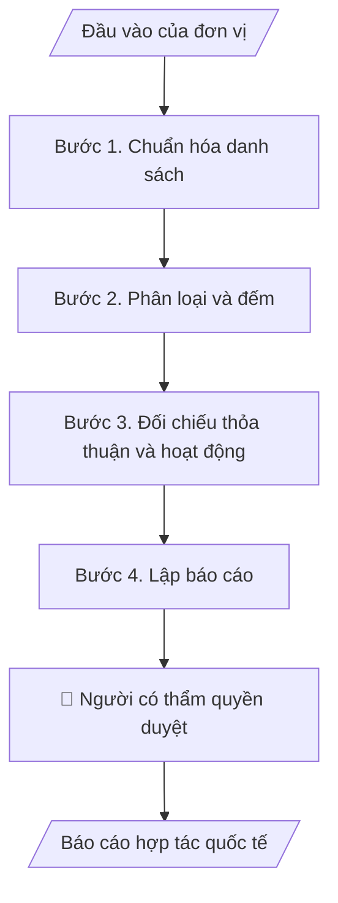

# Báo cáo hợp tác quốc tế

## Khi nào dùng
Khi cần báo cáo hoạt động hợp tác quốc tế theo kỳ cho Ban Giám hiệu hoặc ĐHQGHN; khi cần trả lời nhanh số thỏa thuận, số đối tác, số lượt trao đổi theo năm.

## Định dạng và file đầu ra

Định dạng đầu ra có thể chọn theo sản phẩm/yêu cầu: .docx, .pdf. Đọc mục “Định dạng bổ sung” trong quy cách đầu ra trước khi chọn.

**Phải tạo file thực tế để tải xuống, không chỉ trả nội dung trong chat.** Định dạng mặc định của skill: **.docx**. Nếu có bảng số liệu nghiệp vụ yêu cầu file bảng tính riêng, tạo thêm Excel theo yêu cầu; không tự tạo file kiểm tra. Không chờ người dùng yêu cầu xuất file lần nữa. Ưu tiên định dạng người dùng chỉ định; đọc quy tắc xuất file tại references/quy-cach-dau-ra.md.

**Chạy qua API (không có công cụ tạo file):** trả đủ nội dung dạng văn bản có tiêu đề, bảng; ứng dụng gọi sẽ xuất file.

## Quy cách đầu ra và thông tin thiếu
Khi dựng file Word/Excel, áp dụng mục “Thể thức và bảng biểu khi dựng file” trong quy cách đầu ra (cỡ chữ từng thành phần, bảng nhiều trang, số trang, phụ lục). Đọc [quy cách và cấu trúc sản phẩm](references/quy-cach-dau-ra.md) trước khi soạn/xuất. File giao chỉ gồm sản phẩm nghiệp vụ được yêu cầu; kiểm tra nội bộ không xuất kèm. Thiếu thông tin thì giữ nguyên trường/mục và chỗ điền theo mẫu gốc (dòng dấu chấm, dấu gạch hoặc ô trống); không tự điền dữ liệu mẫu, số 0, mã chờ xác minh hay dòng chờ ký. Mẫu chuyên ngành còn áp dụng được ưu tiên về cấu trúc, mã biểu và người ký. Bản đầy đủ: [quy tắc chung](references/quy-tac-chung.md).

Khi người dùng yêu cầu bộ slide (.pptx), đọc mục “Xuất PowerPoint (.pptx) khi được yêu cầu” trong quy cách đầu ra.

Khi báo cáo có số liệu cần so sánh hoặc nêu xu hướng, đọc mục “Biểu đồ và hình trong báo cáo số liệu” trong quy cách đầu ra trước khi vẽ.

## Kiểm soát áp dụng và phê duyệt
Trước khi chạy, xác định `ngay_ap_dung`, `loai_hinh_truong`, `quy_che_noi_bo`, `nguon_du_lieu`, `nguoi_kiem_duyet`; chỉ hỏi thông tin liên quan nghiệp vụ, không dùng giá trị giả định thay dữ liệu bắt buộc. Đối chiếu căn cứ pháp lý với văn bản gốc, hiệu lực, điều khoản áp dụng và chuyển tiếp. Bản đầy đủ: [quy tắc chung](references/quy-tac-chung.md).

## Giới hạn và human gate
AI hỗ trợ chuẩn bị và đối chiếu; cán bộ phụ trách kiểm tra dữ liệu/căn cứ, người có thẩm quyền duyệt và ký. Không đánh dấu đã ký, đã duyệt, đã công bố khi chưa có chứng cứ. Dữ liệu sinh viên, sức khỏe, nhân sự, tài chính chỉ dùng theo mục đích và phân quyền, che thông tin định danh khi dùng ví dụ (Luật 91/2025/QH15, hiệu lực 01/01/2026); không tải dữ liệu lên dịch vụ ngoài khi chưa có quyền. Bản đầy đủ: [quy tắc chung](references/quy-tac-chung.md).

## Bối cảnh riêng của VNU-IS

Skill mới cho Trường Quốc tế – ĐHQGHN (VNU-IS), v0.4.2. Dựng từ website công khai và phiếu khảo sát CES còn trống; **chưa có dữ liệu khảo sát thực tế của đơn vị**. Đọc [bối cảnh VNU-IS](references/boi-canh-vnuis.md) trước khi chạy; các mã C1–C8 nằm ở mục 6 của file đó.

- **Đơn vị thường dùng:** Phòng KHCN và Hợp tác phát triển.
- **Nghiệp vụ trong phiếu CES:** "Báo cáo đối ngoại: Tổng hợp hoạt động hợp tác quốc tế định kỳ" (sheet `06_KS_KHCN_HTPT`). Tần suất gợi ý: Định kỳ. Đầu vào gợi ý: Danh sách hoạt động; MOU; mobility; sự kiện; mẫu. Khó khăn gợi ý: Tài liệu phân tán, nhiều định dạng; Đọc và đối chiếu thủ công mất thời gian; Khó kiểm tra chênh lệch, trùng lặp và nguồn số liệu; Đầu ra phụ thuộc kinh nghiệm từng cá nhân.

**Chờ xác nhận khi khảo sát**
- Mẫu báo cáo đối ngoại của ĐHQGHN (C8).
- Danh mục MOU/MOA hiện có và người giữ bản gốc (C8).

Nếu người dùng chưa trả lời mục chờ xác nhận liên quan, hỏi lại; không tự điền giả định.

## Đầu vào (Input)

| Trường | Mô tả | Bắt buộc |
|---|---|---|
| `danh_sach_hoat_dong` | Danh sách hoạt động hợp tác trong kỳ (loại, đối tác, thời gian, đầu mối) | Có |
| `danh_muc_thoa_thuan` | Danh mục MOU/MOA: đối tác, ngày ký, thời hạn, trạng thái theo văn bản | Có |
| `du_lieu_trao_doi` | Số lượt người học và giảng viên đi hoặc đến, theo chương trình (ví dụ ERASMUS+, giao lưu) | Không |
| `mau_bao_cao` | Mẫu báo cáo hoặc chỉ tiêu theo yêu cầu của ĐHQGHN | Có |
| `ky_bao_cao` | Kỳ báo cáo | Có |

### Thông tin VNU-IS đã điền sẵn (không hỏi lại)

| Mục | Giá trị mặc định |
|---|---|
| Cơ quan chủ quản; Trường; địa danh | Đại học Quốc gia Hà Nội (ĐHQGHN); Trường Quốc tế – ĐHQGHN (VNU – International School); Hà Nội |
| Đơn vị sử dụng và phối hợp | Phòng KHCN và Hợp tác phát triển |
| Cơ sở | Xuân Thủy (Cầu Giấy); Phan Tây Nhạc (Xuân Phương); Hòa Lạc (tòa HT1, Khu Đô thị ĐHQGHN). Ghi rõ cơ sở khi nội dung gắn địa điểm |
| Mô hình đào tạo | Chọn đúng mô hình trước khi áp quy tắc, không áp quy tắc của mô hình này cho mô hình khác: (1) ĐHQGHN cấp bằng; (2) liên kết quốc tế, đối tác nước ngoài cấp bằng; (3) song bằng; (4) cử nhân – thạc sĩ tích hợp; (5) tiếng Anh dự bị và mô hình 2+2 |
| Ngôn ngữ đầu ra | Tiếng Việt là bản gốc; thêm tiếng Anh cho đối tác, người học quốc tế hoặc khi được yêu cầu |
| Người duyệt và ký | Ghi theo vai trò (Trưởng phòng, Phó Hiệu trưởng phụ trách, Hiệu trưởng); tuyến duyệt và thẩm quyền ký chờ C1, C6 |

Nguồn: website và phiếu CES; đổi theo khảo sát thì sửa tại đây và trong `references/boi-canh-vnuis.md`.

## Quy trình

*⏱ là ước tính ban đầu của bộ gốc, chưa đo tại VNU-IS; hiệu chỉnh sau khảo sát.*

**Bước 1. Chuẩn hóa danh sách**
- Làm gì: Gộp, loại trùng, chuẩn tên đối tác (Việt và Anh) và quốc gia; hoạt động thiếu thông tin đưa vào danh sách cần bổ sung.
- Dùng input: `danh_sach_hoat_dong`
- Vai trò: Chuyên viên hợp tác · AI hỗ trợ: chuẩn hóa và phát hiện trùng · ⏱ thời gian do đơn vị ước tính sau khảo sát
- Lưu ý nghiệp vụ: Tên đối tác giữ đúng như văn bản; không tự sửa.
- → Kết quả bước: Danh sách hoạt động đã chuẩn hóa.

**Bước 2. Phân loại và đếm**
- Làm gì: Phân theo loại: thỏa thuận mới, thỏa thuận hiện hành, trao đổi người học, trao đổi giảng viên và học giả, hội thảo, dự án nghiên cứu; đếm hoạt động, đối tác, quốc gia, lượt người.
- Dùng input: `danh_sach_hoat_dong`, `du_lieu_trao_doi`
- Vai trò: Chuyên viên hợp tác · AI hỗ trợ: phân loại và đếm · ⏱ thời gian do đơn vị ước tính sau khảo sát
- Lưu ý nghiệp vụ: Mỗi con số ghi nguồn dòng; nêu rõ đơn vị đếm (hoạt động, đối tác hay lượt người).
- → Kết quả bước: Bảng số liệu theo loại.

**Bước 3. Đối chiếu thỏa thuận và hoạt động**
- Làm gì: Mỗi hoạt động có thỏa thuận hiệu lực hay không theo danh mục; thỏa thuận hết hạn hoặc chưa rõ trạng thái được gắn cờ.
- Dùng input: `danh_muc_thoa_thuan`, `danh_sach_hoat_dong`
- Vai trò: Trưởng phòng · AI hỗ trợ: đối chiếu · ⏱ thời gian do đơn vị ước tính sau khảo sát
- Lưu ý nghiệp vụ: Hiệu lực chỉ theo văn bản người dùng cung cấp; không tự suy ra gia hạn.
- → Kết quả bước: Danh sách cờ cần xác minh.

**Bước 4. Lập báo cáo**
- Làm gì: Ghép theo mẫu; nhận xét dựa trên số liệu; xu hướng chỉ nêu khi có từ 3 kỳ.
- Dùng input: `mau_bao_cao`, `ky_bao_cao`
- Vai trò: Trưởng phòng · AI hỗ trợ: dự thảo báo cáo · ⏱ thời gian do đơn vị ước tính sau khảo sát
- Lưu ý nghiệp vụ: Tên đối tác chỉ nêu khi được phép công bố.
- → Kết quả bước: Báo cáo hợp tác quốc tế.

## Luồng quy trình (Workflow)

## Đầu ra

File nghiệp vụ thực tế theo định dạng mặc định ở đầu skill hoặc định dạng người dùng yêu cầu, kèm liên kết tải trong phản hồi cuối.

Sản phẩm nghiệp vụ hoàn chỉnh theo [quy cách và cấu trúc](references/quy-cach-dau-ra.md), giữ các trường chưa có dữ liệu ở trạng thái trống. Không xuất kèm danh mục kiểm/phụ lục kiểm tra đầu ra.

## Kiểm tra nội bộ trước khi giao

- [ ] Bố cục khớp cấu trúc tại references/quy-cach-dau-ra.md.
- [ ] Số trong tổng quan khớp bảng chi tiết.
- [ ] Mỗi đối tác ghi nhất quán tên Việt và Anh.
- [ ] Thỏa thuận hết hạn hoặc chưa rõ trạng thái đã được gắn cờ.
- [ ] Không có tên đối tác chưa được phép công bố.
- [ ] Đã qua Human gate.

Tiêu chí đạt = tất cả các ô được đánh dấu.

## Human gate (người kiểm duyệt)
- **Trưởng phòng KHCN và Hợp tác phát triển** kiểm tra số liệu.
- **Người có thẩm quyền của Trường** duyệt báo cáo gửi ĐHQGHN.

## Giới hạn (guardrails)
- KHÔNG tự khẳng định thỏa thuận còn hiệu lực.
- KHÔNG công bố thông tin đối tác khi chưa được đồng ý.

## Căn cứ & lưu ý
- Căn cứ pháp lý và quy định nội bộ do người dùng cung cấp; chưa có thì ghi `[CẦN XÁC MINH]`, không suy diễn.
- Ví dụ trong skill chỉ để minh họa; không đưa dữ liệu cá nhân thật vào ví dụ. Tên Trường, cơ quan chủ quản và địa danh dùng đúng bảng thông tin VNU-IS đã điền sẵn.

## Quản trị phiên bản
- Phiên bản gói VNU-IS `0.4.2` (cập nhật 2026-10-11); hồ sơ tại [references/version.json](references/version.json). Skill mới, không có bản gốc trong bộ 171 skill; dùng khung và quy cách đầu ra của skill `hop-nhat-bao-cao-don-vi`.
- Người phê duyệt nghiệp vụ: **chưa chỉ định**. Trạng thái: dự thảo nghiệp vụ, chờ khảo sát; kiểm tra pháp lý trước thực thi.
- Giấy phép theo LICENSE của kho (bản quyền CES Global).
