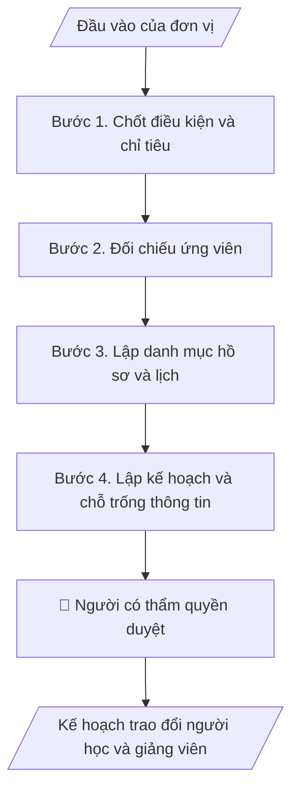

# Kế hoạch trao đổi người học và giảng viên

## Khi nào dùng
Khi chuẩn bị một đợt trao đổi theo thỏa thuận có sẵn; khi cần danh sách hồ sơ và mốc cho cả đoàn đi và đoàn đến.

## Định dạng và file đầu ra

Định dạng đầu ra có thể chọn theo sản phẩm/yêu cầu: .docx, .pdf. Đọc mục “Định dạng bổ sung” trong quy cách đầu ra trước khi chọn.

**Phải tạo file thực tế để tải xuống, không chỉ trả nội dung trong chat.** Định dạng mặc định của skill: **.docx**. Nếu có bảng số liệu nghiệp vụ yêu cầu file bảng tính riêng, tạo thêm Excel theo yêu cầu; không tự tạo file kiểm tra. Không chờ người dùng yêu cầu xuất file lần nữa. Ưu tiên định dạng người dùng chỉ định; đọc quy tắc xuất file tại references/quy-cach-dau-ra.md.

**Chạy qua API (không có công cụ tạo file):** trả đủ nội dung dạng văn bản có tiêu đề, bảng; ứng dụng gọi sẽ xuất file.

## Quy cách đầu ra và thông tin thiếu
Khi dựng file Word/Excel, áp dụng mục “Thể thức và bảng biểu khi dựng file” trong quy cách đầu ra (cỡ chữ từng thành phần, bảng nhiều trang, số trang, phụ lục). Đọc [quy cách và cấu trúc sản phẩm](references/quy-cach-dau-ra.md) trước khi soạn/xuất. File giao chỉ gồm sản phẩm nghiệp vụ được yêu cầu; kiểm tra nội bộ không xuất kèm. Thiếu thông tin thì giữ nguyên trường/mục và chỗ điền theo mẫu gốc (dòng dấu chấm, dấu gạch hoặc ô trống); không tự điền dữ liệu mẫu, số 0, mã chờ xác minh hay dòng chờ ký. Mẫu chuyên ngành còn áp dụng được ưu tiên về cấu trúc, mã biểu và người ký. Bản đầy đủ: [quy tắc chung](references/quy-tac-chung.md).

Khi người dùng yêu cầu bộ slide (.pptx), đọc mục “Xuất PowerPoint (.pptx) khi được yêu cầu” trong quy cách đầu ra.

Khi báo cáo có số liệu cần so sánh hoặc nêu xu hướng, đọc mục “Biểu đồ và hình trong báo cáo số liệu” trong quy cách đầu ra trước khi vẽ.

## Kiểm soát áp dụng và phê duyệt
Trước khi chạy, xác định `ngay_ap_dung`, `loai_hinh_truong`, `quy_che_noi_bo`, `nguon_du_lieu`, `nguoi_kiem_duyet`; chỉ hỏi thông tin liên quan nghiệp vụ, không dùng giá trị giả định thay dữ liệu bắt buộc. Đối chiếu căn cứ pháp lý với văn bản gốc, hiệu lực, điều khoản áp dụng và chuyển tiếp. Bản đầy đủ: [quy tắc chung](references/quy-tac-chung.md).

## Giới hạn và human gate
AI hỗ trợ chuẩn bị và đối chiếu; cán bộ phụ trách kiểm tra dữ liệu/căn cứ, người có thẩm quyền duyệt và ký. Không đánh dấu đã ký, đã duyệt, đã công bố khi chưa có chứng cứ. Dữ liệu sinh viên, sức khỏe, nhân sự, tài chính chỉ dùng theo mục đích và phân quyền, che thông tin định danh khi dùng ví dụ (Luật 91/2025/QH15, hiệu lực 01/01/2026); không tải dữ liệu lên dịch vụ ngoài khi chưa có quyền. Bản đầy đủ: [quy tắc chung](references/quy-tac-chung.md).

## Bối cảnh riêng của VNU-IS

Skill mới cho Trường Quốc tế – ĐHQGHN (VNU-IS), v0.4.2. Dựng từ website công khai và phiếu khảo sát CES còn trống; **chưa có dữ liệu khảo sát thực tế của đơn vị**. Đọc [bối cảnh VNU-IS](references/boi-canh-vnuis.md) trước khi chạy; các mã C1–C8 nằm ở mục 6 của file đó.

- **Đơn vị thường dùng:** Phòng KHCN và Hợp tác phát triển; Phòng Đào tạo.
- **Nghiệp vụ trong phiếu CES:** không có dòng riêng trong phiếu CES; phiếu giao trao đổi quốc tế cho Phòng KHCN&HTPT (sheet 00) và website nêu hợp tác, trao đổi người học; cần xác nhận khi khảo sát.

**Chờ xác nhận khi khảo sát**
- Quy trình xét chọn và thẩm quyền quyết định (C6).
- Quy định công nhận học phần khi trao đổi (C2).

Nếu người dùng chưa trả lời mục chờ xác nhận liên quan, hỏi lại; không tự điền giả định.

## Đầu vào (Input)

| Trường | Mô tả | Bắt buộc |
|---|---|---|
| `thoa_thuan_trao_doi` | Thỏa thuận hoặc thông báo chương trình trao đổi của đối tác | Có |
| `danh_sach_ung_vien` | Danh sách người học hoặc giảng viên đăng ký, đã che thông tin nhạy cảm | Có |
| `dieu_kien_va_chi_tieu` | Điều kiện chọn, chỉ tiêu, hạn do đối tác và Trường đặt | Có |
| `quy_dinh_cong_nhan` | Quy định công nhận học phần, tín chỉ khi người học về | Không |
| `lich_dot_trao_doi` | Thời gian dự kiến của đợt | Có |

### Thông tin VNU-IS đã điền sẵn (không hỏi lại)

| Mục | Giá trị mặc định |
|---|---|
| Cơ quan chủ quản; Trường; địa danh | Đại học Quốc gia Hà Nội (ĐHQGHN); Trường Quốc tế – ĐHQGHN (VNU – International School); Hà Nội |
| Đơn vị sử dụng và phối hợp | Phòng KHCN và Hợp tác phát triển; Phòng Đào tạo |
| Cơ sở | Xuân Thủy (Cầu Giấy); Phan Tây Nhạc (Xuân Phương); Hòa Lạc (tòa HT1, Khu Đô thị ĐHQGHN). Ghi rõ cơ sở khi nội dung gắn địa điểm |
| Mô hình đào tạo | Chọn đúng mô hình trước khi áp quy tắc, không áp quy tắc của mô hình này cho mô hình khác: (1) ĐHQGHN cấp bằng; (2) liên kết quốc tế, đối tác nước ngoài cấp bằng; (3) song bằng; (4) cử nhân – thạc sĩ tích hợp; (5) tiếng Anh dự bị và mô hình 2+2 |
| Ngôn ngữ đầu ra | Tiếng Việt là bản gốc; thêm tiếng Anh cho đối tác, người học quốc tế hoặc khi được yêu cầu |
| Người duyệt và ký | Ghi theo vai trò (Trưởng phòng, Phó Hiệu trưởng phụ trách, Hiệu trưởng); tuyến duyệt và thẩm quyền ký chờ C1, C6 |

Nguồn: website và phiếu CES; đổi theo khảo sát thì sửa tại đây và trong `references/boi-canh-vnuis.md`.

## Quy trình

*⏱ là ước tính ban đầu của bộ gốc, chưa đo tại VNU-IS; hiệu chỉnh sau khảo sát.*

**Bước 1. Chốt điều kiện và chỉ tiêu**
- Làm gì: Từ thỏa thuận và thông báo, lập bảng điều kiện, chỉ tiêu, hạn; điều kiện mơ hồ gắn `[CẦN XÁC MINH]`.
- Dùng input: `thoa_thuan_trao_doi`, `dieu_kien_va_chi_tieu`
- Vai trò: Chuyên viên hợp tác · AI hỗ trợ: trích điều kiện · ⏱ thời gian do đơn vị ước tính sau khảo sát
- Lưu ý nghiệp vụ: Không tự đặt điều kiện cho người học.
- → Kết quả bước: Bảng điều kiện và chỉ tiêu.

**Bước 2. Đối chiếu ứng viên**
- Làm gì: So từng ứng viên với điều kiện; ghi đủ, thiếu, không đủ kèm lý do.
- Dùng input: `danh_sach_ung_vien`, `dieu_kien_va_chi_tieu`
- Vai trò: Chuyên viên hợp tác · AI hỗ trợ: đối chiếu · ⏱ thời gian do đơn vị ước tính sau khảo sát
- Lưu ý nghiệp vụ: Chỉ đánh giá điều kiện hình thức; việc chọn do hội đồng.
- → Kết quả bước: Bảng đối chiếu.

**Bước 3. Lập danh mục hồ sơ và lịch**
- Làm gì: Danh mục hồ sơ cho mỗi ứng viên và mốc: nộp hồ sơ, thông báo, chuẩn bị đi, về, công nhận học phần.
- Dùng input: `quy_dinh_cong_nhan`, `lich_dot_trao_doi`
- Vai trò: Chuyên viên hợp tác · AI hỗ trợ: lập lịch · ⏱ thời gian do đơn vị ước tính sau khảo sát
- Lưu ý nghiệp vụ: Thủ tục xuất nhập cảnh theo cơ quan có thẩm quyền; skill chỉ liệt kê, không khẳng định.
- → Kết quả bước: Danh mục hồ sơ và lịch.

**Bước 4. Lập kế hoạch và chỗ trống thông tin**
- Làm gì: Ghép kế hoạch: mục tiêu, đối tượng, lịch, phân công, kinh phí nếu có; liệt kê thông tin còn thiếu.
- Dùng input: `thoa_thuan_trao_doi`
- Vai trò: Trưởng phòng · AI hỗ trợ: dự thảo kế hoạch · ⏱ thời gian do đơn vị ước tính sau khảo sát
- Lưu ý nghiệp vụ: Kinh phí chỉ ghi khi có dự toán duyệt.
- → Kết quả bước: Kế hoạch trao đổi.

## Luồng quy trình (Workflow)

## Đầu ra

File nghiệp vụ thực tế theo định dạng mặc định ở đầu skill hoặc định dạng người dùng yêu cầu, kèm liên kết tải trong phản hồi cuối.

Sản phẩm nghiệp vụ hoàn chỉnh theo [quy cách và cấu trúc](references/quy-cach-dau-ra.md), giữ các trường chưa có dữ liệu ở trạng thái trống. Không xuất kèm danh mục kiểm/phụ lục kiểm tra đầu ra.

## Kiểm tra nội bộ trước khi giao

- [ ] Bố cục khớp cấu trúc tại references/quy-cach-dau-ra.md.
- [ ] Điều kiện khớp thỏa thuận.
- [ ] Ứng viên thiếu hồ sơ được liệt kê.
- [ ] Không có thông tin cá nhân nhạy cảm trong kế hoạch tổng hợp.
- [ ] Thông tin chưa có để trống và ghi chú.
- [ ] Đã qua Human gate.

Tiêu chí đạt = tất cả các ô được đánh dấu.

## Human gate (người kiểm duyệt)
- **Trưởng phòng KHCN và Hợp tác phát triển** kiểm tra kế hoạch.
- **Hội đồng hoặc lãnh đạo có thẩm quyền** quyết định danh sách được chọn.

## Giới hạn (guardrails)
- KHÔNG tự chọn người đi hoặc đến.
- KHÔNG khẳng định thủ tục xuất nhập cảnh hay visa.

## Căn cứ & lưu ý
- Căn cứ pháp lý và quy định nội bộ do người dùng cung cấp; chưa có thì ghi `[CẦN XÁC MINH]`, không suy diễn.
- Ví dụ trong skill chỉ để minh họa; không đưa dữ liệu cá nhân thật vào ví dụ. Tên Trường, cơ quan chủ quản và địa danh dùng đúng bảng thông tin VNU-IS đã điền sẵn.

## Quản trị phiên bản
- Phiên bản gói VNU-IS `0.4.2` (cập nhật 2026-10-11); hồ sơ tại [references/version.json](references/version.json). Skill mới, không có bản gốc trong bộ 171 skill; dùng khung và quy cách đầu ra của skill `hop-nhat-bao-cao-don-vi`.
- Người phê duyệt nghiệp vụ: **chưa chỉ định**. Trạng thái: dự thảo nghiệp vụ, chờ khảo sát; kiểm tra pháp lý trước thực thi.
- Giấy phép theo LICENSE của kho (bản quyền CES Global).
