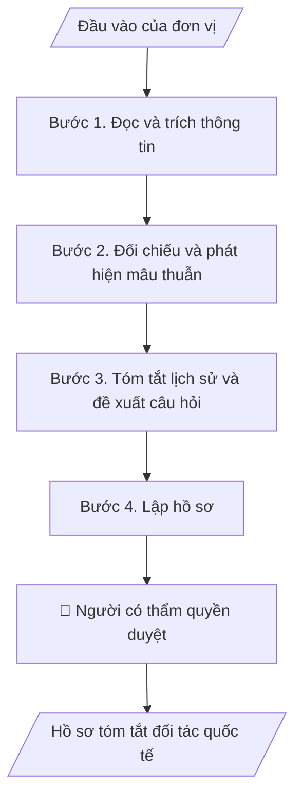

# Hồ sơ tóm tắt đối tác quốc tế

## Khi nào dùng
Khi chuẩn bị đón tiếp, đàm phán, ký MOU/MOA hoặc xin ý kiến lãnh đạo về một đối tác; khi cần tra cứu lịch sử hợp tác với một đối tác.

## Định dạng và file đầu ra

Định dạng đầu ra có thể chọn theo sản phẩm/yêu cầu: .docx, .pdf. Đọc mục “Định dạng bổ sung” trong quy cách đầu ra trước khi chọn.

**Phải tạo file thực tế để tải xuống, không chỉ trả nội dung trong chat.** Định dạng mặc định của skill: **.docx**. Nếu có bảng số liệu nghiệp vụ yêu cầu file bảng tính riêng, tạo thêm Excel theo yêu cầu; không tự tạo file kiểm tra. Không chờ người dùng yêu cầu xuất file lần nữa. Ưu tiên định dạng người dùng chỉ định; đọc quy tắc xuất file tại references/quy-cach-dau-ra.md.

**Chạy qua API (không có công cụ tạo file):** trả đủ nội dung dạng văn bản có tiêu đề, bảng; ứng dụng gọi sẽ xuất file.

## Quy cách đầu ra và thông tin thiếu
Khi dựng file Word/Excel, áp dụng mục “Thể thức và bảng biểu khi dựng file” trong quy cách đầu ra (cỡ chữ từng thành phần, bảng nhiều trang, số trang, phụ lục). Đọc [quy cách và cấu trúc sản phẩm](references/quy-cach-dau-ra.md) trước khi soạn/xuất. File giao chỉ gồm sản phẩm nghiệp vụ được yêu cầu; kiểm tra nội bộ không xuất kèm. Thiếu thông tin thì giữ nguyên trường/mục và chỗ điền theo mẫu gốc (dòng dấu chấm, dấu gạch hoặc ô trống); không tự điền dữ liệu mẫu, số 0, mã chờ xác minh hay dòng chờ ký. Mẫu chuyên ngành còn áp dụng được ưu tiên về cấu trúc, mã biểu và người ký. Bản đầy đủ: [quy tắc chung](references/quy-tac-chung.md).

Khi người dùng yêu cầu bộ slide (.pptx), đọc mục “Xuất PowerPoint (.pptx) khi được yêu cầu” trong quy cách đầu ra.

Khi báo cáo có số liệu cần so sánh hoặc nêu xu hướng, đọc mục “Biểu đồ và hình trong báo cáo số liệu” trong quy cách đầu ra trước khi vẽ.

## Kiểm soát áp dụng và phê duyệt
Trước khi chạy, xác định `ngay_ap_dung`, `loai_hinh_truong`, `quy_che_noi_bo`, `nguon_du_lieu`, `nguoi_kiem_duyet`; chỉ hỏi thông tin liên quan nghiệp vụ, không dùng giá trị giả định thay dữ liệu bắt buộc. Đối chiếu căn cứ pháp lý với văn bản gốc, hiệu lực, điều khoản áp dụng và chuyển tiếp. Bản đầy đủ: [quy tắc chung](references/quy-tac-chung.md).

## Giới hạn và human gate
AI hỗ trợ chuẩn bị và đối chiếu; cán bộ phụ trách kiểm tra dữ liệu/căn cứ, người có thẩm quyền duyệt và ký. Không đánh dấu đã ký, đã duyệt, đã công bố khi chưa có chứng cứ. Dữ liệu sinh viên, sức khỏe, nhân sự, tài chính chỉ dùng theo mục đích và phân quyền, che thông tin định danh khi dùng ví dụ (Luật 91/2025/QH15, hiệu lực 01/01/2026); không tải dữ liệu lên dịch vụ ngoài khi chưa có quyền. Bản đầy đủ: [quy tắc chung](references/quy-tac-chung.md).

## Bối cảnh riêng của VNU-IS

Skill mới cho Trường Quốc tế – ĐHQGHN (VNU-IS), v0.4.2. Dựng từ website công khai và phiếu khảo sát CES còn trống; **chưa có dữ liệu khảo sát thực tế của đơn vị**. Đọc [bối cảnh VNU-IS](references/boi-canh-vnuis.md) trước khi chạy; các mã C1–C8 nằm ở mục 6 của file đó.

- **Đơn vị thường dùng:** Phòng KHCN và Hợp tác phát triển; Viện ĐMST&CGCN; các khoa.
- **Nghiệp vụ trong phiếu CES:** "Quản lý đối tác: Xây dựng hồ sơ tóm tắt đối tác quốc tế" (sheet `06_KS_KHCN_HTPT`). Tần suất gợi ý: Theo hồ sơ/vụ việc. Đầu vào gợi ý: Tài liệu đối tác; MOU cũ; báo cáo hợp tác; hồ sơ công khai tải về. Khó khăn gợi ý: Tài liệu phân tán, nhiều định dạng; Đọc và đối chiếu thủ công mất thời gian; Dễ thiếu thành phần, sai logic hoặc bỏ sót ngoại lệ; Đầu ra phụ thuộc kinh nghiệm từng cá nhân. Nghiệp vụ liên quan: "Quản lý đối tác – chuyên gia: Quản lý hồ sơ, nhu cầu hợp tác và lịch sử làm việc với đối tác/chuyên gia".

**Chờ xác nhận khi khảo sát**
- Mẫu hồ sơ đối tác đang dùng nếu có (C8).
- Đầu mối lưu bản gốc MOU/MOA (C8).

Nếu người dùng chưa trả lời mục chờ xác nhận liên quan, hỏi lại; không tự điền giả định.

## Đầu vào (Input)

| Trường | Mô tả | Bắt buộc |
|---|---|---|
| `ten_doi_tac` | Tên đối tác bằng tiếng Việt và tiếng Anh | Có |
| `tai_lieu_nguon` | Hồ sơ năng lực, MOU cũ, báo cáo hợp tác, biên bản, tài liệu công khai đã tải | Có |
| `muc_dich` | Mục đích hồ sơ (đón tiếp, đàm phán, ký kết, báo cáo) | Có |
| `lich_su_hop_tac` | Hoạt động đã làm cùng đối tác nếu có | Không |

### Thông tin VNU-IS đã điền sẵn (không hỏi lại)

| Mục | Giá trị mặc định |
|---|---|
| Cơ quan chủ quản; Trường; địa danh | Đại học Quốc gia Hà Nội (ĐHQGHN); Trường Quốc tế – ĐHQGHN (VNU – International School); Hà Nội |
| Đơn vị sử dụng và phối hợp | Phòng KHCN và Hợp tác phát triển; Viện ĐMST&CGCN; các khoa |
| Cơ sở | Xuân Thủy (Cầu Giấy); Phan Tây Nhạc (Xuân Phương); Hòa Lạc (tòa HT1, Khu Đô thị ĐHQGHN). Ghi rõ cơ sở khi nội dung gắn địa điểm |
| Mô hình đào tạo | Chọn đúng mô hình trước khi áp quy tắc, không áp quy tắc của mô hình này cho mô hình khác: (1) ĐHQGHN cấp bằng; (2) liên kết quốc tế, đối tác nước ngoài cấp bằng; (3) song bằng; (4) cử nhân – thạc sĩ tích hợp; (5) tiếng Anh dự bị và mô hình 2+2 |
| Ngôn ngữ đầu ra | Tiếng Việt là bản gốc; thêm tiếng Anh cho đối tác, người học quốc tế hoặc khi được yêu cầu |
| Người duyệt và ký | Ghi theo vai trò (Trưởng phòng, Phó Hiệu trưởng phụ trách, Hiệu trưởng); tuyến duyệt và thẩm quyền ký chờ C1, C6 |

Nguồn: website và phiếu CES; đổi theo khảo sát thì sửa tại đây và trong `references/boi-canh-vnuis.md`.

## Quy trình

*⏱ là ước tính ban đầu của bộ gốc, chưa đo tại VNU-IS; hiệu chỉnh sau khảo sát.*

**Bước 1. Đọc và trích thông tin**
- Làm gì: Trích tên, quốc gia, loại hình, lĩnh vực, đầu mối, thỏa thuận đã có, hoạt động đã làm; mỗi thông tin gắn nguồn (tên file, trang hoặc mục).
- Dùng input: `ten_doi_tac`, `tai_lieu_nguon`
- Vai trò: Chuyên viên hợp tác · AI hỗ trợ: trích xuất và gắn nguồn · ⏱ thời gian do đơn vị ước tính sau khảo sát
- Lưu ý nghiệp vụ: Thông tin không có trong tài liệu thì ghi "chưa có tài liệu"; không điền từ trí nhớ.
- → Kết quả bước: Bảng thông tin có nguồn.

**Bước 2. Đối chiếu và phát hiện mâu thuẫn**
- Làm gì: So thông tin giữa các tài liệu (tên, năm, phạm vi); nêu chỗ khác nhau.
- Dùng input: `tai_lieu_nguon`
- Vai trò: Chuyên viên hợp tác · AI hỗ trợ: đối chiếu · ⏱ thời gian do đơn vị ước tính sau khảo sát
- Lưu ý nghiệp vụ: Không chọn thông tin nào đúng.
- → Kết quả bước: Danh sách mâu thuẫn.

**Bước 3. Tóm tắt lịch sử và đề xuất câu hỏi**
- Làm gì: Tóm tắt theo thời gian; liệt kê điều cần hỏi thêm trước khi làm việc.
- Dùng input: `lich_su_hop_tac`, `muc_dich`
- Vai trò: Trưởng phòng · AI hỗ trợ: dự thảo tóm tắt · ⏱ thời gian do đơn vị ước tính sau khảo sát
- Lưu ý nghiệp vụ: Không đánh giá uy tín hay xếp hạng đối tác nếu không có nguồn người dùng cung cấp.
- → Kết quả bước: Tóm tắt và câu hỏi cần làm rõ.

**Bước 4. Lập hồ sơ**
- Làm gì: Ghép thành hồ sơ 1 đến 2 trang theo mục đích.
- Dùng input: `muc_dich`
- Vai trò: Chuyên viên hợp tác · AI hỗ trợ: ghép hồ sơ · ⏱ thời gian do đơn vị ước tính sau khảo sát
- Lưu ý nghiệp vụ: Ghi ngày lập và phiên bản tài liệu nguồn.
- → Kết quả bước: Hồ sơ đối tác.

## Luồng quy trình (Workflow)

## Đầu ra

File nghiệp vụ thực tế theo định dạng mặc định ở đầu skill hoặc định dạng người dùng yêu cầu, kèm liên kết tải trong phản hồi cuối.

Sản phẩm nghiệp vụ hoàn chỉnh theo [quy cách và cấu trúc](references/quy-cach-dau-ra.md), giữ các trường chưa có dữ liệu ở trạng thái trống. Không xuất kèm danh mục kiểm/phụ lục kiểm tra đầu ra.

## Kiểm tra nội bộ trước khi giao

- [ ] Bố cục khớp cấu trúc tại references/quy-cach-dau-ra.md.
- [ ] Mỗi thông tin có nguồn.
- [ ] Tên Việt và Anh nhất quán.
- [ ] Không có đánh giá hay xếp hạng không nguồn.
- [ ] Thông tin thiếu được ghi rõ là thiếu.
- [ ] Đã qua Human gate.

Tiêu chí đạt = tất cả các ô được đánh dấu.

## Human gate (người kiểm duyệt)
- **Chuyên viên phụ trách đối tác** xác nhận thông tin.
- **Trưởng phòng KHCN và Hợp tác phát triển** duyệt trước khi dùng làm căn cứ đàm phán.

## Giới hạn (guardrails)
- KHÔNG bịa thông tin về đối tác.
- KHÔNG đưa nội dung bí mật của đối tác ra ngoài hồ sơ nội bộ.

## Căn cứ & lưu ý
- Căn cứ pháp lý và quy định nội bộ do người dùng cung cấp; chưa có thì ghi `[CẦN XÁC MINH]`, không suy diễn.
- Ví dụ trong skill chỉ để minh họa; không đưa dữ liệu cá nhân thật vào ví dụ. Tên Trường, cơ quan chủ quản và địa danh dùng đúng bảng thông tin VNU-IS đã điền sẵn.

## Quản trị phiên bản
- Phiên bản gói VNU-IS `0.4.2` (cập nhật 2026-10-11); hồ sơ tại [references/version.json](references/version.json). Skill mới, không có bản gốc trong bộ 171 skill; dùng khung và quy cách đầu ra của skill `hop-nhat-bao-cao-don-vi`.
- Người phê duyệt nghiệp vụ: **chưa chỉ định**. Trạng thái: dự thảo nghiệp vụ, chờ khảo sát; kiểm tra pháp lý trước thực thi.
- Giấy phép theo LICENSE của kho (bản quyền CES Global).
