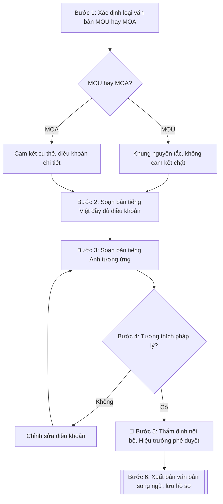

# Soạn biên bản ghi nhớ / thỏa thuận hợp tác (MOU/MOA) song ngữ Việt–Anh

## Khi nào dùng
Khi cần soạn thảo văn bản ghi nhớ (MOU – Memorandum of Understanding) hoặc thỏa thuận
hợp tác (MOA – Memorandum of Agreement) giữa trường với đối tác trong nước
hoặc quốc tế, phục vụ ký kết hợp tác đào tạo, nghiên cứu khoa học, trao đổi giảng viên –
sinh viên.

## Định dạng và file đầu ra

Định dạng đầu ra có thể chọn theo sản phẩm/yêu cầu: .docx, .pdf. Đọc mục “Định dạng bổ sung” trong quy cách đầu ra trước khi chọn.

**Phải tạo file thực tế để tải xuống, không chỉ trả nội dung trong chat.** Định dạng mặc định của skill: **.docx**. Nếu có bảng số liệu nghiệp vụ yêu cầu file bảng tính riêng, tạo thêm Excel theo yêu cầu; không tự tạo file kiểm tra. Không chờ người dùng yêu cầu xuất file lần nữa. Ưu tiên định dạng người dùng chỉ định; đọc quy tắc xuất file tại references/quy-cach-dau-ra.md.

**Chạy qua API (không có công cụ tạo file):** trả đủ nội dung dạng văn bản có tiêu đề, bảng; ứng dụng gọi sẽ xuất file.

## Quy cách đầu ra và thông tin thiếu
Khi dựng file Word/Excel, áp dụng mục “Thể thức và bảng biểu khi dựng file” trong quy cách đầu ra (cỡ chữ từng thành phần, bảng nhiều trang, số trang, phụ lục). Đọc [quy cách và cấu trúc sản phẩm](references/quy-cach-dau-ra.md) trước khi soạn/xuất. File giao chỉ gồm sản phẩm nghiệp vụ được yêu cầu; kiểm tra nội bộ không xuất kèm. Thiếu thông tin thì giữ nguyên trường/mục và chỗ điền theo mẫu gốc (dòng dấu chấm, dấu gạch hoặc ô trống); không tự điền dữ liệu mẫu, số 0, mã chờ xác minh hay dòng chờ ký. Mẫu chuyên ngành còn áp dụng được ưu tiên về cấu trúc, mã biểu và người ký. Bản đầy đủ: [quy tắc chung](references/quy-tac-chung.md).

Khi người dùng yêu cầu bộ slide (.pptx), đọc mục “Xuất PowerPoint (.pptx) khi được yêu cầu” trong quy cách đầu ra.

## Kiểm soát áp dụng và phê duyệt
Trước khi chạy, xác định `ngay_ap_dung`, `loai_hinh_truong`, `quy_che_noi_bo`, `nguon_du_lieu`, `nguoi_kiem_duyet`; chỉ hỏi thông tin liên quan nghiệp vụ, không dùng giá trị giả định thay dữ liệu bắt buộc. Đối chiếu căn cứ pháp lý với văn bản gốc, hiệu lực, điều khoản áp dụng và chuyển tiếp. Bản đầy đủ: [quy tắc chung](references/quy-tac-chung.md).

## Giới hạn và human gate
AI hỗ trợ chuẩn bị và đối chiếu; cán bộ phụ trách kiểm tra dữ liệu/căn cứ, người có thẩm quyền duyệt và ký. Không đánh dấu đã ký, đã duyệt, đã công bố khi chưa có chứng cứ. Dữ liệu sinh viên, sức khỏe, nhân sự, tài chính chỉ dùng theo mục đích và phân quyền, che thông tin định danh khi dùng ví dụ (Luật 91/2025/QH15, hiệu lực 01/01/2026); không tải dữ liệu lên dịch vụ ngoài khi chưa có quyền. Bản đầy đủ: [quy tắc chung](references/quy-tac-chung.md).

## Bối cảnh riêng của VNU-IS

Bản chỉnh cho Trường Quốc tế – ĐHQGHN (VNU-IS), v0.4.2. Dựng từ website công khai và phiếu khảo sát CES còn trống; **chưa có dữ liệu khảo sát thực tế của đơn vị**. Đọc [bối cảnh VNU-IS](references/boi-canh-vnuis.md) trước khi chạy; các mã C1–C8 nằm ở mục 6 của file đó.

- **Đơn vị thường dùng:** Phòng KHCN và Hợp tác phát triển; Viện ĐMST&CGCN; các khoa.
- **Nghiệp vụ trong phiếu CES:** "Thỏa thuận: Rà soát và so sánh MOU/MOA song ngữ" (sheet `06_KS_KHCN_HTPT`). Tần suất gợi ý: Theo nhu cầu. Đầu vào gợi ý: Dự thảo; mẫu chuẩn; bản cũ; ý kiến pháp lý. Khó khăn gợi ý: Tài liệu phân tán, nhiều định dạng; Đọc và đối chiếu thủ công mất thời gian; Dễ bỏ sót trường dữ liệu/phiên bản; Thuật ngữ và giọng điệu chưa nhất quán. Đây là gợi ý có sẵn của CES, chưa phải xác nhận của đơn vị.

**Điều chỉnh khi dùng cho VNU-IS**
- So sánh hai bản Việt và Anh theo từng điều khoản; chỉ ra chỗ lệch nghĩa. Bản nào có giá trị khi hai bản khác nhau do điều khoản ngôn ngữ của thỏa thuận quyết định; skill không tự kết luận.
- Kiểm tra có hay không các nhóm điều khoản: phạm vi, thời hạn, sở hữu trí tuệ, dữ liệu, tài chính, giải quyết tranh chấp, chấm dứt. Chỉ ghi có hay không, không tư vấn pháp lý.
- Loại hợp tác trên website: trao đổi sinh viên và học viên (kể cả ERASMUS+), công nhận chuyển tiếp, thu hút học giả quốc tế, dự án nghiên cứu.
- Thẩm quyền ký và thủ tục xin ý kiến ĐHQGHN chưa rõ; ghi `[CẦN XÁC MINH]` (C1, C6).

**Chờ xác nhận khi khảo sát**
- Mẫu MOU/MOA chuẩn của Trường (C8).
- Quy trình xin ý kiến ĐHQGHN với thỏa thuận quốc tế (C6).

Nếu người dùng chưa trả lời mục chờ xác nhận liên quan, hỏi lại; không tự điền giả định.

## Đầu vào (Input)

| Trường | Mô tả | Bắt buộc |
|---|---|---|
| `loai_van_ban` | MOU (ghi nhớ, không ràng buộc pháp lý chặt) / MOA (thỏa thuận, có cam kết cụ thể) | Có |
| `ten_doi_tac` | Tên đầy đủ của đối tác (tiếng Việt và tiếng Anh), quốc gia, người đại diện | Có |
| `muc_dich` | Mục đích hợp tác (1–2 câu) | Có |
| `linh_vuc_hop_tac` | Các lĩnh vực hợp tác: đào tạo, NCKH, trao đổi GV-SV, đồng tổ chức hội thảo... | Có |
| `trach_nhiem_ben_a` | Trách nhiệm của Bên A (trường) | Có |
| `trach_nhiem_ben_b` | Trách nhiệm của đối tác | Có |
| `thoi_han` | Thời hạn hiệu lực (số năm) và điều kiện gia hạn/chấm dứt | Có |
| `nguoi_ky` | Người ký hai bên (chức danh, họ tên) | Có |
| `ngay_ky_du_kien` | Ngày dự kiến ký kết | Không |

### Thông tin VNU-IS đã điền sẵn (không hỏi lại)

| Mục | Giá trị mặc định |
|---|---|
| Cơ quan chủ quản; Trường; địa danh | Đại học Quốc gia Hà Nội (ĐHQGHN); Trường Quốc tế – ĐHQGHN (VNU – International School); Hà Nội |
| Đơn vị sử dụng và phối hợp | Phòng KHCN và Hợp tác phát triển; Viện ĐMST&CGCN; các khoa |
| Cơ sở | Xuân Thủy (Cầu Giấy); Phan Tây Nhạc (Xuân Phương); Hòa Lạc (tòa HT1, Khu Đô thị ĐHQGHN). Ghi rõ cơ sở khi nội dung gắn địa điểm |
| Mô hình đào tạo | Chọn đúng mô hình trước khi áp quy tắc, không áp quy tắc của mô hình này cho mô hình khác: (1) ĐHQGHN cấp bằng; (2) liên kết quốc tế, đối tác nước ngoài cấp bằng; (3) song bằng; (4) cử nhân – thạc sĩ tích hợp; (5) tiếng Anh dự bị và mô hình 2+2 |
| Ngôn ngữ đầu ra | Tiếng Việt là bản gốc; thêm tiếng Anh cho đối tác, người học quốc tế hoặc khi được yêu cầu |
| Người duyệt và ký | Ghi theo vai trò (Trưởng phòng, Phó Hiệu trưởng phụ trách, Hiệu trưởng); tuyến duyệt và thẩm quyền ký chờ C1, C6 |

Nguồn: website và phiếu CES; đổi theo khảo sát thì sửa tại đây và trong `references/boi-canh-vnuis.md`.

## Quy trình

*⏱ là ước tính ban đầu của bộ gốc, chưa đo tại VNU-IS; hiệu chỉnh sau khảo sát.*

**Bước 1. Xác định loại văn bản (MOU hay MOA)**
- Làm gì: căn cứ `loai_van_ban` và mức độ cam kết trong `muc_dich`, `linh_vuc_hop_tac` để chốt khung soạn: MOU dùng khi hai bên mới thiết lập quan hệ, nội dung mang tính nguyên tắc; MOA dùng khi đã có cam kết cụ thể (kinh phí, số lượng, tiến độ) — điều khoản chi tiết và chặt chẽ hơn.
- Dùng input: `loai_van_ban`, `muc_dich`, `linh_vuc_hop_tac`.
- Vai trò: Trưởng Phòng KHCN&HTPT · AI hỗ trợ: phân tích mức độ cam kết · ⏱ ~20–30 phút (ước tính)
- Lưu ý nghiệp vụ: nếu trong `linh_vuc_hop_tac` hoặc trách nhiệm hai bên xuất hiện cam kết tài chính cụ thể mà `loai_van_ban` là MOU thì phải cảnh báo và đề xuất chuyển sang MOA hoặc tách phụ lục hợp đồng riêng.
- → Kết quả bước: quyết định loại văn bản + khung điều khoản áp dụng (nguyên tắc cho MOU, chi tiết cho MOA).

**Bước 2. Soạn bản tiếng Việt đầy đủ điều khoản**
- Làm gì: soạn bản tiếng Việt theo đúng thứ tự: Tiêu ngữ – Quốc hiệu → tên văn bản → tên hai bên (Bên A/Bên B) → căn cứ ký kết → Điều 1. Mục đích → Điều 2. Lĩnh vực hợp tác → Điều 3. Trách nhiệm của Bên A → Điều 4. Trách nhiệm của Bên B → Điều 5. Thời hạn hiệu lực → Điều 6. Điều khoản chung (ngôn ngữ sử dụng, giải quyết bất đồng, sửa đổi, hiệu lực thi hành) → phần ký.
- Dùng input: `ten_doi_tac`, `muc_dich`, `linh_vuc_hop_tac`, `trach_nhiem_ben_a`, `trach_nhiem_ben_b`, `thoi_han`, `nguoi_ky`, `ngay_ky_du_kien`.
- Vai trò: Chuyên viên Phòng KHCN&HTPT · AI hỗ trợ: soạn dự thảo tiếng Việt · ⏱ ~1–2 giờ (ước tính)
- Lưu ý nghiệp vụ: trách nhiệm Bên A và Bên B phải đối xứng, không để một bên chỉ có quyền mà không có nghĩa vụ; MOA phải ghi rõ số lượng, kinh phí, tiến độ cụ thể chứ không dùng chữ chung chung như "hỗ trợ tối đa".
- → Kết quả bước: dự thảo bản tiếng Việt hoàn chỉnh (đủ 6 điều + phần ký).

**Bước 3. Soạn bản tiếng Anh tương ứng**
- Làm gì: dịch đầy đủ từng điều của bản tiếng Việt sang tiếng Anh với thuật ngữ pháp lý – hành chính chuẩn (Memorandum of Understanding/Agreement, Party A/Party B, Article, validity, termination...); ghi rõ hai bản có giá trị ngang nhau hoặc chỉ định bản có giá trị ưu tiên khi có khác biệt.
- Dùng input: dự thảo bản tiếng Việt (Bước 2), `ten_doi_tac` (tên tiếng Anh), `nguoi_ky`.
- Vai trò: Chuyên viên Phòng KHCN&HTPT · AI hỗ trợ: dịch sang tiếng Anh · ⏱ ~1–2 giờ (ước tính)
- Lưu ý nghiệp vụ: tên đối tác và chức danh người ký bằng tiếng Anh phải lấy đúng theo văn bản chính thức của đối tác, không tự dịch tên riêng; số năm, số bản, thời hạn thông báo phải khớp tuyệt đối với bản Việt.
- → Kết quả bước: dự thảo bản tiếng Anh tương ứng từng điều (Article 1–6 + phần ký).

**Bước 4. Rà soát tính tương thích pháp lý**
- Làm gì: đối chiếu từng điều khoản của cả hai bản với quy định của Nhà trường và pháp luật Việt Nam; kiểm tra điều khoản tài chính (nếu có) có phù hợp quy định quản lý tài chính; lập bảng các điểm không tương thích và đề xuất chỉnh sửa.
- Dùng input: dự thảo hai bản (Bước 2, Bước 3).
- Vai trò: Phòng Pháp chế · AI hỗ trợ: lập bảng đối chiếu hỗ trợ · ⏱ ~1–2 ngày làm việc (ước tính)
- Lưu ý nghiệp vụ: MOU không được chứa điều khoản tạo nghĩa vụ pháp lý bắt buộc kiểu hợp đồng (phạt vi phạm, bồi thường) — nếu có thì phải chuyển sang MOA; điều khoản nào đối tác yêu cầu mà trái quy định thì ghi rõ để đàm phán lại, không tự ý "làm mềm".
- → Kết quả bước: bảng rà soát tương thích pháp lý (điều khoản – đánh giá – đề xuất chỉnh sửa).

**Bước 5. Trình duyệt nội bộ**
- Làm gì: trình theo đúng trình tự: Phòng KHCN&HTPT thẩm định nội dung → Phòng TC&QT (văn phòng – văn thư) (hoặc Phòng Pháp chế) rà soát pháp lý → Hiệu trưởng phê duyệt trước khi ký; ghi nhận ý kiến, chữ ký từng đơn vị vào phiếu trình duyệt nội bộ.
- Dùng input: `nguoi_ky`, dự thảo đã rà soát (Bước 4).
- Vai trò: Hiệu trưởng · AI hỗ trợ: chuẩn bị hồ sơ trình ký, nhắc lịch và theo dõi tiến độ · ⏱ ~3–5 ngày làm việc (ước tính)
- Lưu ý nghiệp vụ: không được bỏ qua bước rà soát pháp lý với văn bản ký cùng đối tác nước ngoài; ý kiến chưa thống nhất thì phải sửa dự thảo và trình lại, không trình "vượt cấp".
- → Kết quả bước: phiếu trình duyệt nội bộ (đơn vị thẩm định, ý kiến, chữ ký, ngày duyệt).

**Bước 6. Xuất bản văn bản song ngữ**
- Làm gì: hoàn thiện văn bản song ngữ (hai cột hoặc hai phần riêng), kiểm tra lần cuối tính song hành giữa hai bản; xuất bản sẵn sàng in ký kết; lưu 01 bản tại Phòng KHCN&HTPT.
- Dùng input: dự thảo đã duyệt (Bước 5).
- Vai trò: Chuyên viên Phòng KHCN&HTPT · AI hỗ trợ: hoàn thiện văn bản song ngữ và xuất bản · ⏱ ~30–45 phút (ước tính)
- Lưu ý nghiệp vụ: số bản in phải khớp Điều khoản chung (ví dụ 04 bản song ngữ, mỗi bên giữ 02 bản); kiểm tra chữ ký, chức danh, con dấu hai bên trước khi coi là hoàn tất.
- → Kết quả bước: văn bản MOU/MOA song ngữ Việt–Anh hoàn chỉnh + phiếu trình duyệt nội bộ, đã lưu hồ sơ.

## Luồng quy trình (Workflow)

## Đầu ra

File nghiệp vụ thực tế theo định dạng mặc định ở đầu skill hoặc định dạng người dùng yêu cầu, kèm liên kết tải trong phản hồi cuối.

Sản phẩm nghiệp vụ hoàn chỉnh theo [quy cách và cấu trúc](references/quy-cach-dau-ra.md), giữ các trường chưa có dữ liệu ở trạng thái trống. Không xuất kèm danh mục kiểm/phụ lục kiểm tra đầu ra.

## Kiểm tra nội bộ trước khi giao

Các tiêu chí sau dùng để tự đối chiếu; không sao chép vào file xuất. Mục thiếu dữ liệu được để trống, không đánh dấu đã đạt hoặc đã duyệt.

- [ ] Bố cục khớp mẫu áp dụng và cấu trúc tại references/quy-cach-dau-ra.md.
- [ ] Nội dung khớp với Input: tên đối tác, lĩnh vực hợp tác, trách nhiệm hai bên, thời hạn, người ký.
- [ ] Không bịa đặt cam kết, số liệu tài chính, thông tin đối tác.
- [ ] Đúng thể thức văn bản ký kết đối ngoại; hai bản Việt – Anh song hành (số năm, số bản, thời hạn thông báo khớp tuyệt đối).
- [ ] Căn cứ pháp lý đầy đủ, còn hiệu lực: Luật Giáo dục đại học 2025 (Luật số 125/2025/QH15) và văn bản hướng dẫn hợp tác quốc tế; đối chiếu hiệu lực tại ngày nghiệp vụ (xem docs/CAP_NHAT_PHAP_LY.md).
- [ ] Đã qua Human gate: Phòng KHCN&HTPT thẩm định, Phòng Pháp chế rà soát, Hiệu trưởng phê duyệt trước khi ký.
- [ ] Trách nhiệm hai bên đối xứng (không bên nào chỉ có quyền mà không có nghĩa vụ); MOU không chứa điều khoản phạt vi phạm/bồi thường.
- [ ] Tên đối tác, chức danh người ký tiếng Anh đúng theo văn bản chính thức của đối tác.
- [ ] Số bản in khớp Điều khoản chung; phiếu trình duyệt có đủ ý kiến, chữ ký, ngày duyệt từng đơn vị.

Tiêu chí đạt = tất cả các ô được đánh dấu.

## Căn cứ & lưu ý
- Luật Giáo dục đại học 2025 (Luật số 125/2025/QH15) và các văn bản hướng dẫn về hợp tác quốc tế trong giáo dục; đối chiếu hiệu lực tại ngày nghiệp vụ (xem docs/CAP_NHAT_PHAP_LY.md).
- Phần "căn cứ ký kết" trong văn bản chỉ ghi các căn cứ do người dùng cung cấp; chưa có thì để dòng dấu chấm.
- MOU mang tính nguyên tắc, không tạo nghĩa vụ pháp lý bắt buộc như MOA; khi có cam kết tài chính cụ thể nên dùng MOA hoặc phụ lục hợp đồng riêng.
- Văn bản ký với đối tác nước ngoài cần rà soát pháp lý nội bộ trước khi trình Hiệu trưởng.
- Ví dụ trong skill chỉ để minh họa; không đưa dữ liệu cá nhân thật vào ví dụ. Tên Trường, cơ quan chủ quản và địa danh dùng đúng bảng thông tin VNU-IS đã điền sẵn.

## Quản trị phiên bản
- Phiên bản gói VNU-IS `0.4.2` (cập nhật 2026-10-11), dựa trên skill gốc `soan-mou-moa` bản `1.3.2`; hồ sơ đầy đủ tại [references/version.json](references/version.json).
- Người phê duyệt nghiệp vụ: **chưa chỉ định**. Trạng thái: dự thảo nghiệp vụ; kiểm tra pháp lý trước thực thi. Ngày cập nhật không đồng nghĩa mọi văn bản đã được rà soát toàn văn.
- Giấy phép theo LICENSE của kho (bản quyền CES Global). Lịch sử thay đổi: CHANGELOG.md.
