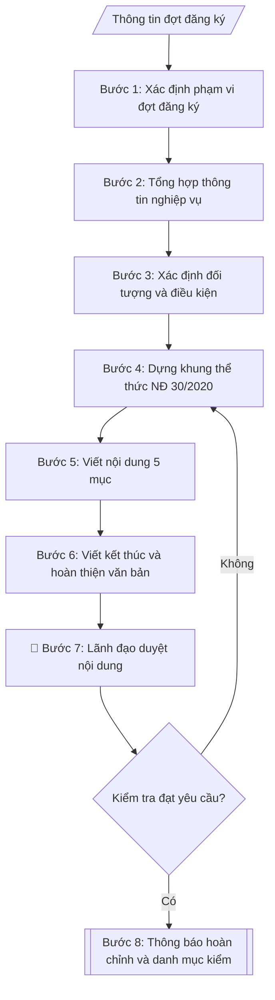

# Thông báo đăng ký đề tài NCKH các cấp

## Khi nào dùng
Khi Phòng KHCN&HTPT cần ban hành thông báo triển khai đợt đăng ký đề tài
nghiên cứu khoa học: xác định cấp đề tài, thời hạn nộp hồ sơ, thành phần hồ sơ,
định mức kinh phí và nơi tiếp nhận, gửi đến các khoa/viện/trung tâm trong trường.

## Định dạng và file đầu ra
Định dạng đầu ra có thể chọn theo sản phẩm/yêu cầu: .docx, .pdf. Đọc mục “Định dạng bổ sung” trong quy cách đầu ra trước khi chọn.

**Phải tạo file thực tế để tải xuống, không chỉ trả nội dung trong chat.** Định dạng mặc định của skill: **.docx**. Nếu có bảng số liệu nghiệp vụ yêu cầu file bảng tính riêng, tạo thêm Excel theo yêu cầu; không tự tạo file kiểm tra. Không chờ người dùng yêu cầu xuất file lần nữa. Ưu tiên định dạng người dùng chỉ định; đọc quy tắc xuất file tại references/quy-cach-dau-ra.md.

**Chạy qua API (không có công cụ tạo file):** trả đủ nội dung dạng văn bản có tiêu đề, bảng; ứng dụng gọi sẽ xuất file.

## Quy cách đầu ra và thông tin thiếu
Khi dựng file Word/Excel, áp dụng mục “Thể thức và bảng biểu khi dựng file” trong quy cách đầu ra (cỡ chữ từng thành phần, bảng nhiều trang, số trang, phụ lục). Đọc [quy cách và cấu trúc sản phẩm](references/quy-cach-dau-ra.md) trước khi soạn/xuất. File giao chỉ gồm sản phẩm nghiệp vụ được yêu cầu; kiểm tra nội bộ không xuất kèm. Thiếu thông tin thì giữ nguyên trường/mục và chỗ điền theo mẫu gốc (dòng dấu chấm, dấu gạch hoặc ô trống); không tự điền dữ liệu mẫu, số 0, mã chờ xác minh hay dòng chờ ký. Mẫu chuyên ngành còn áp dụng được ưu tiên về cấu trúc, mã biểu và người ký. Bản đầy đủ: [quy tắc chung](references/quy-tac-chung.md).

Khi người dùng yêu cầu bộ slide (.pptx), đọc mục “Xuất PowerPoint (.pptx) khi được yêu cầu” trong quy cách đầu ra.

## Kiểm soát áp dụng và phê duyệt
Trước khi chạy, xác định `ngay_ap_dung`, `loai_hinh_truong`, `quy_che_noi_bo`, `nguon_du_lieu`, `nguoi_kiem_duyet`; chỉ hỏi thông tin liên quan nghiệp vụ, không dùng giá trị giả định thay dữ liệu bắt buộc. Đối chiếu căn cứ pháp lý với văn bản gốc, hiệu lực, điều khoản áp dụng và chuyển tiếp. Bản đầy đủ: [quy tắc chung](references/quy-tac-chung.md).

## Giới hạn và human gate
AI hỗ trợ chuẩn bị và đối chiếu; cán bộ phụ trách kiểm tra dữ liệu/căn cứ, người có thẩm quyền duyệt và ký. Không đánh dấu đã ký, đã duyệt, đã công bố khi chưa có chứng cứ. Dữ liệu sinh viên, sức khỏe, nhân sự, tài chính chỉ dùng theo mục đích và phân quyền, che thông tin định danh khi dùng ví dụ (Luật 91/2025/QH15, hiệu lực 01/01/2026); không tải dữ liệu lên dịch vụ ngoài khi chưa có quyền. Bản đầy đủ: [quy tắc chung](references/quy-tac-chung.md).

## Bối cảnh riêng của VNU-IS

Bản chỉnh cho Trường Quốc tế – ĐHQGHN (VNU-IS), v0.4.2. Dựng từ website công khai và phiếu khảo sát CES còn trống; **chưa có dữ liệu khảo sát thực tế của đơn vị**. Đọc [bối cảnh VNU-IS](references/boi-canh-vnuis.md) trước khi chạy; các mã C1–C8 nằm ở mục 6 của file đó.

- **Đơn vị thường dùng:** Phòng KHCN và Hợp tác phát triển (khoa học công nghệ).
- **Nghiệp vụ trong phiếu CES:** "Quản lý đề tài: Tiếp nhận và kiểm tra hồ sơ đề xuất đề tài" (sheet `06_KS_KHCN_HTPT`). Tần suất gợi ý: Theo hồ sơ/vụ việc. Đầu vào gợi ý: Thuyết minh; biểu mẫu; tiêu chí; hồ sơ chủ nhiệm. Khó khăn gợi ý: Tài liệu phân tán, nhiều định dạng; Đọc và đối chiếu thủ công mất thời gian; Dễ thiếu thành phần, sai logic hoặc bỏ sót ngoại lệ; Đầu ra phụ thuộc kinh nghiệm từng cá nhân. Đây là gợi ý có sẵn của CES, chưa phải xác nhận của đơn vị.

**Điều chỉnh khi dùng cho VNU-IS**
- Thông báo đăng ký đề tài ghi điều kiện, hạn nộp theo văn bản của Trường hoặc ĐHQGHN; không đoán.
- Gửi đến Khoa, Viện và giảng viên; bản tiếng Anh khi cần.

**Chờ xác nhận khi khảo sát**
- Kế hoạch KH&CN năm và hạn đăng ký (C6).
- Người ký (C1).

Nếu người dùng chưa trả lời mục chờ xác nhận liên quan, hỏi lại; không tự điền giả định.

## Đầu vào (Input)
| Trường | Mô tả | Bắt buộc |
|---|---|---|
| `dot_dang_ky` | Đợt đăng ký (VD: đợt 1 năm 2027) | Có |
| `cap_de_tai` | Cấp trường / Cấp bộ (tỉnh) / Cấp nhà nước (có thể nhiều cấp trong một thông báo) | Có |
| `doi_tuong` | Đối tượng được đăng ký (cán bộ, giảng viên; tiêu chí chủ nhiệm đề tài) | Có |
| `so_luong_chi_tieu` | Số lượng đề tài dự kiến tuyển chọn theo từng cấp | Có |
| `dinh_muc_kinh_phi` | Mức kinh phí tối đa cho 01 đề tài theo từng cấp | Có |
| `ho_so_yeu_cau` | Thành phần hồ sơ đăng ký (thuyết minh, lý lịch khoa học, dự toán...) | Có |
| `thoi_han_nop` | Hạn cuối nộp hồ sơ (ngày/tháng/năm) | Có |
| `noi_nop` | Nơi tiếp nhận hồ sơ (phòng, địa chỉ, hình thức nộp trực tiếp/online) | Có |
| `dau_moi_lien_he` | Họ tên, điện thoại, email cán bộ phụ trách | Không |
| `can_cu` | Căn cứ ban hành (kế hoạch KHCN năm, quyết định phân bổ kinh phí...) | Không |
| `nguoi_ky` | Hiệu trưởng / Phó Hiệu trưởng / Trưởng Phòng KHCN&HTPT | Có |
| `noi_nhan` | Danh sách nơi nhận | Có |

### Thông tin VNU-IS đã điền sẵn (không hỏi lại)

| Mục | Giá trị mặc định |
|---|---|
| Cơ quan chủ quản; Trường; địa danh | Đại học Quốc gia Hà Nội (ĐHQGHN); Trường Quốc tế – ĐHQGHN (VNU – International School); Hà Nội |
| Đơn vị sử dụng và phối hợp | Phòng KHCN và Hợp tác phát triển (khoa học công nghệ) |
| Cơ sở | Xuân Thủy (Cầu Giấy); Phan Tây Nhạc (Xuân Phương); Hòa Lạc (tòa HT1, Khu Đô thị ĐHQGHN). Ghi rõ cơ sở khi nội dung gắn địa điểm |
| Ngôn ngữ đầu ra | Tiếng Việt là bản gốc; thêm tiếng Anh cho đối tác, người học quốc tế hoặc khi được yêu cầu |
| Hệ thống nguồn dữ liệu có trên website | Kho tài nguyên số; E-Office. Skill không kết nối hệ thống, chỉ dùng file xuất/tải lên (C5) |
| Người duyệt và ký | Ghi theo vai trò (Trưởng phòng, Phó Hiệu trưởng phụ trách, Hiệu trưởng); tuyến duyệt và thẩm quyền ký chờ C1, C6 |

Nguồn: website và phiếu CES; đổi theo khảo sát thì sửa tại đây và trong `references/boi-canh-vnuis.md`.

## Quy trình

*⏱ là ước tính ban đầu của bộ gốc, chưa đo tại VNU-IS; hiệu chỉnh sau khảo sát.*

**Ràng buộc pháp lý khi thực hiện** (trích references/phap-ly.md; đối chiếu toàn văn và hiệu lực tại ngày nghiệp vụ):
- Luật 93/2025/QH15; Nghị định 265/2025 và 267/2025, hiệu lực 14/10/2025: Yêu cầu cấp nhiệm vụ, nguồn kinh phí, tài trợ/đặt hàng, ngày phê duyệt, quy chế cơ quan tài trợ, phương thức khoán và quyền sử dụng kết quả. Đối chiếu NĐ 265 về tài chính và NĐ 267 về nhiệm vụ; không cố định thang xếp loại hoặc thu hồi toàn bộ kinh phí cho mọi đề tài. Nghiệm thu dựa hợp đồng và tiêu chí được duyệt, hội đồng có thẩm quyền xác nhận.
- Trước Bước 1: chọn căn cứ theo đối tượng, loại hình trường và chuyển tiếp; lập bảng văn bản / điều khoản / lý do áp dụng / bằng chứng. Thiếu văn bản gốc hoặc điều khoản thì ghi nhận nội bộ [CẦN XÁC MINH] (không đưa vào file giao), để trống phần tương ứng, chưa kết luận tuân thủ.
- Các con số, thời hạn, số điều, số mức xếp loại, hệ số và mẫu biểu nêu trong các bước dưới đây được giữ từ quy trình gốc (trước cập nhật pháp lý); chỉ dùng khi đã đối chiếu đúng với căn cứ đã chọn, khác thì theo căn cứ. Danh sách điểm cần đối chiếu: docs/DIEM_CAN_DOI_CHIEU_PHAP_LY.md.

**Bước 1. Xác định phạm vi đợt đăng ký**
- Làm gì: đọc `dot_dang_ky` để xác định đợt và năm; lập bảng gồm từng cấp trong `cap_de_tai`, điền `so_luong_chi_tieu` và `dinh_muc_kinh_phi` tương ứng từng cấp; kiểm tra tổng (định mức × chỉ tiêu) có khớp kế hoạch kinh phí KHCN năm đã duyệt không.
- Dùng input: `dot_dang_ky`, `cap_de_tai`, `so_luong_chi_tieu`, `dinh_muc_kinh_phi`.
- Vai trò: Chuyên viên Phòng KHCN&HTPT · AI hỗ trợ: lập bảng phạm vi và kiểm tra tổng kinh phí · ⏱ ~30–45 phút (ước tính)
- Lưu ý nghiệp vụ: định mức cấp bộ/nhà nước thường do Bộ chủ quản quy định, không được tự đặt vượt trần; nếu một thông báo gộp nhiều cấp phải tách rõ từng cấp trong bảng để tránh nhầm lẫn.
- → Kết quả bước: bảng phạm vi đợt đăng ký (cấp đề tài – chỉ tiêu – định mức kinh phí).

**Bước 2. Tổng hợp thông tin nghiệp vụ**
- Làm gì: trích `thoi_han_nop`, `noi_nop`, `ho_so_yeu_cau`, `dau_moi_lien_he` từ input; đối chiếu `thoi_han_nop` với ngày dự kiến ban hành — thời hạn phải sau ngày ban hành ít nhất 15 ngày làm việc (khuyến nghị 30 ngày); kiểm tra `ho_so_yeu_cau` đã ghi đủ số bản cho từng thành phần hồ sơ chưa.
- Dùng input: `thoi_han_nop`, `noi_nop`, `ho_so_yeu_cau`, `dau_moi_lien_he`.
- Vai trò: Chuyên viên Phòng KHCN&HTPT · AI hỗ trợ: tổng hợp và kiểm tra logic thời hạn · ⏱ ~30–45 phút (ước tính)
- Lưu ý nghiệp vụ: bẫy thường gặp — ghi thời hạn chung chung ("cuối tháng 11") thay vì giờ + ngày cụ thể; quên ghi hình thức nộp bản mềm; thiếu đầu mối liên hệ khiến đơn vị không biết hỏi ai.
- → Kết quả bước: phiếu tổng hợp thông tin nghiệp vụ (bảng: hạng mục – nội dung – trạng thái đạt/chưa đạt sau kiểm tra thời hạn).

**Bước 3. Xác định đối tượng và điều kiện đăng ký**
- Làm gì: cụ thể hóa `doi_tuong` thành 3 nhóm điều kiện: (a) ai được đăng ký (cán bộ/giảng viên cơ hữu...); (b) điều kiện chủ nhiệm theo từng cấp trong `cap_de_tai` (trình độ, thâm niên, công trình công bố); (c) điều kiện loại trừ (đang chủ nhiệm đề tài quá hạn chưa nghiệm thu); bổ sung lĩnh vực ưu tiên theo `can_cu` (kế hoạch KHCN năm).
- Dùng input: `doi_tuong`, `cap_de_tai`, `can_cu`.
- Vai trò: Trưởng Phòng KHCN&HTPT · AI hỗ trợ: cụ thể hóa điều kiện theo từng cấp · ⏱ ~45–60 phút (ước tính)
- Lưu ý nghiệp vụ: điều kiện chủ nhiệm cấp bộ/nhà nước phải theo quy định của Bộ chủ quản, không được hạ chuẩn; quy định loại trừ phải rõ ràng để tránh khiếu nại sau này.
- → Kết quả bước: danh sách điều kiện đăng ký phân theo từng cấp đề tài.

**Bước 4. Dựng khung thể thức văn bản theo NĐ 30/2020**
- Làm gì: dựng khung văn bản hành chính đúng thứ tự: Quốc hiệu – Tiêu ngữ → Tên cơ quan ban hành → Số, ký hiệu → Địa danh, ngày tháng năm → Tiêu đề → Kính gửi → Nội dung → Nơi nhận → Chữ ký; điền `nguoi_ky`, `noi_nhan` vào đúng vị trí; kiểm tra thẩm quyền ký phù hợp với cấp đề tài.
- Dùng input: `nguoi_ky`, `noi_nhan`, `dot_dang_ky`.
- Vai trò: Chuyên viên Phòng KHCN&HTPT · AI hỗ trợ: dựng khung văn bản đúng thể thức Nghị định 30/2020 · ⏱ ~20–30 phút (ước tính)
- Lưu ý nghiệp vụ: tiêu đề phải ghi rõ đợt và năm ("Về việc đăng ký đề tài NCKH đợt 1 năm 2027"); nơi nhận phải có dòng "Lưu: VT, ..." theo quy định văn thư; kiểm tra số, ký hiệu văn bản với Văn thư để không bị trùng.
- → Kết quả bước: khung văn bản đúng thể thức, sẵn sàng điền nội dung.

**Bước 5. Viết nội dung thông báo (5 mục)**
- Làm gì: viết 5 mục từ kết quả các bước 1–3: 1. Đối tượng, điều kiện đăng ký; 2. Cấp đề tài, số lượng chỉ tiêu, định mức kinh phí (dạng bảng); 3. Hồ sơ đăng ký (liệt kê từng thành phần + số bản); 4. Thời hạn và nơi nộp hồ sơ; 5. Thông tin liên hệ, giải đáp thắc mắc.
- Dùng input: kết quả bước 1 (`so_luong_chi_tieu`, `dinh_muc_kinh_phi`), bước 2 (`ho_so_yeu_cau`, `thoi_han_nop`, `noi_nop`, `dau_moi_lien_he`), bước 3 (`doi_tuong`).
- Vai trò: Chuyên viên Phòng KHCN&HTPT · AI hỗ trợ: soạn dự thảo 5 mục nội dung từ kết quả các bước trước · ⏱ ~45–60 phút (ước tính)
- Lưu ý nghiệp vụ: số liệu kinh phí ở mục 2 phải khớp 100% với bảng bước 1; mục 4 phải ghi rõ hậu quả nộp muộn ("hồ sơ nộp sau thời hạn trên không được xem xét").
- → Kết quả bước: dự thảo nội dung thông báo đầy đủ 5 mục.

**Bước 6. Viết phần kết thúc và hoàn thiện văn bản**
- Làm gì: viết câu kết đề nghị các đơn vị phổ biến thông báo đến cán bộ, giảng viên; thêm ký hiệu kết thúc "./."; ghép phần kết thúc và khối chữ ký vào khung văn bản ở bước 4.
- Dùng input: `nguoi_ky`, `noi_nhan`, kết quả bước 4, bước 5.
- Vai trò: Chuyên viên Phòng KHCN&HTPT · AI hỗ trợ: viết phần kết thúc và ráp hoàn chỉnh văn bản · ⏱ ~15–20 phút (ước tính)
- Lưu ý nghiệp vụ: ký hiệu "./." đặt sau câu kết thúc nội dung, trước khối "Nơi nhận"; khối chữ ký ghi đúng chức danh người ký theo `nguoi_ky` (VD: "TL. HIỆU TRƯỞNG / TRƯỞNG PHÒNG KHCN").
- → Kết quả bước: dự thảo thông báo hoàn chỉnh (thể thức + nội dung + kết thúc).

**Bước 7. Kiểm tra toàn diện và trình lãnh đạo duyệt**
- Làm gì: chạy danh mục kiểm tra: thể thức NĐ 30/2020, chính tả, số liệu kinh phí khớp kế hoạch, logic thời hạn (không rơi vào ngày nghỉ/lễ), thẩm quyền ký, nơi nhận đầy đủ; trình lãnh đạo duyệt nội dung; nếu không đạt thì quay lại bước 4 hoặc 5 để sửa.
- Dùng input: toàn bộ input + kết quả bước 6.
- Vai trò: Trưởng Phòng KHCN&HTPT · AI hỗ trợ: chạy danh mục kiểm tra kỹ thuật · ⏱ ~1–2 giờ (ước tính, kể cả thời gian chờ duyệt)
- Lưu ý nghiệp vụ: lỗi hay gặp nhất là thời hạn nộp rơi vào ngày nghỉ/lễ và số ký hiệu văn bản bị trùng; kiểm tra số văn bản với Văn thư trước khi trình ký.
- → Kết quả bước: thông báo đã được lãnh đạo duyệt + kết quả đối chiếu nội bộ (không xuất kèm file).

**Bước 8. Xuất bản**
- Làm gì: xuất văn bản hoàn chỉnh theo định dạng đầu ra của skill, sẵn sàng trình ký/chuyển sang Word; lưu kèm danh mục kiểm tra vào hồ sơ đợt đăng ký.
- Dùng input: kết quả bước 7.
- Vai trò: Chuyên viên Phòng KHCN&HTPT · AI hỗ trợ: xuất văn bản theo định dạng đầu ra của skill và lưu hồ sơ đợt đăng ký · ⏱ ~10–15 phút (ước tính)
- Lưu ý nghiệp vụ: sau khi ký, lưu 01 bản có số văn bản chính thức để làm căn cứ cho các bước tiếp nhận hồ sơ sau này.
- → Kết quả bước: văn bản thông báo hoàn chỉnh + kết quả đối chiếu nội bộ (không xuất kèm file).

## Luồng quy trình (Workflow)

## Đầu ra
- Văn bản thông báo hoàn chỉnh.
- Danh mục kiểm tra thể thức và nội dung.

File nghiệp vụ thực tế theo định dạng mặc định ở đầu skill hoặc định dạng người dùng yêu cầu, kèm liên kết tải trong phản hồi cuối.

Sản phẩm nghiệp vụ theo [quy cách và cấu trúc](references/quy-cach-dau-ra.md); trường thiếu để trống, không kèm tài liệu kiểm tra đầu ra.

## Kiểm tra nội bộ trước khi giao
Các tiêu chí sau dùng để tự đối chiếu; không sao chép vào file xuất. Mục thiếu dữ liệu được để trống, không đánh dấu đã đạt hoặc đã duyệt.

- [ ] Đủ các phần và đúng bố cục theo cấu trúc tại references/quy-cach-dau-ra.md (không theo cấu trúc của bản gốc).
- [ ] Số liệu trong output (chỉ tiêu, định mức kinh phí theo từng cấp) khớp 100% với Input (`dot_dang_ky`, `so_luong_chi_tieu`, `dinh_muc_kinh_phi`)
- [ ] Không bịa đặt căn cứ pháp lý, số ký hiệu văn bản, thông tin đơn vị
- [ ] Đúng thể thức văn bản hành chính theo Nghị định 30/2020/NĐ-CP
- [ ] Căn cứ pháp lý đầy đủ, còn hiệu lực (kế hoạch KHCN năm, quyết định phân bổ kinh phí; quy định của Bộ chủ quản đối với cấp bộ trở lên)
- [ ] Đủ 5 mục nội dung: (1) đối tượng, điều kiện đăng ký; (2) cấp/số lượng/định mức kinh phí (dạng bảng); (3) hồ sơ đăng ký; (4) thời hạn và nơi nộp; (5) thông tin liên hệ
- [ ] Thời hạn nộp sau ngày ban hành ít nhất 15 ngày làm việc, không rơi vào ngày nghỉ/lễ; ghi rõ hậu quả nộp muộn
- [ ] Thẩm quyền ký phù hợp cấp đề tài; nơi nhận đầy đủ kèm dòng "Lưu: VT, ..."; số ký hiệu văn bản đã kiểm tra với Văn thư, không trùng
- [ ] Đã qua Human gate: lãnh đạo có thẩm quyền đã duyệt nội dung trước khi ban hành

## Căn cứ & lưu ý
- Nghị định 30/2020/NĐ-CP về công tác văn thư (thể thức văn bản).
- Quy chế quản lý đề tài NCKH cấp trường của Trường Quốc tế – ĐHQGHN (giả lập).
- Quy định quản lý nhiệm vụ KHCN cấp bộ của Bộ chủ quản (đối với đề tài cấp bộ trở lên).
- Thời hạn nộp hồ sơ nên chừa ít nhất 30 ngày kể từ ngày ban hành để đơn vị chuẩn bị.
- Ví dụ trong skill chỉ để minh họa; không đưa dữ liệu cá nhân thật vào ví dụ. Tên Trường, cơ quan chủ quản và địa danh dùng đúng bảng thông tin VNU-IS đã điền sẵn.

## Tư liệu đối chiếu
Bản gốc trước cập nhật pháp lý (kèm ví dụ giả lập) lưu tại `references/quy-trinh-lich-su.md`, chỉ để đối chiếu hồ sơ lịch sử; không dùng căn cứ, mẫu hay số liệu trong đó làm chỉ dẫn hiện hành.

## Quản trị phiên bản
- Phiên bản gói VNU-IS `0.4.2` (cập nhật 2026-10-11), dựa trên skill gốc `thong-bao-dang-ky-de-tai` bản `1.3.2`; hồ sơ đầy đủ tại [references/version.json](references/version.json).
- Người phê duyệt nghiệp vụ: **chưa chỉ định**. Trạng thái: dự thảo nghiệp vụ; kiểm tra pháp lý trước thực thi. Ngày cập nhật không đồng nghĩa mọi văn bản đã được rà soát toàn văn.
- Giấy phép theo LICENSE của kho (bản quyền CES Global). Lịch sử thay đổi: CHANGELOG.md.
