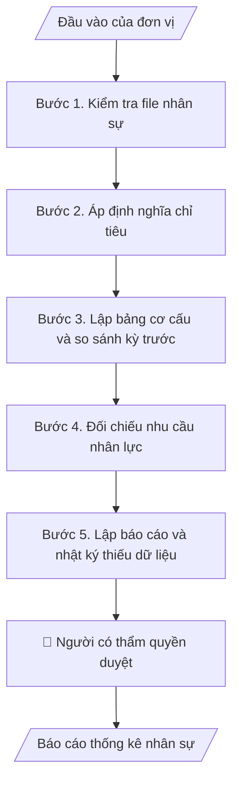

# Báo cáo thống kê nhân sự

## Khi nào dùng
Khi Phòng Tổ chức và Quản trị cần báo cáo số liệu nhân sự theo kỳ hoặc theo yêu cầu của ĐHQGHN, Ban Giám hiệu; và khi cần đối chiếu nhu cầu nhân lực với vị trí việc làm hiện có.

## Định dạng và file đầu ra

Định dạng đầu ra có thể chọn theo sản phẩm/yêu cầu: .docx, .pdf. Đọc mục “Định dạng bổ sung” trong quy cách đầu ra trước khi chọn.

**Phải tạo file thực tế để tải xuống, không chỉ trả nội dung trong chat.** Định dạng mặc định của skill: **.docx**. Nếu có bảng số liệu nghiệp vụ yêu cầu file bảng tính riêng, tạo thêm Excel theo yêu cầu; không tự tạo file kiểm tra. Không chờ người dùng yêu cầu xuất file lần nữa. Ưu tiên định dạng người dùng chỉ định; đọc quy tắc xuất file tại references/quy-cach-dau-ra.md.

**Chạy qua API (không có công cụ tạo file):** trả đủ nội dung dạng văn bản có tiêu đề, bảng; ứng dụng gọi sẽ xuất file.

## Quy cách đầu ra và thông tin thiếu
Khi dựng file Word/Excel, áp dụng mục “Thể thức và bảng biểu khi dựng file” trong quy cách đầu ra (cỡ chữ từng thành phần, bảng nhiều trang, số trang, phụ lục). Đọc [quy cách và cấu trúc sản phẩm](references/quy-cach-dau-ra.md) trước khi soạn/xuất. File giao chỉ gồm sản phẩm nghiệp vụ được yêu cầu; kiểm tra nội bộ không xuất kèm. Thiếu thông tin thì giữ nguyên trường/mục và chỗ điền theo mẫu gốc (dòng dấu chấm, dấu gạch hoặc ô trống); không tự điền dữ liệu mẫu, số 0, mã chờ xác minh hay dòng chờ ký. Mẫu chuyên ngành còn áp dụng được ưu tiên về cấu trúc, mã biểu và người ký. Bản đầy đủ: [quy tắc chung](references/quy-tac-chung.md).

Khi người dùng yêu cầu bộ slide (.pptx), đọc mục “Xuất PowerPoint (.pptx) khi được yêu cầu” trong quy cách đầu ra.

Khi báo cáo có số liệu cần so sánh hoặc nêu xu hướng, đọc mục “Biểu đồ và hình trong báo cáo số liệu” trong quy cách đầu ra trước khi vẽ.

## Kiểm soát áp dụng và phê duyệt
Trước khi chạy, xác định `ngay_ap_dung`, `loai_hinh_truong`, `quy_che_noi_bo`, `nguon_du_lieu`, `nguoi_kiem_duyet`; chỉ hỏi thông tin liên quan nghiệp vụ, không dùng giá trị giả định thay dữ liệu bắt buộc. Đối chiếu căn cứ pháp lý với văn bản gốc, hiệu lực, điều khoản áp dụng và chuyển tiếp. Bản đầy đủ: [quy tắc chung](references/quy-tac-chung.md).

## Giới hạn và human gate
AI hỗ trợ chuẩn bị và đối chiếu; cán bộ phụ trách kiểm tra dữ liệu/căn cứ, người có thẩm quyền duyệt và ký. Không đánh dấu đã ký, đã duyệt, đã công bố khi chưa có chứng cứ. Dữ liệu sinh viên, sức khỏe, nhân sự, tài chính chỉ dùng theo mục đích và phân quyền, che thông tin định danh khi dùng ví dụ (Luật 91/2025/QH15, hiệu lực 01/01/2026); không tải dữ liệu lên dịch vụ ngoài khi chưa có quyền. Bản đầy đủ: [quy tắc chung](references/quy-tac-chung.md).

## Bối cảnh riêng của VNU-IS

Skill mới cho Trường Quốc tế – ĐHQGHN (VNU-IS), v0.4.2. Dựng từ website công khai và phiếu khảo sát CES còn trống; **chưa có dữ liệu khảo sát thực tế của đơn vị**. Đọc [bối cảnh VNU-IS](references/boi-canh-vnuis.md) trước khi chạy; các mã C1–C8 nằm ở mục 6 của file đó.

- **Đơn vị thường dùng:** Phòng Tổ chức và Quản trị.
- **Nghiệp vụ trong phiếu CES:** "Báo cáo nhân sự: Lập báo cáo thống kê nhân sự định kỳ" (sheet `03_KS_TCQT`). Tần suất gợi ý: Định kỳ. Đầu vào gợi ý: Excel nhân sự đã xuất; mẫu báo cáo; định nghĩa chỉ tiêu. Khó khăn gợi ý: Tài liệu phân tán, nhiều định dạng; Đọc và đối chiếu thủ công mất thời gian; Khó kiểm tra chênh lệch, trùng lặp và nguồn số liệu; Đầu ra phụ thuộc kinh nghiệm từng cá nhân. Nghiệp vụ liên quan: "Hoạch định nhân sự: Tổng hợp cơ cấu, biên chế và nhu cầu nhân lực".

**Chờ xác nhận khi khảo sát**
- Định nghĩa chỉ tiêu và mẫu báo cáo nhân sự (C8).
- Quy định về dữ liệu nhân sự được tải lên (C5).

Nếu người dùng chưa trả lời mục chờ xác nhận liên quan, hỏi lại; không tự điền giả định.

## Đầu vào (Input)

| Trường | Mô tả | Bắt buộc |
|---|---|---|
| `file_nhan_su` | File Excel nhân sự đã xuất, đã che hoặc dùng mã nội bộ thay họ tên; tối thiểu: đơn vị, chức danh, vị trí việc làm, trình độ, loại hợp đồng, trạng thái | Có |
| `dinh_nghia_chi_tieu` | Định nghĩa từng chỉ tiêu do Trường quy định (ví dụ cách tính giảng viên cơ hữu, người kiêm nhiệm) | Có |
| `mau_bao_cao` | Mẫu báo cáo nhân sự đang dùng hoặc mẫu của ĐHQGHN | Có |
| `ky_bao_cao` | Kỳ báo cáo và ngày chốt số liệu | Có |
| `ke_hoach_nhan_luc` | Vị trí việc làm, nhu cầu, biên chế được giao nếu có | Không |

### Thông tin VNU-IS đã điền sẵn (không hỏi lại)

| Mục | Giá trị mặc định |
|---|---|
| Cơ quan chủ quản; Trường; địa danh | Đại học Quốc gia Hà Nội (ĐHQGHN); Trường Quốc tế – ĐHQGHN (VNU – International School); Hà Nội |
| Đơn vị sử dụng và phối hợp | Phòng Tổ chức và Quản trị |
| Ngôn ngữ đầu ra | Tiếng Việt là bản gốc; thêm tiếng Anh cho đối tác, người học quốc tế hoặc khi được yêu cầu |
| Hệ thống nguồn dữ liệu có trên website | E-Office. Skill không kết nối hệ thống, chỉ dùng file xuất/tải lên (C5) |
| Người duyệt và ký | Ghi theo vai trò (Trưởng phòng, Phó Hiệu trưởng phụ trách, Hiệu trưởng); tuyến duyệt và thẩm quyền ký chờ C1, C6 |

Nguồn: website và phiếu CES; đổi theo khảo sát thì sửa tại đây và trong `references/boi-canh-vnuis.md`.

## Quy trình

*⏱ là ước tính ban đầu của bộ gốc, chưa đo tại VNU-IS; hiệu chỉnh sau khảo sát.*

**Bước 1. Kiểm tra file nhân sự**
- Làm gì: Đọc cột, kiểu dữ liệu, ô trống, bản ghi trùng, ngày không hợp lệ, giá trị ngoài danh mục; lập bảng "cần rà" theo dòng.
- Dùng input: `file_nhan_su`
- Vai trò: Chuyên viên nhân sự · AI hỗ trợ: quét lỗi dữ liệu · ⏱ thời gian do đơn vị ước tính sau khảo sát
- Lưu ý nghiệp vụ: Không sửa file gốc; mọi chỉnh sửa do người phụ trách làm trên bản của mình.
- → Kết quả bước: Bảng dữ liệu cần rà.

**Bước 2. Áp định nghĩa chỉ tiêu**
- Làm gì: Tính từng chỉ tiêu theo định nghĩa đã cung cấp, theo từng đơn vị (4 phòng, 6 khoa, Viện, Hội đồng). Người kiêm nhiệm hai vai trò chỉ đếm một lần ở tổng toàn Trường và ghi rõ quy tắc đã dùng.
- Dùng input: `file_nhan_su`, `dinh_nghia_chi_tieu`
- Vai trò: Chuyên viên nhân sự · AI hỗ trợ: tính và đối chiếu tổng · ⏱ thời gian do đơn vị ước tính sau khảo sát
- Lưu ý nghiệp vụ: Nếu tổng các nhóm không bằng tổng chung thì nêu chênh lệch, không làm tròn che lệch.
- → Kết quả bước: Bảng chỉ tiêu theo đơn vị.

**Bước 3. Lập bảng cơ cấu và so sánh kỳ trước**
- Làm gì: Cơ cấu theo chức danh, trình độ, loại hợp đồng; so với kỳ trước nếu có file kỳ trước; chỉ nêu xu hướng khi có từ 3 mốc số liệu.
- Dùng input: `file_nhan_su`, `ky_bao_cao`
- Vai trò: Trưởng phòng · AI hỗ trợ: dự thảo bảng và nhận xét dựa trên số liệu · ⏱ thời gian do đơn vị ước tính sau khảo sát
- Lưu ý nghiệp vụ: Chỉ nêu số lượng; không đánh giá cá nhân.
- → Kết quả bước: Bảng cơ cấu và so sánh.

**Bước 4. Đối chiếu nhu cầu nhân lực**
- Làm gì: So vị trí việc làm và nhu cầu với số hiện có; liệt kê chênh lệch và các vị trí thiếu dữ liệu.
- Dùng input: `ke_hoach_nhan_luc`
- Vai trò: Trưởng phòng · AI hỗ trợ: lập bảng chênh lệch · ⏱ thời gian do đơn vị ước tính sau khảo sát
- Lưu ý nghiệp vụ: Không tự đặt biên chế hay chỉ tiêu tuyển dụng.
- → Kết quả bước: Bảng chênh lệch nhu cầu và hiện có.

**Bước 5. Lập báo cáo và nhật ký thiếu dữ liệu**
- Làm gì: Ghép thành báo cáo theo mẫu; thêm nhật ký chỉ tiêu thiếu dữ liệu hoặc mâu thuẫn.
- Dùng input: `mau_bao_cao`, `ky_bao_cao`
- Vai trò: Trưởng phòng · AI hỗ trợ: ghép báo cáo · ⏱ thời gian do đơn vị ước tính sau khảo sát
- Lưu ý nghiệp vụ: Nhóm quá nhỏ có thể nhận diện cá nhân thì gộp nhóm khi báo cáo ra ngoài Phòng; ngưỡng do Trường quyết.
- → Kết quả bước: Báo cáo thống kê nhân sự.

## Luồng quy trình (Workflow)

## Đầu ra

File nghiệp vụ thực tế theo định dạng mặc định ở đầu skill hoặc định dạng người dùng yêu cầu, kèm liên kết tải trong phản hồi cuối.

Sản phẩm nghiệp vụ hoàn chỉnh theo [quy cách và cấu trúc](references/quy-cach-dau-ra.md), giữ các trường chưa có dữ liệu ở trạng thái trống. Không xuất kèm danh mục kiểm/phụ lục kiểm tra đầu ra.

## Kiểm tra nội bộ trước khi giao

- [ ] Bố cục khớp cấu trúc tại references/quy-cach-dau-ra.md.
- [ ] Tổng các nhóm bằng tổng chung hoặc đã nêu chênh lệch.
- [ ] Không có họ tên cá nhân trong báo cáo tổng hợp.
- [ ] Mọi chỉ tiêu có định nghĩa kèm theo.
- [ ] Chỉ số liệu có trong file; chỗ thiếu để trống và ghi vào nhật ký.
- [ ] Đã qua Human gate.

Tiêu chí đạt = tất cả các ô được đánh dấu.

## Human gate (người kiểm duyệt)
- **Trưởng phòng Tổ chức và Quản trị** kiểm tra số liệu và định nghĩa trước khi gửi.
- **Người có thẩm quyền của Trường** duyệt báo cáo gửi ĐHQGHN.

## Giới hạn (guardrails)
- KHÔNG đưa dữ liệu nhân sự định danh lên dịch vụ ngoài khi chưa có quyền (C5).
- KHÔNG tự đặt biên chế, chỉ tiêu tuyển dụng hay đánh giá cá nhân.

## Căn cứ & lưu ý
- Căn cứ pháp lý và quy định nội bộ do người dùng cung cấp; chưa có thì ghi `[CẦN XÁC MINH]`, không suy diễn.
- Ví dụ trong skill chỉ để minh họa; không đưa dữ liệu cá nhân thật vào ví dụ. Tên Trường, cơ quan chủ quản và địa danh dùng đúng bảng thông tin VNU-IS đã điền sẵn.

## Quản trị phiên bản
- Phiên bản gói VNU-IS `0.4.2` (cập nhật 2026-10-11); hồ sơ tại [references/version.json](references/version.json). Skill mới, không có bản gốc trong bộ 171 skill; dùng khung và quy cách đầu ra của skill `hop-nhat-bao-cao-don-vi`.
- Người phê duyệt nghiệp vụ: **chưa chỉ định**. Trạng thái: dự thảo nghiệp vụ, chờ khảo sát; kiểm tra pháp lý trước thực thi.
- Giấy phép theo LICENSE của kho (bản quyền CES Global).
