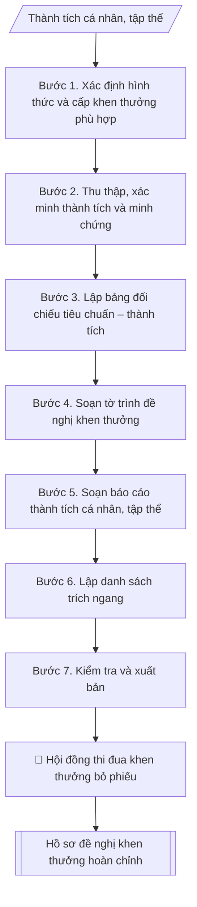

# Hồ sơ đề nghị khen thưởng các cấp

## Khi nào dùng
Khi cần đề nghị khen thưởng cho cá nhân hoặc tập thể: Huân chương, Bằng khen của Thủ tướng,
Bằng khen Bộ/Giáo dục, Chiến sĩ thi đua, Giấy khen của Hiệu trưởng...; chuẩn bị tờ trình,
báo cáo thành tích và danh sách trích ngang gửi Hội đồng thi đua – khen thưởng cấp trên.

## Định dạng và file đầu ra

Định dạng đầu ra có thể chọn theo sản phẩm/yêu cầu: .docx, .pdf. Đọc mục “Định dạng bổ sung” trong quy cách đầu ra trước khi chọn.

**Phải tạo file thực tế để tải xuống, không chỉ trả nội dung trong chat.** Định dạng mặc định của skill: **.docx**. Nếu có bảng số liệu nghiệp vụ yêu cầu file bảng tính riêng, tạo thêm Excel theo yêu cầu; không tự tạo file kiểm tra. Không chờ người dùng yêu cầu xuất file lần nữa. Ưu tiên định dạng người dùng chỉ định; đọc quy tắc xuất file tại references/quy-cach-dau-ra.md.

**Chạy qua API (không có công cụ tạo file):** trả đủ nội dung dạng văn bản có tiêu đề, bảng; ứng dụng gọi sẽ xuất file.

## Quy cách đầu ra và thông tin thiếu
Khi dựng file Word/Excel, áp dụng mục “Thể thức và bảng biểu khi dựng file” trong quy cách đầu ra (cỡ chữ từng thành phần, bảng nhiều trang, số trang, phụ lục). Đọc [quy cách và cấu trúc sản phẩm](references/quy-cach-dau-ra.md) trước khi soạn/xuất. File giao chỉ gồm sản phẩm nghiệp vụ được yêu cầu; kiểm tra nội bộ không xuất kèm. Thiếu thông tin thì giữ nguyên trường/mục và chỗ điền theo mẫu gốc (dòng dấu chấm, dấu gạch hoặc ô trống); không tự điền dữ liệu mẫu, số 0, mã chờ xác minh hay dòng chờ ký. Mẫu chuyên ngành còn áp dụng được ưu tiên về cấu trúc, mã biểu và người ký. Bản đầy đủ: [quy tắc chung](references/quy-tac-chung.md).

Khi người dùng yêu cầu bộ slide (.pptx), đọc mục “Xuất PowerPoint (.pptx) khi được yêu cầu” trong quy cách đầu ra.

## Kiểm soát áp dụng và phê duyệt
Trước khi chạy, xác định `ngay_ap_dung`, `loai_hinh_truong`, `quy_che_noi_bo`, `nguon_du_lieu`, `nguoi_kiem_duyet`; chỉ hỏi thông tin liên quan nghiệp vụ, không dùng giá trị giả định thay dữ liệu bắt buộc. Đối chiếu căn cứ pháp lý với văn bản gốc, hiệu lực, điều khoản áp dụng và chuyển tiếp. Bản đầy đủ: [quy tắc chung](references/quy-tac-chung.md).

## Giới hạn và human gate
AI hỗ trợ chuẩn bị và đối chiếu; cán bộ phụ trách kiểm tra dữ liệu/căn cứ, người có thẩm quyền duyệt và ký. Không đánh dấu đã ký, đã duyệt, đã công bố khi chưa có chứng cứ. Dữ liệu sinh viên, sức khỏe, nhân sự, tài chính chỉ dùng theo mục đích và phân quyền, che thông tin định danh khi dùng ví dụ (Luật 91/2025/QH15, hiệu lực 01/01/2026); không tải dữ liệu lên dịch vụ ngoài khi chưa có quyền. Bản đầy đủ: [quy tắc chung](references/quy-tac-chung.md).

## Bối cảnh riêng của VNU-IS

Bản chỉnh cho Trường Quốc tế – ĐHQGHN (VNU-IS), v0.4.2. Dựng từ website công khai và phiếu khảo sát CES còn trống; **chưa có dữ liệu khảo sát thực tế của đơn vị**. Đọc [bối cảnh VNU-IS](references/boi-canh-vnuis.md) trước khi chạy; các mã C1–C8 nằm ở mục 6 của file đó.

- **Đơn vị thường dùng:** Phòng Tổ chức và Quản trị (thi đua – khen thưởng).
- **Nghiệp vụ trong phiếu CES:** "Hồ sơ cán bộ: Kiểm tra thành phần hồ sơ bổ nhiệm, nâng lương, thi đua" (sheet `03_KS_TCQT`). Tần suất gợi ý: Theo hồ sơ/vụ việc. Đầu vào gợi ý: Danh mục bắt buộc; hồ sơ cá nhân; quyết định liên quan. Khó khăn gợi ý: Tài liệu phân tán, nhiều định dạng; Đọc và đối chiếu thủ công mất thời gian; Dễ thiếu thành phần, sai logic hoặc bỏ sót ngoại lệ; Đầu ra phụ thuộc kinh nghiệm từng cá nhân. Đây là gợi ý có sẵn của CES, chưa phải xác nhận của đơn vị.

**Điều chỉnh khi dùng cho VNU-IS**
- Các cấp khen thưởng: cấp Trường, ĐHQGHN, cấp cao hơn; mỗi cấp có hồ sơ riêng do người dùng nạp; skill không tự suy ra tiêu chuẩn.
- Thành tích quốc tế, công bố: ghi nguồn minh chứng, không tự nâng thành tích.
- Danh sách trích ngang chỉ có thông tin cần thiết.

**Chờ xác nhận khi khảo sát**
- Hướng dẫn khen thưởng của ĐHQGHN (C2).
- Mốc nộp hồ sơ (C8).

Nếu người dùng chưa trả lời mục chờ xác nhận liên quan, hỏi lại; không tự điền giả định.

## Đầu vào (Input)

| Trường | Mô tả | Bắt buộc |
|---|---|---|
| `doi_tuong` | Cá nhân / Tập thể | Có |
| `ho_ten_tap_the` | Họ tên cá nhân hoặc tên tập thể đề nghị | Có |
| `chuc_vu_don_vi` | Chức vụ, đơn vị công tác (cá nhân) / đơn vị chủ quản (tập thể) | Có |
| `hinh_thuc_khen` | Huân chương / Bằng khen Thủ tướng / Bằng khen Bộ / CSTĐ / Giấy khen... | Có |
| `cap_trinh` | Cấp trình (Hiệu trưởng / ĐHQGHN / Bộ GD&ĐT / Thủ tướng Chính phủ...; chờ C6) | Có |
| `thanh_tich` | Tóm tắt thành tích nổi bật theo năm, có số liệu minh chứng | Có |
| `thoi_gian_xet` | Giai đoạn xét thành tích (vd: 2021–2026) | Có |
| `can_cu` | Quy định, tiêu chuẩn của hình thức khen thưởng tương ứng | Có |
| `nguoi_ky` | Hiệu trưởng / Chủ tịch Hội đồng TĐKT trường | Có |

### Thông tin VNU-IS đã điền sẵn (không hỏi lại)

| Mục | Giá trị mặc định |
|---|---|
| Cơ quan chủ quản; Trường; địa danh | Đại học Quốc gia Hà Nội (ĐHQGHN); Trường Quốc tế – ĐHQGHN (VNU – International School); Hà Nội |
| Đơn vị sử dụng và phối hợp | Phòng Tổ chức và Quản trị (thi đua – khen thưởng) |
| Ngôn ngữ đầu ra | Tiếng Việt là bản gốc; thêm tiếng Anh cho đối tác, người học quốc tế hoặc khi được yêu cầu |
| Hệ thống nguồn dữ liệu có trên website | E-Office. Skill không kết nối hệ thống, chỉ dùng file xuất/tải lên (C5) |
| Người duyệt và ký | Ghi theo vai trò (Trưởng phòng, Phó Hiệu trưởng phụ trách, Hiệu trưởng); tuyến duyệt và thẩm quyền ký chờ C1, C6 |

Nguồn: website và phiếu CES; đổi theo khảo sát thì sửa tại đây và trong `references/boi-canh-vnuis.md`.

## Quy trình

*⏱ là ước tính ban đầu của bộ gốc, chưa đo tại VNU-IS; hiệu chỉnh sau khảo sát.*

**Bước 1. Xác định hình thức và cấp khen thưởng phù hợp**
- Làm gì: căn cứ `thanh_tich` và `hinh_thuc_khen` đề xuất, đối chiếu với tiêu chuẩn của từng
hình thức trong Luật Thi đua, khen thưởng và văn bản hướng dẫn (Huân chương, Bằng khen Thủ
tướng, Bằng khen Bộ, Chiến sĩ thi đua, Giấy khen...); xác định `cap_trinh` có thẩm quyền
xét tặng; kiểm tra đối tượng chưa từng được tặng cùng hình thức cho cùng thành tích.
- Dùng input: `doi_tuong`, `hinh_thuc_khen`, `cap_trinh`, `thanh_tich`, `can_cu`.
- Vai trò: Chuyên viên Phòng TC&QT (nhân sự) · AI hỗ trợ: phân tích input, xác định yêu cầu · ⏱ ~20–45 phút (ước tính)
- Lưu ý nghiệp vụ: bẫy thường gặp là đề nghị hình thức khen cao hơn tiêu chuẩn thành tích
thực tế (hồ sơ bị trả) hoặc đề nghị trùng hình thức đã được tặng cho cùng giai đoạn thành
tích; hình thức khen phải tương xứng và có tính kế thừa (không nhảy cóc từ Giấy khen lên
Huân chương).
- → Kết quả bước: phiếu xác định hình thức khen (hình thức đề nghị | tiêu chuẩn yêu cầu |
thành tích đối chiếu | kết luận phù hợp/không phù hợp).

**Bước 2. Thu thập, xác minh thành tích và minh chứng**
- Làm gì: thu thập chi tiết từng nội dung trong `thanh_tich` theo `thoi_gian_xet`: quá trình
công tác, thành tích từng năm (đề tài, bài báo, giải thưởng, sáng kiến, kết quả đánh giá
viên chức...), kèm minh chứng cho từng nội dung (quyết định nghiệm thu, bản sao bài báo,
quyết định công nhận danh hiệu...); kiểm tra giai đoạn xét liên tục, không trùng lặp thành
tích đã được khen ở cùng hình thức.
- Dùng input: `thanh_tich`, `thoi_gian_xet`, `ho_ten_tap_the`, `chuc_vu_don_vi`.
- Vai trò: Chuyên viên Phòng TC&QT (nhân sự) · AI hỗ trợ: xử lý sơ bộ theo quy trình · ⏱ ~20–45 phút (ước tính)
- Lưu ý nghiệp vụ: mọi con số trong báo cáo thành tích (số đề tài, số bài báo, số NCS)
đều phải có minh chứng đối chiếu được; thành tích tập thể và cá nhân phải tách bạch
(không lấy thành tích tập thể ghi cho cá nhân); kiểm tra kết quả đánh giá viên chức các
năm trong giai đoạn xét (thường yêu cầu hoàn thành tốt nhiệm vụ trở lên).
- → Kết quả bước: bảng tổng hợp thành tích đã xác minh (năm | nội dung thành tích |
minh chứng kèm theo).

**Bước 3. Lập bảng đối chiếu tiêu chuẩn – thành tích**
- Làm gì: liệt kê từng tiêu chuẩn của hình thức khen đã xác định ở Bước 1, đối chiếu với
thành tích đã xác minh ở Bước 2, đánh dấu từng tiêu chí: Đạt / Chưa đạt / Cần làm rõ;
ghi rõ căn cứ pháp lý của từng tiêu chuẩn (`can_cu`).
- Dùng input: `hinh_thuc_khen`, `can_cu` + kết quả Bước 1–2.
- Vai trò: Chuyên viên Phòng TC&QT (nhân sự) (Trưởng phòng kiểm tra lại) · AI hỗ trợ: lập bảng tính toán · ⏱ ~15–30 phút (ước tính)
- Lưu ý nghiệp vụ: đây là bước quyết định hồ sơ có đủ điều kiện trình hay không — nếu có
tiêu chí chưa đạt phải dừng lại và báo lại đơn vị, không cố soạn hồ sơ; tiêu chí "cần làm
rõ" phải được xử lý dứt điểm trước khi sang bước soạn thảo.
- → Kết quả bước: bảng đối chiếu tiêu chuẩn – thành tích (tiêu chuẩn | yêu cầu |
thực tế | kết quả) + kết luận đủ/không đủ điều kiện trình.

**Bước 4. Soạn tờ trình đề nghị khen thưởng**
- Làm gì: soạn tờ trình theo thể thức NĐ 30/2020: Quốc hiệu – Tiêu ngữ, tên trường, số/ký
hiệu, địa danh ngày tháng, tên loại "TỜ TRÌNH" + trích yếu (Về việc đề nghị tặng...);
Kính gửi `cap_trinh`; phần căn cứ (Luật Thi đua, khen thưởng; quy định của cấp trình;
kết quả bình xét của Hội đồng TĐKT trường — số, ngày họp); nội dung đề nghị (tặng hình
thức gì cho ai — họ tên/tên tập thể, chức vụ, đơn vị — kèm tóm tắt thành tích); nêu rõ
có danh sách trích ngang và báo cáo thành tích kèm theo; câu kết trình cấp có thẩm quyền
xem xét, quyết định; Nơi nhận; `nguoi_ky` ký.
- Dùng input: `doi_tuong`, `ho_ten_tap_the`, `chuc_vu_don_vi`, `hinh_thuc_khen`, `cap_trinh`, `thanh_tich`, `nguoi_ky`.
- Vai trò: Chuyên viên Phòng TC&QT (nhân sự) · AI hỗ trợ: soạn dự thảo đúng thể thức · ⏱ ~20–45 phút (ước tính)
- Lưu ý nghiệp vụ: trích yếu phải nêu đúng hình thức khen đề nghị; phần căn cứ bắt buộc có
kết quả bình xét của Hội đồng TĐKT trường (ngày họp, tỷ lệ bỏ phiếu) — thiếu căn cứ này
hồ sơ không hợp lệ; số lượng đề nghị trong tờ trình phải khớp tuyệt đối với danh sách
trích ngang.
- → Kết quả bước: dự thảo tờ trình đề nghị khen thưởng hoàn chỉnh.

**Bước 5. Soạn báo cáo thành tích cá nhân/tập thể**
- Làm gì: soạn báo cáo thành tích theo mẫu chuẩn: Quốc hiệu – Tiêu ngữ; tên báo cáo + hình
thức khen đề nghị; I. Sơ lược lý lịch (họ tên, chức vụ, đơn vị, trình độ — hoặc thông tin
tập thể); II. Thành tích đạt được trong `thoi_gian_xet` (trình bày theo năm hoặc theo nhóm
nội dung, nêu bật, có số liệu từ Bước 2); III. Các danh hiệu, hình thức khen thưởng đã được
tặng; lời cam đoan tính chính xác + chữ ký người báo cáo; phần xác nhận của thủ trưởng
đơn vị.
- Dùng input: `doi_tuong`, `ho_ten_tap_the`, `chuc_vu_don_vi`, `thanh_tich`, `thoi_gian_xet`, `hinh_thuc_khen`.
- Vai trò: Chuyên viên Phòng TC&QT (nhân sự) · AI hỗ trợ: soạn dự thảo đúng thể thức · ⏱ ~20–45 phút (ước tính)
- Lưu ý nghiệp vụ: thành tích trình bày theo thứ tự ưu tiên (nổi bật nhất trước), số liệu
khớp với bảng tổng hợp ở Bước 2; mục III phải kê khai trung thực các khen thưởng đã nhận
(cơ quan xét đối chiếu để tránh khen trùng); báo cáo cá nhân do chính cá nhân ký và cam đoan.
- → Kết quả bước: dự thảo báo cáo thành tích hoàn chỉnh.

**Bước 6. Lập danh sách trích ngang**
- Làm gì: lập bảng trích ngang kèm tờ trình với các cột: TT, họ tên (hoặc tên tập thể),
chức vụ/đơn vị, tóm tắt thành tích (ngắn gọn, nêu số liệu chính), hình thức đề nghị;
kiểm tra số thứ tự, họ tên, hình thức đề nghị khớp với tờ trình (Bước 4) và báo cáo thành
tích (Bước 5).
- Dùng input: `ho_ten_tap_the`, `chuc_vu_don_vi`, `thanh_tich`, `hinh_thuc_khen`.
- Vai trò: Chuyên viên Phòng TC&QT (nhân sự) · AI hỗ trợ: lập bảng tính toán · ⏱ ~20–45 phút (ước tính)
- Lưu ý nghiệp vụ: trích ngang là tài liệu cấp trên đọc đầu tiên — tóm tắt thành tích
không quá 2 dòng nhưng phải nêu được điểm nổi bật nhất; nếu nhiều đối tượng, sắp xếp theo
thứ tự ưu tiên đề nghị.
- → Kết quả bước: danh sách trích ngang đề nghị khen thưởng.

**Bước 7. Kiểm tra và xuất bản**
- Làm gì: soát toàn bộ hồ sơ: tiêu chuẩn hình thức khen khớp thành tích (kết quả Bước 3),
thời gian xét liên tục, minh chứng đầy đủ; họ tên/chức vụ/đơn vị thống nhất giữa tờ trình,
báo cáo thành tích và trích ngang; thẩm quyền trình đúng `cap_trinh`; thể thức văn bản
đúng NĐ 30/2020; `nguoi_ky` đúng thẩm quyền.
- Dùng input: toàn bộ input (tổng soát), `nguoi_ky`.
- Vai trò: Chuyên viên Phòng TC&QT (nhân sự) (Trưởng phòng kiểm tra lại) · AI hỗ trợ: quét lỗi theo danh mục kiểm · ⏱ ~15–30 phút (ước tính)
- Lưu ý nghiệp vụ: lỗi phổ biến nhất là không thống nhất họ tên/chức danh giữa 3 tài liệu
(viết tắt ở trích ngang, viết đầy đủ ở tờ trình); kiểm tra lần cuối số lượng đối tượng
trong tờ trình = số dòng trong trích ngang = số báo cáo thành tích đính kèm.
- → Kết quả bước: bộ hồ sơ đề nghị khen thưởng hoàn chỉnh (tờ trình + báo cáo thành tích
+ danh sách trích ngang), sẵn sàng trình ký.

## Luồng quy trình (Workflow)

## Đầu ra

File nghiệp vụ thực tế theo định dạng mặc định ở đầu skill hoặc định dạng người dùng yêu cầu, kèm liên kết tải trong phản hồi cuối.

Sản phẩm nghiệp vụ hoàn chỉnh theo [quy cách và cấu trúc](references/quy-cach-dau-ra.md), giữ các trường chưa có dữ liệu ở trạng thái trống. Không xuất kèm danh mục kiểm/phụ lục kiểm tra đầu ra.

## Kiểm tra nội bộ trước khi giao

Các tiêu chí sau dùng để tự đối chiếu; không sao chép vào file xuất. Mục thiếu dữ liệu được để trống, không đánh dấu đã đạt hoặc đã duyệt.

- [ ] Bố cục khớp mẫu áp dụng và cấu trúc tại references/quy-cach-dau-ra.md.
- [ ] Nội dung và số liệu trong output khớp đúng với Input đã cho (không thêm, bớt hay suy diễn)
- [ ] Không bịa đặt số liệu, minh chứng, trích dẫn hay căn cứ
- [ ] Đúng thể thức và định dạng theo Luật Thi đua, khen thưởng và các văn bản hướng dẫn thi hành.
- [ ] Căn cứ pháp lý được trích dẫn đầy đủ và còn hiệu lực
- [ ] Đã qua Human gate: người có thẩm quyền đã kiểm tra và duyệt trước khi phát hành; bản soạn chưa được coi là đã ký/đã duyệt
- [ ] Trích yếu phải nêu đúng hình thức khen đề nghị

## Căn cứ & lưu ý
- Luật Thi đua, khen thưởng và các văn bản hướng dẫn thi hành.
- Quyết định 37/2018/QĐ-TTg về xét công nhận GS/PGS (tham chiếu khi thành tích liên quan
học hàm, học vị trong báo cáo thành tích).
- Nghị định 30/2020/NĐ-CP về công tác văn thư (thể thức văn bản).
- Thành tích phải có minh chứng, giai đoạn xét liên tục, không trùng lặp với thành tích
đã được khen thưởng ở cùng hình thức.
- Ví dụ trong skill chỉ để minh họa; không đưa dữ liệu cá nhân thật vào ví dụ. Tên Trường, cơ quan chủ quản và địa danh dùng đúng bảng thông tin VNU-IS đã điền sẵn.

## Quản trị phiên bản
- Phiên bản gói VNU-IS `0.4.2` (cập nhật 2026-10-11), dựa trên skill gốc `ho-so-de-nghi-khen-thuong` bản `1.3.2`; hồ sơ đầy đủ tại [references/version.json](references/version.json).
- Người phê duyệt nghiệp vụ: **chưa chỉ định**. Trạng thái: dự thảo nghiệp vụ; kiểm tra pháp lý trước thực thi. Ngày cập nhật không đồng nghĩa mọi văn bản đã được rà soát toàn văn.
- Giấy phép theo LICENSE của kho (bản quyền CES Global). Lịch sử thay đổi: CHANGELOG.md.
