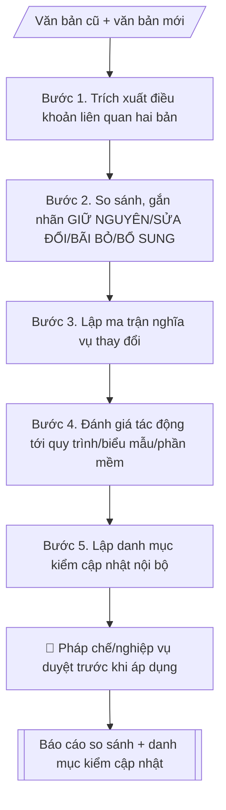

# Theo dõi thay đổi văn bản pháp quy

## Khi nào dùng
Khi có văn bản pháp quy mới ban hành thay thế/sửa đổi/bổ sung văn bản đang áp dụng
(quy chế đào tạo, quy định tài chính, quy chế văn thư...), cần đánh giá tác động và
cập nhật hệ thống văn bản nội bộ. Dùng chung cho Phòng TC&QT (thanh tra – pháp chế) và mọi
đơn vị chịu tác động.

## Định dạng và file đầu ra

Định dạng đầu ra có thể chọn theo sản phẩm/yêu cầu: .docx, .pdf. Đọc mục “Định dạng bổ sung” trong quy cách đầu ra trước khi chọn.

**Phải tạo file thực tế để tải xuống, không chỉ trả nội dung trong chat.** Định dạng mặc định của skill: **.docx**. Nếu có bảng số liệu nghiệp vụ yêu cầu file bảng tính riêng, tạo thêm Excel theo yêu cầu; không tự tạo file kiểm tra. Không chờ người dùng yêu cầu xuất file lần nữa. Ưu tiên định dạng người dùng chỉ định; đọc quy tắc xuất file tại references/quy-cach-dau-ra.md.

**Chạy qua API (không có công cụ tạo file):** trả đủ nội dung dạng văn bản có tiêu đề, bảng; ứng dụng gọi sẽ xuất file.

## Quy cách đầu ra và thông tin thiếu
Khi dựng file Word/Excel, áp dụng mục “Thể thức và bảng biểu khi dựng file” trong quy cách đầu ra (cỡ chữ từng thành phần, bảng nhiều trang, số trang, phụ lục). Đọc [quy cách và cấu trúc sản phẩm](references/quy-cach-dau-ra.md) trước khi soạn/xuất. File giao chỉ gồm sản phẩm nghiệp vụ được yêu cầu; kiểm tra nội bộ không xuất kèm. Thiếu thông tin thì giữ nguyên trường/mục và chỗ điền theo mẫu gốc (dòng dấu chấm, dấu gạch hoặc ô trống); không tự điền dữ liệu mẫu, số 0, mã chờ xác minh hay dòng chờ ký. Mẫu chuyên ngành còn áp dụng được ưu tiên về cấu trúc, mã biểu và người ký. Bản đầy đủ: [quy tắc chung](references/quy-tac-chung.md).

Khi người dùng yêu cầu bộ slide (.pptx), đọc mục “Xuất PowerPoint (.pptx) khi được yêu cầu” trong quy cách đầu ra.

## Kiểm soát áp dụng và phê duyệt
Trước khi chạy, xác định `ngay_ap_dung`, `loai_hinh_truong`, `quy_che_noi_bo`, `nguon_du_lieu`, `nguoi_kiem_duyet`; chỉ hỏi thông tin liên quan nghiệp vụ, không dùng giá trị giả định thay dữ liệu bắt buộc. Đối chiếu căn cứ pháp lý với văn bản gốc, hiệu lực, điều khoản áp dụng và chuyển tiếp. Bản đầy đủ: [quy tắc chung](references/quy-tac-chung.md).

## Giới hạn và human gate
AI hỗ trợ chuẩn bị và đối chiếu; cán bộ phụ trách kiểm tra dữ liệu/căn cứ, người có thẩm quyền duyệt và ký. Không đánh dấu đã ký, đã duyệt, đã công bố khi chưa có chứng cứ. Dữ liệu sinh viên, sức khỏe, nhân sự, tài chính chỉ dùng theo mục đích và phân quyền, che thông tin định danh khi dùng ví dụ (Luật 91/2025/QH15, hiệu lực 01/01/2026); không tải dữ liệu lên dịch vụ ngoài khi chưa có quyền. Bản đầy đủ: [quy tắc chung](references/quy-tac-chung.md).

## Bối cảnh riêng của VNU-IS

Bản chỉnh cho Trường Quốc tế – ĐHQGHN (VNU-IS), v0.4.2. Dựng từ website công khai và phiếu khảo sát CES còn trống; **chưa có dữ liệu khảo sát thực tế của đơn vị**. Đọc [bối cảnh VNU-IS](references/boi-canh-vnuis.md) trước khi chạy; các mã C1–C8 nằm ở mục 6 của file đó.

- **Đơn vị thường dùng:** Phòng Tổ chức và Quản trị (pháp chế – tuân thủ); các phòng liên quan.
- **Nghiệp vụ trong phiếu CES:** "Pháp chế – tuân thủ: Theo dõi văn bản quy định và đầu việc tuân thủ" (sheet `03_KS_TCQT`). Tần suất gợi ý: Thường xuyên. Đầu vào gợi ý: Văn bản mới do người dùng tải lên; danh mục quy định nội bộ. Khó khăn gợi ý: Tài liệu phân tán, nhiều định dạng; Đọc và đối chiếu thủ công mất thời gian; Dễ bỏ sót trường dữ liệu/phiên bản; Đầu ra phụ thuộc kinh nghiệm từng cá nhân. Đây là gợi ý có sẵn của CES, chưa phải xác nhận của đơn vị.

**Điều chỉnh khi dùng cho VNU-IS**
- Ba tầng văn bản: văn bản Nhà nước; văn bản của ĐHQGHN (cơ quan chủ quản); quy định nội bộ VNU-IS. Chương trình liên kết còn chịu quy định của trường đối tác. Tầng nào chưa có file thì ghi "chưa có tài liệu".
- Kết quả là bảng ảnh hưởng theo đơn vị (phòng, khoa, Viện, Hội đồng) kèm đầu việc và hạn; không phải ý kiến pháp lý.
- Skill không tự khẳng định hiệu lực; chỉ ghi hiệu lực theo văn bản người dùng tải lên và `[CẦN XÁC MINH]` với nguồn chính thức.

**Chờ xác nhận khi khảo sát**
- Danh mục quy định nội bộ hiện hành (C2).
- Kênh nhận văn bản mới từ ĐHQGHN (C6).

Nếu người dùng chưa trả lời mục chờ xác nhận liên quan, hỏi lại; không tự điền giả định.

## Đầu vào (Input)

| Trường | Mô tả | Bắt buộc |
|---|---|---|
| `van_ban_cu` | Tên, số/ký hiệu, ngày ban hành, nội dung các điều khoản liên quan | Có |
| `van_ban_moi` | Tên, số/ký hiệu, ngày ban hành, ngày hiệu lực, nội dung | Có |
| `linh_vuc` | Đào tạo / tài chính / tổ chức cán bộ / văn thư... | Có |
| `van_ban_noi_bo_lien_quan` | Danh sách văn bản/quy trình nội bộ đang viện dẫn văn bản cũ | Không |

### Thông tin VNU-IS đã điền sẵn (không hỏi lại)

| Mục | Giá trị mặc định |
|---|---|
| Cơ quan chủ quản; Trường; địa danh | Đại học Quốc gia Hà Nội (ĐHQGHN); Trường Quốc tế – ĐHQGHN (VNU – International School); Hà Nội |
| Đơn vị sử dụng và phối hợp | Phòng Tổ chức và Quản trị (pháp chế – tuân thủ); các phòng liên quan |
| Ngôn ngữ đầu ra | Tiếng Việt là bản gốc; thêm tiếng Anh cho đối tác, người học quốc tế hoặc khi được yêu cầu |
| Hệ thống nguồn dữ liệu có trên website | E-Office. Skill không kết nối hệ thống, chỉ dùng file xuất/tải lên (C5) |
| Người duyệt và ký | Ghi theo vai trò (Trưởng phòng, Phó Hiệu trưởng phụ trách, Hiệu trưởng); tuyến duyệt và thẩm quyền ký chờ C1, C6 |

Nguồn: website và phiếu CES; đổi theo khảo sát thì sửa tại đây và trong `references/boi-canh-vnuis.md`.

## Quy trình

*⏱ là ước tính ban đầu của bộ gốc, chưa đo tại VNU-IS; hiệu chỉnh sau khảo sát.*

**Bước 1. Trích xuất điều khoản**
- Làm gì: đọc `van_ban_cu` và `van_ban_moi`, trích các điều khoản liên quan đến `linh_vuc`
  theo từng nội dung (không cần toàn văn nếu văn bản dài); với mỗi điều khoản ghi rõ
  số điều/khoản và trích từ bản nào.
- Dùng input: `van_ban_cu`, `van_ban_moi`, `linh_vuc`
- Vai trò: Cán bộ Phòng TC&QT (thanh tra – pháp chế) · AI hỗ trợ: trích xuất điều khoản hai bản, ghi rõ số điều/khoản và nguồn trích · ⏱ ~15–30 phút (ước tính)
- Lưu ý nghiệp vụ: luôn dẫn chiếu số/ký hiệu văn bản và ngày hiệu lực của bản mới;
  không dùng văn bản đã hết hiệu lực làm căn cứ so sánh mà không ghi chú rõ.
- → Kết quả bước: "danh sách điều khoản liên quan hai bản" (nội dung + số điều/khoản +
  nguồn trích).

**Bước 2. So sánh và đánh dấu**
- Làm gì: đối chiếu từng nội dung giữa hai bản, gắn nhãn: GIỮ NGUYÊN / SỬA ĐỔI /
  BÃI BỎ / BỔ SUNG MỚI; với nội dung SỬA ĐỔI ghi ngắn gọn điểm khác biệt.
- Dùng input: kết quả bước 1 (danh sách điều khoản)
- Vai trò: Cán bộ Phòng TC&QT (thanh tra – pháp chế) (xác nhận nhãn và điều khoản mơ hồ) · AI hỗ trợ: gắn nhãn so sánh sơ bộ từng nội dung · ⏱ ~30 phút–1 giờ (ước tính)
- Lưu ý nghiệp vụ: nội dung chỉ đổi cách diễn đạt mà không đổi nghĩa vụ → GIỮ NGUYÊN
  (ghi chú diễn đạt mới), tránh gắn nhầm SỬA ĐỔI; điều khoản mơ hồ ghi "cần ý kiến
  pháp chế", không tự diễn giải theo hướng có lợi/bất lợi cho một bên.
- → Kết quả bước: "bảng so sánh điều khoản cũ/mới có gắn nhãn".

**Bước 3. Lập ma trận nghĩa vụ thay đổi**
- Làm gì: với mỗi nội dung SỬA ĐỔI / BÃI BỎ / BỔ SUNG MỚI ở bước 2, xác định: đơn vị
  hoặc cá nhân nào phải làm gì khác so với trước đây; ghi thời hạn áp dụng theo ngày
  hiệu lực của văn bản mới.
- Dùng input: kết quả bước 2 (bảng so sánh), `van_ban_moi`, `van_ban_noi_bo_lien_quan`
- Vai trò: Cán bộ Phòng TC&QT (thanh tra – pháp chế) phối hợp đơn vị nghiệp vụ (xác nhận đơn vị thực hiện và thời hạn) · AI hỗ trợ: lập ma trận nghĩa vụ dự thảo · ⏱ ~30 phút–1 giờ (ước tính)
- Lưu ý nghiệp vụ: nghĩa vụ phải cụ thể đến mức đơn vị biết phải làm gì ("sửa quy trình X",
  "bổ sung biểu mẫu Y"); thời hạn áp dụng không được muộn hơn ngày văn bản mới có hiệu lực.
- → Kết quả bước: "ma trận nghĩa vụ thay đổi" (thay đổi → đơn vị → việc phải làm khác
  → thời hạn).

**Bước 4. Đánh giá tác động**
- Làm gì: rà soát các quy trình, biểu mẫu, phần mềm của trường đang viện dẫn văn bản cũ
  để xác định cái nào bị ảnh hưởng bởi các thay đổi ở bước 3; phân loại mức tác động:
  phải sửa ngay / sửa trong kỳ / chỉ theo dõi.
- Dùng input: kết quả bước 3 (ma trận nghĩa vụ), `van_ban_noi_bo_lien_quan`
- Vai trò: Cán bộ Phòng TC&QT (thanh tra – pháp chế) (xác nhận mức tác động) · AI hỗ trợ: rà soát tra cứu chéo văn bản nội bộ đang viện dẫn văn bản cũ · ⏱ ~30 phút–1 giờ (ước tính)
- Lưu ý nghiệp vụ: kiểm tra cả văn bản nội bộ không nằm trong danh sách đầu vào nhưng
  có viện dẫn số/ký hiệu văn bản cũ (tra cứu chéo); không bỏ sót phần mềm quản lý
  có hard-code quy định cũ.
- → Kết quả bước: "bảng đánh giá tác động" (quy trình / biểu mẫu / phần mềm →
  mức tác động).

**Bước 5. Lập danh mục kiểm cập nhật**
- Làm gì: tổng hợp từ bước 4 danh sách văn bản nội bộ / biểu mẫu / quy trình cần sửa;
  với mỗi mục ghi đơn vị chủ trì và hạn chót đề xuất.
- Dùng input: kết quả bước 4 (bảng đánh giá tác động)
- Vai trò: Cán bộ Phòng TC&QT (thanh tra – pháp chế) · AI hỗ trợ: tổng hợp danh mục kiểm cập nhật nội bộ từ bảng đánh giá tác động · ⏱ ~10–15 phút (ước tính)
- Lưu ý nghiệp vụ: hạn chót đề xuất phải trước ngày văn bản mới có hiệu lực; danh mục kiểm
  là đầu vào để thủ trưởng đơn vị duyệt phân công — phải đầy đủ, không thiếu mục.
- → Kết quả bước: "danh mục kiểm cập nhật nội bộ" → cùng các sản phẩm trước tạo Output cuối
  (change bản yêu cầu).
## Luồng quy trình (Workflow)

## Đầu ra

File nghiệp vụ thực tế theo định dạng mặc định ở đầu skill hoặc định dạng người dùng yêu cầu, kèm liên kết tải trong phản hồi cuối.

Sản phẩm nghiệp vụ hoàn chỉnh theo [quy cách và cấu trúc](references/quy-cach-dau-ra.md), giữ các trường chưa có dữ liệu ở trạng thái trống. Không xuất kèm danh mục kiểm/phụ lục kiểm tra đầu ra.

## Kiểm tra nội bộ trước khi giao

- [ ] Bố cục khớp mẫu áp dụng và cấu trúc tại references/quy-cach-dau-ra.md.
- [ ] Mỗi điều khoản dẫn chiếu số/ký hiệu, ngày ban hành và ngày hiệu lực của văn bản mới; không dùng văn bản hết hiệu lực làm căn cứ mà không ghi chú rõ.
- [ ] Bảng so sánh gắn nhãn đúng: nội dung chỉ đổi diễn đạt mà không đổi nghĩa vụ → GIỮ NGUYÊN (ghi chú diễn đạt mới), không gắn nhầm SỬA ĐỔI.
- [ ] Ma trận nghĩa vụ cụ thể đến mức đơn vị biết phải làm gì ("sửa quy trình X", "bổ sung biểu mẫu Y"); thời hạn không muộn hơn ngày văn bản mới có hiệu lực.
- [ ] Đánh giá tác động bao phủ quy trình/biểu mẫu/phần mềm đang viện dẫn văn bản cũ, kể cả văn bản nội bộ ngoài danh sách đầu vào (đã tra cứu chéo) và phần mềm có hard-code quy định cũ.
- [ ] Danh mục kiểm cập nhật đầy đủ mục, mỗi mục có đơn vị chủ trì và hạn chót trước ngày văn bản mới có hiệu lực.
- [ ] Không đưa kết luận pháp lý cuối cùng ("đúng/sai", "hợp pháp/không hợp pháp"); điều khoản mơ hồ ghi "cần ý kiến pháp chế" — mọi nhận định ghi rõ "để tham khảo".
- [ ] Đã qua Human gate: pháp chế/nghiệp vụ duyệt change bản yêu cầu và ma trận nghĩa vụ; thủ trưởng đơn vị duyệt danh mục kiểm thuộc phạm vi đơn vị mình.

> Tiêu chí đạt: tất cả các ô được đánh dấu.

## Human gate (người kiểm duyệt)
- **Pháp chế / cán bộ phụ trách nghiệp vụ** duyệt change bản yêu cầu và ma trận nghĩa vụ
  trước khi triển khai cập nhật.
- Thủ trưởng đơn vị duyệt danh mục kiểm cập nhật thuộc phạm vi đơn vị mình.

## Giới hạn (guardrails)
- Không đưa ra kết luận pháp lý cuối cùng ("đúng/sai", "hợp pháp/không hợp pháp") —
  mọi nhận định ghi rõ "để tham khảo, cần ý kiến pháp chế".
- Không tự ý diễn giải điều khoản mơ hồ theo hướng có lợi/bất lợi cho một bên.
- Không thay thế việc tra cứu văn bản gốc — luôn dẫn chiếu số/ký hiệu văn bản.

## Căn cứ & lưu ý
- Văn bản pháp quy của Nhà nước và văn bản nội bộ của trường (phiên bản cụ thể).
- Ví dụ trong skill chỉ để minh họa; không đưa dữ liệu cá nhân thật vào ví dụ. Tên Trường, cơ quan chủ quản và địa danh dùng đúng bảng thông tin VNU-IS đã điền sẵn.

## Quản trị phiên bản
- Phiên bản gói VNU-IS `0.4.2` (cập nhật 2026-10-11), dựa trên skill gốc `theo-doi-thay-doi-van-ban-phap-quy` bản `1.3.2`; hồ sơ đầy đủ tại [references/version.json](references/version.json).
- Người phê duyệt nghiệp vụ: **chưa chỉ định**. Trạng thái: dự thảo nghiệp vụ; kiểm tra pháp lý trước thực thi. Ngày cập nhật không đồng nghĩa mọi văn bản đã được rà soát toàn văn.
- Giấy phép theo LICENSE của kho (bản quyền CES Global). Lịch sử thay đổi: CHANGELOG.md.
