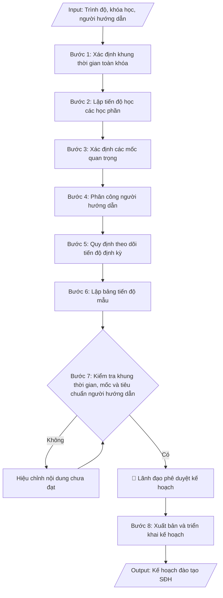

# Kế hoạch đào tạo sau đại học (tiến độ học viên/NCS)

## Khi nào dùng
Khi cần lập kế hoạch đào tạo và theo dõi tiến độ cho một khóa/lớp cao học hoặc một
nghiên cứu sinh: xác định khung thời gian toàn khóa, các mốc quan trọng, phân công người
hướng dẫn và lịch kiểm tra tiến độ định kỳ.

## Định dạng và file đầu ra

Định dạng đầu ra có thể chọn theo sản phẩm/yêu cầu: .docx, .pdf. Đọc mục “Định dạng bổ sung” trong quy cách đầu ra trước khi chọn.

**Phải tạo file thực tế để tải xuống, không chỉ trả nội dung trong chat.** Định dạng mặc định của skill: **.docx**. Nếu có bảng số liệu nghiệp vụ yêu cầu file bảng tính riêng, tạo thêm Excel theo yêu cầu; không tự tạo file kiểm tra. Không chờ người dùng yêu cầu xuất file lần nữa. Ưu tiên định dạng người dùng chỉ định; đọc quy tắc xuất file tại references/quy-cach-dau-ra.md.

**Chạy qua API (không có công cụ tạo file):** trả đủ nội dung dạng văn bản có tiêu đề, bảng; ứng dụng gọi sẽ xuất file.

## Quy cách đầu ra và thông tin thiếu
Khi dựng file Word/Excel, áp dụng mục “Thể thức và bảng biểu khi dựng file” trong quy cách đầu ra (cỡ chữ từng thành phần, bảng nhiều trang, số trang, phụ lục). Đọc [quy cách và cấu trúc sản phẩm](references/quy-cach-dau-ra.md) trước khi soạn/xuất. File giao chỉ gồm sản phẩm nghiệp vụ được yêu cầu; kiểm tra nội bộ không xuất kèm. Thiếu thông tin thì giữ nguyên trường/mục và chỗ điền theo mẫu gốc (dòng dấu chấm, dấu gạch hoặc ô trống); không tự điền dữ liệu mẫu, số 0, mã chờ xác minh hay dòng chờ ký. Mẫu chuyên ngành còn áp dụng được ưu tiên về cấu trúc, mã biểu và người ký. Bản đầy đủ: [quy tắc chung](references/quy-tac-chung.md).

Khi người dùng yêu cầu bộ slide (.pptx), đọc mục “Xuất PowerPoint (.pptx) khi được yêu cầu” trong quy cách đầu ra.

## Kiểm soát áp dụng và phê duyệt
Trước khi chạy, xác định `ngay_ap_dung`, `loai_hinh_truong`, `quy_che_noi_bo`, `nguon_du_lieu`, `nguoi_kiem_duyet`; chỉ hỏi thông tin liên quan nghiệp vụ, không dùng giá trị giả định thay dữ liệu bắt buộc. Đối chiếu căn cứ pháp lý với văn bản gốc, hiệu lực, điều khoản áp dụng và chuyển tiếp. Bản đầy đủ: [quy tắc chung](references/quy-tac-chung.md).

## Giới hạn và human gate
AI hỗ trợ chuẩn bị và đối chiếu; cán bộ phụ trách kiểm tra dữ liệu/căn cứ, người có thẩm quyền duyệt và ký. Không đánh dấu đã ký, đã duyệt, đã công bố khi chưa có chứng cứ. Dữ liệu sinh viên, sức khỏe, nhân sự, tài chính chỉ dùng theo mục đích và phân quyền, che thông tin định danh khi dùng ví dụ (Luật 91/2025/QH15, hiệu lực 01/01/2026); không tải dữ liệu lên dịch vụ ngoài khi chưa có quyền. Bản đầy đủ: [quy tắc chung](references/quy-tac-chung.md).

## Bối cảnh riêng của VNU-IS

Bản chỉnh cho Trường Quốc tế – ĐHQGHN (VNU-IS), v0.4.2. Dựng từ website công khai và phiếu khảo sát CES còn trống; **chưa có dữ liệu khảo sát thực tế của đơn vị**. Đọc [bối cảnh VNU-IS](references/boi-canh-vnuis.md) trước khi chạy; các mã C1–C8 nằm ở mục 6 của file đó.

- **Đơn vị thường dùng:** Phòng Đào tạo (sau đại học).
- **Nghiệp vụ trong phiếu CES:** "Kế hoạch đào tạo: Xây dựng kế hoạch năm học và tiến độ học kỳ" (sheet `04_KS_Dao_tao`). Tần suất gợi ý: Định kỳ. Đầu vào gợi ý: Khung thời gian; danh sách học phần; quy mô lớp; ràng buộc. Khó khăn gợi ý: Tài liệu phân tán, nhiều định dạng; Đọc và đối chiếu thủ công mất thời gian; Dễ bỏ sót trường dữ liệu/phiên bản; Đầu ra phụ thuộc kinh nghiệm từng cá nhân. Đây là gợi ý có sẵn của CES, chưa phải xác nhận của đơn vị.

**Điều chỉnh khi dùng cho VNU-IS**
- Kế hoạch học kỳ chương trình sau đại học gắn lịch giảng của giảng viên nước ngoài nếu có; ghi múi giờ khi dạy trực tuyến.
- Không tự đặt thời gian tối đa hoàn thành; theo quy chế (C2).

**Chờ xác nhận khi khảo sát**
- Quy chế đào tạo sau đại học áp dụng (C2).
- Người phụ trách sau đại học (C7).

Nếu người dùng chưa trả lời mục chờ xác nhận liên quan, hỏi lại; không tự điền giả định.

## Đầu vào (Input)

| Trường | Mô tả | Bắt buộc |
|---|---|---|
| `trinh_do` | Thạc sĩ / Tiến sĩ | Có |
| `khoa_lop` | Khóa/lớp cao học hoặc tên NCS và khóa đào tạo | Có |
| `nganh` | Ngành đào tạo | Có |
| `thoi_gian_bat_dau` | Thời điểm bắt đầu khóa đào tạo | Có |
| `thoi_gian_dao_tao` | Thời gian đào tạo chuẩn (thạc sĩ 2 năm; tiến sĩ 3–4 năm) | Có |
| `nguoi_huong_dan` | Người hướng dẫn khoa học (đủ tiêu chuẩn theo quy chế) | Có |
| `hoc_phan` | Danh mục học phần và học kỳ dự kiến hoàn thành | Không |
| `moc_quan_trong` | Các mốc: bảo vệ đề cương, seminar chuyên đề, bảo vệ luận văn/luận án | Không |
| `chu_ky_bao_cao` | Chu kỳ báo cáo tiến độ (6 tháng / hằng năm) | Không (mặc định: 6 tháng) |

### Thông tin VNU-IS đã điền sẵn (không hỏi lại)

| Mục | Giá trị mặc định |
|---|---|
| Cơ quan chủ quản; Trường; địa danh | Đại học Quốc gia Hà Nội (ĐHQGHN); Trường Quốc tế – ĐHQGHN (VNU – International School); Hà Nội |
| Đơn vị sử dụng và phối hợp | Phòng Đào tạo (sau đại học) |
| Mô hình đào tạo | Chọn đúng mô hình trước khi áp quy tắc, không áp quy tắc của mô hình này cho mô hình khác: (1) ĐHQGHN cấp bằng; (2) liên kết quốc tế, đối tác nước ngoài cấp bằng; (3) song bằng; (4) cử nhân – thạc sĩ tích hợp; (5) tiếng Anh dự bị và mô hình 2+2 |
| Ngôn ngữ đầu ra | Tiếng Việt là bản gốc; thêm tiếng Anh cho đối tác, người học quốc tế hoặc khi được yêu cầu |
| Hệ thống nguồn dữ liệu có trên website | LMS; cổng sinh viên. Skill không kết nối hệ thống, chỉ dùng file xuất/tải lên (C5) |
| Người duyệt và ký | Ghi theo vai trò (Trưởng phòng, Phó Hiệu trưởng phụ trách, Hiệu trưởng); tuyến duyệt và thẩm quyền ký chờ C1, C6 |

Nguồn: website và phiếu CES; đổi theo khảo sát thì sửa tại đây và trong `references/boi-canh-vnuis.md`.

## Quy trình

*⏱ là ước tính ban đầu của bộ gốc, chưa đo tại VNU-IS; hiệu chỉnh sau khảo sát.*

**Bước 1. Xác định khung thời gian toàn khóa**
- Làm gì: xác định thời điểm bắt đầu (ngày nhập học) và thời điểm kết thúc dự kiến (bảo vệ luận
  văn/luận án); đối chiếu tổng thời gian với thời gian đào tạo chuẩn theo quy chế (thạc sĩ 2 năm;
  tiến sĩ 3–4 năm tùy đối tượng đầu vào).
- Dùng input: `trinh_do`, `khoa_lop`, `thoi_gian_bat_dau`, `thoi_gian_dao_tao`
- Vai trò: Chuyên viên Phòng Đào tạo (sau đại học) · AI hỗ trợ: xác định khung thời gian toàn khóa từ ngày nhập học · ⏱ ~30 phút (ước tính)
- Lưu ý nghiệp vụ: khung thời gian phải nằm trong giới hạn tối đa của quy chế (kể cả thời gian
  được gia hạn); ghi rõ hình thức đào tạo (tập trung/không tập trung).
- → Kết quả bước: khung thời gian toàn khóa đã chốt (ngày bắt đầu – ngày kết thúc dự kiến).

**Bước 2. Lập tiến độ học các học phần**
- Làm gì: phân bổ các học phần bắt buộc và tự chọn vào từng học kỳ; ghi rõ học phần nào là điều
  kiện tiên quyết của học phần sau (nếu có); sắp xếp sao cho học viên hoàn thành học phần trước
  khi bước vào giai đoạn làm luận văn/luận án.
- Dùng input: `hoc_phan`, `trinh_do`
- Vai trò: Khoa quản lý chuyên ngành/Chuyên viên Phòng Đào tạo (sau đại học) · AI hỗ trợ: phân bổ học phần bắt buộc và tự chọn vào từng học kỳ · ⏱ ~1 giờ (ước tính)
- Lưu ý nghiệp vụ: học phần phương pháp nghiên cứu khoa học nên xếp sớm để phục vụ làm đề cương;
  tránh dồn quá nhiều học phần vào một học kỳ.
- → Kết quả bước: bảng phân bổ học phần theo từng học kỳ (học kỳ – thời gian – danh mục học phần).

**Bước 3. Xác định các mốc quan trọng**
- Làm gì: liệt kê đầy đủ các mốc theo trình độ, gắn thời hạn dự kiến cho từng mốc:
  - Học viên cao học: hoàn thành học phần → giao đề tài → bảo vệ đề cương luận văn → seminar
    giữa kỳ → nộp luận văn hoàn chỉnh → bảo vệ luận văn;
  - Nghiên cứu sinh: hoàn thành học phần tiến sĩ → bảo vệ đề cương luận án → thực hiện chuyên đề
    tiến sĩ/seminar → công bố khoa học theo quy định → viết luận án → bảo vệ luận án cấp cơ sở →
    bảo vệ luận án cấp trường.
- Dùng input: `moc_quan_trong`, `trinh_do`
- Vai trò: Chuyên viên Phòng Đào tạo (sau đại học) · AI hỗ trợ: liệt kê các mốc (báo cáo tiến độ, bảo vệ) theo trình độ · ⏱ ~30 phút (ước tính)
- Lưu ý nghiệp vụ: các mốc phải sắp xếp logic, không chồng chéo thời gian; mốc bảo vệ luận án cấp
  trường của NCS phải sau bảo vệ cấp cơ sở và sau khi hoàn thành công bố khoa học.
- → Kết quả bước: bảng các mốc quan trọng (mốc công việc – thời hạn dự kiến) theo trình độ.

**Bước 4. Phân công người hướng dẫn**
- Làm gì: ghi rõ họ tên, học hàm/học vị, đơn vị công tác của người hướng dẫn chính (và đồng hướng
  dẫn nếu có) cho từng học viên/NCS; kiểm tra người hướng dẫn đủ tiêu chuẩn theo quy chế và không
  vượt số lượng học viên/NCS được hướng dẫn đồng thời.
- Dùng input: `nguoi_huong_dan`, `khoa_lop`
- Vai trò: Phòng Đào tạo (sau đại học) · AI hỗ trợ: lập danh sách đề xuất người hướng dẫn, kiểm tra tiêu chuẩn và giới hạn số HV/NCS hướng dẫn · ⏱ ~1 giờ (ước tính)
- Lưu ý nghiệp vụ: người hướng dẫn tiến sĩ phải đáp ứng tiêu chuẩn cao hơn (có công trình công bố,
  đã hướng dẫn thành công); kiểm tra số lượng đang hướng dẫn tại thời điểm phân công, không chỉ
  dựa vào khai báo.
- → Kết quả bước: danh sách phân công người hướng dẫn (học viên/NCS – người hướng dẫn –
  số lượng đang hướng dẫn).

**Bước 5. Quy định theo dõi tiến độ định kỳ**
- Làm gì: quy định chu kỳ báo cáo tiến độ (mặc định 6 tháng); quy định trách nhiệm: học viên/NCS
  nộp báo cáo theo mẫu, người hướng dẫn nhận xét và đánh giá, Phòng Đào tạo (sau đại học) tổng hợp;
  quy định cơ chế cảnh báo các trường hợp chậm tiến độ và biện pháp xử lý (gia hạn, cảnh báo
  học vụ, thôi học theo quy chế).
- Dùng input: `chu_ky_bao_cao`
- Vai trò: Phòng Đào tạo (sau đại học) · AI hỗ trợ: soạn dự thảo quy định chu kỳ báo cáo tiến độ và trách nhiệm các bên · ⏱ ~1 giờ (ước tính)
- Lưu ý nghiệp vụ: phải quy định rõ "chậm tiến độ" được đo bằng tiêu chí nào (chậm bao nhiêu mốc/
  bao lâu); biện pháp xử lý phải có căn cứ quy chế, không xử lý cảm tính.
- → Kết quả bước: quy định theo dõi tiến độ định kỳ (chu kỳ, trách nhiệm các bên, cơ chế cảnh báo
  và xử lý).

**Bước 6. Lập bảng tiến độ mẫu**
- Làm gì: lập bảng theo dõi với các cột: họ tên học viên/NCS – đề tài – người hướng dẫn –
  từng mốc công việc (hoàn thành học phần, bảo vệ đề cương, seminar, nộp luận văn/luận án,
  bảo vệ) – ghi chú; bảng này được cập nhật sau mỗi kỳ báo cáo.
- Dùng input: `khoa_lop`, `nguoi_huong_dan`
- Vai trò: Chuyên viên Phòng Đào tạo (sau đại học) · AI hỗ trợ: lập bảng theo dõi tiến độ mẫu đầy đủ các cột · ⏱ ~20 phút (ước tính)
- Lưu ý nghiệp vụ: bảng phải bao phủ đầy đủ 100% học viên/NCS của khóa; các mốc trong bảng phải
  khớp với bảng mốc ở Bước 3.
- → Kết quả bước: bảng theo dõi tiến độ mẫu (sẵn sàng điền và cập nhật định kỳ).

**Bước 7. Kiểm tra khung thời gian, mốc và tiêu chuẩn người hướng dẫn**
- Làm gì: kiểm tra lần cuối: khung thời gian toàn khóa đúng thời gian đào tạo chuẩn theo quy chế;
  các mốc quan trọng đầy đủ, logic, không chồng chéo; người hướng dẫn đủ tiêu chuẩn và trong giới
  hạn số lượng; bảng tiến độ đầy đủ học viên/NCS. Nội dung chưa đạt thì hiệu chỉnh rồi kiểm tra lại.
- Dùng input: `thoi_gian_dao_tao`, `nguoi_huong_dan`, `moc_quan_trong`
- Vai trò: Trưởng Phòng Đào tạo (sau đại học) · AI hỗ trợ: kiểm tra chéo khung thời gian, học phần và quy chế · ⏱ ~1 giờ (ước tính)
- Lưu ý nghiệp vụ: đây là điểm kiểm tra cuối trước khi trình duyệt — lỗi mốc chồng chéo hoặc người
  hướng dẫn quá tải nếu lọt qua sẽ gây khó khăn cho cả khóa đào tạo.
- → Kết quả bước: kế hoạch đã qua kiểm tra, đạt yêu cầu, sẵn sàng trình phê duyệt.

**Bước 8. Xuất bản và triển khai kế hoạch**
- Làm gì: hoàn thiện kế hoạch file theo định dạng đầu ra của skill kèm bảng tiến độ mẫu; trình lãnh đạo phê duyệt;
  sau khi duyệt, gửi kế hoạch đến lớp/khóa, người hướng dẫn và các đơn vị liên quan để triển khai.
- Dùng input: `khoa_lop`, `nganh`
- Vai trò: Hiệu trưởng/Phó Hiệu trưởng phụ trách phê duyệt · AI hỗ trợ: chuẩn bị hồ sơ trình ký, soạn thông báo triển khai · ⏱ ~1 giờ (ước tính)
- Lưu ý nghiệp vụ: lưu bản kế hoạch đã phê duyệt làm căn cứ đối chiếu tiến độ các kỳ sau; mọi điều
  chỉnh kế hoạch sau phê duyệt phải được ghi nhận bằng văn bản.
- → Kết quả bước: kế hoạch đào tạo SĐH đã phê duyệt, đã gửi các bên liên quan để triển khai.

## Luồng quy trình (Workflow)

## Đầu ra

File nghiệp vụ thực tế theo định dạng mặc định ở đầu skill hoặc định dạng người dùng yêu cầu, kèm liên kết tải trong phản hồi cuối.

Sản phẩm nghiệp vụ hoàn chỉnh theo [quy cách và cấu trúc](references/quy-cach-dau-ra.md), giữ các trường chưa có dữ liệu ở trạng thái trống. Không xuất kèm danh mục kiểm/phụ lục kiểm tra đầu ra.

## Kiểm tra nội bộ trước khi giao
- [ ] Bố cục khớp mẫu áp dụng và cấu trúc tại references/quy-cach-dau-ra.md.
- [ ] Số liệu/nội dung trong output khớp với Input đã cho (trình độ, khóa/lớp, ngành, thời gian, người hướng dẫn, học phần, các mốc, chu kỳ báo cáo).
- [ ] Không bịa đặt số liệu, minh chứng, trích dẫn.
- [ ] Đúng thể thức văn bản hành chính của kế hoạch.
- [ ] Căn cứ pháp lý đầy đủ, còn hiệu lực (Thông tư 23/2021/TT-BGDĐT đối với thạc sĩ; Thông tư 18/2021/TT-BGDĐT đối với tiến sĩ).
- [ ] Đã qua Human gate: lãnh đạo đã phê duyệt kế hoạch; bản đã phê duyệt được lưu làm căn cứ đối chiếu tiến độ.
- [ ] Khung thời gian toàn khóa nằm trong giới hạn tối đa của quy chế (kể cả thời gian được gia hạn); các mốc sắp xếp logic, không chồng chéo.
- [ ] Mốc bảo vệ luận án cấp trường sau bảo vệ cấp cơ sở và sau khi hoàn thành công bố khoa học (đối với NCS); các mốc trong bảng tiến độ khớp bảng mốc ở mục III.
- [ ] Người hướng dẫn đủ tiêu chuẩn quy chế và không vượt số lượng HV/NCS được hướng dẫn đồng thời; bảng tiến độ bao phủ 100% học viên/NCS của khóa; "chậm tiến độ" có tiêu chí đo cụ thể, biện pháp xử lý có căn cứ quy chế.
Tiêu chí đạt = tất cả các ô được đánh dấu.

## Căn cứ & lưu ý

> ⚠ Cập nhật pháp lý (rà soát 11/10/2026, nguồn thứ cấp, cần người phụ trách pháp chế xác nhận): Thông tư 53/2026/TT-BGDĐT (ban hành 30/06/2026) quy định quy chế tuyển sinh và đào tạo sau đại học thạc sĩ, tiến sĩ và thay thế Thông tư 23/2021/TT-BGDĐT, Thông tư 18/2021/TT-BGDĐT; theo nguồn thứ cấp, Thông tư áp dụng cho các khóa thông báo tuyển sinh từ 01/01/2027. Trước khi dẫn căn cứ: đọc toàn văn và điều khoản chuyển tiếp, xác định khóa/đợt thuộc văn bản nào; không tự trích điều khoản của Thông tư cũ nếu chưa xác định còn áp dụng.
- Thông tư 23/2021/TT-BGDĐT (Quy chế tuyển sinh và đào tạo trình độ thạc sĩ).
- Thông tư 18/2021/TT-BGDĐT (Quy chế tuyển sinh và đào tạo trình độ tiến sĩ).
- Đối với nghiên cứu sinh, bổ sung các mốc: bảo vệ đề cương luận án, thực hiện
  chuyên đề tiến sĩ, công bố khoa học theo quy định, bảo vệ luận án cấp cơ sở và
  cấp trường.
- Người hướng dẫn phải đáp ứng tiêu chuẩn theo quy chế và không vượt quá số
  lượng học viên/nghiên cứu sinh được hướng dẫn đồng thời.
- Ví dụ trong skill chỉ để minh họa; không đưa dữ liệu cá nhân thật vào ví dụ. Tên Trường, cơ quan chủ quản và địa danh dùng đúng bảng thông tin VNU-IS đã điền sẵn.

## Quản trị phiên bản
- Phiên bản gói VNU-IS `0.4.2` (cập nhật 2026-10-11), dựa trên skill gốc `ke-hoach-dao-tao-sdh` bản `1.3.2`; hồ sơ đầy đủ tại [references/version.json](references/version.json).
- Người phê duyệt nghiệp vụ: **chưa chỉ định**. Trạng thái: dự thảo nghiệp vụ; kiểm tra pháp lý trước thực thi. Ngày cập nhật không đồng nghĩa mọi văn bản đã được rà soát toàn văn.
- Giấy phép theo LICENSE của kho (bản quyền CES Global). Lịch sử thay đổi: CHANGELOG.md.
