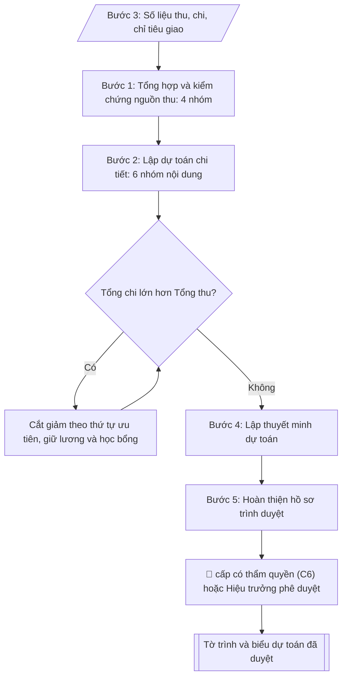

# Lập dự toán thu – chi ngân sách năm

## Khi nào dùng
Khi xây dựng dự toán ngân sách năm (năm tài chính hoặc năm học) của trường: tổng hợp các
nguồn thu, lập kế hoạch chi tiết theo từng nội dung chi, cân đối thu – chi và trình cấp có
thẩm quyền phê duyệt.

## Định dạng và file đầu ra
Định dạng đầu ra có thể chọn theo sản phẩm/yêu cầu: .xlsx, .csv, .pdf. Đọc mục “Định dạng bổ sung” trong quy cách đầu ra trước khi chọn.

**Phải tạo file thực tế để tải xuống, không chỉ trả nội dung trong chat.** Định dạng mặc định của skill: **.xlsx**. Nếu yêu cầu gồm cả báo cáo thuyết minh, tạo thêm file Word cho báo cáo; không ghép báo cáo dài vào bảng tính. Không chờ người dùng yêu cầu xuất file lần nữa. Ưu tiên định dạng người dùng chỉ định; đọc quy tắc xuất file tại references/quy-cach-dau-ra.md.

**Chạy qua API (không có công cụ tạo file):** trả đủ nội dung dạng văn bản có tiêu đề, bảng; ứng dụng gọi sẽ xuất file.

## Quy cách đầu ra và thông tin thiếu
Khi dựng file Word/Excel, áp dụng mục “Thể thức và bảng biểu khi dựng file” trong quy cách đầu ra (cỡ chữ từng thành phần, bảng nhiều trang, số trang, phụ lục). Đọc [quy cách và cấu trúc sản phẩm](references/quy-cach-dau-ra.md) trước khi soạn/xuất. File giao chỉ gồm sản phẩm nghiệp vụ được yêu cầu; kiểm tra nội bộ không xuất kèm. Thiếu thông tin thì giữ nguyên trường/mục và chỗ điền theo mẫu gốc (dòng dấu chấm, dấu gạch hoặc ô trống); không tự điền dữ liệu mẫu, số 0, mã chờ xác minh hay dòng chờ ký. Mẫu chuyên ngành còn áp dụng được ưu tiên về cấu trúc, mã biểu và người ký. Bản đầy đủ: [quy tắc chung](references/quy-tac-chung.md).

Khi người dùng yêu cầu bộ slide (.pptx), đọc mục “Xuất PowerPoint (.pptx) khi được yêu cầu” trong quy cách đầu ra.

## Kiểm soát áp dụng và phê duyệt
Trước khi chạy, xác định `ngay_ap_dung`, `loai_hinh_truong`, `quy_che_noi_bo`, `nguon_du_lieu`, `nguoi_kiem_duyet`; chỉ hỏi thông tin liên quan nghiệp vụ, không dùng giá trị giả định thay dữ liệu bắt buộc. Đối chiếu căn cứ pháp lý với văn bản gốc, hiệu lực, điều khoản áp dụng và chuyển tiếp. Bản đầy đủ: [quy tắc chung](references/quy-tac-chung.md).

Nếu có cập nhật pháp lý dưới đây, đọc [căn cứ và điều kiện áp dụng](references/phap-ly.md) trước khi làm. Quy trình dưới đây giữ nghiệp vụ từ bản gốc; mọi viện dẫn văn bản, mẫu biểu, điều khoản phải theo căn cứ đã chọn trong phap-ly.md, không theo văn bản cũ.

## Giới hạn và human gate
AI hỗ trợ chuẩn bị và đối chiếu; cán bộ phụ trách kiểm tra dữ liệu/căn cứ, người có thẩm quyền duyệt và ký. Không đánh dấu đã ký, đã duyệt, đã công bố khi chưa có chứng cứ. Dữ liệu sinh viên, sức khỏe, nhân sự, tài chính chỉ dùng theo mục đích và phân quyền, che thông tin định danh khi dùng ví dụ (Luật 91/2025/QH15, hiệu lực 01/01/2026); không tải dữ liệu lên dịch vụ ngoài khi chưa có quyền. Bản đầy đủ: [quy tắc chung](references/quy-tac-chung.md).

## Bối cảnh riêng của VNU-IS

Bản chỉnh cho Trường Quốc tế – ĐHQGHN (VNU-IS), v0.4.2. Dựng từ website công khai và phiếu khảo sát CES còn trống; **chưa có dữ liệu khảo sát thực tế của đơn vị**. Đọc [bối cảnh VNU-IS](references/boi-canh-vnuis.md) trước khi chạy; các mã C1–C8 nằm ở mục 6 của file đó.

- **Đơn vị thường dùng:** Phòng Tổ chức và Quản trị (kế hoạch – tài chính); các đơn vị gửi nhu cầu.
- **Nghiệp vụ trong phiếu CES:** "Thanh toán: Kiểm tra thành phần hồ sơ thanh toán/quyết toán" (sheet `03_KS_TCQT`). Tần suất gợi ý: Theo hồ sơ/vụ việc. Đầu vào gợi ý: Chứng từ; hợp đồng; nghiệm thu; danh mục kiểm; quy định. Khó khăn gợi ý: Tài liệu phân tán, nhiều định dạng; Đọc và đối chiếu thủ công mất thời gian; Dễ thiếu thành phần, sai logic hoặc bỏ sót ngoại lệ; Đầu ra phụ thuộc kinh nghiệm từng cá nhân. Đây là gợi ý có sẵn của CES, chưa phải xác nhận của đơn vị.

**Điều chỉnh khi dùng cho VNU-IS**
- Dự toán tổng hợp từ nhu cầu từng đơn vị; không tự cắt hoặc thêm khoản.
- Học phí chương trình liên kết phụ thuộc thỏa thuận với đối tác (C2).

**Chờ xác nhận khi khảo sát**
- Định mức và tuyến duyệt dự toán (C2, C6).
- Mẫu dự toán (C8).

Nếu người dùng chưa trả lời mục chờ xác nhận liên quan, hỏi lại; không tự điền giả định.

## Đầu vào (Input)
| Trường | Mô tả | Bắt buộc |
|---|---|---|
| `nam_ngan_sach` | Năm ngân sách lập dự toán (vd: 2027) | Có |
| `so_lieu_thu` | Số liệu các nguồn thu: học phí, ngân sách nhà nước cấp, thu dịch vụ – liên kết đào tạo, thu khác (đơn vị: triệu đồng) | Có |
| `so_lieu_chi` | Kế hoạch chi: lương – phụ cấp, hoạt động thường xuyên, học bổng, NCKH, đầu tư – mua sắm, dự phòng | Có |
| `chi_tieu_giao` | Chỉ tiêu, định mức được giao (biên chế, quỹ lương, nhiệm vụ chi...) | Không |
| `du_phong_ty_le` | Tỷ lệ dự phòng chi (mặc định: 3% tổng chi) | Không |
| `don_vi_trinh` | Cấp trình duyệt (cấp có thẩm quyền (C6) / Hiệu trưởng) | Có |
| `nguoi_lap` | Chuyên viên lập dự toán (để ký tên cuối biểu) | Không |

### Thông tin VNU-IS đã điền sẵn (không hỏi lại)

| Mục | Giá trị mặc định |
|---|---|
| Cơ quan chủ quản; Trường; địa danh | Đại học Quốc gia Hà Nội (ĐHQGHN); Trường Quốc tế – ĐHQGHN (VNU – International School); Hà Nội |
| Đơn vị sử dụng và phối hợp | Phòng Tổ chức và Quản trị (kế hoạch – tài chính); các đơn vị gửi nhu cầu |
| Ngôn ngữ đầu ra | Tiếng Việt là bản gốc; thêm tiếng Anh cho đối tác, người học quốc tế hoặc khi được yêu cầu |
| Người duyệt và ký | Ghi theo vai trò (Trưởng phòng, Phó Hiệu trưởng phụ trách, Hiệu trưởng); tuyến duyệt và thẩm quyền ký chờ C1, C6 |

Nguồn: website và phiếu CES; đổi theo khảo sát thì sửa tại đây và trong `references/boi-canh-vnuis.md`.

## Quy trình

*⏱ là ước tính ban đầu của bộ gốc, chưa đo tại VNU-IS; hiệu chỉnh sau khảo sát.*

**Ràng buộc pháp lý khi thực hiện** (trích references/phap-ly.md; đối chiếu toàn văn và hiệu lực tại ngày nghiệp vụ):
- Luật 89/2025/QH15 và Nghị định 73/2026/NĐ-CP – ngân sách năm 2026: Yêu cầu năm ngân sách, nguồn kinh phí, dự toán được giao và thời điểm nghiệp vụ; áp dụng Luật 89 từ 01/01/2026 và NĐ 73 cho năm ngân sách 2026. Quyết toán 2025 phải kiểm tra chế độ và chuyển tiếp của năm đó, không tự thay toàn bộ căn cứ lịch sử.
- Trước Bước 1: chọn căn cứ theo đối tượng, loại hình trường và chuyển tiếp; lập bảng văn bản / điều khoản / lý do áp dụng / bằng chứng. Thiếu văn bản gốc hoặc điều khoản thì ghi nhận nội bộ [CẦN XÁC MINH] (không đưa vào file giao), để trống phần tương ứng, chưa kết luận tuân thủ.
- Các con số, thời hạn, số điều, số mức xếp loại, hệ số và mẫu biểu nêu trong các bước dưới đây được giữ từ quy trình gốc (trước cập nhật pháp lý); chỉ dùng khi đã đối chiếu đúng với căn cứ đã chọn, khác thì theo căn cứ. Danh sách điểm cần đối chiếu: docs/DIEM_CAN_DOI_CHIEU_PHAP_LY.md.

**Bước 1. Tổng hợp và kiểm chứng nguồn thu**
- Làm gì: phân loại đầy đủ 4 nhóm nguồn thu từ `so_lieu_thu`: (1) thu học phí, lệ phí
  (quy mô tuyển sinh × mức thu dự kiến); (2) ngân sách nhà nước cấp (kinh phí thường xuyên,
  kinh phí không thường xuyên / nhiệm vụ đặt hàng); (3) thu dịch vụ – liên kết đào tạo
  (đào tạo ngắn hạn, tư vấn, chuyển giao, cho thuê cơ sở vật chất); (4) thu khác (lãi tiền
  gửi, hợp tác, nguồn thu hợp pháp khác). Với mỗi nguồn, kiểm tra tính khả thi qua quyết
  định giao dự toán, hợp đồng đã ký và số thực hiện năm trước; đánh dấu nguồn chưa chắc chắn.
- Dùng input: `so_lieu_thu`, `chi_tieu_giao`, `nam_ngan_sach`.
- Vai trò: Chuyên viên Phòng TC&QT (kế hoạch – tài chính) · AI hỗ trợ: tổng hợp, chuẩn hóa dữ liệu · ⏱ ~1–2 giờ (ước tính)
- Lưu ý nghiệp vụ: không đưa nguồn thu "hy vọng" vào tổng thu để cân đối; thu dịch vụ
  phải có hợp đồng hoặc kế hoạch triển khai khả thi kèm theo.
- → Kết quả bước: bảng tổng hợp nguồn thu đã kiểm chứng (4 nhóm, số tiền, ghi chú mức độ
  chắc chắn của từng nguồn).

**Bước 2. Lập dự toán chi tiết theo 6 nhóm nội dung chi**
- Làm gì: dựng chi tiết từng nhóm từ `so_lieu_chi`: chi lương – phụ cấp (biên chế được giao
  × ngạch bậc, hệ số × lương cơ sở + các khoản phụ cấp); chi hoạt động thường xuyên (điện,
  nước, văn phòng phẩm, công tác phí, sửa chữa nhỏ...); chi học bổng, hỗ trợ sinh viên;
  chi nghiên cứu khoa học; chi đầu tư – mua sắm; chi dự phòng theo `du_phong_ty_le`
  (mặc định 3% tổng chi). Mỗi khoản chi ghi rõ cơ sở tính.
- Dùng input: `so_lieu_chi`, `chi_tieu_giao`, `du_phong_ty_le`.
- Vai trò: Chuyên viên Phòng TC&QT (kế hoạch – tài chính) · AI hỗ trợ: lập bảng biểu, định dạng · ⏱ ~30–60 phút (ước tính)
- Lưu ý nghiệp vụ: chi lương tính theo biên chế được giao, không theo biên chế mong muốn;
  chi dự phòng tính trên tổng chi sau khi đã lập đủ 5 nhóm còn lại.
- → Kết quả bước: bảng dự toán chi chi tiết 6 nhóm (số tiền kèm cơ sở tính từng khoản).

**Bước 3. Cân đối thu – chi**
- Làm gì: cộng tổng thu (Bước 1) và tổng chi (Bước 2); nếu tổng chi > tổng thu, cắt giảm
  theo thứ tự ưu tiên: chi đầu tư – mua sắm → chi hoạt động thường xuyên → các nội dung chi
  khác; tuyệt đối không giảm chi lương – phụ cấp và chi học bổng đã cam kết. Lặp lại cho đến
  khi tổng thu = tổng chi; ghi lại nhật ký mọi điều chỉnh (trước/sau).
- Dùng input: kết quả Bước 1 và Bước 2.
- Vai trò: Chuyên viên Phòng TC&QT (kế hoạch – tài chính) · AI hỗ trợ: xử lý sơ bộ, tổng hợp · ⏱ ~30–60 phút (ước tính)
- Lưu ý nghiệp vụ: bẫy thường gặp là cắt giảm lương/học bổng để cân đối cho nhanh — vi phạm
  cam kết chi; mọi khoản cắt giảm phải có vết để giải trình ở thuyết minh.
- → Kết quả bước: bảng cân đối thu = chi cuối cùng + nhật ký điều chỉnh.

**Bước 4. Lập thuyết minh dự toán**
- Làm gì: viết giải trình cơ sở tính của từng khoản thu/chi biến động lớn so với năm trước
  (nguyên nhân: tuyển sinh, lương cơ sở, nhiệm vụ mới; định mức áp dụng); nêu rõ các khoản
  đã cắt giảm ở Bước 3 và lý do.
- Dùng input: kết quả Bước 1 – 3, `chi_tieu_giao`.
- Vai trò: Chuyên viên Phòng TC&QT (kế hoạch – tài chính) · AI hỗ trợ: soạn dự thảo, tính toán, phân tích số liệu · ⏱ ~30–60 phút (ước tính)
- Lưu ý nghiệp vụ: thuyết minh là căn cứ để cấp có thẩm quyền (C6) chất vấn — mọi số liệu trong
  thuyết minh phải khớp 100% với số trên biểu dự toán.
- → Kết quả bước: dự thảo thuyết minh dự toán.

**Bước 5. Hoàn thiện hồ sơ và trình duyệt**
- Làm gì: ghép bộ hồ sơ gồm Tờ trình + biểu dự toán thu + biểu dự toán chi + thuyết minh;
  kiểm tra số học cộng khớp, đơn vị tính thống nhất (triệu đồng), tổng thu = tổng chi;
  lấy chữ ký người lập (`nguoi_lap`) và trưởng phòng; trình cấp có thẩm quyền (`don_vi_trinh`)
  phê duyệt theo quy chế chi tiêu nội bộ.
- Dùng input: `don_vi_trinh`, `nguoi_lap`, kết quả Bước 3 – 4.
- Vai trò: Chuyên viên Phòng TC&QT (kế hoạch – tài chính) (lập hồ sơ); Trưởng Phòng TC&QT (kế hoạch – tài chính) ký duyệt · AI hỗ trợ: đối chiếu tự động, cảnh báo sai lệch, tính toán, phân tích số liệu · ⏱ ~1–3 giờ (ước tính)
- Lưu ý nghiệp vụ: dự toán phải được phê duyệt trước khi năm ngân sách bắt đầu; mọi khoản
  chi đều phải có trong dự toán được duyệt hoặc được điều chỉnh, bổ sung theo thẩm quyền.
- → Kết quả bước: bộ hồ sơ trình duyệt hoàn chỉnh (Tờ trình + 2 biểu + thuyết minh, đã ký).

## Luồng quy trình (Workflow)

## Đầu ra
- Tờ trình phê duyệt dự toán ngân sách năm.
- Bảng dự toán thu ngân sách năm (đơn vị: triệu đồng).
- Bảng dự toán chi ngân sách năm (đơn vị: triệu đồng), tổng thu = tổng chi.
- Thuyết minh dự toán (tóm tắt).

File nghiệp vụ thực tế theo định dạng mặc định ở đầu skill hoặc định dạng người dùng yêu cầu, kèm liên kết tải trong phản hồi cuối.

Sản phẩm nghiệp vụ hoàn chỉnh theo [quy cách và cấu trúc](references/quy-cach-dau-ra.md), giữ các trường chưa có dữ liệu ở trạng thái trống. Không xuất kèm danh mục kiểm/phụ lục kiểm tra đầu ra.

## Kiểm tra nội bộ trước khi giao
Các tiêu chí sau dùng để tự đối chiếu; không sao chép vào file xuất. Mục thiếu dữ liệu được để trống, không đánh dấu đã đạt hoặc đã duyệt.

- [ ] Đủ các phần và đúng bố cục theo cấu trúc tại references/quy-cach-dau-ra.md (không theo cấu trúc của bản gốc).
- [ ] Có đầy đủ sản phẩm: Tờ trình phê duyệt dự toán ngân sách năm
- [ ] Có đầy đủ sản phẩm: Bảng dự toán thu ngân sách năm (đơn vị: triệu đồng)
- [ ] Mọi số liệu, tên, ngày tháng trong output khớp với Input đã cung cấp (không thêm bớt, không suy đoán)
- [ ] Không bịa đặt số liệu, minh chứng, trích dẫn hay căn cứ
- [ ] Đúng thể thức, định dạng văn bản theo quy định hiện hành
- [ ] Căn cứ pháp lý nêu đầy đủ, còn hiệu lực tại thời điểm lập
- [ ] Đã qua Human gate: người có thẩm quyền đã kiểm tra/ký duyệt trước khi phát hành
- [ ] Không đưa nguồn thu "hy vọng" vào tổng thu để cân đối
- [ ] Chi lương tính theo biên chế được giao, không theo biên chế mong muốn

## Căn cứ & lưu ý
- Luật Ngân sách nhà nước 2015 (sửa đổi, bổ sung); Nghị định 163/2016/NĐ-CP hướng dẫn
  thi hành Luật Ngân sách nhà nước.
- Đơn vị sự nghiệp công lập tự chủ tài chính thực hiện theo Nghị định 60/2021/NĐ-CP
  về cơ chế tự chủ tài chính của đơn vị sự nghiệp công lập.
- Dự toán phải được phê duyệt trước khi năm ngân sách bắt đầu; mọi khoản chi đều phải
  có trong dự toán được duyệt hoặc được điều chỉnh, bổ sung theo thẩm quyền.
- Ví dụ trong skill chỉ để minh họa; không đưa dữ liệu cá nhân thật vào ví dụ. Tên Trường, cơ quan chủ quản và địa danh dùng đúng bảng thông tin VNU-IS đã điền sẵn.

## Tư liệu đối chiếu
Bản gốc trước cập nhật pháp lý (kèm ví dụ giả lập) lưu tại `references/quy-trinh-lich-su.md`, chỉ để đối chiếu hồ sơ lịch sử; không dùng căn cứ, mẫu hay số liệu trong đó làm chỉ dẫn hiện hành.

## Quản trị phiên bản
- Phiên bản gói VNU-IS `0.4.2` (cập nhật 2026-10-11), dựa trên skill gốc `lap-du-toan-nam` bản `1.3.2`; hồ sơ đầy đủ tại [references/version.json](references/version.json).
- Người phê duyệt nghiệp vụ: **chưa chỉ định**. Trạng thái: dự thảo nghiệp vụ; kiểm tra pháp lý trước thực thi. Ngày cập nhật không đồng nghĩa mọi văn bản đã được rà soát toàn văn.
- Giấy phép theo LICENSE của kho (bản quyền CES Global). Lịch sử thay đổi: CHANGELOG.md.
