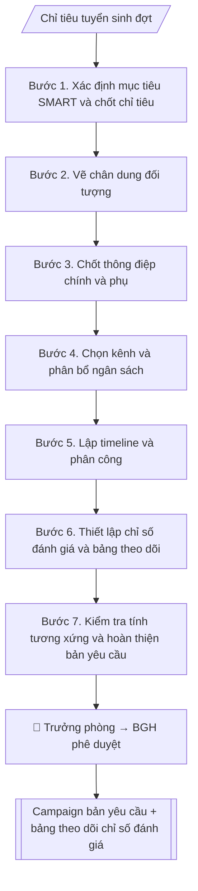

# Đề bài chiến dịch tuyển sinh

## Khi nào dùng
Trước mỗi đợt chiến dịch tuyển sinh (mở đợt, cao điểm, xét tuyển bổ sung...), khi cần một bản
bản yêu cầu thống nhất để cả nhóm triển khai và trình lãnh đạo phê duyệt.

## Định dạng và file đầu ra

Định dạng đầu ra có thể chọn theo sản phẩm/yêu cầu: .docx, .pdf, .pptx. Đọc mục “Định dạng bổ sung” trong quy cách đầu ra trước khi chọn.

**Phải tạo file thực tế để tải xuống, không chỉ trả nội dung trong chat.** Định dạng mặc định của skill: **.docx**. Nếu có bảng số liệu nghiệp vụ yêu cầu file bảng tính riêng, tạo thêm Excel theo yêu cầu; không tự tạo file kiểm tra. Không chờ người dùng yêu cầu xuất file lần nữa. Ưu tiên định dạng người dùng chỉ định; đọc quy tắc xuất file tại references/quy-cach-dau-ra.md.

**Chạy qua API (không có công cụ tạo file):** trả đủ nội dung dạng văn bản có tiêu đề, bảng; ứng dụng gọi sẽ xuất file.

## Quy cách đầu ra và thông tin thiếu
Khi dựng file Word/Excel, áp dụng mục “Thể thức và bảng biểu khi dựng file” trong quy cách đầu ra (cỡ chữ từng thành phần, bảng nhiều trang, số trang, phụ lục). Đọc [quy cách và cấu trúc sản phẩm](references/quy-cach-dau-ra.md) trước khi soạn/xuất. File giao chỉ gồm sản phẩm nghiệp vụ được yêu cầu; kiểm tra nội bộ không xuất kèm. Thiếu thông tin thì giữ nguyên trường/mục và chỗ điền theo mẫu gốc (dòng dấu chấm, dấu gạch hoặc ô trống); không tự điền dữ liệu mẫu, số 0, mã chờ xác minh hay dòng chờ ký. Mẫu chuyên ngành còn áp dụng được ưu tiên về cấu trúc, mã biểu và người ký. Bản đầy đủ: [quy tắc chung](references/quy-tac-chung.md).

Khi người dùng yêu cầu bộ slide (.pptx), đọc mục “Xuất PowerPoint (.pptx) khi được yêu cầu” trong quy cách đầu ra.

## Kiểm soát áp dụng và phê duyệt
Trước khi chạy, xác định `ngay_ap_dung`, `loai_hinh_truong`, `quy_che_noi_bo`, `nguon_du_lieu`, `nguoi_kiem_duyet`; chỉ hỏi thông tin liên quan nghiệp vụ, không dùng giá trị giả định thay dữ liệu bắt buộc. Đối chiếu căn cứ pháp lý với văn bản gốc, hiệu lực, điều khoản áp dụng và chuyển tiếp. Bản đầy đủ: [quy tắc chung](references/quy-tac-chung.md).

## Giới hạn và human gate
AI hỗ trợ chuẩn bị và đối chiếu; cán bộ phụ trách kiểm tra dữ liệu/căn cứ, người có thẩm quyền duyệt và ký. Không đánh dấu đã ký, đã duyệt, đã công bố khi chưa có chứng cứ. Dữ liệu sinh viên, sức khỏe, nhân sự, tài chính chỉ dùng theo mục đích và phân quyền, che thông tin định danh khi dùng ví dụ (Luật 91/2025/QH15, hiệu lực 01/01/2026); không tải dữ liệu lên dịch vụ ngoài khi chưa có quyền. Bản đầy đủ: [quy tắc chung](references/quy-tac-chung.md).

## Bối cảnh riêng của VNU-IS

Bản chỉnh cho Trường Quốc tế – ĐHQGHN (VNU-IS), v0.4.2. Dựng từ website công khai và phiếu khảo sát CES còn trống; **chưa có dữ liệu khảo sát thực tế của đơn vị**. Đọc [bối cảnh VNU-IS](references/boi-canh-vnuis.md) trước khi chạy; các mã C1–C8 nằm ở mục 6 của file đó.

- **Đơn vị thường dùng:** Phòng Truyền thông và Tuyển sinh.
- **Nghiệp vụ trong phiếu CES:** "Chiến lược tuyển sinh: Phân tích dữ liệu tuyển sinh theo nguồn/kênh/chương trình" (sheet `05_KS_TT_Tuyen_sinh`). Tần suất gợi ý: Theo chu kỳ/kế hoạch. Đầu vào gợi ý: Excel/CSV danh sách học sinh/sinh viên tiềm năng, hồ sơ đăng ký, kết quả tuyển sinh; các giai đoạn của quá trình tuyển sinh. Khó khăn gợi ý: Tài liệu phân tán, nhiều định dạng; Đọc và đối chiếu thủ công mất thời gian; Khó kiểm tra chênh lệch, trùng lặp và nguồn số liệu; Đầu ra phụ thuộc kinh nghiệm từng cá nhân. Đây là gợi ý có sẵn của CES, chưa phải xác nhận của đơn vị.

**Điều chỉnh khi dùng cho VNU-IS**
- Bản yêu cầu ghi rõ nhóm chương trình đích: ĐHQGHN cấp bằng, liên kết quốc tế (website nêu 130 chỉ tiêu xét tuyển trực tiếp), song bằng, tích hợp, sau đại học; và phương thức xét tuyển nhắm tới.
- Thông điệp về học bổng, việc làm, xếp hạng chỉ dùng khi có thông báo hiện hành hoặc số liệu có nguồn do Phòng xác nhận; không lấy số tự công bố trên website làm cam kết.
- Kênh sẵn có theo website: biểu mẫu tư vấn, nền tảng AI tư vấn, hotline, email. Kênh khác (mạng xã hội, quảng cáo) do Phòng cung cấp, skill không giả định.
- chỉ số đánh giá và ngân sách do Phòng đặt; chưa có thì để trống.

**Chờ xác nhận khi khảo sát**
- Ngân sách, kênh, chỉ số đánh giá chiến dịch (C8).
- Nguồn số liệu tuyển sinh chính thức (C4).

Nếu người dùng chưa trả lời mục chờ xác nhận liên quan, hỏi lại; không tự điền giả định.

## Đầu vào (Input)

| Trường | Mô tả | Bắt buộc |
|---|---|---|
| `ten_chien_dich` | Tên chiến dịch/đợt | Có |
| `thoi_gian` | Thời gian chạy chiến dịch | Có |
| `muc_tieu` | Mục tiêu cụ thể, đo được (thí sinh tiềm năng, hồ sơ, nhập học) | Có |
| `doi_tuong` | Chân dung đối tượng (học sinh lớp 12 khu vực nào, phụ huynh...) | Có |
| `thong_diep` | Thông điệp chính + thông điệp phụ | Có |
| `kenh` | Kênh triển khai (paid + owned + earned) | Có |
| `ngan_sach` | Ngân sách dự kiến theo kênh | Có |
| `kpi` | chỉ số đánh giá theo kênh và tổng | Có |

### Thông tin VNU-IS đã điền sẵn (không hỏi lại)

| Mục | Giá trị mặc định |
|---|---|
| Cơ quan chủ quản; Trường; địa danh | Đại học Quốc gia Hà Nội (ĐHQGHN); Trường Quốc tế – ĐHQGHN (VNU – International School); Hà Nội |
| Đơn vị sử dụng và phối hợp | Phòng Truyền thông và Tuyển sinh |
| Mô hình đào tạo | Chọn đúng mô hình trước khi áp quy tắc, không áp quy tắc của mô hình này cho mô hình khác: (1) ĐHQGHN cấp bằng; (2) liên kết quốc tế, đối tác nước ngoài cấp bằng; (3) song bằng; (4) cử nhân – thạc sĩ tích hợp; (5) tiếng Anh dự bị và mô hình 2+2 |
| Ngôn ngữ đầu ra | Tiếng Việt là bản gốc; thêm tiếng Anh cho đối tác, người học quốc tế hoặc khi được yêu cầu |
| Hệ thống nguồn dữ liệu có trên website | Biểu mẫu tuyển sinh; nền tảng AI tư vấn (ai.vnuis.edu.vn); hotline và is@vnu.edu.vn. Skill không kết nối hệ thống, chỉ dùng file xuất/tải lên (C5) |
| Người duyệt và ký | Ghi theo vai trò (Trưởng phòng, Phó Hiệu trưởng phụ trách, Hiệu trưởng); tuyến duyệt và thẩm quyền ký chờ C1, C6 |

Nguồn: website và phiếu CES; đổi theo khảo sát thì sửa tại đây và trong `references/boi-canh-vnuis.md`.

## Quy trình

*⏱ là ước tính ban đầu của bộ gốc, chưa đo tại VNU-IS; hiệu chỉnh sau khảo sát.*

**Bước 1. Xác định mục tiêu SMART và chốt chỉ tiêu**
- Làm gì: chuyển `muc_tieu` thành mục tiêu SMART (cụ thể, đo được, khả thi, liên quan, có thời hạn), gắn với chỉ tiêu tuyển sinh của đợt; chốt con số cuối (VD: 3.000 hồ sơ đợt 1) và mốc thời gian đo.
- Dùng input: `muc_tieu`, `thoi_gian`.
- Vai trò: Trưởng Phòng Truyền thông và Tuyển sinh · AI hỗ trợ: xử lý sơ bộ, tổng hợp · ⏱ ~1–2 giờ (ước tính)
- Lưu ý nghiệp vụ: mục tiêu phải bám chỉ tiêu tuyển sinh đã được duyệt; tránh mục tiêu mơ hồ kiểu "tăng nhận biết" mà không đo được.
- → Kết quả bước: Mục tiêu SMART đã chốt (con số + thời hạn đo).

**Bước 2. Vẽ chân dung đối tượng**
- Làm gì: từ `doi_tuong`, mô tả chi tiết từng nhóm: học sinh lớp 12 ở khu vực nào, dùng kênh nào hằng ngày, quan tâm điều gì khi chọn trường; phụ huynh: mối bận tâm (học phí, đầu ra, xa nhà).
- Dùng input: `doi_tuong`.
- Vai trò: Chuyên viên Phòng Truyền thông và Tuyển sinh · AI hỗ trợ: xử lý sơ bộ, tổng hợp · ⏱ ~30–90 phút (ước tính)
- Lưu ý nghiệp vụ: chân dung càng cụ thể thì chọn kênh và thông điệp càng trúng; tách riêng học sinh và phụ huynh vì mối quan tâm khác nhau.
- → Kết quả bước: Bảng chân dung đối tượng (nhóm – đặc điểm – kênh hay dùng – mối quan tâm).

**Bước 3. Chốt thông điệp chính và thông điệp phụ**
- Làm gì: từ `thong_diep`, chốt 1 thông điệp chính (≤ 12 từ, dễ nhớ) + 2–3 thông điệp phụ; kiểm tra từng thông điệp có bằng chứng/số liệu trong đề án tuyển sinh không; rà soát theo brand voice trẻ trung, học thuật.
- Dùng input: `thong_diep`.
- Vai trò: Trưởng Phòng Truyền thông và Tuyển sinh · AI hỗ trợ: đối chiếu tự động, cảnh báo sai lệch · ⏱ ~1–2 giờ (ước tính)
- Lưu ý nghiệp vụ: không đưa thông điệp sai lệch so với đề án tuyển sinh đã ban hành; mỗi thông điệp phụ phải có số liệu chứng minh.
- → Kết quả bước: Bộ thông điệp đã chốt (1 chính + 2–3 phụ, kèm bằng chứng).

**Bước 4. Chọn kênh và phân bổ ngân sách**
- Làm gì: từ `kenh`, liệt kê kênh paid/owned/earned; ưu tiên kênh có tỉ lệ chuyển đổi tốt từ các đợt trước; phân bổ `ngan_sach` theo từng kênh (số tiền cụ thể); ghi vai trò của từng kênh trong phễu.
- Dùng input: `kenh`, `ngan_sach` + bộ thông điệp (Bước 3).
- Vai trò: Chuyên viên Phòng Truyền thông và Tuyển sinh · AI hỗ trợ: xử lý sơ bộ, tổng hợp · ⏱ ~1–2 giờ (ước tính)
- Lưu ý nghiệp vụ: tổng phân bổ phải khớp 100% ngân sách được duyệt; không cam kết ngân sách vượt thẩm quyền.
- → Kết quả bước: Bảng kênh – ngân sách – vai trò (tổng khớp ngân sách duyệt).

**Bước 5. Lập timeline và phân công**
- Làm gì: chia 4 pha: chuẩn bị → chạy → cao điểm → tổng kết; gắn từng mốc vào `thoi_gian`; mỗi mốc ghi công việc, người phụ trách, sản phẩm bàn giao; đối chiếu timeline với lịch tuyển sinh chung của Bộ/trường.
- Dùng input: `thoi_gian` + bảng kênh – ngân sách (Bước 4).
- Vai trò: Chuyên viên Phòng Truyền thông và Tuyển sinh · AI hỗ trợ: đối chiếu tự động, cảnh báo sai lệch · ⏱ ~30–60 phút (ước tính)
- Lưu ý nghiệp vụ: mốc cao điểm phải trùng giai đoạn thí sinh quyết định (sau thi tốt nghiệp THPT); để dự phòng 5–7 ngày cho phê duyệt nội dung.
- → Kết quả bước: Timeline chi tiết (mốc – công việc – phụ trách – bàn giao).

**Bước 6. Thiết lập chỉ số đánh giá và bảng theo dõi**
- Làm gì: từ `kpi`, chốt chỉ số đánh giá tổng và chỉ số đánh giá từng kênh; thiết kế bảng theo dõi hằng tuần (tuần – chỉ số đánh giá kế hoạch – thực tế – chênh lệch – hành động); quy định ngưỡng cảnh báo (VD: đạt < 70% kế hoạch tuần → họp rà soát).
- Dùng input: `kpi` + mục tiêu SMART (Bước 1).
- Vai trò: Chuyên viên Phòng Truyền thông và Tuyển sinh · AI hỗ trợ: đối chiếu tự động, cảnh báo sai lệch, lập bảng biểu, định dạng · ⏱ ~30–60 phút (ước tính)
- Lưu ý nghiệp vụ: chỉ số đánh giá phải đo được hằng tuần bằng dữ liệu thực (thí sinh tiềm năng, hồ sơ), không dùng chỉ số cảm tính.
- → Kết quả bước: Bộ chỉ số đánh giá đã chốt + mẫu bảng theo dõi hằng tuần.

**Bước 7. Kiểm tra tính tương xứng và hoàn thiện bản yêu cầu**
- Làm gì: kiểm tra tam giác mục tiêu – ngân sách – chỉ số đánh giá có tương xứng không (ngân sách có đủ để đạt chỉ số đánh giá không); rà soát toàn bộ bản yêu cầu: thông điệp bám đề án, timeline khớp lịch chung; tổng hợp thành bản yêu cầu hoàn chỉnh.
- Dùng input: `ten_chien_dich` (tên bản yêu cầu), toàn bộ bán thành phẩm Bước 1–6.
- Vai trò: Chuyên viên Phòng Truyền thông và Tuyển sinh · AI hỗ trợ: tổng hợp, chuẩn hóa dữ liệu, đối chiếu tự động, cảnh báo sai lệch · ⏱ ~1–2 giờ (ước tính)
- Lưu ý nghiệp vụ: nếu ngân sách không đủ đạt chỉ số đánh giá thì hoặc giảm mục tiêu hoặc xin bổ sung — không để bản yêu cầu "thiếu tiền mà đòi kết quả".
- → Kết quả bước: Campaign bản yêu cầu hoàn chỉnh (sẵn sàng trình duyệt).

## Luồng quy trình (Workflow)

## Đầu ra

File nghiệp vụ thực tế theo định dạng mặc định ở đầu skill hoặc định dạng người dùng yêu cầu, kèm liên kết tải trong phản hồi cuối.

Sản phẩm nghiệp vụ hoàn chỉnh theo [quy cách và cấu trúc](references/quy-cach-dau-ra.md), giữ các trường chưa có dữ liệu ở trạng thái trống. Không xuất kèm danh mục kiểm/phụ lục kiểm tra đầu ra.

## Kiểm tra nội bộ trước khi giao

- [ ] Bố cục khớp mẫu áp dụng và cấu trúc tại references/quy-cach-dau-ra.md.
- [ ] Có đầy đủ sản phẩm: Campaign bản yêu cầu hoàn chỉnh: mục tiêu, đối tượng, thông điệp, kênh, ngân sách,…
- [ ] Có đầy đủ sản phẩm: Bảng theo dõi chỉ số đánh giá hằng tuần (mẫu)
- [ ] Mọi số liệu, tên, ngày tháng trong output khớp với Input đã cung cấp (không thêm bớt, không suy đoán)
- [ ] Không bịa đặt số liệu, minh chứng, trích dẫn hay căn cứ
- [ ] Đúng thể thức, định dạng văn bản theo quy định hiện hành
- [ ] Căn cứ pháp lý nêu đầy đủ, còn hiệu lực tại thời điểm lập
- [ ] Đã qua Human gate: người có thẩm quyền đã kiểm tra/ký duyệt trước khi phát hành
- [ ] Mục tiêu phải bám chỉ tiêu tuyển sinh đã được duyệt
- [ ] Chân dung càng cụ thể thì chọn kênh và thông điệp càng trúng

> Tiêu chí đạt: tất cả các ô đều được đánh dấu.

## Human gate (người kiểm duyệt)
- Trưởng phòng duyệt bản yêu cầu trước khi trình.
- Ban Giám hiệu phê duyệt ngân sách chiến dịch.
- Không chạy chiến dịch khi chưa được phê duyệt.

## Giới hạn (guardrails)
- Không tự chạy quảng cáo, tự chi ngân sách.
- Không cam kết ngân sách vượt thẩm quyền.
- Không đưa thông điệp sai lệch so với đề án tuyển sinh đã ban hành.
- Không dùng hình ảnh, KOLs không rõ bản quyền/thỏa thuận.

## Căn cứ & lưu ý
- Bản yêu cầu phải bám đề án tuyển sinh và lịch tuyển sinh của Bộ GD&ĐT.
- Brand voice: trẻ trung, học thuật.
- Ví dụ trong skill chỉ để minh họa; không đưa dữ liệu cá nhân thật vào ví dụ. Tên Trường, cơ quan chủ quản và địa danh dùng đúng bảng thông tin VNU-IS đã điền sẵn.

## Quản trị phiên bản
- Phiên bản gói VNU-IS `0.4.2` (cập nhật 2026-10-11), dựa trên skill gốc `campaign-brief-tuyen-sinh` bản `1.3.2`; hồ sơ đầy đủ tại [references/version.json](references/version.json).
- Người phê duyệt nghiệp vụ: **chưa chỉ định**. Trạng thái: dự thảo nghiệp vụ; kiểm tra pháp lý trước thực thi. Ngày cập nhật không đồng nghĩa mọi văn bản đã được rà soát toàn văn.
- Giấy phép theo LICENSE của kho (bản quyền CES Global). Lịch sử thay đổi: CHANGELOG.md.
