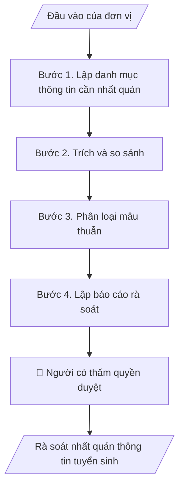

# Rà soát nhất quán thông tin tuyển sinh

## Khi nào dùng
Khi chuẩn bị mùa tuyển sinh, phát hành brochure, cập nhật website, hỏi đáp hoặc nền tảng AI tư vấn; khi phát hiện hai tài liệu nêu số liệu khác nhau.

## Định dạng và file đầu ra

Định dạng đầu ra có thể chọn theo sản phẩm/yêu cầu: .docx, .pdf. Đọc mục “Định dạng bổ sung” trong quy cách đầu ra trước khi chọn.

**Phải tạo file thực tế để tải xuống, không chỉ trả nội dung trong chat.** Định dạng mặc định của skill: **.docx**. Nếu có bảng số liệu nghiệp vụ yêu cầu file bảng tính riêng, tạo thêm Excel theo yêu cầu; không tự tạo file kiểm tra. Không chờ người dùng yêu cầu xuất file lần nữa. Ưu tiên định dạng người dùng chỉ định; đọc quy tắc xuất file tại references/quy-cach-dau-ra.md.

**Chạy qua API (không có công cụ tạo file):** trả đủ nội dung dạng văn bản có tiêu đề, bảng; ứng dụng gọi sẽ xuất file.

## Quy cách đầu ra và thông tin thiếu
Khi dựng file Word/Excel, áp dụng mục “Thể thức và bảng biểu khi dựng file” trong quy cách đầu ra (cỡ chữ từng thành phần, bảng nhiều trang, số trang, phụ lục). Đọc [quy cách và cấu trúc sản phẩm](references/quy-cach-dau-ra.md) trước khi soạn/xuất. File giao chỉ gồm sản phẩm nghiệp vụ được yêu cầu; kiểm tra nội bộ không xuất kèm. Thiếu thông tin thì giữ nguyên trường/mục và chỗ điền theo mẫu gốc (dòng dấu chấm, dấu gạch hoặc ô trống); không tự điền dữ liệu mẫu, số 0, mã chờ xác minh hay dòng chờ ký. Mẫu chuyên ngành còn áp dụng được ưu tiên về cấu trúc, mã biểu và người ký. Bản đầy đủ: [quy tắc chung](references/quy-tac-chung.md).

Khi người dùng yêu cầu bộ slide (.pptx), đọc mục “Xuất PowerPoint (.pptx) khi được yêu cầu” trong quy cách đầu ra.

Khi báo cáo có số liệu cần so sánh hoặc nêu xu hướng, đọc mục “Biểu đồ và hình trong báo cáo số liệu” trong quy cách đầu ra trước khi vẽ.

## Kiểm soát áp dụng và phê duyệt
Trước khi chạy, xác định `ngay_ap_dung`, `loai_hinh_truong`, `quy_che_noi_bo`, `nguon_du_lieu`, `nguoi_kiem_duyet`; chỉ hỏi thông tin liên quan nghiệp vụ, không dùng giá trị giả định thay dữ liệu bắt buộc. Đối chiếu căn cứ pháp lý với văn bản gốc, hiệu lực, điều khoản áp dụng và chuyển tiếp. Bản đầy đủ: [quy tắc chung](references/quy-tac-chung.md).

## Giới hạn và human gate
AI hỗ trợ chuẩn bị và đối chiếu; cán bộ phụ trách kiểm tra dữ liệu/căn cứ, người có thẩm quyền duyệt và ký. Không đánh dấu đã ký, đã duyệt, đã công bố khi chưa có chứng cứ. Dữ liệu sinh viên, sức khỏe, nhân sự, tài chính chỉ dùng theo mục đích và phân quyền, che thông tin định danh khi dùng ví dụ (Luật 91/2025/QH15, hiệu lực 01/01/2026); không tải dữ liệu lên dịch vụ ngoài khi chưa có quyền. Bản đầy đủ: [quy tắc chung](references/quy-tac-chung.md).

## Bối cảnh riêng của VNU-IS

Skill mới cho Trường Quốc tế – ĐHQGHN (VNU-IS), v0.4.2. Dựng từ website công khai và phiếu khảo sát CES còn trống; **chưa có dữ liệu khảo sát thực tế của đơn vị**. Đọc [bối cảnh VNU-IS](references/boi-canh-vnuis.md) trước khi chạy; các mã C1–C8 nằm ở mục 6 của file đó.

- **Đơn vị thường dùng:** Phòng Truyền thông và Tuyển sinh.
- **Nghiệp vụ trong phiếu CES:** "Kiểm soát thông tin: Rà soát tính nhất quán thông tin tuyển sinh trên tài liệu" (sheet `05_KS_TT_Tuyen_sinh`). Tần suất gợi ý: Theo nhu cầu. Đầu vào gợi ý: Brochure; website copy; hỏi đáp; thông báo; quy chế. Khó khăn gợi ý: Tài liệu phân tán, nhiều định dạng; Đọc và đối chiếu thủ công mất thời gian; Dễ bỏ sót trường dữ liệu/phiên bản; Đầu ra phụ thuộc kinh nghiệm từng cá nhân.

**Chờ xác nhận khi khảo sát**
- Văn bản tuyển sinh đã ban hành (C2, C4).
- Người duyệt nội dung tuyển sinh (C6).

Nếu người dùng chưa trả lời mục chờ xác nhận liên quan, hỏi lại; không tự điền giả định.

## Đầu vào (Input)

| Trường | Mô tả | Bắt buộc |
|---|---|---|
| `tai_lieu_can_ra_soat` | Brochure, nội dung website, hỏi đáp, thông báo, bản tin (file hoặc văn bản dán vào) | Có |
| `nguon_chinh_thuc` | Thông báo hoặc đề án tuyển sinh đã ban hành, quy chế tuyển sinh | Có |
| `thu_tu_uu_tien_nguon` | Khi lệch nhau thì ưu tiên nguồn nào; mặc định đề xuất: văn bản tuyển sinh đã ban hành trước, rồi website, rồi brochure; người dùng chốt | Không |
| `danh_sach_chuong_trinh` | Danh sách chương trình chính thức, mã, tên Việt và Anh | Không |

### Thông tin VNU-IS đã điền sẵn (không hỏi lại)

| Mục | Giá trị mặc định |
|---|---|
| Cơ quan chủ quản; Trường; địa danh | Đại học Quốc gia Hà Nội (ĐHQGHN); Trường Quốc tế – ĐHQGHN (VNU – International School); Hà Nội |
| Đơn vị sử dụng và phối hợp | Phòng Truyền thông và Tuyển sinh |
| Mô hình đào tạo | Chọn đúng mô hình trước khi áp quy tắc, không áp quy tắc của mô hình này cho mô hình khác: (1) ĐHQGHN cấp bằng; (2) liên kết quốc tế, đối tác nước ngoài cấp bằng; (3) song bằng; (4) cử nhân – thạc sĩ tích hợp; (5) tiếng Anh dự bị và mô hình 2+2 |
| Ngôn ngữ đầu ra | Tiếng Việt là bản gốc; thêm tiếng Anh cho đối tác, người học quốc tế hoặc khi được yêu cầu |
| Hệ thống nguồn dữ liệu có trên website | Biểu mẫu tuyển sinh; nền tảng AI tư vấn (ai.vnuis.edu.vn); hotline và is@vnu.edu.vn. Skill không kết nối hệ thống, chỉ dùng file xuất/tải lên (C5) |
| Người duyệt và ký | Ghi theo vai trò (Trưởng phòng, Phó Hiệu trưởng phụ trách, Hiệu trưởng); tuyến duyệt và thẩm quyền ký chờ C1, C6 |

Nguồn: website và phiếu CES; đổi theo khảo sát thì sửa tại đây và trong `references/boi-canh-vnuis.md`.

## Quy trình

*⏱ là ước tính ban đầu của bộ gốc, chưa đo tại VNU-IS; hiệu chỉnh sau khảo sát.*

**Bước 1. Lập danh mục thông tin cần nhất quán**
- Làm gì: Liệt kê các nhóm thông tin: số chương trình, danh sách chương trình và mã, chỉ tiêu, phương thức, học phí, học bổng, điều kiện tiếng Anh, mốc thời gian, liên hệ.
- Dùng input: `danh_sach_chuong_trinh`
- Vai trò: Chuyên viên tuyển sinh · AI hỗ trợ: lập danh mục · ⏱ thời gian do đơn vị ước tính sau khảo sát
- Lưu ý nghiệp vụ: Nhóm nào tài liệu không có thì ghi "tài liệu không nêu".
- → Kết quả bước: Danh mục thông tin.

**Bước 2. Trích và so sánh**
- Làm gì: Trích từng thông tin từ mỗi tài liệu kèm vị trí; so với nguồn chính thức và giữa các tài liệu.
- Dùng input: `tai_lieu_can_ra_soat`, `nguon_chinh_thuc`
- Vai trò: Chuyên viên tuyển sinh · AI hỗ trợ: trích và so sánh · ⏱ thời gian do đơn vị ước tính sau khảo sát
- Lưu ý nghiệp vụ: Giữ nguyên chữ và số như tài liệu.
- → Kết quả bước: Bảng so sánh.

**Bước 3. Phân loại mâu thuẫn**
- Làm gì: Mỗi mâu thuẫn ghi nguồn A, nguồn B, mức độ (số liệu, mốc thời gian, tên gọi, cách diễn đạt), đề xuất nguồn nên theo.
- Dùng input: `thu_tu_uu_tien_nguon`, `nguon_chinh_thuc`
- Vai trò: Chuyên viên tuyển sinh · AI hỗ trợ: phân loại · ⏱ thời gian do đơn vị ước tính sau khảo sát
- Lưu ý nghiệp vụ: Mâu thuẫn về học phí, học bổng, chỉ tiêu, mốc thời gian xếp mức cao.
- → Kết quả bước: Danh sách mâu thuẫn.

**Bước 4. Lập báo cáo rà soát**
- Làm gì: Tóm tắt, danh sách sửa theo tài liệu, thông tin chưa có nguồn chính thức.
- Dùng input: `tai_lieu_can_ra_soat`
- Vai trò: Trưởng phòng · AI hỗ trợ: dự thảo báo cáo · ⏱ thời gian do đơn vị ước tính sau khảo sát
- Lưu ý nghiệp vụ: Người dùng quyết định sửa tài liệu nào.
- → Kết quả bước: Báo cáo rà soát.

## Luồng quy trình (Workflow)

## Đầu ra

File nghiệp vụ thực tế theo định dạng mặc định ở đầu skill hoặc định dạng người dùng yêu cầu, kèm liên kết tải trong phản hồi cuối.

Sản phẩm nghiệp vụ hoàn chỉnh theo [quy cách và cấu trúc](references/quy-cach-dau-ra.md), giữ các trường chưa có dữ liệu ở trạng thái trống. Không xuất kèm danh mục kiểm/phụ lục kiểm tra đầu ra.

## Kiểm tra nội bộ trước khi giao

- [ ] Bố cục khớp cấu trúc tại references/quy-cach-dau-ra.md.
- [ ] Mỗi mâu thuẫn ghi đủ hai nguồn và vị trí.
- [ ] Không tự chọn số đúng khi chưa có nguồn chính thức.
- [ ] Số liệu giữ nguyên như tài liệu.
- [ ] Nhóm thông tin không có trong tài liệu được ghi rõ.
- [ ] Đã qua Human gate.

Tiêu chí đạt = tất cả các ô được đánh dấu.

## Human gate (người kiểm duyệt)
- **Trưởng phòng Truyền thông và Tuyển sinh** duyệt danh sách sửa.
- **Người có thẩm quyền** duyệt nội dung tuyển sinh chính thức.

## Giới hạn (guardrails)
- KHÔNG tự điền học phí, chỉ tiêu, điểm chuẩn hoặc điều kiện xét tuyển.
- KHÔNG sửa tài liệu gốc; chỉ đề xuất.

## Căn cứ & lưu ý
- Căn cứ pháp lý và quy định nội bộ do người dùng cung cấp; chưa có thì ghi `[CẦN XÁC MINH]`, không suy diễn.
- Ví dụ trong skill chỉ để minh họa; không đưa dữ liệu cá nhân thật vào ví dụ. Tên Trường, cơ quan chủ quản và địa danh dùng đúng bảng thông tin VNU-IS đã điền sẵn.

## Quản trị phiên bản
- Phiên bản gói VNU-IS `0.4.2` (cập nhật 2026-10-11); hồ sơ tại [references/version.json](references/version.json). Skill mới, không có bản gốc trong bộ 171 skill; dùng khung và quy cách đầu ra của skill `hop-nhat-bao-cao-don-vi`.
- Người phê duyệt nghiệp vụ: **chưa chỉ định**. Trạng thái: dự thảo nghiệp vụ, chờ khảo sát; kiểm tra pháp lý trước thực thi.
- Giấy phép theo LICENSE của kho (bản quyền CES Global).
