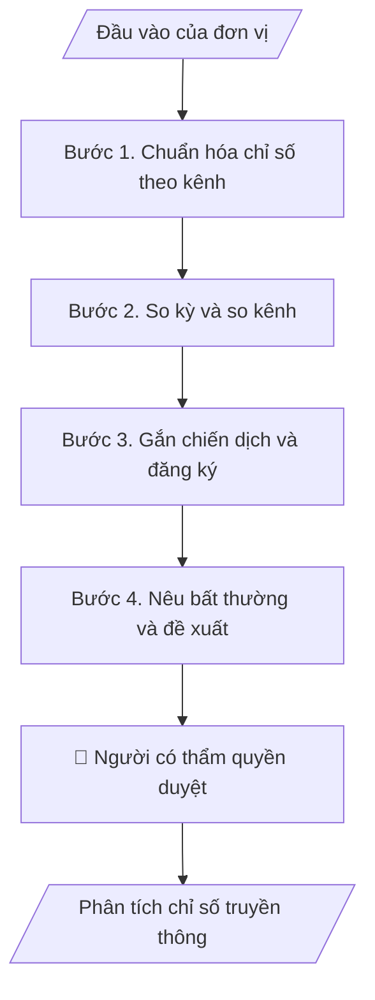

# Phân tích chỉ số truyền thông

## Khi nào dùng
Khi có file xuất chỉ số từ nhiều kênh và cần bảng so sánh thống nhất; khi cần đánh giá chiến dịch theo số liệu.

## Định dạng và file đầu ra

Định dạng đầu ra có thể chọn theo sản phẩm/yêu cầu: .xlsx, .csv, .pdf, .json, .html. Đọc mục “Định dạng bổ sung” trong quy cách đầu ra trước khi chọn.

**Phải tạo file thực tế để tải xuống, không chỉ trả nội dung trong chat.** Định dạng mặc định của skill: **.xlsx**. Nếu yêu cầu gồm cả báo cáo thuyết minh, tạo thêm file Word cho báo cáo; không ghép báo cáo dài vào bảng tính. Không chờ người dùng yêu cầu xuất file lần nữa. Ưu tiên định dạng người dùng chỉ định; đọc quy tắc xuất file tại references/quy-cach-dau-ra.md.

**Chạy qua API (không có công cụ tạo file):** trả đủ nội dung dạng văn bản có tiêu đề, bảng; ứng dụng gọi sẽ xuất file.

## Quy cách đầu ra và thông tin thiếu
Khi dựng file Word/Excel, áp dụng mục “Thể thức và bảng biểu khi dựng file” trong quy cách đầu ra (cỡ chữ từng thành phần, bảng nhiều trang, số trang, phụ lục). Đọc [quy cách và cấu trúc sản phẩm](references/quy-cach-dau-ra.md) trước khi soạn/xuất. File giao chỉ gồm sản phẩm nghiệp vụ được yêu cầu; kiểm tra nội bộ không xuất kèm. Thiếu thông tin thì giữ nguyên trường/mục và chỗ điền theo mẫu gốc (dòng dấu chấm, dấu gạch hoặc ô trống); không tự điền dữ liệu mẫu, số 0, mã chờ xác minh hay dòng chờ ký. Mẫu chuyên ngành còn áp dụng được ưu tiên về cấu trúc, mã biểu và người ký. Bản đầy đủ: [quy tắc chung](references/quy-tac-chung.md).

Khi người dùng yêu cầu bộ slide (.pptx), đọc mục “Xuất PowerPoint (.pptx) khi được yêu cầu” trong quy cách đầu ra.

## Kiểm soát áp dụng và phê duyệt
Trước khi chạy, xác định `ngay_ap_dung`, `loai_hinh_truong`, `quy_che_noi_bo`, `nguon_du_lieu`, `nguoi_kiem_duyet`; chỉ hỏi thông tin liên quan nghiệp vụ, không dùng giá trị giả định thay dữ liệu bắt buộc. Đối chiếu căn cứ pháp lý với văn bản gốc, hiệu lực, điều khoản áp dụng và chuyển tiếp. Bản đầy đủ: [quy tắc chung](references/quy-tac-chung.md).

## Giới hạn và human gate
AI hỗ trợ chuẩn bị và đối chiếu; cán bộ phụ trách kiểm tra dữ liệu/căn cứ, người có thẩm quyền duyệt và ký. Không đánh dấu đã ký, đã duyệt, đã công bố khi chưa có chứng cứ. Dữ liệu sinh viên, sức khỏe, nhân sự, tài chính chỉ dùng theo mục đích và phân quyền, che thông tin định danh khi dùng ví dụ (Luật 91/2025/QH15, hiệu lực 01/01/2026); không tải dữ liệu lên dịch vụ ngoài khi chưa có quyền. Bản đầy đủ: [quy tắc chung](references/quy-tac-chung.md).

## Bối cảnh riêng của VNU-IS

Skill mới cho Trường Quốc tế – ĐHQGHN (VNU-IS), v0.4.2. Dựng từ website công khai và phiếu khảo sát CES còn trống; **chưa có dữ liệu khảo sát thực tế của đơn vị**. Đọc [bối cảnh VNU-IS](references/boi-canh-vnuis.md) trước khi chạy; các mã C1–C8 nằm ở mục 6 của file đó.

- **Đơn vị thường dùng:** Phòng Truyền thông và Tuyển sinh.
- **Nghiệp vụ trong phiếu CES:** "Phân tích hiệu quả: Tổng hợp chỉ số truyền thông từ file xuất" (sheet `05_KS_TT_Tuyen_sinh`). Tần suất gợi ý: Thường xuyên. Đầu vào gợi ý: Excel kênh; chỉ tiêu; chiến dịch; nội dung. Khó khăn gợi ý: Tài liệu phân tán, nhiều định dạng; Đọc và đối chiếu thủ công mất thời gian; Khó kiểm tra chênh lệch, trùng lặp và nguồn số liệu; Đầu ra phụ thuộc kinh nghiệm từng cá nhân. Nghiệp vụ liên quan: "Báo cáo: Tổng hợp báo cáo ngày/tuần chiến dịch tuyển sinh".

**Chờ xác nhận khi khảo sát**
- Danh sách kênh và quyền xuất dữ liệu (C5).
- Nguồn số liệu đăng ký chính thức (C4).

Nếu người dùng chưa trả lời mục chờ xác nhận liên quan, hỏi lại; không tự điền giả định.

## Đầu vào (Input)

| Trường | Mô tả | Bắt buộc |
|---|---|---|
| `file_chi_so` | File xuất từ từng kênh: tên kênh, ngày, lượt hiển thị, tương tác, truy cập, đăng ký | Có |
| `dinh_nghia_chi_so` | Định nghĩa chỉ số mỗi kênh dùng (các kênh đếm khác nhau) | Có |
| `ke_hoach_chien_dich` | Chiến dịch, thời gian, mục tiêu do đơn vị đặt | Không |
| `du_lieu_dang_ky` | Số đăng ký hoặc hồ sơ tuyển sinh cùng kỳ nếu có | Không |
| `ky_phan_tich` | Kỳ phân tích và kỳ so sánh | Có |

### Thông tin VNU-IS đã điền sẵn (không hỏi lại)

| Mục | Giá trị mặc định |
|---|---|
| Cơ quan chủ quản; Trường; địa danh | Đại học Quốc gia Hà Nội (ĐHQGHN); Trường Quốc tế – ĐHQGHN (VNU – International School); Hà Nội |
| Đơn vị sử dụng và phối hợp | Phòng Truyền thông và Tuyển sinh |
| Cơ sở | Xuân Thủy (Cầu Giấy); Phan Tây Nhạc (Xuân Phương); Hòa Lạc (tòa HT1, Khu Đô thị ĐHQGHN). Ghi rõ cơ sở khi nội dung gắn địa điểm |
| Ngôn ngữ đầu ra | Tiếng Việt là bản gốc; thêm tiếng Anh cho đối tác, người học quốc tế hoặc khi được yêu cầu |
| Người duyệt và ký | Ghi theo vai trò (Trưởng phòng, Phó Hiệu trưởng phụ trách, Hiệu trưởng); tuyến duyệt và thẩm quyền ký chờ C1, C6 |

Nguồn: website và phiếu CES; đổi theo khảo sát thì sửa tại đây và trong `references/boi-canh-vnuis.md`.

## Quy trình

*⏱ là ước tính ban đầu của bộ gốc, chưa đo tại VNU-IS; hiệu chỉnh sau khảo sát.*

**Bước 1. Chuẩn hóa chỉ số theo kênh**
- Làm gì: Đưa file từng kênh về cùng cấu trúc; chỉ số cùng tên nhưng định nghĩa khác được tách riêng, không cộng chung.
- Dùng input: `file_chi_so`, `dinh_nghia_chi_so`
- Vai trò: Chuyên viên truyền thông · AI hỗ trợ: chuẩn hóa · ⏱ thời gian do đơn vị ước tính sau khảo sát
- Lưu ý nghiệp vụ: Không cộng lượt xem giữa kênh khi định nghĩa khác.
- → Kết quả bước: Bảng chỉ số chuẩn hóa.

**Bước 2. So kỳ và so kênh**
- Làm gì: So với kỳ trước và giữa các kênh; xu hướng chỉ nêu khi có từ 3 mốc.
- Dùng input: `ky_phan_tich`
- Vai trò: Chuyên viên truyền thông · AI hỗ trợ: tính và so sánh · ⏱ thời gian do đơn vị ước tính sau khảo sát
- Lưu ý nghiệp vụ: Không suy nhân quả từ tương quan.
- → Kết quả bước: Bảng so sánh.

**Bước 3. Gắn chiến dịch và đăng ký**
- Làm gì: Gắn chỉ số vào chiến dịch theo thời gian; nếu có dữ liệu đăng ký thì nêu mối liên hệ theo thời gian, không kết luận nguyên nhân.
- Dùng input: `ke_hoach_chien_dich`, `du_lieu_dang_ky`
- Vai trò: Trưởng bộ phận · AI hỗ trợ: ghép dữ liệu · ⏱ thời gian do đơn vị ước tính sau khảo sát
- Lưu ý nghiệp vụ: Nguồn đăng ký phải là dữ liệu chính thức (C4).
- → Kết quả bước: Bảng chiến dịch và kết quả.

**Bước 4. Nêu bất thường và đề xuất**
- Làm gì: Liệt kê giá trị bất thường, nêu giả thuyết gắn nhãn, đề xuất việc cần kiểm tra.
- Dùng input: `file_chi_so`
- Vai trò: Trưởng bộ phận · AI hỗ trợ: dự thảo nhận xét · ⏱ thời gian do đơn vị ước tính sau khảo sát
- Lưu ý nghiệp vụ: Giả thuyết phải ghi rõ là chưa kiểm chứng.
- → Kết quả bước: Báo cáo chỉ số và đề xuất.

## Luồng quy trình (Workflow)

## Đầu ra

File nghiệp vụ thực tế theo định dạng mặc định ở đầu skill hoặc định dạng người dùng yêu cầu, kèm liên kết tải trong phản hồi cuối.

Sản phẩm nghiệp vụ hoàn chỉnh theo [quy cách và cấu trúc](references/quy-cach-dau-ra.md), giữ các trường chưa có dữ liệu ở trạng thái trống. Không xuất kèm danh mục kiểm/phụ lục kiểm tra đầu ra.

## Kiểm tra nội bộ trước khi giao

- [ ] Bố cục khớp cấu trúc tại references/quy-cach-dau-ra.md.
- [ ] Chỉ số khác định nghĩa không bị cộng chung.
- [ ] Xu hướng chỉ nêu khi có từ 3 mốc.
- [ ] Mọi giả thuyết có nhãn chưa kiểm chứng.
- [ ] Số liệu truy được về file gốc.
- [ ] Đã qua Human gate.

Tiêu chí đạt = tất cả các ô được đánh dấu.

## Human gate (người kiểm duyệt)
- **Trưởng bộ phận truyền thông** xác nhận số liệu và nhận xét.
- **Trưởng phòng Truyền thông và Tuyển sinh** duyệt báo cáo.

## Giới hạn (guardrails)
- KHÔNG kết luận chiến dịch gây ra số đăng ký khi chỉ có tương quan.
- KHÔNG dùng số liệu của đối thủ hoặc ngoài nguồn được cung cấp.

## Căn cứ & lưu ý
- Căn cứ pháp lý và quy định nội bộ do người dùng cung cấp; chưa có thì ghi `[CẦN XÁC MINH]`, không suy diễn.
- Ví dụ trong skill chỉ để minh họa; không đưa dữ liệu cá nhân thật vào ví dụ. Tên Trường, cơ quan chủ quản và địa danh dùng đúng bảng thông tin VNU-IS đã điền sẵn.

## Quản trị phiên bản
- Phiên bản gói VNU-IS `0.4.2` (cập nhật 2026-10-11); hồ sơ tại [references/version.json](references/version.json). Skill mới, không có bản gốc trong bộ 171 skill; dùng khung và quy cách đầu ra của skill `funnel-theo-doi-thi-sinh`.
- Người phê duyệt nghiệp vụ: **chưa chỉ định**. Trạng thái: dự thảo nghiệp vụ, chờ khảo sát; kiểm tra pháp lý trước thực thi.
- Giấy phép theo LICENSE của kho (bản quyền CES Global).
