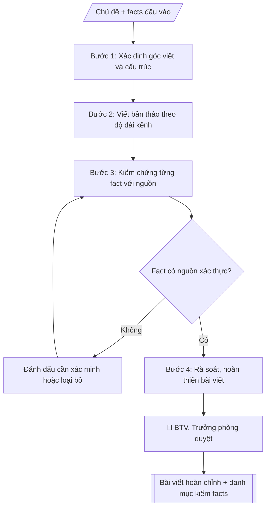

# Bài viết truyền thông

## Khi nào dùng
Khi cần bài viết cho website, fanpage, bản tin: tin sự kiện, gương sinh viên/giảng viên tiêu biểu,
giới thiệu ngành học, thông tin tuyển sinh, thành tựu nghiên cứu.

## Định dạng và file đầu ra

Định dạng đầu ra có thể chọn theo sản phẩm/yêu cầu: .docx, .pdf, .txt, .md, .html. Đọc mục “Định dạng bổ sung” trong quy cách đầu ra trước khi chọn.

**Phải tạo file thực tế để tải xuống, không chỉ trả nội dung trong chat.** Định dạng mặc định của skill: **.docx**. Nếu có bảng số liệu nghiệp vụ yêu cầu file bảng tính riêng, tạo thêm Excel theo yêu cầu; không tự tạo file kiểm tra. Không chờ người dùng yêu cầu xuất file lần nữa. Ưu tiên định dạng người dùng chỉ định; đọc quy tắc xuất file tại references/quy-cach-dau-ra.md.

**Chạy qua API (không có công cụ tạo file):** trả đủ nội dung dạng văn bản có tiêu đề, bảng; ứng dụng gọi sẽ xuất file.

## Quy cách đầu ra và thông tin thiếu
Khi dựng file Word/Excel, áp dụng mục “Thể thức và bảng biểu khi dựng file” trong quy cách đầu ra (cỡ chữ từng thành phần, bảng nhiều trang, số trang, phụ lục). Đọc [quy cách và cấu trúc sản phẩm](references/quy-cach-dau-ra.md) trước khi soạn/xuất. File giao chỉ gồm sản phẩm nghiệp vụ được yêu cầu; kiểm tra nội bộ không xuất kèm. Thiếu thông tin thì giữ nguyên trường/mục và chỗ điền theo mẫu gốc (dòng dấu chấm, dấu gạch hoặc ô trống); không tự điền dữ liệu mẫu, số 0, mã chờ xác minh hay dòng chờ ký. Mẫu chuyên ngành còn áp dụng được ưu tiên về cấu trúc, mã biểu và người ký. Bản đầy đủ: [quy tắc chung](references/quy-tac-chung.md).

Khi người dùng yêu cầu bộ slide (.pptx), đọc mục “Xuất PowerPoint (.pptx) khi được yêu cầu” trong quy cách đầu ra.

## Kiểm soát áp dụng và phê duyệt
Trước khi chạy, xác định `ngay_ap_dung`, `loai_hinh_truong`, `quy_che_noi_bo`, `nguon_du_lieu`, `nguoi_kiem_duyet`; chỉ hỏi thông tin liên quan nghiệp vụ, không dùng giá trị giả định thay dữ liệu bắt buộc. Đối chiếu căn cứ pháp lý với văn bản gốc, hiệu lực, điều khoản áp dụng và chuyển tiếp. Bản đầy đủ: [quy tắc chung](references/quy-tac-chung.md).

## Giới hạn và human gate
AI hỗ trợ chuẩn bị và đối chiếu; cán bộ phụ trách kiểm tra dữ liệu/căn cứ, người có thẩm quyền duyệt và ký. Không đánh dấu đã ký, đã duyệt, đã công bố khi chưa có chứng cứ. Dữ liệu sinh viên, sức khỏe, nhân sự, tài chính chỉ dùng theo mục đích và phân quyền, che thông tin định danh khi dùng ví dụ (Luật 91/2025/QH15, hiệu lực 01/01/2026); không tải dữ liệu lên dịch vụ ngoài khi chưa có quyền. Bản đầy đủ: [quy tắc chung](references/quy-tac-chung.md).

## Bối cảnh riêng của VNU-IS

Bản chỉnh cho Trường Quốc tế – ĐHQGHN (VNU-IS), v0.4.2. Dựng từ website công khai và phiếu khảo sát CES còn trống; **chưa có dữ liệu khảo sát thực tế của đơn vị**. Đọc [bối cảnh VNU-IS](references/boi-canh-vnuis.md) trước khi chạy; các mã C1–C8 nằm ở mục 6 của file đó.

- **Đơn vị thường dùng:** Phòng Truyền thông và Tuyển sinh (website, mạng xã hội, bản tin).
- **Nghiệp vụ trong phiếu CES:** "Sản xuất nội dung: Soạn bài website, social post, email bản tin" (sheet `05_KS_TT_Tuyen_sinh`). Tần suất gợi ý: Thường xuyên. Đầu vào gợi ý: Bản yêu cầu; dữ kiện; ảnh; nguồn; guideline thương hiệu. Khó khăn gợi ý: Tài liệu phân tán, nhiều định dạng; Đọc và đối chiếu thủ công mất thời gian; Dễ bỏ sót trường dữ liệu/phiên bản; Đầu ra phụ thuộc kinh nghiệm từng cá nhân. Đây là gợi ý có sẵn của CES, chưa phải xác nhận của đơn vị.

**Điều chỉnh khi dùng cho VNU-IS**
- Tin về hội thảo, hợp tác, nghiên cứu: ghi đúng tên đơn vị đối tác, tên sự kiện, ngày; không thêm trích dẫn phát biểu mà người dùng không cung cấp.
- Con số về xếp hạng, việc làm, người học chỉ đưa vào khi có nguồn Phòng xác nhận.
- Ảnh, video có người: xác nhận đã được đồng ý sử dụng.
- Guideline thương hiệu của Trường do người dùng nạp; chưa có thì dùng văn phong trung tính.

**Chờ xác nhận khi khảo sát**
- Guideline thương hiệu và mẫu bài tiêu biểu (C8).
- Quy trình duyệt bài trước khi đăng (C6).

Nếu người dùng chưa trả lời mục chờ xác nhận liên quan, hỏi lại; không tự điền giả định.

## Đầu vào (Input)

| Trường | Mô tả | Bắt buộc |
|---|---|---|
| `chu_de` | Chủ đề bài viết | Có |
| `dinh_dang` | Tin ngắn / bài phỏng vấn / bài giới thiệu / bài PR | Có |
| `kenh` | Website / fanpage (quyết định độ dài, giọng văn) | Có |
| `thong_tin` | Facts đầu vào: sự kiện, nhân vật, số liệu, trích dẫn (dạng gạch đầu dòng) | Có |
| `muc_dich` | Thông tin / tuyển sinh / xây dựng thương hiệu | Có |
| `do_dai` | Số từ mong muốn (website 600–900, fanpage 150–300) | Không |
| `cta` | Lời kêu gọi hành động cuối bài (đăng ký tư vấn, xem thêm...) | Không |

### Thông tin VNU-IS đã điền sẵn (không hỏi lại)

| Mục | Giá trị mặc định |
|---|---|
| Cơ quan chủ quản; Trường; địa danh | Đại học Quốc gia Hà Nội (ĐHQGHN); Trường Quốc tế – ĐHQGHN (VNU – International School); Hà Nội |
| Đơn vị sử dụng và phối hợp | Phòng Truyền thông và Tuyển sinh (website, mạng xã hội, bản tin) |
| Cơ sở | Xuân Thủy (Cầu Giấy); Phan Tây Nhạc (Xuân Phương); Hòa Lạc (tòa HT1, Khu Đô thị ĐHQGHN). Ghi rõ cơ sở khi nội dung gắn địa điểm |
| Ngôn ngữ đầu ra | Tiếng Việt là bản gốc; thêm tiếng Anh cho đối tác, người học quốc tế hoặc khi được yêu cầu |
| Người duyệt và ký | Ghi theo vai trò (Trưởng phòng, Phó Hiệu trưởng phụ trách, Hiệu trưởng); tuyến duyệt và thẩm quyền ký chờ C1, C6 |

Nguồn: website và phiếu CES; đổi theo khảo sát thì sửa tại đây và trong `references/boi-canh-vnuis.md`.

## Quy trình

*⏱ là ước tính ban đầu của bộ gốc, chưa đo tại VNU-IS; hiệu chỉnh sau khảo sát.*

**Bước 1. Xác định góc viết và cấu trúc**
- Làm gì: chọn góc viết phù hợp brand voice (trẻ trung + học thuật) và mục đích bài (thông tin / tuyển sinh / xây dựng thương hiệu); dựng cấu trúc: tiêu đề thu hút → mở bài (hook) → thân bài (facts sắp xếp theo logic) → kết + lời kêu gọi hành động.
- Dùng input: `chu_de`, `dinh_dang`, `muc_dich`, `kenh` (quyết định độ dài, giọng văn).
- Vai trò: Chuyên viên Phòng Truyền thông và Tuyển sinh · AI hỗ trợ: soạn dự thảo, lập bảng biểu, định dạng · ⏱ ~30–60 phút (ước tính)
- Lưu ý nghiệp vụ: góc viết phải phục vụ đúng mục đích; fanpage ưu tiên cảm xúc và hook nhanh, website ưu tiên đầy đủ 5W1H.
- → Kết quả bước: Dàn ý bài viết (góc viết + cấu trúc các phần).

**Bước 2. Viết bản thảo**
- Làm gì: viết bài theo dàn ý: câu ngắn, đoạn ngắn cho fanpage (150–300 từ); đầy đủ 5W1H cho website (600–900 từ); trích dẫn giữ nguyên văn lời nhân vật; chèn lời kêu gọi hành động cuối bài.
- Dùng input: `thong_tin`, `do_dai`, `cta`, `kenh`.
- Vai trò: Chuyên viên Phòng Truyền thông và Tuyển sinh · AI hỗ trợ: soạn dự thảo · ⏱ ~30–60 phút (ước tính)
- Lưu ý nghiệp vụ: không thêm số liệu, thành tích, trích dẫn ngoài input; không dùng từ ngữ tuyệt đối hóa ("nhất", "duy nhất") khi chưa có căn cứ; không so sánh với trường khác.
- → Kết quả bước: Bản thảo bài viết.

**Bước 3. Kiểm chứng facts**
- Làm gì: đối chiếu từng tên người/chức danh/số liệu/ngày tháng/trích dẫn trong bản thảo với nguồn đầu vào; fact nào thiếu nguồn thì đánh dấu [cần xác minh] hoặc loại bỏ; lập danh mục kiểm chứng.
- Dùng input: `thong_tin`.
- Vai trò: Chuyên viên Phòng Truyền thông và Tuyển sinh · AI hỗ trợ: đối chiếu tự động, cảnh báo sai lệch · ⏱ ~1–2 giờ (ước tính)
- Lưu ý nghiệp vụ: trích dẫn phải được nhân vật xác nhận; ảnh phải được đồng ý sử dụng; mọi số liệu tuyển sinh phải khớp với đề án tuyển sinh đã ban hành.
- → Kết quả bước: Danh mục kiểm chứng facts (từng fact: đã có nguồn / cần xác minh).

**Bước 4. Rà soát và hoàn thiện**
- Làm gì: rà soát bản thảo theo danh mục kiểm: loại bỏ fact chưa xác minh (hoặc giữ dấu [cần xác minh]), kiểm tra brand voice, chính tả, hashtag/lời kêu gọi hành động; hoàn thiện bài viết cuối cùng; danh mục kiểm chỉ dùng nội bộ.
- Dùng input: (kết quả Bước 2, 3).
- Vai trò: Chuyên viên Phòng Truyền thông và Tuyển sinh · AI hỗ trợ: soạn dự thảo, đối chiếu tự động, cảnh báo sai lệch · ⏱ ~1–2 giờ (ước tính)
- Lưu ý nghiệp vụ: không trình duyệt/bàn giao bài khi còn fact [cần xác minh] liên quan đến số liệu hoặc trích dẫn quan trọng.
- → Kết quả bước: Bài viết hoàn chỉnh + danh mục kiểm chứng facts.

## Luồng quy trình (Workflow)


```

## Đầu ra

File nghiệp vụ thực tế theo định dạng mặc định ở đầu skill hoặc định dạng người dùng yêu cầu, kèm liên kết tải trong phản hồi cuối.

Sản phẩm nghiệp vụ hoàn chỉnh theo [quy cách và cấu trúc](references/quy-cach-dau-ra.md), giữ các trường chưa có dữ liệu ở trạng thái trống. Không xuất kèm danh mục kiểm/phụ lục kiểm tra đầu ra.

## Kiểm tra nội bộ trước khi giao

- [ ] Bố cục khớp mẫu áp dụng và cấu trúc tại references/quy-cach-dau-ra.md.
- [ ] Có đầy đủ sản phẩm: Bài viết hoàn chỉnh theo độ dài kênh
- [ ] Bố cục khớp mẫu áp dụng và cấu trúc tại references/quy-cach-dau-ra.md.
- [ ] Mọi số liệu, tên, ngày tháng trong output khớp với Input đã cung cấp (không thêm bớt, không suy đoán)
- [ ] Không bịa đặt số liệu, minh chứng, trích dẫn hay căn cứ
- [ ] Đúng thể thức, định dạng văn bản theo quy định hiện hành
- [ ] Căn cứ pháp lý nêu đầy đủ, còn hiệu lực tại thời điểm lập
- [ ] Đã qua Human gate: người có thẩm quyền đã kiểm tra/ký duyệt trước khi phát hành
- [ ] Góc viết phải phục vụ đúng mục đích
- [ ] Không thêm số liệu, thành tích, trích dẫn ngoài input

> Tiêu chí đạt: tất cả các ô đều được đánh dấu.

## Human gate (người kiểm duyệt)
- Biên tập viên kiểm chứng facts theo danh mục kiểm trước khi trình.
- Trưởng phòng duyệt bài cuối cùng trước khi đăng.
- Nhân vật trong bài phải xác nhận trích dẫn và đồng ý sử dụng hình ảnh.

## Giới hạn (guardrails)
- Không bịa số liệu, thành tích, trích dẫn.
- Không tự đăng bài lên bất kỳ kênh nào.
- Không dùng hình ảnh chưa được nhân vật đồng ý hoặc không rõ bản quyền.
- Không dùng ngôn từ tuyệt đối hóa, so sánh thiếu căn cứ với trường khác.

## Căn cứ & lưu ý
- Brand voice: trẻ trung, học thuật — thống nhất mọi bài viết.
- Mọi thông tin tuyển sinh phải khớp đề án tuyển sinh đã ban hành.
- Ví dụ trong skill chỉ để minh họa; không đưa dữ liệu cá nhân thật vào ví dụ. Tên Trường, cơ quan chủ quản và địa danh dùng đúng bảng thông tin VNU-IS đã điền sẵn.

## Quản trị phiên bản
- Phiên bản gói VNU-IS `0.4.2` (cập nhật 2026-10-11), dựa trên skill gốc `bai-viet-truyen-thong` bản `1.3.2`; hồ sơ đầy đủ tại [references/version.json](references/version.json).
- Người phê duyệt nghiệp vụ: **chưa chỉ định**. Trạng thái: dự thảo nghiệp vụ; kiểm tra pháp lý trước thực thi. Ngày cập nhật không đồng nghĩa mọi văn bản đã được rà soát toàn văn.
- Giấy phép theo LICENSE của kho (bản quyền CES Global). Lịch sử thay đổi: CHANGELOG.md.
