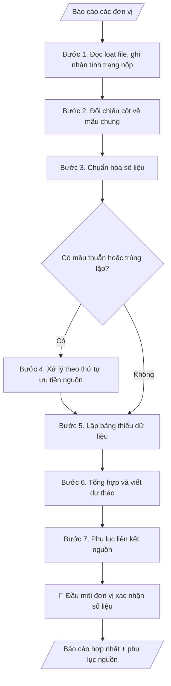

# Hợp nhất báo cáo nhiều đơn vị

## Khi nào dùng
Khi cần tổng hợp báo cáo từ nhiều khoa/phòng/trung tâm thành một báo cáo chung của trường:
báo cáo 3 công khai, báo cáo kiểm định, báo cáo tổng kết năm học, báo cáo đột xuất theo yêu cầu
cấp trên. Đặc biệt hữu ích khi các đơn vị nộp file rời rạc, mẫu biểu không thống nhất.

## Định dạng và file đầu ra

Định dạng đầu ra có thể chọn theo sản phẩm/yêu cầu: .docx, .pdf. Đọc mục “Định dạng bổ sung” trong quy cách đầu ra trước khi chọn.

**Phải tạo file thực tế để tải xuống, không chỉ trả nội dung trong chat.** Định dạng mặc định của skill: **.docx**. Nếu có bảng số liệu nghiệp vụ yêu cầu file bảng tính riêng, tạo thêm Excel theo yêu cầu; không tự tạo file kiểm tra. Không chờ người dùng yêu cầu xuất file lần nữa. Ưu tiên định dạng người dùng chỉ định; đọc quy tắc xuất file tại references/quy-cach-dau-ra.md.

**Chạy qua API (không có công cụ tạo file):** trả đủ nội dung dạng văn bản có tiêu đề, bảng; ứng dụng gọi sẽ xuất file.

## Quy cách đầu ra và thông tin thiếu
Khi dựng file Word/Excel, áp dụng mục “Thể thức và bảng biểu khi dựng file” trong quy cách đầu ra (cỡ chữ từng thành phần, bảng nhiều trang, số trang, phụ lục). Đọc [quy cách và cấu trúc sản phẩm](references/quy-cach-dau-ra.md) trước khi soạn/xuất. File giao chỉ gồm sản phẩm nghiệp vụ được yêu cầu; kiểm tra nội bộ không xuất kèm. Thiếu thông tin thì giữ nguyên trường/mục và chỗ điền theo mẫu gốc (dòng dấu chấm, dấu gạch hoặc ô trống); không tự điền dữ liệu mẫu, số 0, mã chờ xác minh hay dòng chờ ký. Mẫu chuyên ngành còn áp dụng được ưu tiên về cấu trúc, mã biểu và người ký. Bản đầy đủ: [quy tắc chung](references/quy-tac-chung.md).

Khi người dùng yêu cầu bộ slide (.pptx), đọc mục “Xuất PowerPoint (.pptx) khi được yêu cầu” trong quy cách đầu ra.

Khi báo cáo có số liệu cần so sánh hoặc nêu xu hướng, đọc mục “Biểu đồ và hình trong báo cáo số liệu” trong quy cách đầu ra trước khi vẽ.

## Kiểm soát áp dụng và phê duyệt
Trước khi chạy, xác định `ngay_ap_dung`, `loai_hinh_truong`, `quy_che_noi_bo`, `nguon_du_lieu`, `nguoi_kiem_duyet`; chỉ hỏi thông tin liên quan nghiệp vụ, không dùng giá trị giả định thay dữ liệu bắt buộc. Đối chiếu căn cứ pháp lý với văn bản gốc, hiệu lực, điều khoản áp dụng và chuyển tiếp. Bản đầy đủ: [quy tắc chung](references/quy-tac-chung.md).

## Giới hạn và human gate
AI hỗ trợ chuẩn bị và đối chiếu; cán bộ phụ trách kiểm tra dữ liệu/căn cứ, người có thẩm quyền duyệt và ký. Không đánh dấu đã ký, đã duyệt, đã công bố khi chưa có chứng cứ. Dữ liệu sinh viên, sức khỏe, nhân sự, tài chính chỉ dùng theo mục đích và phân quyền, che thông tin định danh khi dùng ví dụ (Luật 91/2025/QH15, hiệu lực 01/01/2026); không tải dữ liệu lên dịch vụ ngoài khi chưa có quyền. Bản đầy đủ: [quy tắc chung](references/quy-tac-chung.md).

## Bối cảnh riêng của VNU-IS

Bản chỉnh cho Trường Quốc tế – ĐHQGHN (VNU-IS), v0.4.2. Dựng từ website công khai và phiếu khảo sát CES còn trống; **chưa có dữ liệu khảo sát thực tế của đơn vị**. Đọc [bối cảnh VNU-IS](references/boi-canh-vnuis.md) trước khi chạy; các mã C1–C8 nằm ở mục 6 của file đó.

- **Đơn vị thường dùng:** Phòng Tổ chức và Quản trị (tổng hợp); 4 phòng, 6 khoa, Viện, Hội đồng (nộp báo cáo).
- **Nghiệp vụ trong phiếu CES:** "Tổng hợp: Lập báo cáo tuần/tháng/quý/năm của Trường" (sheet `03_KS_TCQT`). Tần suất gợi ý: Định kỳ. Đầu vào gợi ý: Báo cáo đơn vị; mẫu báo cáo; số liệu tổng hợp. Khó khăn gợi ý: Tài liệu phân tán, nhiều định dạng; Đọc và đối chiếu thủ công mất thời gian; Khó kiểm tra chênh lệch, trùng lặp và nguồn số liệu; Đầu ra phụ thuộc kinh nghiệm từng cá nhân. Đây là gợi ý có sẵn của CES, chưa phải xác nhận của đơn vị.

**Điều chỉnh khi dùng cho VNU-IS**
- Danh sách đơn vị nộp báo cáo mặc định: 4 phòng, 6 khoa, Viện ĐMST&CGCN, Hội đồng KH&ĐT; bảng theo dõi đơn vị chưa nộp, nộp nháp, nộp đủ.
- Phòng Đào tạo có nhiều mảng (đào tạo, sau đại học, công tác sinh viên, khảo thí, đảm bảo chất lượng): tách mục riêng khi tổng hợp.
- Khi các đơn vị báo cáo số khác nhau về cùng một chỉ tiêu (website của Trường cũng nêu 3 số chương trình khác nhau): liệt kê mâu thuẫn, không tự chọn số.
- Chu kỳ tuần, tháng, quý, năm do Trường quy định; năm học tính theo lịch của Trường.

**Chờ xác nhận khi khảo sát**
- Mẫu báo cáo tuần/tháng/quý/năm đang dùng và định nghĩa từng chỉ tiêu (C8).
- Nguồn số liệu chính thức khi mâu thuẫn (C4).

Nếu người dùng chưa trả lời mục chờ xác nhận liên quan, hỏi lại; không tự điền giả định.

## Đầu vào (Input)

| Trường | Mô tả | Bắt buộc |
|---|---|---|
| `mau_bao_cao_chung` | Mẫu báo cáo tổng (các mục, chỉ tiêu, bảng biểu yêu cầu) | Có |
| `bao_cao_don_vi` | Danh sách báo cáo từng đơn vị (tên đơn vị + nội dung/số liệu) | Có |
| `dinh_nghia_chi_tieu` | Định nghĩa từng chỉ tiêu (cách tính, đơn vị tính, kỳ số liệu) | Có |
| `ky_bao_cao` | Kỳ báo cáo (VD: năm học 2026–2027; 6 tháng đầu năm 2026) | Có |
| `thu_tu_uu_tien_nguon` | Khi số liệu mâu thuẫn, ưu tiên nguồn nào (VD: số liệu Phòng Đào tạo > số liệu khoa) | Không |

### Thông tin VNU-IS đã điền sẵn (không hỏi lại)

| Mục | Giá trị mặc định |
|---|---|
| Cơ quan chủ quản; Trường; địa danh | Đại học Quốc gia Hà Nội (ĐHQGHN); Trường Quốc tế – ĐHQGHN (VNU – International School); Hà Nội |
| Đơn vị sử dụng và phối hợp | Phòng Tổ chức và Quản trị (tổng hợp); 4 phòng, 6 khoa, Viện, Hội đồng (nộp báo cáo) |
| Cơ sở | Xuân Thủy (Cầu Giấy); Phan Tây Nhạc (Xuân Phương); Hòa Lạc (tòa HT1, Khu Đô thị ĐHQGHN). Ghi rõ cơ sở khi nội dung gắn địa điểm |
| Ngôn ngữ đầu ra | Tiếng Việt là bản gốc; thêm tiếng Anh cho đối tác, người học quốc tế hoặc khi được yêu cầu |
| Hệ thống nguồn dữ liệu có trên website | E-Office (văn bản điều hành). Skill không kết nối hệ thống, chỉ dùng file xuất/tải lên (C5) |
| Người duyệt và ký | Ghi theo vai trò (Trưởng phòng, Phó Hiệu trưởng phụ trách, Hiệu trưởng); tuyến duyệt và thẩm quyền ký chờ C1, C6 |

Nguồn: website và phiếu CES; đổi theo khảo sát thì sửa tại đây và trong `references/boi-canh-vnuis.md`.

## Quy trình

*⏱ là ước tính ban đầu của bộ gốc, chưa đo tại VNU-IS; hiệu chỉnh sau khảo sát.*

**Bước 1. Đọc loạt file và ghi nhận tình trạng nộp**
- Làm gì: đọc toàn bộ báo cáo trong `bao_cao_don_vi`; lập danh sách đơn vị đã nộp / chưa nộp / nộp bản nháp;
  ghi nhận kỳ số liệu mà mỗi đơn vị ghi trong báo cáo của mình.
- Dùng input: `bao_cao_don_vi`, `ky_bao_cao`.
- Vai trò: Đầu mối tổng hợp (Văn phòng/Phòng Đào tạo) · AI hỗ trợ: đọc loạt file, ghi nhận tình trạng nộp và kỳ số liệu từng đơn vị · ⏱ ~15–30 phút (ước tính)
- Lưu ý nghiệp vụ: phân biệt "chưa nộp" với "nộp bản nháp chưa xác minh" — bản nháp KHÔNG được đưa vào
  tổng hợp; kỳ số liệu lệch nhau giữa các đơn vị phải ghi nhận ngay để xử lý ở Bước 3.
- → Kết quả bước: bảng tình trạng nộp (đơn vị | trạng thái | kỳ số liệu ghi nhận).

**Bước 2. Đối chiếu cột trường dữ liệu về mẫu chung**
- Làm gì: ánh xạ từng số liệu của mỗi đơn vị về đúng chỉ tiêu trong `mau_bao_cao_chung` theo
  `dinh_nghia_chi_tieu`; ghi lại các chỉ tiêu không đối chiếu được sang cột mẫu và các số liệu của đơn vị không thuộc
  chỉ tiêu nào.
- Dùng input: `bao_cao_don_vi`, `mau_bao_cao_chung`, `dinh_nghia_chi_tieu`.
- Vai trò: Đầu mối tổng hợp (Văn phòng/Phòng Đào tạo) · AI hỗ trợ: đối chiếu cột số liệu về chỉ tiêu mẫu chung theo định nghĩa, đánh dấu chỗ không chắc · ⏱ ~20–40 phút (ước tính)
- Lưu ý nghiệp vụ: đối chiếu cột phải theo định nghĩa chỉ tiêu, không theo tên gọi — hai đơn vị có thể gọi
  khác nhau nhưng cùng một chỉ tiêu, hoặc ngược lại; chỗ nào không chắc thì ghi "cần xác minh", không đoán.
- → Kết quả bước: bảng đối chiếu cột (đơn vị | số liệu gốc | chỉ tiêu mẫu chung | trạng thái đối chiếu cột).

**Bước 3. Chuẩn hóa số liệu**
- Làm gì: thống nhất đơn vị tính, kỳ số liệu, quy tắc làm tròn giữa các đơn vị; thực hiện quy đổi khi cần
  và ghi rõ công thức quy đổi.
- Dùng input: bảng đối chiếu cột (Bước 2), `dinh_nghia_chi_tieu`.
- Vai trò: Đầu mối tổng hợp (Văn phòng/Phòng Đào tạo) · AI hỗ trợ: chuẩn hóa đơn vị tính, kỳ số liệu, thực hiện quy đổi có ghi công thức · ⏱ ~15–30 phút (ước tính)
- Lưu ý nghiệp vụ: mọi quy đổi phải minh bạch công thức để đơn vị kiểm tra lại được; không làm tròn
  trung gian khi số liệu còn phải cộng dồn ở Bước 6.
- → Kết quả bước: bộ số liệu đã chuẩn hóa, sẵn sàng tổng hợp.

**Bước 4. Xử lý trùng lặp và mâu thuẫn**
- Làm gì: phát hiện số liệu trùng lặp (cùng đối tượng được hai đơn vị báo) hoặc mâu thuẫn giữa các đơn vị;
  áp `thu_tu_uu_tien_nguon` để chọn số liệu dùng; mọi chỗ mâu thuẫn đều ghi chú rõ, không tự ý chọn số "đẹp".
- Dùng input: số liệu đã chuẩn hóa (Bước 3), `thu_tu_uu_tien_nguon`.
- Vai trò: Đầu mối tổng hợp (Văn phòng/Phòng Đào tạo) · AI hỗ trợ: phát hiện trùng lặp/mâu thuẫn, áp thứ tự ưu tiên nguồn; chỗ không có thứ tự thì ghi "cần xác minh" · ⏱ ~15–30 phút (ước tính)
- Lưu ý nghiệp vụ: nếu không có thứ tự ưu tiên nguồn thì không tự chọn — ghi vào danh sách mâu thuẫn
  cần xác minh; trùng lặp phải loại trước khi cộng dồn, nếu không tổng sẽ bị đội lên.
- → Kết quả bước: danh sách mâu thuẫn đã xử lý (ghi nguồn được chọn + lý do) và danh sách mâu thuẫn
  cần xác minh thêm.

**Bước 5. Lập bảng thiếu dữ liệu**
- Làm gì: liệt kê đơn vị nào thiếu chỉ tiêu nào, đơn vị nào chưa nộp báo cáo; đánh dấu các chỉ tiêu thiếu
  có ảnh hưởng đến kết quả tổng hợp.
- Dùng input: kết quả Bước 1 (tình trạng nộp), Bước 2 (chỉ tiêu không đối chiếu được sang cột mẫu).
- Vai trò: Đầu mối tổng hợp (Văn phòng/Phòng Đào tạo) · AI hỗ trợ: lập bảng thiếu dữ liệu (đơn vị thiếu chỉ tiêu nào, đơn vị nào chưa nộp) · ⏱ ~10–20 phút (ước tính)
- Lưu ý nghiệp vụ: gap nhật ký là cam kết minh bạch — "chưa có số liệu" phải ghi rõ, không để trống lặng lẽ;
  số liệu từ bản nháp chưa xác minh không đưa vào tổng.
- → Kết quả bước: bảng thiếu dữ liệu (đơn vị | chỉ tiêu thiếu | trạng thái).

**Bước 6. Tổng hợp số liệu và viết dự thảo nhận xét**
- Làm gì: cộng dồn số liệu theo định nghĩa chỉ tiêu, điền vào các mục của `mau_bao_cao_chung`;
  viết phần nhận xét/đánh giá CHỈ dựa trên số liệu đã tổng hợp, mỗi nhận xét gắn với con số cụ thể.
- Dùng input: số liệu đã chuẩn hóa (Bước 3), `mau_bao_cao_chung`, `ky_bao_cao`.
- Vai trò: Đầu mối tổng hợp (Văn phòng/Phòng Đào tạo) · AI hỗ trợ: cộng dồn số liệu, điền mẫu chung, viết nhận xét chỉ dựa trên số liệu · ⏱ ~20–40 phút (ước tính)
- Lưu ý nghiệp vụ: cấm suy diễn vượt số liệu (không "dự báo", không gán "nguyên nhân" khi không có căn cứ);
  chỉ tiêu nào thiếu số liệu thì ghi "chưa có số liệu", không bỏ mục.
- → Kết quả bước: dự thảo báo cáo hợp nhất (số liệu đã điền + nhận xét dựa trên số liệu).

**Bước 7. Lập phụ lục liên kết nguồn**
- Làm gì: với mỗi con số trong báo cáo hợp nhất, ghi chú thích nguồn: đơn vị nào, báo cáo nào, trang/mục nào;
  kiểm tra không để con số nào "mồ côi" nguồn.
- Dùng input: dự thảo báo cáo (Bước 6), `bao_cao_don_vi`.
- Vai trò: Đầu mối tổng hợp (Văn phòng/Phòng Đào tạo); đầu mối từng đơn vị xác nhận số liệu đơn vị mình · AI hỗ trợ: lập phụ lục liên kết nguồn, kiểm tra không con số nào "mồ côi" nguồn · ⏱ ~15–25 phút (ước tính)
- Lưu ý nghiệp vụ: mất liên kết nguồn = số liệu không dùng được khi bị chất vấn; đây là bước kiểm tra
  cuối cùng trước khi chuyển human gate.
- → Kết quả bước: phụ lục liên kết nguồn đầy đủ + báo cáo hợp nhất hoàn chỉnh.
## Luồng quy trình (Workflow)

## Đầu ra

File nghiệp vụ thực tế theo định dạng mặc định ở đầu skill hoặc định dạng người dùng yêu cầu, kèm liên kết tải trong phản hồi cuối.

Sản phẩm nghiệp vụ hoàn chỉnh theo [quy cách và cấu trúc](references/quy-cach-dau-ra.md), giữ các trường chưa có dữ liệu ở trạng thái trống. Không xuất kèm danh mục kiểm/phụ lục kiểm tra đầu ra.

## Kiểm tra nội bộ trước khi giao

- [ ] Báo cáo hợp nhất đầy đủ 5 phần theo cấu trúc sản phẩm tại references/quy-cach-dau-ra.md: tiêu đề + kỳ báo cáo + ngày lập; phạm vi số liệu (đơn vị nào đã có số liệu / chưa nộp / nộp bản nháp); nội dung theo mẫu chung; bảng thiếu dữ liệu; danh sách mâu thuẫn cần xác minh + hạn bổ sung.
- [ ] Số liệu trong output khớp với báo cáo các đơn vị trong Input; không bịa, không ước lượng, không "làm tròn cho đẹp".
- [ ] Mỗi con số trong báo cáo hợp nhất đều có chú thích nguồn (đơn vị, báo cáo, mục) trong phụ lục liên kết nguồn.
- [ ] Số liệu từ bản nháp chưa xác minh KHÔNG đưa vào tổng; chỉ tiêu thiếu để trống ô số liệu và ghi vào bảng thiếu dữ liệu, không bỏ mục.
- [ ] Trùng lặp đã loại trước khi cộng dồn; mâu thuẫn ghi rõ nguồn được chọn + lý do theo thứ tự ưu tiên nguồn.
- [ ] Nhận xét/đánh giá chỉ dựa trên số liệu đã tổng hợp — không suy diễn vượt số liệu (không dự báo, không gán nguyên nhân khi không có căn cứ).
- [ ] Đã qua Human gate: đầu mối từng đơn vị đã xác nhận số liệu đơn vị mình; lãnh đạo đã duyệt báo cáo cuối trước khi ban hành/gửi cấp trên.

> Tiêu chí đạt: tất cả các ô được đánh dấu.

## Human gate (người kiểm duyệt)
1. **Đầu mối từng đơn vị**: xác nhận số liệu của đơn vị mình trong bản hợp nhất (đặc biệt các chỗ
   bị chuẩn hóa/quy đổi hoặc mâu thuẫn).
2. **Đầu mối tổng hợp** (thường là Văn phòng/Phòng Đào tạo): duyệt gap nhật ký và danh sách mâu thuẫn,
   quyết định có chờ bổ sung hay báo cáo với ghi chú thiếu.
3. **Lãnh đạo**: duyệt báo cáo cuối cùng trước khi ban hành/gửi cấp trên.

## Giới hạn (guardrails)
- KHÔNG bịa, ước lượng hay "làm tròn cho đẹp" bất kỳ số liệu nào còn thiếu.
- KHÔNG tự điền số liệu thay đơn vị chưa nộp — ghi rõ "chưa có số liệu".
- Mọi con số phải giữ liên kết về nguồn gốc (đơn vị, báo cáo, mục); mất liên kết = số liệu không dùng được.
- KHÔNG viết nhận xét, đánh giá vượt quá những gì số liệu chứng minh được.

## Căn cứ & lưu ý
- Định nghĩa chỉ tiêu do đơn vị chủ trì báo cáo ban hành là chuẩn duy nhất để đối chiếu cột.
- Quy tắc minh bạch số liệu này áp dụng cho mọi loại báo cáo tổng hợp trong trường.
- Ví dụ trong skill chỉ để minh họa; không đưa dữ liệu cá nhân thật vào ví dụ. Tên Trường, cơ quan chủ quản và địa danh dùng đúng bảng thông tin VNU-IS đã điền sẵn.
- Không cộng số liệu của đơn vị chủ trì với số của đơn vị tham gia khi cùng đếm một đối tượng (bài báo, đề tài, hợp đồng, sinh viên): đối chiếu theo tên hoặc mã duy nhất trước, ghi rõ phần trùng và phần chỉ có ở một nguồn; chưa đối chiếu xong thì không chốt tổng.
- Không dùng tỷ lệ do đơn vị tự ghi khi có số tử/mẫu: tính lại, lệch thì ghi cả hai và đưa vào mục mâu thuẫn.
- Không đưa nhận định thiếu minh chứng (ví dụ "hài lòng 100%" không nêu mẫu, số phiếu, cách tính) vào bản hợp nhất.
- Không bỏ qua kỳ báo cáo lệch so với mẫu chung hoặc ngày lập báo cáo; đơn vị tính khác nhau (tỷ, triệu) phải quy đổi và ghi chú.
- Không nêu số đơn vị hay đơn vị chưa nộp khi chưa có danh sách đơn vị phải nộp: ghi "chưa xác định được", không tự suy ra.

## Quản trị phiên bản
- Phiên bản gói VNU-IS `0.4.2` (cập nhật 2026-10-11), dựa trên skill gốc `hop-nhat-bao-cao-don-vi` bản `1.3.2`; hồ sơ đầy đủ tại [references/version.json](references/version.json).
- Người phê duyệt nghiệp vụ: **chưa chỉ định**. Trạng thái: dự thảo nghiệp vụ; kiểm tra pháp lý trước thực thi. Ngày cập nhật không đồng nghĩa mọi văn bản đã được rà soát toàn văn.
- Giấy phép theo LICENSE của kho (bản quyền CES Global). Lịch sử thay đổi: CHANGELOG.md.
