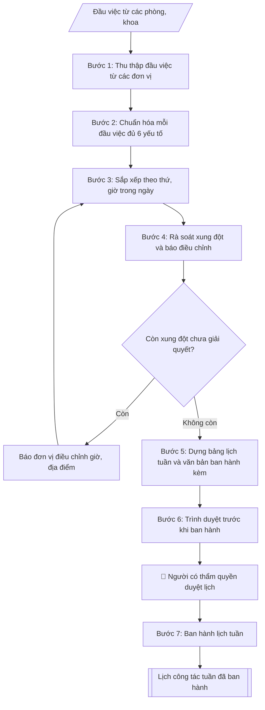

# Lập lịch công tác tuần

## Khi nào dùng
Cuối mỗi tuần, Văn phòng tổng hợp đầu việc của các đơn vị thành lịch công tác tuần tiếp theo
của Ban Giám hiệu, ban hành cho toàn trường.

## Định dạng và file đầu ra

Định dạng đầu ra có thể chọn theo sản phẩm/yêu cầu: .xlsx, .csv, .pdf. Đọc mục “Định dạng bổ sung” trong quy cách đầu ra trước khi chọn.

**Phải tạo file thực tế để tải xuống, không chỉ trả nội dung trong chat.** Định dạng mặc định của skill: **.xlsx**. Nếu yêu cầu gồm cả báo cáo thuyết minh, tạo thêm file Word cho báo cáo; không ghép báo cáo dài vào bảng tính. Không chờ người dùng yêu cầu xuất file lần nữa. Ưu tiên định dạng người dùng chỉ định; đọc quy tắc xuất file tại references/quy-cach-dau-ra.md.

**Chạy qua API (không có công cụ tạo file):** trả đủ nội dung dạng văn bản có tiêu đề, bảng; ứng dụng gọi sẽ xuất file.

## Quy cách đầu ra và thông tin thiếu
Khi dựng file Word/Excel, áp dụng mục “Thể thức và bảng biểu khi dựng file” trong quy cách đầu ra (cỡ chữ từng thành phần, bảng nhiều trang, số trang, phụ lục). Đọc [quy cách và cấu trúc sản phẩm](references/quy-cach-dau-ra.md) trước khi soạn/xuất. File giao chỉ gồm sản phẩm nghiệp vụ được yêu cầu; kiểm tra nội bộ không xuất kèm. Thiếu thông tin thì giữ nguyên trường/mục và chỗ điền theo mẫu gốc (dòng dấu chấm, dấu gạch hoặc ô trống); không tự điền dữ liệu mẫu, số 0, mã chờ xác minh hay dòng chờ ký. Mẫu chuyên ngành còn áp dụng được ưu tiên về cấu trúc, mã biểu và người ký. Bản đầy đủ: [quy tắc chung](references/quy-tac-chung.md).

Khi người dùng yêu cầu bộ slide (.pptx), đọc mục “Xuất PowerPoint (.pptx) khi được yêu cầu” trong quy cách đầu ra.

## Kiểm soát áp dụng và phê duyệt
Trước khi chạy, xác định `ngay_ap_dung`, `loai_hinh_truong`, `quy_che_noi_bo`, `nguon_du_lieu`, `nguoi_kiem_duyet`; chỉ hỏi thông tin liên quan nghiệp vụ, không dùng giá trị giả định thay dữ liệu bắt buộc. Đối chiếu căn cứ pháp lý với văn bản gốc, hiệu lực, điều khoản áp dụng và chuyển tiếp. Bản đầy đủ: [quy tắc chung](references/quy-tac-chung.md).

## Giới hạn và human gate
AI hỗ trợ chuẩn bị và đối chiếu; cán bộ phụ trách kiểm tra dữ liệu/căn cứ, người có thẩm quyền duyệt và ký. Không đánh dấu đã ký, đã duyệt, đã công bố khi chưa có chứng cứ. Dữ liệu sinh viên, sức khỏe, nhân sự, tài chính chỉ dùng theo mục đích và phân quyền, che thông tin định danh khi dùng ví dụ (Luật 91/2025/QH15, hiệu lực 01/01/2026); không tải dữ liệu lên dịch vụ ngoài khi chưa có quyền. Bản đầy đủ: [quy tắc chung](references/quy-tac-chung.md).

## Bối cảnh riêng của VNU-IS

Bản chỉnh cho Trường Quốc tế – ĐHQGHN (VNU-IS), v0.4.2. Dựng từ website công khai và phiếu khảo sát CES còn trống; **chưa có dữ liệu khảo sát thực tế của đơn vị**. Đọc [bối cảnh VNU-IS](references/boi-canh-vnuis.md) trước khi chạy; các mã C1–C8 nằm ở mục 6 của file đó.

- **Đơn vị thường dùng:** Mọi đơn vị trong Trường; Văn phòng (TC&QT) hợp nhất.
- **Nghiệp vụ trong phiếu CES:** "Lịch công tác: Hợp nhất lịch công tác từ các đầu mối" (sheet `03_KS_TCQT`). Tần suất gợi ý: Theo chu kỳ/kế hoạch. Đầu vào gợi ý: Excel/Word/email đã xuất; quy tắc ưu tiên. Khó khăn gợi ý: Tài liệu phân tán, nhiều định dạng; Đọc và đối chiếu thủ công mất thời gian; Dễ bỏ sót trường dữ liệu/phiên bản; Đầu ra phụ thuộc kinh nghiệm từng cá nhân. Đây là gợi ý có sẵn của CES, chưa phải xác nhận của đơn vị.

**Điều chỉnh khi dùng cho VNU-IS**
- Lịch hợp nhất theo cơ sở và phòng họp; xung đột lịch được liệt kê để Văn phòng giải quyết, skill không tự đổi.
- Ghi rõ ai kiêm nhiệm nhiều vai trò để tránh trùng lịch.

**Chờ xác nhận khi khảo sát**
- Cách các đơn vị gửi lịch (C8).
- Người duyệt lịch tuần (C6).

Nếu người dùng chưa trả lời mục chờ xác nhận liên quan, hỏi lại; không tự điền giả định.

## Đầu vào (Input)

| Trường | Mô tả | Bắt buộc |
|---|---|---|
| `tuan` | Tuần thứ mấy, từ ngày–đến ngày | Có |
| `dau_viec` | Danh sách đầu việc, mỗi đầu việc gồm: thứ/ngày, giờ, nội dung, địa điểm, thành phần tham dự, đơn vị chủ trì, lãnh đạo chủ trì/dự | Có |

### Thông tin VNU-IS đã điền sẵn (không hỏi lại)

| Mục | Giá trị mặc định |
|---|---|
| Cơ quan chủ quản; Trường; địa danh | Đại học Quốc gia Hà Nội (ĐHQGHN); Trường Quốc tế – ĐHQGHN (VNU – International School); Hà Nội |
| Đơn vị sử dụng và phối hợp | Mọi đơn vị trong Trường; Văn phòng (TC&QT) hợp nhất |
| Cơ sở | Xuân Thủy (Cầu Giấy); Phan Tây Nhạc (Xuân Phương); Hòa Lạc (tòa HT1, Khu Đô thị ĐHQGHN). Ghi rõ cơ sở khi nội dung gắn địa điểm |
| Ngôn ngữ đầu ra | Tiếng Việt là bản gốc; thêm tiếng Anh cho đối tác, người học quốc tế hoặc khi được yêu cầu |
| Hệ thống nguồn dữ liệu có trên website | E-Office (văn bản điều hành). Skill không kết nối hệ thống, chỉ dùng file xuất/tải lên (C5) |
| Người duyệt và ký | Ghi theo vai trò (Trưởng phòng, Phó Hiệu trưởng phụ trách, Hiệu trưởng); tuyến duyệt và thẩm quyền ký chờ C1, C6 |

Nguồn: website và phiếu CES; đổi theo khảo sát thì sửa tại đây và trong `references/boi-canh-vnuis.md`.

## Quy trình

*⏱ là ước tính ban đầu của bộ gốc, chưa đo tại VNU-IS; hiệu chỉnh sau khảo sát.*

**Bước 1. Thu thập đầu việc từ các đơn vị**
- Làm gì: Nhận danh sách đầu việc các phòng/khoa gửi về (qua email/biểu mẫu) cho tuần trong `tuan`; kiểm tra đơn vị nào chưa gửi thì đôn đốc; ghi nhận thời điểm chốt nhận (thường trước 16h00 thứ Sáu) để làm căn cứ từ chối đầu việc gửi muộn.
- Dùng input: `tuan`, `dau_viec`.
- Vai trò: Chuyên viên Phòng TC&QT (văn phòng – văn thư) · AI hỗ trợ: xử lý sơ bộ theo quy trình · ⏱ ~20–45 phút (ước tính)
- Lưu ý nghiệp vụ: Đầu việc gửi sau giờ chốt chỉ đưa vào lịch khi có xác nhận của Chánh Văn phòng; lưu lại bản gốc đầu việc từng đơn vị gửi để đối chiếu khi có khiếu nại.
- → Kết quả bước: Danh sách đầu việc thô đã tập hợp đủ từ các đơn vị.

**Bước 2. Chuẩn hóa mỗi đầu việc đủ 6 yếu tố**
- Làm gì: Với từng đầu việc, kiểm tra và bổ sung cho đủ 6 yếu tố: (1) thứ/ngày, (2) giờ, (3) nội dung, (4) địa điểm, (5) thành phần tham dự, (6) đơn vị chủ trì + lãnh đạo chủ trì/dự; đầu việc thiếu yếu tố nào thì trả về đơn vị bổ sung; chuẩn hóa cách ghi (giờ dạng "08h00", ngày dạng "12/10").
- Dùng input: `dau_viec`.
- Vai trò: Chuyên viên Phòng TC&QT (văn phòng – văn thư) · AI hỗ trợ: xử lý sơ bộ theo quy trình · ⏱ ~20–45 phút (ước tính)
- Lưu ý nghiệp vụ: Bẫy thường gặp — thiếu "lãnh đạo dự" (không biết xếp lịch cho ai), thiếu địa điểm, nội dung ghi chung chung ("họp triển khai công việc" mà không rõ việc gì); không tự suy đoán bổ sung thông tin thiếu.
- → Kết quả bước: Danh sách đầu việc đã chuẩn hóa, mỗi đầu việc đủ 6 yếu tố.

**Bước 3. Sắp xếp theo thứ, giờ trong ngày**
- Làm gì: Sắp xếp đầu việc theo thứ trong tuần (Thứ 2 → Thứ 7/Chủ nhật), trong mỗi ngày sắp theo giờ tăng dần; gộp các đầu việc liên tiếp cùng địa điểm/thành phần nếu đơn vị đồng ý; đánh dấu các đầu việc cần Hiệu trưởng quyết hoặc có tính chất đặc biệt (lễ, hội nghị lớn).
- Dùng input: `tuan`, `dau_viec` (đã chuẩn hóa).
- Vai trò: Chuyên viên Phòng TC&QT (văn phòng – văn thư) · AI hỗ trợ: xử lý sơ bộ theo quy trình · ⏱ ~20–45 phút (ước tính)
- Lưu ý nghiệp vụ: Đầu việc "cả ngày" hoặc chưa chốt giờ phải ghi rõ trạng thái, không tự đặt giờ; sự kiện nhiều ngày ghi rõ ngày bắt đầu – kết thúc.
- → Kết quả bước: Bảng lịch tuần đã sắp xếp theo thời gian.

**Bước 4. Rà soát xung đột và báo điều chỉnh**
- Làm gì: Quét toàn bảng: một lãnh đạo không được dự 2 việc cùng khung giờ; địa điểm không được xếp 2 việc trùng giờ; phát hiện xung đột thì lập danh sách xung đột (việc nào – trùng với việc nào – lãnh đạo/địa điểm nào), báo ngay cho đơn vị chủ trì để điều chỉnh giờ/địa điểm hoặc xin ý kiến lãnh đạo ưu tiên việc nào.
- Dùng input: `dau_viec` (đã chuẩn hóa, sắp xếp).
- Vai trò: Chuyên viên Phòng TC&QT (văn phòng – văn thư) (Trưởng phòng kiểm tra lại) · AI hỗ trợ: quét lỗi theo danh mục kiểm · ⏱ ~15–30 phút (ước tính)
- Lưu ý nghiệp vụ: Ưu tiên giữ nguyên lịch của Hiệu trưởng, điều chỉnh lịch cấp dưới; xung đột không giải quyết được thì ghi chú rõ trong lịch ("chờ điều chỉnh") thay vì âm thầm bỏ việc.
- → Kết quả bước: Danh sách xung đột lịch + phương án điều chỉnh đã thống nhất với đơn vị.

**Bước 5. Dựng bảng lịch tuần và văn bản ban hành kèm**
- Làm gì: Dựng bảng với các cột: Thứ/Ngày | Giờ | Nội dung | Địa điểm | Thành phần | Chủ trì; viết tiêu đề "LỊCH CÔNG TÁC TUẦN [số] (từ [ngày] đến [ngày])" + dòng văn bản ban hành kèm (số thông báo của Phòng TC&QT (văn phòng – văn thư)); viết phần Ghi chú: cơ chế báo thay đổi (báo về Phòng TC&QT (văn phòng – văn thư) trước giờ chốt), đầu mối liên hệ.
- Dùng input: `tuan`.
- Vai trò: Chuyên viên Phòng TC&QT (văn phòng – văn thư) · AI hỗ trợ: soạn dự thảo đúng thể thức · ⏱ ~20–45 phút (ước tính)
- Lưu ý nghiệp vụ: Tên lãnh đạo trong cột "Chủ trì" ghi đúng chức danh (Hiệu trưởng / PHT phụ trách ...); không viết tắt tên đơn vị ở lần xuất hiện đầu tiên trong bảng.
- → Kết quả bước: Bảng lịch công tác tuần hoàn chỉnh kèm ghi chú.

**Bước 6. Trình duyệt trước khi ban hành**
- Làm gì: Gửi bảng lịch + danh sách xung đột (nếu còn) cho Chánh Văn phòng rà soát, sau đó trình Hiệu trưởng duyệt (human gate); ghi nhận ý kiến điều chỉnh của lãnh đạo và cập nhật vào bảng lịch.
- Dùng input: toàn bộ.
- Vai trò: Chuyên viên Phòng TC&QT (văn phòng – văn thư) chuẩn bị, người có thẩm quyền duyệt lịch (theo quy chế làm việc của trường) · AI hỗ trợ: tổng hợp hồ sơ, soạn phiếu trình/tờ trình đầy đủ · ⏱ ~15–30 phút chuẩn bị + chờ duyệt (ước tính)
- Lưu ý nghiệp vụ: Lịch tuần chỉ ban hành sau khi Hiệu trưởng duyệt — không tự phát hành bản nháp; mọi điều chỉnh sau duyệt phải xin ý kiến lại.
- → Kết quả bước: Bảng lịch tuần đã được lãnh đạo duyệt.

**Bước 7. Ban hành lịch tuần**
- Làm gì: Phát hành lịch tuần đã duyệt trên các kênh chính thức (website trường, email các đơn vị, bảng tin); lưu bản đã ban hành vào hồ sơ công việc tuần; theo dõi các báo thay đổi trong tuần để cập nhật (nếu có).
- Dùng input: toàn bộ.
- Vai trò: Văn thư Phòng TC&QT (văn phòng – văn thư) · AI hỗ trợ: định dạng bản chính, cập nhật sổ phát hành · ⏱ ~30 phút (ước tính)
- Lưu ý nghiệp vụ: Lịch thường ban hành vào chiều thứ Sáu cho tuần kế tiếp; bản cập nhật (nếu có) phải ghi rõ "thay thế bản ngày ..." để tránh nhầm lẫn.
- → Kết quả bước: Lịch công tác tuần đã ban hành + hồ sơ lưu.

## Luồng quy trình (Workflow)

## Đầu ra

File nghiệp vụ thực tế theo định dạng mặc định ở đầu skill hoặc định dạng người dùng yêu cầu, kèm liên kết tải trong phản hồi cuối.

Sản phẩm nghiệp vụ hoàn chỉnh theo [quy cách và cấu trúc](references/quy-cach-dau-ra.md), giữ các trường chưa có dữ liệu ở trạng thái trống. Không xuất kèm danh mục kiểm/phụ lục kiểm tra đầu ra.

## Kiểm tra nội bộ trước khi giao

Các tiêu chí sau dùng để tự đối chiếu; không sao chép vào file xuất. Mục thiếu dữ liệu được để trống, không đánh dấu đã đạt hoặc đã duyệt.

- [ ] Bố cục khớp mẫu áp dụng và cấu trúc tại references/quy-cach-dau-ra.md.
- [ ] Nội dung và số liệu trong output khớp đúng với Input đã cho (không thêm, bớt hay suy diễn)
- [ ] Không bịa đặt số liệu, minh chứng, trích dẫn hay căn cứ
- [ ] Đúng cấu trúc và thể thức theo references/quy-cach-dau-ra.md.
- [ ] Căn cứ pháp lý được trích dẫn đầy đủ và còn hiệu lực
- [ ] Đã qua Human gate: người có thẩm quyền đã kiểm tra và duyệt trước khi phát hành; bản soạn chưa được coi là đã ký/đã duyệt
- [ ] Đầu việc "cả ngày" hoặc chưa chốt giờ phải ghi rõ trạng thái, không tự đặt giờ
- [ ] Tên lãnh đạo trong cột "Chủ trì" ghi đúng chức danh (Hiệu trưởng / PHT phụ trách ...)
- [ ] Mọi điều chỉnh sau duyệt phải xin ý kiến lại

## Căn cứ & lưu ý
- Lịch tuần thường ban hành vào chiều thứ Sáu cho tuần kế tiếp.
- Ví dụ trong skill chỉ để minh họa; không đưa dữ liệu cá nhân thật vào ví dụ. Tên Trường, cơ quan chủ quản và địa danh dùng đúng bảng thông tin VNU-IS đã điền sẵn.

## Quản trị phiên bản
- Phiên bản gói VNU-IS `0.4.2` (cập nhật 2026-10-11), dựa trên skill gốc `lap-lich-cong-tac-tuan` bản `1.3.2`; hồ sơ đầy đủ tại [references/version.json](references/version.json).
- Người phê duyệt nghiệp vụ: **chưa chỉ định**. Trạng thái: dự thảo nghiệp vụ; kiểm tra pháp lý trước thực thi. Ngày cập nhật không đồng nghĩa mọi văn bản đã được rà soát toàn văn.
- Giấy phép theo LICENSE của kho (bản quyền CES Global). Lịch sử thay đổi: CHANGELOG.md.
