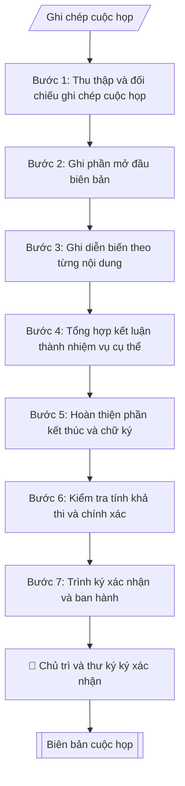

# Soạn biên bản cuộc họp

## Khi nào dùng
Sau mỗi cuộc họp, hội nghị, phiên họp hội đồng cần lập biên bản ghi nhận diễn biến và kết luận
làm căn cứ triển khai.

## Khi nào KHÔNG dùng
- Là phiên họp Hội đồng Khoa học và Đào tạo → dùng `vnuis-hd-soan-bien-ban-hop`.

## Định dạng và file đầu ra

Định dạng đầu ra có thể chọn theo sản phẩm/yêu cầu: .docx, .pdf. Đọc mục “Định dạng bổ sung” trong quy cách đầu ra trước khi chọn.

**Phải tạo file thực tế để tải xuống, không chỉ trả nội dung trong chat.** Định dạng mặc định của skill: **.docx**. Nếu có bảng số liệu nghiệp vụ yêu cầu file bảng tính riêng, tạo thêm Excel theo yêu cầu; không tự tạo file kiểm tra. Không chờ người dùng yêu cầu xuất file lần nữa. Ưu tiên định dạng người dùng chỉ định; đọc quy tắc xuất file tại references/quy-cach-dau-ra.md.

**Chạy qua API (không có công cụ tạo file):** trả đủ nội dung dạng văn bản có tiêu đề, bảng; ứng dụng gọi sẽ xuất file.

## Quy cách đầu ra và thông tin thiếu
Khi dựng file Word/Excel, áp dụng mục “Thể thức và bảng biểu khi dựng file” trong quy cách đầu ra (cỡ chữ từng thành phần, bảng nhiều trang, số trang, phụ lục). Đọc [quy cách và cấu trúc sản phẩm](references/quy-cach-dau-ra.md) trước khi soạn/xuất. File giao chỉ gồm sản phẩm nghiệp vụ được yêu cầu; kiểm tra nội bộ không xuất kèm. Thiếu thông tin thì giữ nguyên trường/mục và chỗ điền theo mẫu gốc (dòng dấu chấm, dấu gạch hoặc ô trống); không tự điền dữ liệu mẫu, số 0, mã chờ xác minh hay dòng chờ ký. Mẫu chuyên ngành còn áp dụng được ưu tiên về cấu trúc, mã biểu và người ký. Bản đầy đủ: [quy tắc chung](references/quy-tac-chung.md).

Khi người dùng yêu cầu bộ slide (.pptx), đọc mục “Xuất PowerPoint (.pptx) khi được yêu cầu” trong quy cách đầu ra.

## Kiểm soát áp dụng và phê duyệt
Trước khi chạy, xác định `ngay_ap_dung`, `loai_hinh_truong`, `quy_che_noi_bo`, `nguon_du_lieu`, `nguoi_kiem_duyet`; chỉ hỏi thông tin liên quan nghiệp vụ, không dùng giá trị giả định thay dữ liệu bắt buộc. Đối chiếu căn cứ pháp lý với văn bản gốc, hiệu lực, điều khoản áp dụng và chuyển tiếp. Bản đầy đủ: [quy tắc chung](references/quy-tac-chung.md).

## Giới hạn và human gate
AI hỗ trợ chuẩn bị và đối chiếu; cán bộ phụ trách kiểm tra dữ liệu/căn cứ, người có thẩm quyền duyệt và ký. Không đánh dấu đã ký, đã duyệt, đã công bố khi chưa có chứng cứ. Dữ liệu sinh viên, sức khỏe, nhân sự, tài chính chỉ dùng theo mục đích và phân quyền, che thông tin định danh khi dùng ví dụ (Luật 91/2025/QH15, hiệu lực 01/01/2026); không tải dữ liệu lên dịch vụ ngoài khi chưa có quyền. Bản đầy đủ: [quy tắc chung](references/quy-tac-chung.md).

## Bối cảnh riêng của VNU-IS

Bản chỉnh cho Trường Quốc tế – ĐHQGHN (VNU-IS), v0.4.2. Dựng từ website công khai và phiếu khảo sát CES còn trống; **chưa có dữ liệu khảo sát thực tế của đơn vị**. Đọc [bối cảnh VNU-IS](references/boi-canh-vnuis.md) trước khi chạy; các mã C1–C8 nằm ở mục 6 của file đó.

- **Đơn vị thường dùng:** Mọi đơn vị trong Trường.
- **Nghiệp vụ trong phiếu CES:** "Họp – sự kiện: Bóc tách biên bản và danh sách nhiệm vụ sau họp" (sheet `03_KS_TCQT`). Tần suất gợi ý: Theo sự kiện. Đầu vào gợi ý: Ghi âm; transcript; tài liệu trình bày. Khó khăn gợi ý: Tài liệu phân tán, nhiều định dạng; Đọc và đối chiếu thủ công mất thời gian; Dễ bỏ sót trường dữ liệu/phiên bản; Đầu ra phụ thuộc kinh nghiệm từng cá nhân. Đây là gợi ý có sẵn của CES, chưa phải xác nhận của đơn vị.

**Điều chỉnh khi dùng cho VNU-IS**
- Biên bản họp giao ban, họp đơn vị, họp hội đồng: ghi người dự theo chức danh; người kiêm nhiệm ghi cả hai vai trò.
- Họp có tiếng Anh hoặc đối tác nước ngoài: giữ nguyên thuật ngữ gốc, nêu rõ ngôn ngữ họp.
- Chuyển nhiệm vụ sau họp sang vnuis-vp-chuan-bi-hop-theo-doi-nhiem-vu; biên bản Hội đồng KH&ĐT dùng vnuis-hd-soan-bien-ban-hop.

**Chờ xác nhận khi khảo sát**
- Có ghi âm họp hay không (C5).
- Mẫu biên bản (C8).

Nếu người dùng chưa trả lời mục chờ xác nhận liên quan, hỏi lại; không tự điền giả định.

## Đầu vào (Input)

| Trường | Mô tả | Bắt buộc |
|---|---|---|
| `ten_cuoc_hop` | Tên cuộc họp | Có |
| `thoi_gian` | Ngày, giờ bắt đầu – kết thúc | Có |
| `dia_diem` | Địa điểm họp (chọn cơ sở: Xuân Thủy, Phan Tây Nhạc, Hòa Lạc) | Có |
| `chu_tri` | Người chủ trì | Có |
| `thu_ky` | Thư ký ghi biên bản | Có |
| `thanh_phan` | Thành phần tham dự (và vắng mặt có lý do) | Có |
| `noi_dung` | Nội dung họp: từng vấn đề, ý kiến phát biểu chính | Có |
| `ket_luan` | Kết luận / phân công nhiệm vụ của chủ trì | Có |
| `co_quan_chu_quan` | Cơ quan chủ quản: Đại học Quốc gia Hà Nội (đã điền sẵn) | Không (mặc định: ĐHQGHN) |
| `co_quan_ban_hanh` | Cơ quan ban hành: Trường Quốc tế – ĐHQGHN (đã điền sẵn); ghi thêm đơn vị soạn thảo nếu khác | Không (mặc định: Trường Quốc tế – ĐHQGHN) |
| `dia_danh` | Địa danh ghi ở dòng ngày tháng năm (mặc định: Hà Nội) | Không (mặc định: Hà Nội) |
| `so_van_ban` | Số, ký hiệu văn bản đã được cấp (để trống nếu chưa cấp; không tự đặt) | Không |
| `noi_nhan` | Danh sách nơi nhận, gồm cả nơi lưu (VT, đơn vị soạn) | Có |

### Thông tin VNU-IS đã điền sẵn (không hỏi lại)

| Mục | Giá trị mặc định |
|---|---|
| Cơ quan chủ quản; Trường; địa danh | Đại học Quốc gia Hà Nội (ĐHQGHN); Trường Quốc tế – ĐHQGHN (VNU – International School); Hà Nội |
| Đơn vị sử dụng và phối hợp | Mọi đơn vị trong Trường |
| Cơ sở | Xuân Thủy (Cầu Giấy); Phan Tây Nhạc (Xuân Phương); Hòa Lạc (tòa HT1, Khu Đô thị ĐHQGHN). Ghi rõ cơ sở khi nội dung gắn địa điểm |
| Ngôn ngữ đầu ra | Tiếng Việt là bản gốc; thêm tiếng Anh cho đối tác, người học quốc tế hoặc khi được yêu cầu |
| Hệ thống nguồn dữ liệu có trên website | E-Office (văn bản điều hành). Skill không kết nối hệ thống, chỉ dùng file xuất/tải lên (C5) |
| Người duyệt và ký | Ghi theo vai trò (Trưởng phòng, Phó Hiệu trưởng phụ trách, Hiệu trưởng); tuyến duyệt và thẩm quyền ký chờ C1, C6 |

Nguồn: website và phiếu CES; đổi theo khảo sát thì sửa tại đây và trong `references/boi-canh-vnuis.md`.

## Quy trình

*⏱ là ước tính ban đầu của bộ gốc, chưa đo tại VNU-IS; hiệu chỉnh sau khảo sát.*

**Bước 1. Thu thập và đối chiếu ghi chép cuộc họp**
- Làm gì: Thu thập ghi chép/bản ghi âm cuộc họp; đối chiếu thông tin hành chính: `ten_cuoc_hop`, `thoi_gian` (giờ bắt đầu – kết thúc), `dia_diem`, `chu_tri`, `thu_ky`, `thanh_phan` (người dự, người vắng mặt và lý do); kiểm tra tên, chức danh người dự có chính xác không (đối chiếu danh sách triệu tập).
- Dùng input: `ten_cuoc_hop`, `thoi_gian`, `dia_diem`, `chu_tri`, `thu_ky`, `thanh_phan`.
- Vai trò: Chuyên viên Phòng TC&QT (văn phòng – văn thư) (Trưởng phòng kiểm tra lại) · AI hỗ trợ: đối chiếu chéo tự động · ⏱ ~15–30 phút (ước tính)
- Lưu ý nghiệp vụ: Tên người và chức danh sai là lỗi nghiêm trọng trong biên bản — kiểm tra kỹ từng tên; người vắng mặt phải ghi rõ lý do (vắng có phép/vắng không phép/đi công tác).
- → Kết quả bước: Khung thông tin hành chính cuộc họp đã kiểm chuẩn.

**Bước 2. Ghi phần mở đầu biên bản**
- Làm gì: Viết phần đầu theo Mẫu 1.9: cơ quan chủ quản nếu có, cơ quan ban hành, quốc hiệu – tiêu ngữ, số/ký hiệu BB và địa danh/ngày (chưa có để trống), dòng "BIÊN BẢN" + tên cuộc họp (in hoa, căn giữa), các dòng Thời gian / Địa điểm / Chủ trì / Thư ký / Thành phần (ghi số lượng người dự, liệt kê người vắng mặt kèm lý do). Phần đầu văn bản lấy từ `co_quan_chu_quan` (nếu có), `co_quan_ban_hanh`, `dia_danh`, `so_van_ban` (để dòng dấu chấm nếu chưa cấp số).
- Dùng input: `ten_cuoc_hop`, `thoi_gian`, `dia_diem`, `chu_tri`, `thu_ky`, `thanh_phan`, `co_quan_chu_quan`, `co_quan_ban_hanh`, `dia_danh`, `so_van_ban`.
- Vai trò: Chuyên viên Phòng TC&QT (văn phòng – văn thư) · AI hỗ trợ: xử lý sơ bộ theo quy trình · ⏱ ~20–45 phút (ước tính)
- Lưu ý nghiệp vụ: Giờ họp ghi đầy đủ theo dạng "…h… – …h…, ngày … tháng … năm …" từ `thoi_gian` (chỗ nào input chưa có thì để dòng dấu chấm); chủ trì và thư ký ghi đủ học hàm/học vị + họ tên + chức danh.
- → Kết quả bước: Phần mở đầu biên bản hoàn chỉnh.

**Bước 3. Ghi diễn biến theo từng nội dung**
- Làm gì: Với từng vấn đề trong `noi_dung`, ghi thành mục đánh số 1., 2., 3...; mỗi mục ghi: nội dung vấn đề được trình bày + ý kiến phát biểu chính (ghi tên người phát biểu + ý chính, không ghi nguyên văn dài dòng trừ phát biểu cần lưu chính xác); giữ giọng văn khách quan, trung thực, không bình luận.
- Dùng input: `noi_dung`.
- Vai trò: Chuyên viên Phòng TC&QT (văn phòng – văn thư) · AI hỗ trợ: xử lý sơ bộ theo quy trình · ⏱ ~20–45 phút (ước tính)
- Lưu ý nghiệp vụ: Chỉ ghi ý kiến có giá trị (đề xuất, phản biện, số liệu) — bỏ qua phát biểu mang tính xã giao; ý kiến trái chiều phải ghi đầy đủ cả hai phía, không thiên lệch; không tự ý "làm đẹp" lời phát biểu.
- → Kết quả bước: Dự thảo phần diễn biến theo từng nội dung.

**Bước 4. Tổng hợp kết luận thành nhiệm vụ cụ thể**
- Làm gì: Từ `ket_luan`, chuyển từng kết luận/phân công của chủ trì thành mục đánh số, mỗi mục giữ việc gì – đơn vị/cá nhân thực hiện (đầu mối) – thời hạn hoàn thành theo ghi chép đã cung cấp; kiểm tra mỗi nhiệm vụ có đầu mối rõ ràng và hạn chót cụ thể (ngày/tháng/năm), để trống đầu mối hoặc thời hạn chưa được xác nhận.
- Dùng input: `ket_luan`.
- Vai trò: Chuyên viên Phòng TC&QT (văn phòng – văn thư) · AI hỗ trợ: tổng hợp và chuẩn hóa dữ liệu · ⏱ ~20–45 phút (ước tính)
- Lưu ý nghiệp vụ: Bẫy thường gặp — kết luận ghi "các đơn vị triển khai" mà không chỉ rõ đơn vị nào; hạn chót ghi "sớm" hoặc "trong thời gian tới". Ghi đầu mối và thời hạn đúng kết luận nguồn; chưa có để trống, không tự giao việc hoặc đặt hạn.
- → Kết quả bước: Dự thảo phần kết luận với nhiệm vụ đã gắn đầu mối và thời hạn.

**Bước 5. Hoàn thiện phần kết thúc và chữ ký**
- Làm gì: Ghi dòng thời gian kết thúc cuộc họp ("Cuộc họp kết thúc lúc ... cùng ngày./."); bố trí khối chữ ký: bên trái "THƯ KÝ", bên phải "CHỦ TRÌ", họ tên người ký bên dưới (chừa khoảng trống ký ở bản trình ký). Nơi nhận lấy từ `noi_nhan`.
- Dùng input: `thoi_gian`, `chu_tri`, `thu_ky`, `noi_nhan`.
- Vai trò: Chuyên viên Phòng TC&QT (văn phòng – văn thư) (Trưởng phòng kiểm tra lại) · AI hỗ trợ: áp dụng góp ý, hoàn thiện bản thảo · ⏱ ~15–30 phút (ước tính)
- Lưu ý nghiệp vụ: Giờ kết thúc phải khớp thực tế (không sớm hơn giờ bắt đầu đã ghi); biên bản hợp lệ cần chữ ký của cả chủ trì và thư ký.
- → Kết quả bước: Phần kết thúc + khối chữ ký hoàn chỉnh.

**Bước 6. Kiểm tra tính khả thi và chính xác**
- Làm gì: Kiểm tra từng nhiệm vụ trong kết luận: có khả thi không (đầu mối có năng lực/thẩm quyền thực hiện, hạn chót có thực tế không); đối chiếu tên người, chức danh, số liệu với ghi chép gốc; đọc soát chính tả toàn văn.
- Dùng input: toàn bộ input (đối chiếu chéo).
- Vai trò: Chuyên viên Phòng TC&QT (văn phòng – văn thư) (Trưởng phòng kiểm tra lại) · AI hỗ trợ: quét lỗi theo danh mục kiểm · ⏱ ~15–30 phút (ước tính)
- Lưu ý nghiệp vụ: Nhiệm vụ giao cho đơn vị không dự họp phải được xác nhận lại với đơn vị đó trước khi ban hành biên bản; hạn chót đã qua so với ngày lập biên bản là lỗi phải sửa ngay.
- → Kết quả bước: Kết quả đối chiếu nội bộ (không xuất kèm file) + danh sách chỗ cần sửa (nếu có), trả về bước tương ứng để chỉnh.

**Bước 7. Trình ký xác nhận và ban hành**
- Làm gì: Ghép toàn bộ thành biên bản hoàn chỉnh theo quy cách đầu ra, bổ sung nơi nhận theo mẫu; chuyển cho thư ký và chủ trì ký xác nhận (human gate); sau khi ký, gửi biên bản cho các thành phần dự họp và đơn vị được phân công nhiệm vụ.
- Dùng input: toàn bộ.
- Vai trò: Thư ký chuẩn bị, chủ trì và thư ký cuộc họp ký · AI hỗ trợ: tổng hợp hồ sơ, soạn phiếu trình/tờ trình đầy đủ · ⏱ ~15–30 phút chuẩn bị + chờ duyệt (ước tính)
- Lưu ý nghiệp vụ: Không sửa nội dung diễn biến/kết luận sau khi chủ trì đã ký mà không có ý kiến đồng ý bằng văn bản.
- → Kết quả bước: Biên bản cuộc họp đã ký xác nhận, gửi đến các bên liên quan.

## Luồng quy trình (Workflow)

## Đầu ra

File nghiệp vụ thực tế theo định dạng mặc định ở đầu skill hoặc định dạng người dùng yêu cầu, kèm liên kết tải trong phản hồi cuối.

Sản phẩm nghiệp vụ hoàn chỉnh theo [quy cách và cấu trúc](references/quy-cach-dau-ra.md), giữ các trường chưa có dữ liệu ở trạng thái trống. Không xuất kèm danh mục kiểm/phụ lục kiểm tra đầu ra.

## Kiểm tra nội bộ trước khi giao

Các tiêu chí sau dùng để tự đối chiếu; không sao chép vào file xuất. Mục thiếu dữ liệu được để trống, không đánh dấu đã đạt hoặc đã duyệt.

- [ ] Bố cục khớp mẫu áp dụng và cấu trúc tại references/quy-cach-dau-ra.md.
- [ ] Nội dung và số liệu trong output khớp đúng với Input đã cho (không thêm, bớt hay suy diễn)
- [ ] Không bịa đặt số liệu, minh chứng, trích dẫn hay căn cứ
- [ ] Đúng thể thức văn bản theo Nghị định 30/2020/NĐ-CP (đối chiếu hiệu lực tại ngày nghiệp vụ) và cấu trúc tại references/quy-cach-dau-ra.md.
- [ ] Căn cứ pháp lý được trích dẫn đầy đủ và còn hiệu lực
- [ ] Đã qua Human gate: người có thẩm quyền đã kiểm tra và duyệt trước khi phát hành; bản soạn chưa được coi là đã ký/đã duyệt
- [ ] Tên người và chức danh sai là lỗi nghiêm trọng trong biên bản — kiểm tra kỹ từng tên
- [ ] Người vắng mặt phải ghi rõ lý do (vắng có phép/vắng không phép/đi công tác)
- [ ] Giờ họp ghi đầy đủ theo dạng "…h… – …h…, ngày … tháng … năm …" từ `thoi_gian` (chỗ nào input chưa có thì để dòng dấu chấm)

## Căn cứ & lưu ý
- Biên bản phải khách quan, trung thực; kết luận ghi rõ đầu mối và thời hạn.
- Ví dụ trong skill chỉ để minh họa; không đưa dữ liệu cá nhân thật vào ví dụ. Tên Trường, cơ quan chủ quản và địa danh dùng đúng bảng thông tin VNU-IS đã điền sẵn.
- Không ghi cả quyết định cũ lẫn mới như hai quyết định khi chủ trì đổi ý trong họp: ghi quyết định cuối cùng và nêu ngắn diễn biến đổi ý.
- Không ghi một việc là đã quyết nếu thuộc thẩm quyền cấp trên (Ban Giám hiệu, Hiệu trưởng); ghi "đề xuất" hoặc "trình", và không ban hành thông báo trước khi có quyết định. Chủ trì nói hai điều trái nhau thì ghi theo hướng thận trọng và nêu trong ghi chú nội bộ.
- Không tự sửa số phiếu biểu quyết khi không khớp số người có mặt: giữ đúng số theo ghi chép và nêu trong ghi chú nội bộ.
- Không ghi người vắng mặt là đã nhận việc: ghi "chờ xác nhận". Việc chưa có đầu mối hoặc thời hạn cụ thể ("tuần sau", "sớm") để trống, không tự đặt ngày.
- Không đưa vào biên bản chung thông tin sức khỏe, hoàn cảnh gia đình, kỷ luật của cá nhân sinh viên hay cán bộ; ghi "một trường hợp cần hỗ trợ" nếu chủ trì yêu cầu. Không ghi chuyện ngoài lề.
- Không chọn ngày họp theo giấy mời khi ghi chép nêu ngày khác: dùng ngày chủ trì xác nhận trong họp và nêu trong ghi chú nội bộ. Các điểm cần xác nhận đặt sau dòng "=== GHI CHÚ NỘI BỘ ===", không nằm trong biên bản giao đi.

## Quản trị phiên bản
- Phiên bản gói VNU-IS `0.4.2` (cập nhật 2026-10-11), dựa trên skill gốc `soan-bien-ban-hop` bản `1.3.2`; hồ sơ đầy đủ tại [references/version.json](references/version.json).
- Người phê duyệt nghiệp vụ: **chưa chỉ định**. Trạng thái: dự thảo nghiệp vụ; kiểm tra pháp lý trước thực thi. Ngày cập nhật không đồng nghĩa mọi văn bản đã được rà soát toàn văn.
- Giấy phép theo LICENSE của kho (bản quyền CES Global). Lịch sử thay đổi: CHANGELOG.md.
