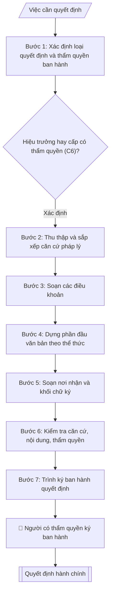

# Soạn quyết định hành chính

## Khi nào dùng
Khi ban hành quyết định: thành lập / giải thể đơn vị, ban hành quy chế – quy định,
điều động – bổ nhiệm, khen thưởng – kỷ luật sinh viên (khen thưởng/kỷ luật viên chức, người lao động dùng vnuis-nhansu-soan-quyet-dinh-khen-thuong-ky-luat-vien-chuc), phê duyệt kế hoạch – đề án.

## Khi nào KHÔNG dùng
- Cần quyết định khen thưởng, kỷ luật viên chức, người lao động → dùng `vnuis-nhansu-soan-quyet-dinh-khen-thuong-ky-luat-vien-chuc`.

## Định dạng và file đầu ra

Định dạng đầu ra có thể chọn theo sản phẩm/yêu cầu: .docx, .pdf. Đọc mục “Định dạng bổ sung” trong quy cách đầu ra trước khi chọn.

**Phải tạo file thực tế để tải xuống, không chỉ trả nội dung trong chat.** Định dạng mặc định của skill: **.docx**. Nếu có bảng số liệu nghiệp vụ yêu cầu file bảng tính riêng, tạo thêm Excel theo yêu cầu; không tự tạo file kiểm tra. Không chờ người dùng yêu cầu xuất file lần nữa. Ưu tiên định dạng người dùng chỉ định; đọc quy tắc xuất file tại references/quy-cach-dau-ra.md.

**Chạy qua API (không có công cụ tạo file):** trả đủ nội dung dạng văn bản có tiêu đề, bảng; ứng dụng gọi sẽ xuất file.

## Quy cách đầu ra và thông tin thiếu
Khi dựng file Word/Excel, áp dụng mục “Thể thức và bảng biểu khi dựng file” trong quy cách đầu ra (cỡ chữ từng thành phần, bảng nhiều trang, số trang, phụ lục). Đọc [quy cách và cấu trúc sản phẩm](references/quy-cach-dau-ra.md) trước khi soạn/xuất. File giao chỉ gồm sản phẩm nghiệp vụ được yêu cầu; kiểm tra nội bộ không xuất kèm. Thiếu thông tin thì giữ nguyên trường/mục và chỗ điền theo mẫu gốc (dòng dấu chấm, dấu gạch hoặc ô trống); không tự điền dữ liệu mẫu, số 0, mã chờ xác minh hay dòng chờ ký. Mẫu chuyên ngành còn áp dụng được ưu tiên về cấu trúc, mã biểu và người ký. Bản đầy đủ: [quy tắc chung](references/quy-tac-chung.md).

Khi người dùng yêu cầu bộ slide (.pptx), đọc mục “Xuất PowerPoint (.pptx) khi được yêu cầu” trong quy cách đầu ra.

## Kiểm soát áp dụng và phê duyệt
Trước khi chạy, xác định `ngay_ap_dung`, `loai_hinh_truong`, `quy_che_noi_bo`, `nguon_du_lieu`, `nguoi_kiem_duyet`; chỉ hỏi thông tin liên quan nghiệp vụ, không dùng giá trị giả định thay dữ liệu bắt buộc. Đối chiếu căn cứ pháp lý với văn bản gốc, hiệu lực, điều khoản áp dụng và chuyển tiếp. Bản đầy đủ: [quy tắc chung](references/quy-tac-chung.md).

## Giới hạn và human gate
AI hỗ trợ chuẩn bị và đối chiếu; cán bộ phụ trách kiểm tra dữ liệu/căn cứ, người có thẩm quyền duyệt và ký. Không đánh dấu đã ký, đã duyệt, đã công bố khi chưa có chứng cứ. Dữ liệu sinh viên, sức khỏe, nhân sự, tài chính chỉ dùng theo mục đích và phân quyền, che thông tin định danh khi dùng ví dụ (Luật 91/2025/QH15, hiệu lực 01/01/2026); không tải dữ liệu lên dịch vụ ngoài khi chưa có quyền. Bản đầy đủ: [quy tắc chung](references/quy-tac-chung.md).

## Bối cảnh riêng của VNU-IS

Bản chỉnh cho Trường Quốc tế – ĐHQGHN (VNU-IS), v0.4.2. Dựng từ website công khai và phiếu khảo sát CES còn trống; **chưa có dữ liệu khảo sát thực tế của đơn vị**. Đọc [bối cảnh VNU-IS](references/boi-canh-vnuis.md) trước khi chạy; các mã C1–C8 nằm ở mục 6 của file đó.

- **Đơn vị thường dùng:** Mọi đơn vị trong Trường; Phòng Tổ chức và Quản trị.
- **Nghiệp vụ trong phiếu CES:** không có dòng riêng trong phiếu CES; đề xuất theo chức năng đơn vị ở sheet 00 và cần xác nhận khi khảo sát.

**Điều chỉnh khi dùng cho VNU-IS**
- Thẩm quyền ban hành (Hiệu trưởng, người được ủy quyền) chưa xác nhận; không đoán "KT. Hiệu trưởng" hay "TUQ." (C1).
- Quyết định thành lập tổ chức, hội đồng: thành phần ghi theo chức danh và vai trò; họ tên do đơn vị đề xuất cung cấp.
- Quyết định liên quan chương trình liên kết hoặc ĐHQGHN cấp bằng: ghi `[CẦN XÁC MINH]` thẩm quyền (C2).

**Chờ xác nhận khi khảo sát**
- Số hiệu, người ký, mẫu quyết định (C1, C8).
- Danh mục quyết định phải xin ý kiến ĐHQGHN (C6).

Nếu người dùng chưa trả lời mục chờ xác nhận liên quan, hỏi lại; không tự điền giả định.

## Đầu vào (Input)

| Trường | Mô tả | Bắt buộc |
|---|---|---|
| `loai_quyet_dinh` | Thành lập / Ban hành văn bản / Nhân sự / Khen thưởng – kỷ luật sinh viên / Phê duyệt | Có |
| `can_cu` | Căn cứ pháp lý: luật, nghị định, quy chế, tờ trình đề nghị | Có |
| `noi_dung` | Nội dung các điều (Điều 1 – quyết định việc gì; Điều 2 – hiệu lực; Điều 3 – trách nhiệm thi hành) | Có |
| `nguoi_ky` | Hiệu trưởng / người đứng đầu cấp có thẩm quyền (C6) / Phó Hiệu trưởng (thừa ủy quyền) | Có |
| `don_vi_soan` | Đơn vị soạn thảo, số ký hiệu dự kiến | Không |
| `co_quan_chu_quan` | Cơ quan chủ quản: Đại học Quốc gia Hà Nội (đã điền sẵn) | Không (mặc định: ĐHQGHN) |
| `co_quan_ban_hanh` | Cơ quan ban hành: Trường Quốc tế – ĐHQGHN (đã điền sẵn); ghi thêm đơn vị soạn thảo nếu khác | Không (mặc định: Trường Quốc tế – ĐHQGHN) |
| `dia_danh` | Địa danh ghi ở dòng ngày tháng năm (mặc định: Hà Nội) | Không (mặc định: Hà Nội) |
| `so_van_ban` | Số, ký hiệu văn bản đã được cấp (để trống nếu chưa cấp; không tự đặt) | Không |
| `noi_nhan` | Danh sách nơi nhận, gồm cả nơi lưu (VT, đơn vị soạn) | Có |

### Thông tin VNU-IS đã điền sẵn (không hỏi lại)

| Mục | Giá trị mặc định |
|---|---|
| Cơ quan chủ quản; Trường; địa danh | Đại học Quốc gia Hà Nội (ĐHQGHN); Trường Quốc tế – ĐHQGHN (VNU – International School); Hà Nội |
| Đơn vị sử dụng và phối hợp | Mọi đơn vị trong Trường; Phòng Tổ chức và Quản trị |
| Cơ sở | Xuân Thủy (Cầu Giấy); Phan Tây Nhạc (Xuân Phương); Hòa Lạc (tòa HT1, Khu Đô thị ĐHQGHN). Ghi rõ cơ sở khi nội dung gắn địa điểm |
| Ngôn ngữ đầu ra | Tiếng Việt là bản gốc; thêm tiếng Anh cho đối tác, người học quốc tế hoặc khi được yêu cầu |
| Hệ thống nguồn dữ liệu có trên website | E-Office (văn bản điều hành). Skill không kết nối hệ thống, chỉ dùng file xuất/tải lên (C5) |
| Người duyệt và ký | Ghi theo vai trò (Trưởng phòng, Phó Hiệu trưởng phụ trách, Hiệu trưởng); tuyến duyệt và thẩm quyền ký chờ C1, C6 |

Nguồn: website và phiếu CES; đổi theo khảo sát thì sửa tại đây và trong `references/boi-canh-vnuis.md`.

## Quy trình

*⏱ là ước tính ban đầu của bộ gốc, chưa đo tại VNU-IS; hiệu chỉnh sau khảo sát.*

**Bước 1. Xác định loại quyết định và thẩm quyền ban hành**
- Làm gì: Đọc `loai_quyet_dinh` để xác định nhóm quyết định (Thành lập / Ban hành văn bản / Nhân sự / Khen thưởng – kỷ luật / Phê duyệt); đối chiếu với `nguoi_ky`: quyết định về tổ chức bộ máy, chiến lược, quy chế thuộc thẩm quyền cấp có thẩm quyền (C6) (người đứng đầu cấp đó ký); quyết định cá biệt điều hành thuộc thẩm quyền Hiệu trưởng; Phó Hiệu trưởng chỉ ký thừa ủy quyền trong phạm vi được ủy quyền.
- Dùng input: `loai_quyet_dinh`, `nguoi_ky`.
- Vai trò: Chuyên viên Phòng TC&QT (văn phòng – văn thư) · AI hỗ trợ: phân tích input, xác định yêu cầu · ⏱ ~20–45 phút (ước tính)
- Lưu ý nghiệp vụ: Xác định sai thẩm quyền là lỗi nghiêm trọng nhất — quyết định do người không có thẩm quyền ký là vô hiệu; khi `nguoi_ky` là Phó Hiệu trưởng, kiểm tra quyết định ủy quyền còn hiệu lực.
- → Kết quả bước: Xác nhận loại quyết định + người có thẩm quyền ký phù hợp.

**Bước 2. Thu thập và sắp xếp căn cứ pháp lý**
- Làm gì: Từ `can_cu`, liệt kê từng căn cứ, kiểm tra hiệu lực và sắp xếp từ văn bản có hiệu lực cao xuống thấp: Luật → Nghị định/Thông tư → Quy chế tổ chức và hoạt động của trường → Nghị quyết cấp có thẩm quyền (C6) → Tờ trình đề nghị của đơn vị; căn cứ là tờ trình phải ghi đủ số/ký hiệu/ngày và chức danh người ký tờ trình.
- Dùng input: `can_cu`.
- Vai trò: Chuyên viên Phòng TC&QT (văn phòng – văn thư) · AI hỗ trợ: xử lý sơ bộ theo quy trình · ⏱ ~20–45 phút (ước tính)
- Lưu ý nghiệp vụ: Bẫy thường gặp — viện dẫn luật đã được sửa đổi, bổ sung mà không ghi rõ luật sửa đổi; thiếu tờ trình đề nghị của đơn vị khiến quyết định thiếu cơ sở thực tiễn; mỗi căn cứ viết thành dòng riêng bắt đầu bằng "Căn cứ".
- → Kết quả bước: Chuỗi căn cứ đã kiểm chuẩn, sắp xếp đúng thứ tự hiệu lực.

**Bước 3. Soạn các điều khoản**
- Làm gì: Chuyển `noi_dung` thành các điều đánh số theo trình tự chuẩn: Điều 1 — nội dung quyết định (quyết định việc gì, đối tượng áp dụng); Điều 2 — hiệu lực thi hành (kể từ ngày ký hoặc ngày cụ thể); Điều 3 (hoặc điều cuối) — trách nhiệm thi hành (liệt kê cụ thể các đơn vị, cá nhân chịu trách nhiệm); điều bổ sung theo loại: quyết định thành lập thêm điều về cơ cấu tổ chức, nhiệm vụ, con dấu/tài khoản (nếu có); quyết định nhân sự ghi rõ họ tên, chức vụ, thời hạn bổ nhiệm.
- Dùng input: `loai_quyet_dinh`, `noi_dung`.
- Vai trò: Chuyên viên Phòng TC&QT (văn phòng – văn thư) · AI hỗ trợ: soạn dự thảo đúng thể thức · ⏱ ~20–45 phút (ước tính)
- Lưu ý nghiệp vụ: Mỗi điều chỉ quy định MỘT nội dung; câu chữ điều khoản phải chặt chẽ, không mơ hồ vì quyết định là văn bản có hiệu lực pháp lý; điều cuối cùng kết bằng "./.".
- → Kết quả bước: Dự thảo các điều khoản đầy đủ, đúng trình tự.

**Bước 4. Dựng phần đầu văn bản theo thể thức NĐ 30/2020**
- Làm gì: Lắp ráp phần đầu: tên trường + quốc hiệu – tiêu ngữ; số, ký hiệu (ký hiệu "QĐ"); địa danh, ngày tháng năm; dòng "QUYẾT ĐỊNH" (in hoa, căn giữa) + trích yếu "Về việc ..."; dòng thẩm quyền ban hành (vd "HIỆU TRƯỞNG TRƯỜNG …", in hoa, căn giữa). Phần đầu văn bản lấy từ `co_quan_chu_quan` (nếu có), `co_quan_ban_hanh`, `dia_danh`, `so_van_ban` (để dòng dấu chấm nếu chưa cấp số).
- Dùng input: `don_vi_soan`, `loai_quyet_dinh`, `co_quan_chu_quan`, `co_quan_ban_hanh`, `dia_danh`, `so_van_ban`.
- Vai trò: Chuyên viên Phòng TC&QT (văn phòng – văn thư) · AI hỗ trợ: soạn dự thảo đúng thể thức · ⏱ ~20–45 phút (ước tính)
- Lưu ý nghiệp vụ: Ký hiệu ghi "QĐ" (+ mã đơn vị nếu có); số quyết định chỉ ghi khi người dùng cung cấp, nếu chưa có thì để dòng dấu chấm (văn thư cấp số khi đăng ký sổ văn bản đi); trích yếu sau "Về việc" viết ngắn gọn, không dấu chấm cuối.
- → Kết quả bước: Khung phần đầu quyết định đúng thể thức.

**Bước 5. Soạn nơi nhận và khối chữ ký**
- Làm gì: Liệt kê nơi nhận: "- Như Điều [số điều trách nhiệm thi hành];" rồi các nơi nhận khác để biết/lưu, kết thúc "- Lưu: VT, [mã đơn vị]."; khối chữ ký bên phải: chức danh người ký theo `nguoi_ky` (HIỆU TRƯỞNG / CHỦ TỊCH HỘI ĐỒNG TRƯỜNG / KT. HIỆU TRƯỞNG – PHÓ HIỆU TRƯỞNG) + họ tên; ghi chú đóng dấu (bản chính đóng dấu đỏ của trường). Nơi nhận lấy từ `noi_nhan`.
- Dùng input: `nguoi_ky`, `noi_dung` (xác định điều trách nhiệm thi hành), `noi_nhan`.
- Vai trò: Chuyên viên Phòng TC&QT (văn phòng – văn thư) · AI hỗ trợ: soạn dự thảo đúng thể thức · ⏱ ~20–45 phút (ước tính)
- Lưu ý nghiệp vụ: Nơi nhận phải bao gồm tất cả đơn vị/cá nhân được nêu trong điều trách nhiệm thi hành; quyết định thuộc thẩm quyền của cấp có thẩm quyền (C6) khác Hiệu trưởng thì do người đứng đầu cấp đó ký, không phải Hiệu trưởng (hội đồng trường công lập đã chấm dứt từ 01/01/2026 theo Điều 46 Luật 125/2025/QH15; xác nhận C6 trước khi dùng).
- → Kết quả bước: Phần nơi nhận + khối chữ ký đúng thẩm quyền.

**Bước 6. Kiểm tra căn cứ, nội dung, thẩm quyền**
- Làm gì: Đối chiếu danh mục kiểm: căn cứ đầy đủ, sắp xếp đúng thứ tự hiệu lực; các điều đánh số đúng trình tự, nội dung rõ ràng, chặt chẽ; thẩm quyền ký đúng với loại quyết định; nơi nhận bao phủ điều trách nhiệm thi hành; thể thức NĐ 30/2020 (quốc hiệu, số ký hiệu, ngày tháng); chính tả, tên người, tên văn bản viện dẫn.
- Dùng input: toàn bộ input (đối chiếu chéo).
- Vai trò: Chuyên viên Phòng TC&QT (văn phòng – văn thư) (Trưởng phòng kiểm tra lại) · AI hỗ trợ: quét lỗi theo danh mục kiểm · ⏱ ~15–30 phút (ước tính)
- Lưu ý nghiệp vụ: Đọc lại từng căn cứ một lần nữa — viện dẫn sai tên/số văn bản là lỗi phổ biến; kiểm tra điều hiệu lực: "kể từ ngày ký" hay ngày cụ thể phải thống nhất với ý đồ ban hành.
- → Kết quả bước: Kết quả đối chiếu thể thức (giữ nội bộ, không xuất kèm file) + danh sách lỗi cần sửa (nếu có), trả về bước tương ứng để chỉnh.

**Bước 7. Trình ký ban hành quyết định**
- Làm gì: Ghép toàn bộ thành quyết định hoàn chỉnh file theo định dạng đầu ra của skill; thực hiện đối chiếu nội bộ, không xuất kèm danh mục kiểm; trình người có thẩm quyền ký ban hành (human gate); sau khi ký, chuyển văn thư đóng dấu, đăng ký vào sổ văn bản đi và phát hành.
- Dùng input: toàn bộ.
- Vai trò: Chuyên viên Phòng TC&QT (văn phòng – văn thư) chuẩn bị, người ký theo `nguoi_ky` · AI hỗ trợ: tổng hợp hồ sơ, soạn phiếu trình/tờ trình đầy đủ · ⏱ ~15–30 phút chuẩn bị + chờ duyệt (ước tính)
- Lưu ý nghiệp vụ: Quyết định chỉ có hiệu lực sau khi ký và đóng dấu; không phát hành bản chưa ký.
- → Kết quả bước: Quyết định hành chính hoàn chỉnh, sẵn sàng ký ban hành.

## Luồng quy trình (Workflow)

## Đầu ra

File nghiệp vụ thực tế theo định dạng mặc định ở đầu skill hoặc định dạng người dùng yêu cầu, kèm liên kết tải trong phản hồi cuối.

Sản phẩm nghiệp vụ hoàn chỉnh theo [quy cách và cấu trúc](references/quy-cach-dau-ra.md), giữ các trường chưa có dữ liệu ở trạng thái trống. Không xuất kèm danh mục kiểm/phụ lục kiểm tra đầu ra.

## Kiểm tra nội bộ trước khi giao

Các tiêu chí sau dùng để tự đối chiếu; không sao chép vào file xuất. Mục thiếu dữ liệu được để trống, không đánh dấu đã đạt hoặc đã duyệt.

- [ ] Bố cục khớp mẫu áp dụng và cấu trúc tại references/quy-cach-dau-ra.md.
- [ ] Nội dung và số liệu trong output khớp đúng với Input đã cho (không thêm, bớt hay suy diễn)
- [ ] Không bịa đặt số liệu, minh chứng, trích dẫn hay căn cứ
- [ ] Đúng thể thức và định dạng theo Nghị định 30/2020/NĐ-CP về công tác văn thư.
- [ ] Căn cứ pháp lý được trích dẫn đầy đủ và còn hiệu lực
- [ ] Đã qua Human gate: người có thẩm quyền đã kiểm tra và duyệt trước khi phát hành; bản soạn chưa được coi là đã ký/đã duyệt
- [ ] Khi `nguoi_ky` là Phó Hiệu trưởng, kiểm tra quyết định ủy quyền còn hiệu lực
- [ ] Câu chữ điều khoản phải chặt chẽ, không mơ hồ vì quyết định là văn bản có hiệu lực pháp lý
- [ ] Nơi nhận phải bao gồm tất cả đơn vị/cá nhân được nêu trong điều trách nhiệm thi hành

## Căn cứ & lưu ý
- Nghị định 30/2020/NĐ-CP về công tác văn thư.
- Quyết định về tổ chức bộ máy, chiến lược thuộc thẩm quyền cấp có thẩm quyền (C6).
- Ví dụ trong skill chỉ để minh họa; không đưa dữ liệu cá nhân thật vào ví dụ. Tên Trường, cơ quan chủ quản và địa danh dùng đúng bảng thông tin VNU-IS đã điền sẵn.

## Quản trị phiên bản
- Phiên bản gói VNU-IS `0.4.2` (cập nhật 2026-10-11), dựa trên skill gốc `soan-quyet-dinh-hc` bản `1.3.2`; hồ sơ đầy đủ tại [references/version.json](references/version.json).
- Người phê duyệt nghiệp vụ: **chưa chỉ định**. Trạng thái: dự thảo nghiệp vụ; kiểm tra pháp lý trước thực thi. Ngày cập nhật không đồng nghĩa mọi văn bản đã được rà soát toàn văn.
- Giấy phép theo LICENSE của kho (bản quyền CES Global). Lịch sử thay đổi: CHANGELOG.md.
