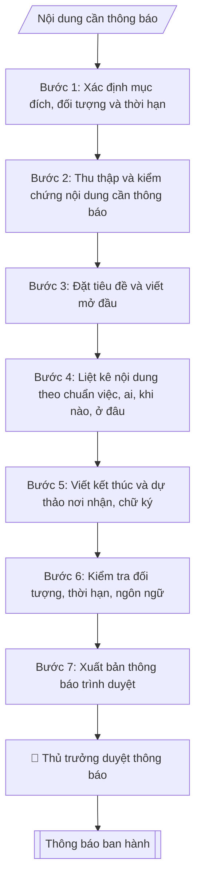

# Soạn thông báo

## Khi nào dùng
Khi cần thông tin chính thức đến toàn thể hoặc một nhóm đối tượng trong trường: lịch nghỉ,
triệu tập họp, quy định mới, kế hoạch, kết quả...

## Khi nào KHÔNG dùng
- Cần văn bản chỉ đạo, quy phạm → dùng `vnuis-vp-soan-quyet-dinh-hanh-chinh`.
- Cần thư mời dự họp, sự kiện → dùng `vnuis-vp-soan-giay-moi`.

## Định dạng và file đầu ra

Định dạng đầu ra có thể chọn theo sản phẩm/yêu cầu: .docx, .pdf. Đọc mục “Định dạng bổ sung” trong quy cách đầu ra trước khi chọn.

**Phải tạo file thực tế để tải xuống, không chỉ trả nội dung trong chat.** Định dạng mặc định của skill: **.docx**. Nếu có bảng số liệu nghiệp vụ yêu cầu file bảng tính riêng, tạo thêm Excel theo yêu cầu; không tự tạo file kiểm tra. Không chờ người dùng yêu cầu xuất file lần nữa. Ưu tiên định dạng người dùng chỉ định; đọc quy tắc xuất file tại references/quy-cach-dau-ra.md.

**Chạy qua API (không có công cụ tạo file):** trả đủ nội dung dạng văn bản có tiêu đề, bảng; ứng dụng gọi sẽ xuất file.

## Quy cách đầu ra và thông tin thiếu
Khi dựng file Word/Excel, áp dụng mục “Thể thức và bảng biểu khi dựng file” trong quy cách đầu ra (cỡ chữ từng thành phần, bảng nhiều trang, số trang, phụ lục). Đọc [quy cách và cấu trúc sản phẩm](references/quy-cach-dau-ra.md) trước khi soạn/xuất. File giao chỉ gồm sản phẩm nghiệp vụ được yêu cầu; kiểm tra nội bộ không xuất kèm. Thiếu thông tin thì giữ nguyên trường/mục và chỗ điền theo mẫu gốc (dòng dấu chấm, dấu gạch hoặc ô trống); không tự điền dữ liệu mẫu, số 0, mã chờ xác minh hay dòng chờ ký. Mẫu chuyên ngành còn áp dụng được ưu tiên về cấu trúc, mã biểu và người ký. Bản đầy đủ: [quy tắc chung](references/quy-tac-chung.md).

Khi người dùng yêu cầu bộ slide (.pptx), đọc mục “Xuất PowerPoint (.pptx) khi được yêu cầu” trong quy cách đầu ra.

## Kiểm soát áp dụng và phê duyệt
Trước khi chạy, xác định `ngay_ap_dung`, `loai_hinh_truong`, `quy_che_noi_bo`, `nguon_du_lieu`, `nguoi_kiem_duyet`; chỉ hỏi thông tin liên quan nghiệp vụ, không dùng giá trị giả định thay dữ liệu bắt buộc. Đối chiếu căn cứ pháp lý với văn bản gốc, hiệu lực, điều khoản áp dụng và chuyển tiếp. Bản đầy đủ: [quy tắc chung](references/quy-tac-chung.md).

## Giới hạn và human gate
AI hỗ trợ chuẩn bị và đối chiếu; cán bộ phụ trách kiểm tra dữ liệu/căn cứ, người có thẩm quyền duyệt và ký. Không đánh dấu đã ký, đã duyệt, đã công bố khi chưa có chứng cứ. Dữ liệu sinh viên, sức khỏe, nhân sự, tài chính chỉ dùng theo mục đích và phân quyền, che thông tin định danh khi dùng ví dụ (Luật 91/2025/QH15, hiệu lực 01/01/2026); không tải dữ liệu lên dịch vụ ngoài khi chưa có quyền. Bản đầy đủ: [quy tắc chung](references/quy-tac-chung.md).

## Bối cảnh riêng của VNU-IS

Bản chỉnh cho Trường Quốc tế – ĐHQGHN (VNU-IS), v0.4.2. Dựng từ website công khai và phiếu khảo sát CES còn trống; **chưa có dữ liệu khảo sát thực tế của đơn vị**. Đọc [bối cảnh VNU-IS](references/boi-canh-vnuis.md) trước khi chạy; các mã C1–C8 nằm ở mục 6 của file đó.

- **Đơn vị thường dùng:** Mọi đơn vị trong Trường; Phòng Tổ chức và Quản trị rà thể thức.
- **Nghiệp vụ trong phiếu CES:** "Hành chính: Soạn thông báo, công văn, giấy mời, lịch công tác" (sheet `03_KS_TCQT`). Tần suất gợi ý: Theo chu kỳ/kế hoạch. Đầu vào gợi ý: Yêu cầu; mẫu văn bản; danh sách nhận; mốc thời gian. Khó khăn gợi ý: Tài liệu phân tán, nhiều định dạng; Đọc và đối chiếu thủ công mất thời gian; Dễ bỏ sót trường dữ liệu/phiên bản; Đầu ra phụ thuộc kinh nghiệm từng cá nhân. Đây là gợi ý có sẵn của CES, chưa phải xác nhận của đơn vị.

**Điều chỉnh khi dùng cho VNU-IS**
- Phân loại thông báo theo đối tượng nhận: viên chức, giảng viên, sinh viên chương trình ĐHQGHN, sinh viên chương trình liên kết, sinh viên quốc tế, đối tác. Thông báo cho sinh viên quốc tế hoặc liên kết thêm bản tiếng Anh khi người dùng yêu cầu.
- Thông báo về lịch học, thi, học phí, học bổng, tuyển sinh chỉ lấy dữ kiện từ văn bản hoặc dữ liệu hiện hành do đơn vị phụ trách cung cấp; không điền số liệu từ website.
- Ghi rõ cơ sở nếu thông báo gắn với địa điểm (Xuân Thủy, Phan Tây Nhạc, Hòa Lạc).

**Chờ xác nhận khi khảo sát**
- Thể thức và người ký thông báo (C1).
- Kênh phát hành: E-Office, website hay email (C5).

Nếu người dùng chưa trả lời mục chờ xác nhận liên quan, hỏi lại; không tự điền giả định.

## Đầu vào (Input)

| Trường | Mô tả | Bắt buộc |
|---|---|---|
| `tieu_de` | Tiêu đề thông báo (ngắn, nêu việc) | Có |
| `doi_tuong` | Toàn thể CBVC / sinh viên / các đơn vị... | Có |
| `noi_dung` | Các điểm cần thông báo, dạng gạch đầu dòng | Có |
| `thoi_han` | Thời gian hiệu lực / hạn thực hiện (nếu có) | Không |
| `don_vi_ban_hanh` | Phòng/ban ban hành | Có |
| `nguoi_ky` | Chức danh người ký | Có |
| `co_quan_chu_quan` | Cơ quan chủ quản: Đại học Quốc gia Hà Nội (đã điền sẵn) | Không (mặc định: ĐHQGHN) |
| `co_quan_ban_hanh` | Cơ quan ban hành: Trường Quốc tế – ĐHQGHN (đã điền sẵn); ghi thêm đơn vị soạn thảo nếu khác | Không (mặc định: Trường Quốc tế – ĐHQGHN) |
| `dia_danh` | Địa danh ghi ở dòng ngày tháng năm (mặc định: Hà Nội) | Không (mặc định: Hà Nội) |
| `so_van_ban` | Số, ký hiệu văn bản đã được cấp (để trống nếu chưa cấp; không tự đặt) | Không |
| `noi_nhan` | Danh sách nơi nhận, gồm cả nơi lưu (VT, đơn vị soạn) | Có |

### Thông tin VNU-IS đã điền sẵn (không hỏi lại)

| Mục | Giá trị mặc định |
|---|---|
| Cơ quan chủ quản; Trường; địa danh | Đại học Quốc gia Hà Nội (ĐHQGHN); Trường Quốc tế – ĐHQGHN (VNU – International School); Hà Nội |
| Đơn vị sử dụng và phối hợp | Mọi đơn vị trong Trường; Phòng Tổ chức và Quản trị rà thể thức |
| Cơ sở | Xuân Thủy (Cầu Giấy); Phan Tây Nhạc (Xuân Phương); Hòa Lạc (tòa HT1, Khu Đô thị ĐHQGHN). Ghi rõ cơ sở khi nội dung gắn địa điểm |
| Ngôn ngữ đầu ra | Tiếng Việt là bản gốc; thêm tiếng Anh cho đối tác, người học quốc tế hoặc khi được yêu cầu |
| Hệ thống nguồn dữ liệu có trên website | E-Office (văn bản điều hành). Skill không kết nối hệ thống, chỉ dùng file xuất/tải lên (C5) |
| Người duyệt và ký | Ghi theo vai trò (Trưởng phòng, Phó Hiệu trưởng phụ trách, Hiệu trưởng); tuyến duyệt và thẩm quyền ký chờ C1, C6 |

Nguồn: website và phiếu CES; đổi theo khảo sát thì sửa tại đây và trong `references/boi-canh-vnuis.md`.

## Quy trình

*⏱ là ước tính ban đầu của bộ gốc, chưa đo tại VNU-IS; hiệu chỉnh sau khảo sát.*

**Bước 1. Xác định mục đích, đối tượng và thời hạn**
- Làm gì: Đọc `tieu_de` để xác định mục đích thông báo (thông tin / yêu cầu thực hiện / triệu tập); đọc `doi_tuong` để xác định phạm vi người nhận (toàn trường / nhóm đơn vị / sinh viên...); đọc `thoi_han` để xác định thời gian hiệu lực hoặc hạn thực hiện; kiểm tra `don_vi_ban_hanh` và `nguoi_ky` có thẩm quyền ban hành thông báo về nội dung này không.
- Dùng input: `tieu_de`, `doi_tuong`, `thoi_han`, `don_vi_ban_hanh`, `nguoi_ky`.
- Vai trò: Chuyên viên Phòng TC&QT (văn phòng – văn thư) · AI hỗ trợ: phân tích input, xác định yêu cầu · ⏱ ~20–45 phút (ước tính)
- Lưu ý nghiệp vụ: Thông báo yêu cầu thực hiện bắt buộc phải có thời hạn rõ ràng; thông báo gửi "toàn thể" mà nội dung chỉ liên quan một nhóm sẽ gây nhiễu — thu hẹp đối tượng cho đúng.
- → Kết quả bước: Xác nhận mục đích + đối tượng nhận + thời hạn của thông báo.

**Bước 2. Thu thập và kiểm chứng nội dung cần thông báo**
- Làm gì: Từ `noi_dung`, kiểm chứng từng điểm: sự kiện có thật không (đối chiếu quyết định/kế hoạch liên quan), ngày giờ có chính xác và rơi đúng thứ trong tuần không, địa điểm có tồn tại và đủ sức chứa đối tượng không; loại bỏ điểm trùng lặp, gộp các điểm cùng chủ đề.
- Dùng input: `noi_dung`, `thoi_han`.
- Vai trò: Chuyên viên Phòng TC&QT (văn phòng – văn thư) · AI hỗ trợ: xử lý sơ bộ theo quy trình · ⏱ ~20–45 phút (ước tính)
- Lưu ý nghiệp vụ: Bẫy thường gặp — ngày tháng trong nội dung không khớp thứ (vd ghi "thứ Sáu, ngày …" nhưng tra lịch lại là thứ khác); hạn đăng ký đặt sau ngày diễn ra sự kiện.
- → Kết quả bước: Danh sách nội dung đã kiểm chứng, loại trùng, sẵn sàng đưa vào thông báo.

**Bước 3. Đặt tiêu đề và viết mở đầu**
- Làm gì: Viết dòng "THÔNG BÁO" (in hoa, căn giữa) + trích yếu ở dòng dưới lấy từ `tieu_de`; viết dòng "Kính gửi" + `doi_tuong`; mở đầu 1–2 câu: nêu căn cứ/quyết định liên quan (nếu có) rồi đi thẳng vào nội dung ("...thông báo ... như sau:"). Phần đầu văn bản lấy từ `co_quan_chu_quan` (nếu có), `co_quan_ban_hanh`, `dia_danh`, `so_van_ban` (để dòng dấu chấm nếu chưa cấp số).
- Dùng input: `tieu_de`, `doi_tuong`, `co_quan_chu_quan`, `co_quan_ban_hanh`, `dia_danh`, `so_van_ban`.
- Vai trò: Chuyên viên Phòng TC&QT (văn phòng – văn thư) · AI hỗ trợ: soạn dự thảo đúng thể thức · ⏱ ~20–45 phút (ước tính)
- Lưu ý nghiệp vụ: Tiêu đề không dài quá một dòng; mở đầu không kể lể dài dòng — thông báo càng vào việc nhanh càng tốt.
- → Kết quả bước: Phần tiêu đề + mở đầu hoàn chỉnh.

**Bước 4. Liệt kê nội dung theo chuẩn việc – ai – khi nào – ở đâu**
- Làm gì: Chuyển từng điểm trong `noi_dung` thành các mục đánh số 1., 2., 3...; mỗi mục phải trả lời đủ 4 câu hỏi: việc gì – ai thực hiện – khi nào – ở đâu; với thông báo yêu cầu thực hiện, mỗi mục ghi rõ đơn vị/cá nhân chịu trách nhiệm và hạn hoàn thành.
- Dùng input: `noi_dung`, `thoi_han`, `doi_tuong`.
- Vai trò: Chuyên viên Phòng TC&QT (văn phòng – văn thư) · AI hỗ trợ: xử lý sơ bộ theo quy trình · ⏱ ~20–45 phút (ước tính)
- Lưu ý nghiệp vụ: Tránh câu bị động mập mờ ("sẽ được bố trí") — phải ghi rõ chủ thể thực hiện; thời gian ghi đầy đủ thứ, ngày/tháng/năm, giờ (nếu có).
- → Kết quả bước: Dự thảo nội dung đánh số, mỗi ý đủ 4 yếu tố.

**Bước 5. Viết kết thúc và dự thảo nơi nhận, chữ ký**
- Làm gì: Viết câu kết: với thông báo yêu cầu thực hiện — "Đề nghị các đơn vị, cá nhân nghiêm túc thực hiện./."; với thông báo thông tin — lời cảm ơn hoặc câu kết phù hợp; liệt kê nơi nhận ("- Như trên;" + "- Lưu: VT, [mã đơn vị]."); khối chữ ký theo `nguoi_ky` (ký thừa ủy quyền thì ghi "TL. HIỆU TRƯỞNG" + chức danh). Nơi nhận lấy từ `noi_nhan`.
- Dùng input: `nguoi_ky`, `doi_tuong`, `noi_nhan`.
- Vai trò: Chuyên viên Phòng TC&QT (văn phòng – văn thư) · AI hỗ trợ: soạn dự thảo đúng thể thức · ⏱ ~20–45 phút (ước tính)
- Lưu ý nghiệp vụ: Thông báo do Trưởng phòng ký phải có quyết định ủy quyền còn hiệu lực; nơi nhận phải bao phủ hết `doi_tuong` đã xác định ở Bước 1.
- → Kết quả bước: Phần kết thúc + nơi nhận + khối chữ ký hoàn chỉnh.

**Bước 6. Kiểm tra đối tượng, thời hạn, ngôn ngữ**
- Làm gì: Đối chiếu: nơi nhận có bao phủ hết đối tượng trong `doi_tuong` không; thời hạn trong nội dung có rõ và nhất quán với `thoi_han` không; đọc lại toàn văn kiểm tra ngôn ngữ dễ hiểu, không vòng vo, không thuật ngữ chuyên môn khó hiểu với đối tượng nhận; kiểm tra thể thức (quốc hiệu, số ký hiệu, ngày tháng).
- Dùng input: toàn bộ input (đối chiếu chéo).
- Vai trò: Chuyên viên Phòng TC&QT (văn phòng – văn thư) (Trưởng phòng kiểm tra lại) · AI hỗ trợ: quét lỗi theo danh mục kiểm · ⏱ ~15–30 phút (ước tính)
- Lưu ý nghiệp vụ: Đọc thử với góc nhìn của người nhận ít thông tin nhất (vd sinh viên năm nhất) — chỗ nào khó hiểu thì viết lại.
- → Kết quả bước: Kết quả đối chiếu nội bộ (không xuất kèm file) + danh sách chỗ cần sửa (nếu có), trả về bước tương ứng để chỉnh.

**Bước 7. Xuất bản thông báo trình duyệt**
- Làm gì: Ghép toàn bộ thành thông báo hoàn chỉnh file theo định dạng đầu ra của skill; chuyển cho thủ trưởng đơn vị ban hành duyệt (human gate) trước khi phát hành trên các kênh (website, email, bảng tin).
- Dùng input: toàn bộ.
- Vai trò: Chuyên viên Phòng TC&QT (văn phòng – văn thư) chuẩn bị, thủ trưởng đơn vị ban hành ký · AI hỗ trợ: tổng hợp hồ sơ, soạn phiếu trình/tờ trình đầy đủ · ⏱ ~15–30 phút chuẩn bị + chờ duyệt (ước tính)
- Lưu ý nghiệp vụ: Thông báo có thời hạn gấp nên ghi rõ giờ phát hành dự kiến để đơn vị truyền thông kịp đăng.
- → Kết quả bước: Thông báo hoàn chỉnh, sẵn sàng ban hành.

## Luồng quy trình (Workflow)

## Đầu ra

File nghiệp vụ thực tế theo định dạng mặc định ở đầu skill hoặc định dạng người dùng yêu cầu, kèm liên kết tải trong phản hồi cuối.

Sản phẩm nghiệp vụ hoàn chỉnh theo [quy cách và cấu trúc](references/quy-cach-dau-ra.md), giữ các trường chưa có dữ liệu ở trạng thái trống. Không xuất kèm danh mục kiểm/phụ lục kiểm tra đầu ra.

## Kiểm tra nội bộ trước khi giao

Các tiêu chí sau dùng để tự đối chiếu; không sao chép vào file xuất. Mục thiếu dữ liệu được để trống, không đánh dấu đã đạt hoặc đã duyệt.

- [ ] Bố cục khớp mẫu áp dụng và cấu trúc tại references/quy-cach-dau-ra.md.
- [ ] Nội dung và số liệu trong output khớp đúng với Input đã cho (không thêm, bớt hay suy diễn)
- [ ] Không bịa đặt số liệu, minh chứng, trích dẫn hay căn cứ
- [ ] Đúng thể thức văn bản theo Nghị định 30/2020/NĐ-CP (đối chiếu hiệu lực tại ngày nghiệp vụ) và cấu trúc tại references/quy-cach-dau-ra.md.
- [ ] Căn cứ pháp lý được trích dẫn đầy đủ và còn hiệu lực
- [ ] Đã qua Human gate: người có thẩm quyền đã kiểm tra và duyệt trước khi phát hành; bản soạn chưa được coi là đã ký/đã duyệt
- [ ] Thông báo yêu cầu thực hiện bắt buộc phải có thời hạn rõ ràng
- [ ] Thông báo gửi "toàn thể" mà nội dung chỉ liên quan một nhóm sẽ gây nhiễu — thu hẹp đối tượng cho đúng
- [ ] Tránh câu bị động mập mờ ("sẽ được bố trí") — phải ghi rõ chủ thể thực hiện

## Căn cứ & lưu ý
- Thông báo càng ngắn càng tốt; tránh văn hoa, vòng vo.
- Ví dụ trong skill chỉ để minh họa; không đưa dữ liệu cá nhân thật vào ví dụ. Tên Trường, cơ quan chủ quản và địa danh dùng đúng bảng thông tin VNU-IS đã điền sẵn.

## Quản trị phiên bản
- Phiên bản gói VNU-IS `0.4.2` (cập nhật 2026-10-11), dựa trên skill gốc `soan-thong-bao` bản `1.3.2`; hồ sơ đầy đủ tại [references/version.json](references/version.json).
- Người phê duyệt nghiệp vụ: **chưa chỉ định**. Trạng thái: dự thảo nghiệp vụ; kiểm tra pháp lý trước thực thi. Ngày cập nhật không đồng nghĩa mọi văn bản đã được rà soát toàn văn.
- Giấy phép theo LICENSE của kho (bản quyền CES Global). Lịch sử thay đổi: CHANGELOG.md.
