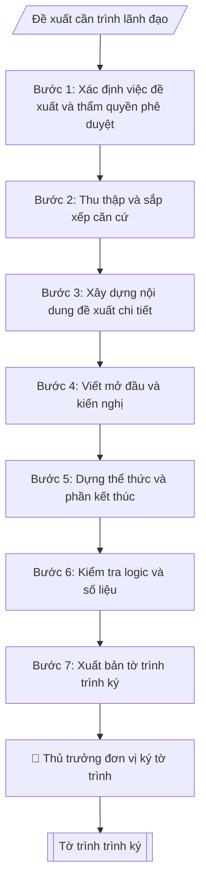

# Soạn tờ trình

## Khi nào dùng
Khi một đơn vị/cá nhân cần trình lãnh đạo xem xét, quyết định một chủ trương, kế hoạch, dự án,
kinh phí...: mở ngành, tổ chức sự kiện, mua sắm, cử đi công tác, ban hành văn bản...

## Định dạng và file đầu ra

Định dạng đầu ra có thể chọn theo sản phẩm/yêu cầu: .docx, .pdf. Đọc mục “Định dạng bổ sung” trong quy cách đầu ra trước khi chọn.

**Phải tạo file thực tế để tải xuống, không chỉ trả nội dung trong chat.** Định dạng mặc định của skill: **.docx**. Nếu có bảng số liệu nghiệp vụ yêu cầu file bảng tính riêng, tạo thêm Excel theo yêu cầu; không tự tạo file kiểm tra. Không chờ người dùng yêu cầu xuất file lần nữa. Ưu tiên định dạng người dùng chỉ định; đọc quy tắc xuất file tại references/quy-cach-dau-ra.md.

**Chạy qua API (không có công cụ tạo file):** trả đủ nội dung dạng văn bản có tiêu đề, bảng; ứng dụng gọi sẽ xuất file.

## Quy cách đầu ra và thông tin thiếu
Khi dựng file Word/Excel, áp dụng mục “Thể thức và bảng biểu khi dựng file” trong quy cách đầu ra (cỡ chữ từng thành phần, bảng nhiều trang, số trang, phụ lục). Đọc [quy cách và cấu trúc sản phẩm](references/quy-cach-dau-ra.md) trước khi soạn/xuất. File giao chỉ gồm sản phẩm nghiệp vụ được yêu cầu; kiểm tra nội bộ không xuất kèm. Thiếu thông tin thì giữ nguyên trường/mục và chỗ điền theo mẫu gốc (dòng dấu chấm, dấu gạch hoặc ô trống); không tự điền dữ liệu mẫu, số 0, mã chờ xác minh hay dòng chờ ký. Mẫu chuyên ngành còn áp dụng được ưu tiên về cấu trúc, mã biểu và người ký. Bản đầy đủ: [quy tắc chung](references/quy-tac-chung.md).

Khi người dùng yêu cầu bộ slide (.pptx), đọc mục “Xuất PowerPoint (.pptx) khi được yêu cầu” trong quy cách đầu ra.

## Kiểm soát áp dụng và phê duyệt
Trước khi chạy, xác định `ngay_ap_dung`, `loai_hinh_truong`, `quy_che_noi_bo`, `nguon_du_lieu`, `nguoi_kiem_duyet`; chỉ hỏi thông tin liên quan nghiệp vụ, không dùng giá trị giả định thay dữ liệu bắt buộc. Đối chiếu căn cứ pháp lý với văn bản gốc, hiệu lực, điều khoản áp dụng và chuyển tiếp. Bản đầy đủ: [quy tắc chung](references/quy-tac-chung.md).

## Giới hạn và human gate
AI hỗ trợ chuẩn bị và đối chiếu; cán bộ phụ trách kiểm tra dữ liệu/căn cứ, người có thẩm quyền duyệt và ký. Không đánh dấu đã ký, đã duyệt, đã công bố khi chưa có chứng cứ. Dữ liệu sinh viên, sức khỏe, nhân sự, tài chính chỉ dùng theo mục đích và phân quyền, che thông tin định danh khi dùng ví dụ (Luật 91/2025/QH15, hiệu lực 01/01/2026); không tải dữ liệu lên dịch vụ ngoài khi chưa có quyền. Bản đầy đủ: [quy tắc chung](references/quy-tac-chung.md).

## Bối cảnh riêng của VNU-IS

Bản chỉnh cho Trường Quốc tế – ĐHQGHN (VNU-IS), v0.4.2. Dựng từ website công khai và phiếu khảo sát CES còn trống; **chưa có dữ liệu khảo sát thực tế của đơn vị**. Đọc [bối cảnh VNU-IS](references/boi-canh-vnuis.md) trước khi chạy; các mã C1–C8 nằm ở mục 6 của file đó.

- **Đơn vị thường dùng:** Mọi đơn vị trong Trường; gửi Ban Giám hiệu hoặc ĐHQGHN.
- **Nghiệp vụ trong phiếu CES:** không có dòng riêng trong phiếu CES; đề xuất theo chức năng đơn vị ở sheet 00 và cần xác nhận khi khảo sát.

**Điều chỉnh khi dùng cho VNU-IS**
- Xác định nơi nhận: Hiệu trưởng hay ĐHQGHN. Việc nào phải xin ý kiến ĐHQGHN, việc nào Trường tự quyết chưa có văn bản phân cấp trong gói này; ghi `[CẦN XÁC MINH]` (C1, C6).
- Tờ trình về chương trình liên kết, song bằng hoặc thỏa thuận quốc tế: nêu rõ nội dung cần trường đối tác chấp thuận để người duyệt thấy ràng buộc.
- Với đề xuất có số liệu (chỉ tiêu, người học), ghi nguồn và kỳ; không dùng số tự công bố trên website.

**Chờ xác nhận khi khảo sát**
- Phân cấp thẩm quyền giữa Hiệu trưởng, Hội đồng KH&ĐT và ĐHQGHN (C6).
- Mẫu tờ trình (C8).

Nếu người dùng chưa trả lời mục chờ xác nhận liên quan, hỏi lại; không tự điền giả định.

## Đầu vào (Input)

| Trường | Mô tả | Bắt buộc |
|---|---|---|
| `ten_to_trinh` | Tên tờ trình (ngắn gọn, nêu việc đề xuất) | Có |
| `kinh_gui` | Ban Giám hiệu / cấp có thẩm quyền (C6) / Hiệu trưởng... | Có |
| `don_vi_trinh` | Đơn vị trình tờ trình | Có |
| `can_cu` | Các căn cứ pháp lý, thực tiễn (quy định, công văn, tình hình) | Có |
| `noi_dung_de_xuat` | Nội dung đề xuất chi tiết, dạng gạch đầu dòng | Có |
| `kien_nghi` | Kiến nghị cụ thể mong lãnh đạo quyết định | Có |
| `tai_lieu_kem_theo` | Danh mục tài liệu đính kèm (dự thảo, dự toán...) | Không |
| `co_quan_chu_quan` | Cơ quan chủ quản: Đại học Quốc gia Hà Nội (đã điền sẵn) | Không (mặc định: ĐHQGHN) |
| `co_quan_ban_hanh` | Cơ quan ban hành: Trường Quốc tế – ĐHQGHN (đã điền sẵn); ghi thêm đơn vị soạn thảo nếu khác | Không (mặc định: Trường Quốc tế – ĐHQGHN) |
| `dia_danh` | Địa danh ghi ở dòng ngày tháng năm (mặc định: Hà Nội) | Không (mặc định: Hà Nội) |
| `so_van_ban` | Số, ký hiệu văn bản đã được cấp (để trống nếu chưa cấp; không tự đặt) | Không |
| `noi_nhan` | Danh sách nơi nhận, gồm cả nơi lưu (VT, đơn vị soạn) | Có |
| `nguoi_ky` | Chức danh, họ tên người ký; hình thức TM./KT./TL./TUQ. chỉ khi có căn cứ | Có |

### Thông tin VNU-IS đã điền sẵn (không hỏi lại)

| Mục | Giá trị mặc định |
|---|---|
| Cơ quan chủ quản; Trường; địa danh | Đại học Quốc gia Hà Nội (ĐHQGHN); Trường Quốc tế – ĐHQGHN (VNU – International School); Hà Nội |
| Đơn vị sử dụng và phối hợp | Mọi đơn vị trong Trường; gửi Ban Giám hiệu hoặc ĐHQGHN |
| Cơ sở | Xuân Thủy (Cầu Giấy); Phan Tây Nhạc (Xuân Phương); Hòa Lạc (tòa HT1, Khu Đô thị ĐHQGHN). Ghi rõ cơ sở khi nội dung gắn địa điểm |
| Ngôn ngữ đầu ra | Tiếng Việt là bản gốc; thêm tiếng Anh cho đối tác, người học quốc tế hoặc khi được yêu cầu |
| Hệ thống nguồn dữ liệu có trên website | E-Office (văn bản điều hành). Skill không kết nối hệ thống, chỉ dùng file xuất/tải lên (C5) |
| Người duyệt và ký | Ghi theo vai trò (Trưởng phòng, Phó Hiệu trưởng phụ trách, Hiệu trưởng); tuyến duyệt và thẩm quyền ký chờ C1, C6 |

Nguồn: website và phiếu CES; đổi theo khảo sát thì sửa tại đây và trong `references/boi-canh-vnuis.md`.

## Quy trình

*⏱ là ước tính ban đầu của bộ gốc, chưa đo tại VNU-IS; hiệu chỉnh sau khảo sát.*

**Bước 1. Xác định việc đề xuất và thẩm quyền phê duyệt**
- Làm gì: Đọc `ten_to_trinh` và `noi_dung_de_xuat`, tóm tắt việc đề xuất trong một câu (làm gì – cho ai – để đạt gì); đọc `kinh_gui` để xác định cấp phê duyệt (Ban Giám hiệu / Hiệu trưởng / cấp có thẩm quyền (C6) / cấp trên) vì cấp phê duyệt quyết định độ chi tiết số liệu và căn cứ cần viện dẫn; kiểm tra `don_vi_trinh` có đúng là đơn vị được giao nhiệm vụ liên quan không.
- Dùng input: `ten_to_trinh`, `kinh_gui`, `don_vi_trinh`, `noi_dung_de_xuat`.
- Vai trò: Chuyên viên Phòng TC&QT (văn phòng – văn thư) · AI hỗ trợ: phân tích input, xác định yêu cầu · ⏱ ~20–45 phút (ước tính)
- Lưu ý nghiệp vụ: Việc vượt thẩm quyền của Ban Giám hiệu (vd: mở ngành mới, chiến lược dài hạn) phải trình cấp có thẩm quyền (C6) — xác định sai cấp phê duyệt là lỗi nghiêm trọng khiến tờ trình bị trả lại.
- → Kết quả bước: Xác nhận việc đề xuất + cấp phê duyệt phù hợp.

**Bước 2. Thu thập và sắp xếp căn cứ**
- Làm gì: Từ `can_cu`, liệt kê từng văn bản pháp lý/quy định/công văn liên quan, kiểm tra hiệu lực (văn bản còn hiệu lực, không bị thay thế), sắp xếp từ văn bản có hiệu lực cao xuống thấp (luật → nghị định/thông tư → quy chế trường → nghị quyết hội đồng trường → công văn), bổ sung căn cứ thực tiễn (số liệu năm trước, tình hình thực tế) nếu `can_cu` còn thiếu.
- Dùng input: `can_cu`.
- Vai trò: Chuyên viên Phòng TC&QT (văn phòng – văn thư) · AI hỗ trợ: xử lý sơ bộ theo quy trình · ⏱ ~20–45 phút (ước tính)
- Lưu ý nghiệp vụ: Bẫy thường gặp — viện dẫn văn bản đã hết hiệu lực hoặc bị thay thế; căn cứ thực tiễn thiếu số liệu khiến lý do đề xuất yếu. Mỗi căn cứ phải ghi đủ tên văn bản, số/ký hiệu, ngày ban hành.
- → Kết quả bước: Danh sách căn cứ đã kiểm chuẩn, sắp xếp đúng thứ tự hiệu lực.

**Bước 3. Xây dựng nội dung đề xuất chi tiết**
- Làm gì: Chuyển từng gạch đầu dòng trong `noi_dung_de_xuat` thành các mục đánh số 1., 2., 3..., mỗi mục một nội dung trọn vẹn; với nội dung liên quan kinh phí/nhân sự/thời gian, bổ sung số liệu cụ thể (tổng số, mức tăng/giảm so với năm trước, mốc thời gian); kiểm tra số liệu giữa các mục có nhất quán không; đối chiếu `tai_lieu_kem_theo` để đảm bảo tài liệu đính kèm khớp với nội dung đề xuất.
- Dùng input: `noi_dung_de_xuat`, `tai_lieu_kem_theo`.
- Vai trò: Chuyên viên Phòng TC&QT (văn phòng – văn thư) · AI hỗ trợ: soạn dự thảo đúng thể thức · ⏱ ~20–45 phút (ước tính)
- Lưu ý nghiệp vụ: Đề xuất xin kinh phí phải có dự toán chi tiết ở tài liệu kèm theo, không dồn hết số liệu vào thân tờ trình; tránh đề xuất chung chung kiểu "tổ chức hiệu quả" mà thiếu chỉ tiêu đo được.
- → Kết quả bước: Dự thảo nội dung đề xuất có số liệu nhất quán + danh mục tài liệu kèm theo đã đối chiếu.

**Bước 4. Viết mở đầu và kiến nghị**
- Làm gì: Viết đoạn mở đầu sau dòng "Kính gửi": nêu lý do, sự cần thiết của việc đề xuất (gắn với nhiệm vụ của đơn vị và tình hình thực tế); sau phần nội dung đề xuất, viết kiến nghị: nêu dứt khoát trong 1–2 câu điều mong lãnh đạo xem xét, quyết định (phê duyệt cái gì, giao cho ai triển khai), lấy nguyên văn ý từ `kien_nghi`.
- Dùng input: `ten_to_trinh`, `don_vi_trinh`, `kien_nghi`.
- Vai trò: Chuyên viên Phòng TC&QT (văn phòng – văn thư) · AI hỗ trợ: soạn dự thảo đúng thể thức · ⏱ ~20–45 phút (ước tính)
- Lưu ý nghiệp vụ: Kiến nghị phải là câu cầu khiến rõ ràng ("Kính đề nghị ... phê duyệt ..."), không viết lưng chừng kiểu "mong lãnh đạo cho ý kiến"; kiến nghị phải khớp đúng phạm vi nội dung đã đề xuất ở Bước 3.
- → Kết quả bước: Đoạn mở đầu + đoạn kiến nghị hoàn chỉnh.

**Bước 5. Dựng thể thức và phần kết thúc**
- Làm gì: Lắp ráp phần đầu: tên trường + quốc hiệu – tiêu ngữ, tên `don_vi_trinh`, số/ký hiệu tờ trình (ký hiệu TTr), địa danh ngày tháng, dòng chữ "TỜ TRÌNH" + tên tờ trình (in hoa, căn giữa), dòng "Kính gửi" + `kinh_gui`; phần kết thúc: câu kết "./.", nơi nhận ("- [cấp phê duyệt];", "- Lưu: VT, [mã đơn vị]."), danh mục tài liệu kèm theo, khối chữ ký người đứng đầu đơn vị trình (chức danh + họ tên). Phần đầu văn bản lấy từ `co_quan_chu_quan` (nếu có), `co_quan_ban_hanh`, `dia_danh`, `so_van_ban` (để dòng dấu chấm nếu chưa cấp số). Nơi nhận lấy từ `noi_nhan`. Khối ký lấy từ `nguoi_ky`.
- Dùng input: `don_vi_trinh`, `ten_to_trinh`, `kinh_gui`, `tai_lieu_kem_theo`, `co_quan_chu_quan`, `co_quan_ban_hanh`, `dia_danh`, `so_van_ban`, `noi_nhan`, `nguoi_ky`.
- Vai trò: Chuyên viên Phòng TC&QT (văn phòng – văn thư) · AI hỗ trợ: soạn dự thảo đúng thể thức · ⏱ ~20–45 phút (ước tính)
- Lưu ý nghiệp vụ: Người ký tờ trình là thủ trưởng đơn vị trình (Trưởng phòng/Trưởng khoa), không phải Hiệu trưởng; ký hiệu ghi "TTr"; số tờ trình chỉ ghi khi người dùng cung cấp, nếu chưa có thì để dòng dấu chấm (văn thư cấp số khi đăng ký sổ văn bản đi).
- → Kết quả bước: Khung tờ trình hoàn chỉnh về thể thức, đã lắp đủ mở đầu – căn cứ – đề xuất – kiến nghị – kết thúc.

**Bước 6. Kiểm tra logic và số liệu**
- Làm gì: Đọc liền mạch từ lý do → căn cứ → đề xuất → kiến nghị, kiểm tra: lý do có dẫn tới đúng nội dung đề xuất không; căn cứ có đủ cơ sở pháp lý cho nội dung đề xuất không; kiến nghị có bao quát hết nội dung đề xuất không; số liệu trong thân tờ trình có khớp với tài liệu kèm theo không; chính tả, tên văn bản viện dẫn chính xác.
- Dùng input: toàn bộ input (đối chiếu chéo).
- Vai trò: Chuyên viên Phòng TC&QT (văn phòng – văn thư) (Trưởng phòng kiểm tra lại) · AI hỗ trợ: quét lỗi theo danh mục kiểm · ⏱ ~15–30 phút (ước tính)
- Lưu ý nghiệp vụ: Lỗi phổ biến — kiến nghị xin phê duyệt nội dung không có trong phần đề xuất, hoặc đề xuất có nội dung nhưng kiến nghị không nhắc tới; số liệu tổng trong thân không khớp bảng chi tiết đính kèm.
- → Kết quả bước: Kết quả đối chiếu logic và số liệu (nội bộ, không xuất kèm file) + danh sách lỗi cần sửa (nếu có), trả về bước tương ứng để chỉnh.

**Bước 7. Xuất bản tờ trình trình ký**
- Làm gì: Ghép toàn bộ thành tờ trình hoàn chỉnh file theo định dạng đầu ra của skill; đính kèm ghi chú các tài liệu cần đính kèm theo tờ trình; chuyển cho thủ trưởng đơn vị trình duyệt (human gate) trước khi trình lên cấp phê duyệt.
- Dùng input: toàn bộ.
- Vai trò: Chuyên viên chuẩn bị, thủ trưởng đơn vị trình ký · AI hỗ trợ: tổng hợp hồ sơ, soạn phiếu trình/tờ trình đầy đủ · ⏱ ~15–30 phút chuẩn bị + chờ duyệt (ước tính)
- Lưu ý nghiệp vụ: Không sửa nội dung đề xuất sau khi thủ trưởng đơn vị đã ký nháy/duyệt mà không xin ý kiến lại.
- → Kết quả bước: Tờ trình hoàn chỉnh + ghi chú tài liệu đính kèm, sẵn sàng trình ký.

## Luồng quy trình (Workflow)

## Đầu ra

File nghiệp vụ thực tế theo định dạng mặc định ở đầu skill hoặc định dạng người dùng yêu cầu, kèm liên kết tải trong phản hồi cuối.

Sản phẩm nghiệp vụ hoàn chỉnh theo [quy cách và cấu trúc](references/quy-cach-dau-ra.md), giữ các trường chưa có dữ liệu ở trạng thái trống. Không xuất kèm danh mục kiểm/phụ lục kiểm tra đầu ra.

## Kiểm tra nội bộ trước khi giao

Các tiêu chí sau dùng để tự đối chiếu; không sao chép vào file xuất. Mục thiếu dữ liệu được để trống, không đánh dấu đã đạt hoặc đã duyệt.

- [ ] Bố cục khớp mẫu áp dụng và cấu trúc tại references/quy-cach-dau-ra.md.
- [ ] Nội dung và số liệu trong output khớp đúng với Input đã cho (không thêm, bớt hay suy diễn)
- [ ] Không bịa đặt số liệu, minh chứng, trích dẫn hay căn cứ
- [ ] Đúng thể thức văn bản theo Nghị định 30/2020/NĐ-CP (đối chiếu hiệu lực tại ngày nghiệp vụ) và cấu trúc tại references/quy-cach-dau-ra.md.
- [ ] Căn cứ pháp lý được trích dẫn đầy đủ và còn hiệu lực
- [ ] Đã qua Human gate: người có thẩm quyền đã kiểm tra và duyệt trước khi phát hành; bản soạn chưa được coi là đã ký/đã duyệt
- [ ] Mỗi căn cứ phải ghi đủ tên văn bản, số/ký hiệu, ngày ban hành
- [ ] Đề xuất xin kinh phí phải có dự toán chi tiết ở tài liệu kèm theo, không dồn hết số liệu vào thân tờ trình
- [ ] Tránh đề xuất chung chung kiểu "tổ chức hiệu quả" mà thiếu chỉ tiêu đo được

## Căn cứ & lưu ý
- Tờ trình là văn bản nội bộ xin ý kiến quyết định — ngôn ngữ trang trọng, kiến nghị dứt khoát.
- Ví dụ trong skill chỉ để minh họa; không đưa dữ liệu cá nhân thật vào ví dụ. Tên Trường, cơ quan chủ quản và địa danh dùng đúng bảng thông tin VNU-IS đã điền sẵn.

## Quản trị phiên bản
- Phiên bản gói VNU-IS `0.4.2` (cập nhật 2026-10-11), dựa trên skill gốc `soan-to-trinh` bản `1.3.2`; hồ sơ đầy đủ tại [references/version.json](references/version.json).
- Người phê duyệt nghiệp vụ: **chưa chỉ định**. Trạng thái: dự thảo nghiệp vụ; kiểm tra pháp lý trước thực thi. Ngày cập nhật không đồng nghĩa mọi văn bản đã được rà soát toàn văn.
- Giấy phép theo LICENSE của kho (bản quyền CES Global). Lịch sử thay đổi: CHANGELOG.md.
